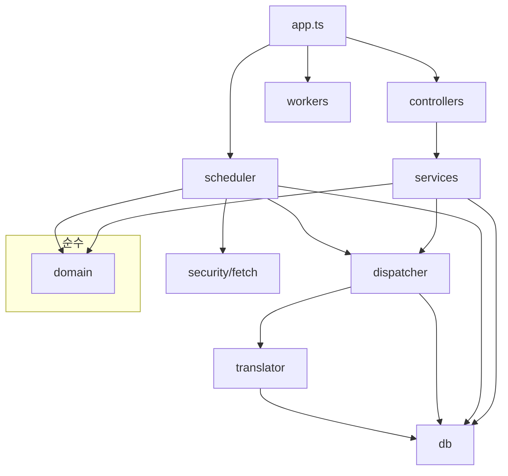
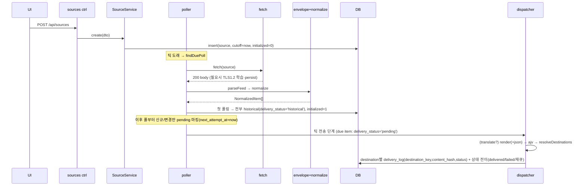

# Backend 모듈 & 라우터 명세 (Codex 트랙)

## D25 — 2026-10-16 승인된 발송·번역·실행 계약

사용자가 2026-10-16에 §4.2·4.4·4.6·4.7·4.9·4.11 및 Fetch/runtime 변경을 명시 승인했다. 아래 계약은 해당 절의 기존 item 전체 재큐·로그 기반 중복 판단·PATCH 404 POST·실패 원문 캐시 계약보다 우선한다. 그룹이 webhook URL을 소유하는 D24는 계속 적용한다.

- **§4.2 저장:** `items.content_revision`은 contentHash가 바뀔 때 증가한다. 항목 상태는 호환용 집계이며 실행 근거는 `delivery_bindings`(source×destination 연결 세대), `item_deliveries`(영속 message/channel/thread ID·마지막 revision), `delivery_jobs`(고정 연결·revision·원문 snapshot·렌더 payload·독립 재시도)다. `delivery_log`는 삭제 가능한 감사 로그다. 연결 키와 작업에는 webhook 비밀 URL을 복제하지 않는다.
- **§4.4 수집:** Stage 1/2, atom_id 식별, 최초 source poll historical을 유지한다. 새 연결 첫 성공 200 스냅샷은 묵음 baseline이며 첫 요청의 조건부 GET을 생략한다. 304·실패는 baseline을 완료하지 않는다. 연결부터 첫 스냅샷까지의 새 글도 묵음 처리될 수 있다. 신규 최초 발송은 관측 당시 유효하고 baseline이 완료된 연결에만 계획한다. 기존 글 갱신은 최초 발송했던 유효 연결에만 계획한다. poll 커밋에서 설정 버전을 재검증하고 바뀌었으면 결과를 버린다. 초기 baseline을 제외하고 신규 건수가 `NEW_ITEMS_HOLD_COUNT`(기본 50) 이상이거나, 신규가 `NEW_ITEMS_HOLD_MIN`(10) 이상이며 스냅샷의 `NEW_ITEMS_HOLD_RATIO`(0.8) 이상이면 신규 작업을 held로 둔다. 같은 소스·연결 안에서는 게시 시각 순서로 처리한다.
- **§4.6 발송:** 모든 최초 POST에 wait=true를 사용한다. editInPlace=true는 원래 message에 PATCH, false는 원래 연결에 update_post다. message ID 미상·PATCH 404는 uneditable이며 자동 POST하지 않는다. POST timeout·5xx·응답 ID 미상·송신 후 기록 불명은 unknown이며 자동 재POST하지 않는다. 429는 목적지 cooldown에 반영하고 일반 실패 횟수에서 제외한다. 연결 종료는 미실행 작업을 취소하고 새 연결로 이전하지 않는다. 비활성화는 연결을 종료하며 재활성화는 새 baseline을 확립한다. H1→H2→H1도 revision 1→2→3으로 갱신한다. 네트워크 I/O는 SQLite 트랜잭션 밖에서 수행한다.
- **§4.7 번역:** .env와 process 환경을 한 번 병합해 모델 실행·상태 서비스에 함께 주입한다. 성공 공유 캐시는 policyVersion·targetLang·field·contextProfile·glossaryVersion·실제 입력을 키로 삼는다. contentHash·item/job/webhook ID는 캐시 키가 아니다. 필요한 필드만 요청하고 캐시 미스 필드는 한 호출로 묶으며 같은 입력의 동시 요청은 합친다. minimal은 제목만 번역하고 템플릿 AST 판정이 불확실하면 제목·본문을 요청한다. 포럼 제목 요구도 포함한다. 실패는 성공 캐시로 저장하지 않고 별도 cooldown을 둔다. 발송 payload를 고정해 Discord 재시도가 번역을 반복하지 않게 한다. Gemini에 abortSignal·JSON schema를 전달한다. 파싱 실패·잘림은 현행 원문 발송이며, 번역 복구만으로 과거 글을 새 POST하지 않는다. 실제 요청·cache hit·skip·fallback·토큰·작업 상관관계를 구분한다.
- **§4.9·§4.11/API:** 소스·그룹 변경과 import는 같은 binding reconciliation을 트랜잭션 안에서 수행한다. 동일 목적지 중복 그룹은 연결 하나이며 무변경 저장으로 세대가 바뀌지 않는다. retry-failed는 기존 유효 연결의 failed 작업 수이며 unknown·legacy_unknown·held를 포함하지 않는다. held는 관리자가 historical 또는 발송으로 결정하고 unknown은 전송 결과를 확인한 뒤 처리한다.
- **Fetch/runtime:** 본문 스트림까지 timeout을 유지하고 최대 응답 바이트를 제한한다(기본 FEED_MAX_BYTES=5242880). 수집·발송 실행 루프를 독립시키고 동시성은 각각 기본 2로 제한한다. 종료는 신규 작업을 막고 수동·예약 작업을 모두 drain한 뒤 DB·Agent를 닫는다. SHUTDOWN_TIMEOUT_MS(기본 30000)를 초과하면 사용 중 DB를 닫지 않고 종료 실패를 기록한다. 오래된 item 본문은 식별자·해시·revision을 보존하는 tombstone으로 축소하며 대기·보류·미확정 작업이 있는 항목은 제외한다.
- **이관:** 0021 이후 새 마이그레이션만 추가한다. historical·완료 건은 재큐하지 않는다. 기존 로그는 확인 가능한 ID만 영속 기록으로 옮기며 연결 계보가 증명되지 않는 pending/failed는 legacy_unknown으로 격리한다. 작업 계획·실행을 함께 전환한다. 실행 전 정지된 운영 DB 사본으로 이관 검증·백업을 수행한다.

---

> 작성: 2026-05-28 · 상위: [README.md](../README.md) (Stage 2 정규화 상세 = README §7)
> 갱신: 2026-06-09 — D24 채널 모델 반영(그룹=전송 채널 통일, 소스 자체 webhook 제거, 그룹 최소 1개 필수; D23 `source_destinations`는 폐기·역전)
> 본 문서는 **백엔드(`src/server/`) 전체 라우터와 모듈**을 구현 직전 수준으로 정의한다.
> **2트랙 분담**: Backend = **Codex** / Frontend = **Gemini**. 경계는 §1.

---

## 1. 2트랙 분담 & 경계

| 트랙 | 담당 | 소유 디렉터리 |
|------|------|---------------|
| **Backend (Codex)** | 라우터·서비스·도메인·DB·스케줄러·디스패처·번역·보안·런타임 | `src/server/**` |
| **Frontend (Gemini)** | 서버 렌더 뷰(.hbs)·htmx·CodeMirror·정적 자산 | `src/resources/templates/**`, `src/resources/presets/**` |

**두 트랙이 만나는 계약 3가지** (이 경계만 맞으면 독립 작업 가능):
1. **페이지 라우트의 view-model** — Codex가 `reply.view('x.hbs', model)`로 넘기는 `model` 형태(§3.2 각 페이지에 명시). Gemini는 그 model 키를 쓰는 .hbs 작성.
2. **JSON·SSE / htmx API 계약** — 데이터·스트림(JSON·SSE)은 app.js가 `fetch`·`EventSource`로, HTML partial mutation은 htmx(`hx-post`/`hx-patch`)가 호출하는 엔드포인트의 req/resp(§3.1, C-1).
3. **프리셋 렌더 변수 계약** — Handlebars 컨텍스트(`{{item.*}}`, `{{source.*}}`) = 설계서 §10. Codex 렌더러와 Gemini 프리셋 .hbs가 공유.

> 원칙: **HTML/뷰 로직은 Gemini, 데이터/렌더 엔진/전송은 Codex.** 렌더러(Handlebars 실행)는 D8에 따라 **서버(Codex)** 가 단일 보유 — 프리셋 .hbs 파일 자체는 Gemini가 작성하지만 실행은 Codex.

---

## 2. 레이어 개관 & 의존 방향

```
src/server/
├── app.ts            # 부트스트랩 (Fastify 생성·플러그인·라우트·listen·graceful shutdown)
├── config.ts         # loadConfig (env→AppConfig; src/server 직속 — runtime/ 밖)
├── runtime/          # container(DI) / migrator
├── controllers/      # 라우터 api/{...}.ts + web.ts(페이지) (HTTP 입출력만, 얇게)
├── contracts/        # 두 트랙 계약 DTO (api · view-models · render-context)
├── services/         # 오케스트레이션 (domain+db 호출 조합, 얇게)
├── domain/           # 순수 로직 — envelope(S1) · normalize(S2)  ※ I/O 없음
├── db/               # 레포지토리 (better-sqlite3 prepared statements)
├── scheduler/        # 단일 인-프로세스 틱 루프 (폴: fetch→정규화→저장 + 전송/재시도 통합)
├── security/         # SSRF-safe fetch · Agent 캐시 · TLS
├── dispatcher/       # 전송 대상 해석 · 프리셋 렌더 · ajv 검증 · webhook · 재시도
├── translator/       # 번역(gemini/nim) · role 기반 키 · graceful
├── workers/          # 백그라운드 잡 (retention cleanup) ※ 스레드 아님 (재시도는 scheduler 틱에 통합)
└── middleware/       # rate-limit · 에러 핸들러 · 요청 로깅
```


- **의존은 위→아래만**. domain은 누구에게도 의존하지 않는 순수 모듈.
- controllers는 services만 호출(도메인·DB 직접 호출 금지).

---

## 3. Controller (Router) 상세

Fastify 라우트. 컨트롤러는 **입력 검증 + 서비스 호출 + 응답 직렬화**만(로직 X). 등록은 `app.ts`에서 `registerApiRoutes(instance, services)`(API)·`registerWebRoutes(...)`(페이지) 함수 호출 — 각 라우트가 절대 경로(`/api/sources` 등)를 직접 선언(prefix register 미사용).

### 3.1 JSON / htmx API 라우트

**Sources** (`controllers/api/sources.ts`)
| Method | Path | 설명 | 요청 형식 | 응답 | 서비스 |
|--------|------|------|----------|--------|--------|
| GET | `/api/sources` | 목록 | — | `Source[]` (JSON) | SourceService.list |
| POST | `/api/sources` | 등록 | `application/x-www-form-urlencoded` | partial HTML (`{> source-row}`) 또는 `204+HX-Redirect` | .create |
| GET | `/api/sources/:id` | 단건 | — | `Source` (JSON) | .get |
| PATCH | `/api/sources/:id` | 수정 | `application/x-www-form-urlencoded` | partial HTML (`{> source-row}`) 또는 `204+HX-Redirect` | .update |
| DELETE | `/api/sources/:id` | 삭제 | — | `204` | .remove |
| POST | `/api/sources/:id/poll` | 수동 폴 트리거 | — | `200` + OOB `#flash` partial (`hx-swap="none"`) | SchedulerService.triggerPoll |
| POST | `/api/sources/:id/retry-failed` | failed item 수동 재큐 | — | `200` + OOB `#flash` partial (`hx-swap="none"`) | SourceService(→`requeueForDelivery`) |
| POST | `/api/sources/:id/test` | 웹훅 **테스트 전송**(샘플 메시지 1회) | — | `200` + OOB `#flash` partial (`hx-swap="none"`) | TestSendService.testSource |
| PATCH | `/api/sources/:id/enabled` | 활성 토글 | `{enabled}` | partial HTML (`{> source-row}`) | .setEnabled |

> **`poll`·`retry-failed`·`enabled` 응답(C-1)**: 셋 다 htmx 직접 액션이라 JSON이 아니라 HTML로 응답한다 — `enabled`는 `{> source-row}` 행 partial(상태 즉시 반영), `poll`·`retry-failed`는 본문 변화가 없는 fire-and-forget라 `200` + OOB `#flash` fragment(`hx-swap="none"`, 알림만). frontend §4.2와 일치.

> **create/update 응답 분기**: sources는 **`HX-Request` 헤더**가 있으면 `204`+`HX-Redirect: /sources`, 없으면(curl/JSON) `source-row` partial. **groups·model·templates의 mutation은 redirect 분기 없이 partial** — groups=`group-row`, model PATCH=저장 flash, templates PATCH=flash+`template-row` 합성(create=`template-row`).

> 등록/수정 시 **`feedUrl` 변경**이면 기존 `items` 삭제 + cutoff·initialized 리셋(다음 폴이 새 피드를 historical 재시드) / **단순 재활성화**(feedUrl 동일)는 cutoff만 갱신. SourceService가 처리(설계서 §5.6).

> **DELETE 응답(공통)**: 소스·그룹·템플릿 DELETE는 모두 **`204`**(본문 없음). 행 제거는 클라가 `hx-target`+**`hx-swap="delete"`**로 처리 — 204는 swap 본문이 없어 `delete`가 타깃 행 element를 제거(frontend §4.2·§5).

> **Source DTO 필드셋(입력/응답 분리)** — 입력과 응답은 **서로 다른 권위 필드셋**이다(드리프트·secret 노출 방지):
> - **`CreateSourceRequest` / `UpdateSourceRequest`**(입력 — `POST`/`PATCH /api/sources`) = `feedUrl` · `name` · `profile` · `pollIntervalSeconds` · `translate` · `templateId` · `webhookName` · `webhookAvatarUrl`(**소스엔 webhook URL 입력 자체가 없다** — D24; `webhookName`/`webhookAvatarUrl`은 그룹 webhook 위에 얹는 **표시용 override**) · `groupIds`(**필수 — 최소 1개**; 그룹이 전송 채널이라 소스는 그룹 없이 전송 불가, §4.9 `assertRequiredGroups`) · **〔Discord 웹훅 기능확장 D22 — 전부 source 소유〕** `silent`(bool) · `mentionRoleIds`(string[]) · `mentionUserIds`(string[]) · `mentionEveryone`(bool) · `mentionHere`(bool) · `threadId` · `threadName` · `appliedTags`(string[]) · `editInPlace`(bool). **`id`·`enabled`·`webhookUrl`·`clearWebhook` 없음** — `enabled`는 `PATCH /api/sources/:id/enabled` 전용 토글이고, webhook URL은 **그룹만 보유**한다(D24).
> - **`SourceDto`**(응답 — `/api/sources`·`/api/sources/:id`·`/api/sources/:id/enabled` 반환) = `id` · `feedUrl` · `name` · `enabled` · `profile` · `detectedProfile?` · `pollIntervalSeconds` · `translate` · `templateId` · `webhookName?` · `webhookAvatarUrl?`(표시용 override) · `groupIds` · **`groupNames`**(string[] — 표시용 그룹 이름, `source.service`가 채움) · **〔D22〕** `silent` · `mentionRoleIds` · `mentionUserIds` · `mentionEveryone` · `mentionHere` · `threadId?` · `threadName?` · `appliedTags` · `editInPlace` · `lastOutcome?`. **소스는 자체 webhook URL을 보유하지 않으므로 `hasWebhook`·`maskedWebhookUrl`을 응답에 두지 않는다**(D24 — webhook 보유·노출은 Group DTO 전용). 전송 채널(webhook)은 소속 그룹이 들고 있고, 소스는 `webhookName`/`webhookAvatarUrl` 표시 override만 더한다. 검증은 아래 노트대로(입력 DTO에 적용).
> **입력 검증**(route schema·ajv + **`SourceService`(공유 진입점)** 양쪽 — import/repository 경로도 동일 범위 강제 → 실패 시 400 `validation_error` + `fields`): `pollIntervalSeconds` integer **60~86400**(default 300; DB `CHECK(poll_interval_seconds>0)`는 최후 sanity floor) · `feedUrl` **http(s)만**·≤2048자·**유일**(이미 존재하는 `feed_url`이면 `409 conflict` — app-level 유일성, create/update·import 공통) · `name` **optional, 제공 시 1~200자, 미제공 시 null** · `groupIds` int[](**최소 1개 필수** — 비면 400 `validation_error`{groupIds}, §4.9 `assertRequiredGroups`). 소스는 webhook URL을 입력받지 않으므로 webhookGuard 검증 대상이 아니다(그룹 webhook 검증은 §4.5·Groups). **〔D22 신규 필드〕** `mentionRoleIds`/`mentionUserIds` = Discord 스노우플레이크 **숫자 문자열 배열**(각 원소 `^\d+$`) · `appliedTags` = 문자열 배열(≤5) · `threadName` = optional ≤100자 · `threadId` = optional 숫자 문자열 · `silent`/`mentionEveryone`/`mentionHere`/`editInPlace` = boolean(default false). 검증 범위는 기존 필드와 동일(route·ajv + SourceService 공유 진입점).

**Groups** (`controllers/api/groups.ts`)
| Method | Path | 설명 | 요청 | 응답 |
|--------|------|------|------|------|
| GET | `/api/groups` | 목록 | — | `Group[]` (JSON) |
| POST | `/api/groups` | 생성 | `{name,webhookUrl?,webhookName?,webhookAvatarUrl?}` | partial HTML (`{> group-row}`) |
| PATCH | `/api/groups/:id` | 수정 | 부분 | partial HTML (`{> group-row}`) |
| POST | `/api/groups/:id/test` | 웹훅 **테스트 전송**(샘플 메시지 1회) | — | `200` + OOB `#flash` partial |
| DELETE | `/api/groups/:id` | 삭제 | — | `204` (source_groups CASCADE) |

> 그룹 멤버십(`groupIds`)은 별도 group 멤버십 endpoint가 아니라 **`POST`/`PATCH /api/sources` 바디의 `groupIds`가 권위**(§4.9 (c))다 — 라우터 구현자가 group endpoint로 오해하지 않도록 표 밖에 둔다.

> **Group 응답 DTO** = `id` · `name` · `webhookName?` · `webhookAvatarUrl?` · **`hasWebhook`**(boolean) · **`maskedWebhookUrl`**(string|null). **원문 `webhook_url` 미포함**(secret 위생). **webhook 보유·노출은 그룹 전용**(D24 — 그룹이 전송 채널, 소스는 자체 webhook 없음). 그룹 webhook은 **optional** — 비어 있으면 `hasWebhook=false`이고 import 직후·미입력 상태가 이에 해당(그 그룹만 가진 소스는 유효 destination이 0개라 전송 시 poller/dispatcher가 **skip** — §4.6).

> **webhook 입력 의미론(PATCH — groups 전용)** — webhook URL은 **그룹만 입력받는다**(D24 — 소스는 webhook URL 입력 자체가 없다). secret이라 폼이 실제 URL을 prefill 못 하고 `maskedWebhookUrl`만 표시하므로(빈 입력이 정상 상태) **기본은 비파괴**다: **빈 `webhookUrl`=기존 유지**(빈칸 제출도 유지 — 다른 필드만 수정 시 webhook 보존) / **`clearWebhook` 플래그 ON=해제(NULL)** / **비어있지 않은 `webhookUrl`=교체**(webhookGuard §4.5 검증). `clearWebhook` ON과 비어있지 않은 `webhookUrl`이 동시에 오면 `400 validation_error`(모순 입력). 그룹 webhook은 optional이라 `clearWebhook` 허용(해제된 그룹은 `hasWebhook=false`, 그 그룹만 가진 소스는 전송 시점에 유효 destination 0개가 돼 poller/dispatcher가 **skip**한다 — §4.6).

**Templates(프리셋)** (`controllers/api/templates.ts`)
| Method | Path | 설명 | 요청 | 응답 |
|--------|------|------|------|------|
| GET | `/api/templates` | 목록 | — | `Template[]` (JSON) |
| GET | `/api/templates/:id` | 단건(편집용 body) | — | `Template` (JSON) |
| POST | `/api/templates` | 생성/복제 | `{label,body,cloneFrom?}` → `is_builtin=0`; **`name`(식별자)은 사용자 입력 아님 — 시스템이 `label`에서 자동 생성**(slugify, 한글 등 슬러그 불가 시 `custom` 기반·충돌 시 `-N`/`-copy` suffix로 고유성 보장). `label` 필수 | partial HTML (`{> template-row}`) |
| PATCH | `/api/templates/:id` | 수정 | `{label?,body?}` (빌트인은 body 직접수정 막고 복제 유도) | partial HTML (저장 flash + `{> template-row}` 합성) |
| DELETE | `/api/templates/:id` | 삭제 | — | `204` (빌트인 삭제 금지) |

**Preview & Sample** (`controllers/api/preview.ts`) — D8/D14/D15
| Method | Path | 설명 | 요청 | 응답 |
|--------|------|------|------|------|
| POST | `/api/preview` | 프리셋 렌더 미리보기(debounce 300ms) | `{templateBody, sourceId?, mode:'sample'\|'live'}` | `{ok, payload?, errors?}` (live: sourceId 필수; sample: 선택) |
| GET | `/api/sources/:id/sample-item` | 미리보기용 정규화 항목(**번역 제외**; 최근 published 1건, 항목 0개면 합성 샘플) | — | `NormalizedItem` |

> `mode:'live'`면 서버가 해당 소스를 **1회 fetch→Stage1→Stage2**해 실제 item으로 렌더(D15). 번역은 **미적용**(D14). 결과는 `ok:true`면 `payload`(렌더된 Discord JSON), 아니면 `errors`. **`errors` = `{stage, message, path?}` 배열**, `stage ∈ 'fetch'`(live 전용: sourceId 누락·SSRF·타임아웃·304·항목 0개) `| 'render'`(Handlebars 컴파일/렌더 실패) `| 'validate'`(ajv 한도 위반 — 위반마다 1개, `path`=`embeds[0].title` 등). `mode:'sample'`은 내장 합성 item이라 `fetch` 단계 없음.

**Model(번역)** (`controllers/api/model.ts`) — §12
| Method | Path | 설명 | 응답 |
|--------|------|------|------|
| GET | `/api/model/config` | 설정 조회(키 값 제외) | `{primary, fallback, targetLang, promptLogMaxBytes}` (JSON) |
| PATCH | `/api/model/config` | 설정 수정 — `UpdateModelConfigRequest`: 각 role별 `{provider∈'gemini'\|'nvidia-nim', model, enabled}`의 부분 객체 수정. provider↔model 정합 검증. `promptLogMaxBytes` 편집 가능. **`targetLang`=`ko` 고정·read-only**(바디에 와도 무시) | partial HTML (저장 알림 flash) |
| GET | `/api/model/status` | provider 실효 상태 | `{primary:'ready'\|'disabled'\|'missing-key'\|'invalid-key', fallback:…}` (JSON) |
| GET | `/api/model/usage` | 최근 사용량(JSON — app.js fetch·주기 폴, C-1) | `{items, nextBefore}`(**`prompt_log` 제외** — N9) |

> **`/api/model/usage` 응답은 `{items, nextBefore}` 단일 envelope**(N9·페이지네이션 §3.1 L149와 일치 — `?limit=`+`?before=` id 커서, DESC). `items`의 각 행에서 **`prompt_log` 컬럼은 제외**한다. `model_usage`에 저장된 prompt_log(기본 ON, `prompt_log_max_bytes`까지)는 디버깅용 원본이므로 목록(app.js fetch·폴, C-1) 응답 직렬화 시 빼고, 토큰·provider·model·latency 등 메타만 반환한다. (저장 정책은 그대로 — §12·DB 권위.)
> **`finish_reason`**(`'stop' | 'length' | 'error'` 등, 모델별 가변)은 **translator 내부 in-memory 판정**(번역 잘림 감지 §4.7)용일 뿐 — `/api/model/usage` 응답·`model_usage` DB(ERD에 컬럼 없음)·UI 어디에도 미포함이다.

**Logs** (`controllers/api/logs.ts`) — D13
| Method | Path | 설명 | 응답 |
|--------|------|------|------|
| GET | `/api/logs/stream` | **SSE** 라이브 tail(delivery+fetch) | `text/event-stream` — 아래 SSE 스키마 |
| GET | `/api/logs?type=delivery\|fetch` | 과거 로그 조회(JSON — app.js fetch·더보기, C-1; +`before`·`limit`) | `{items: [...], nextBefore: id?}` — `nextBefore`=그 `type` 단일 id |

> **SSE event 스키마** (named event + id + JSON data):
> `data`는 REST `GET /api/logs?type=delivery|fetch`의 `items[]`와 같은 DTO shape다. 과거 `timestamp` 필드는 쓰지 않고 **`createdAt`**을 쓴다.
> ```
> event: delivery
> id: 1
> data: {"id":1,"itemId":123,"attemptNo":1,"status":"success|failed|skipped","httpStatus":204,"error":null,"renderedBytes":1024,"destinationKey":"...","contentHash":"...","failureReason":null,"discordMessageId":null,"createdAt":"2026-05-30T00:00:00.000Z"}
> ```
> 또는
> ```
> event: fetch
> id: 2
> data: {"id":2,"sourceId":"...","outcome":"200|304|error","httpStatus":200,"itemsNew":1,"itemsHistorical":0,"itemsChanged":0,"itemsSkipped":0,"durationMs":250,"error":null,"createdAt":"2026-05-30T00:00:00.000Z"}
> ```
> - `id`: SSE `id:` 값은 `data.id`와 동일한 단조 증가 정수(재연결·백필 위치 기준). **`delivery_log`·`fetch_log`는 테이블별 독립 커서/id**(전역 시퀀스 테이블 없음) — `event:delivery`/`event:fetch`가 각자 자기 테이블의 단조 id를 싣는다.
> - 백필: 연결 시 최근 50건 **ASC**(id 오름차순, 오래된→최신) → 이후 발생 이벤트를 **발생 순서대로 라이브 전송(append)**. *(SSE 서버 반환 순서 — REST 페이지네이션 DESC와 별개, 아래 페이지네이션 노트)*
> - 연결초과: `/api/logs/stream`은 rate-limit allowList라 rate-limit에서 제외되고, 동시 연결 cap 초과 시 `503 stream_limit_exceeded`를 반환한다.
> - 15초 comment 핑(idle 끊김 방지) · 동시 연결 소수(≈5) 제한. Last-Event-ID 재연결은 미구현(백필로 갈음).

> **페이지네이션**: `GET /api/logs`·`/api/model/usage`는 **`?limit=`(기본 100) + `?before=`**(id 커서, DESC) 응답 `{items, nextBefore}` 단일 envelope. `before` 미지정 시 최신부터. `/api/logs`는 **`?type=delivery\|fetch`로 테이블을 먼저 가르고**, **`delivery_log`·`fetch_log`는 테이블별 독립 커서/id**라 응답의 `nextBefore: id?`는 **그 `?type` 단일 테이블의 id**다(전역 단일 커서 아님 — SSE event 분리와 정합, 모호성 제거). 목록(sources/groups/templates)은 소량(단일 관리자)이라 전량 반환. **순서 정리(서버 반환 vs 클라 표시)**: REST 히스토리(`?before`)는 **DESC**(최신→과거, 더보기 페이지네이션)로, SSE 백필은 **ASC**(과거→최신 50건)+라이브 append로 반환한다 — 용도가 달라 의도적으로 순서가 다르다(REST=과거 페이지 로드, SSE=시간순 tail). **클라 표시 순서는 frontend §4.7·§8 권위**(서버 반환 순서와 분리).

**Health** (`app.ts` 인라인 — 별도 컨트롤러 파일 없음)
| Method | Path | 설명 | 응답 |
|--------|------|------|------|
| GET | `/healthz` | liveness 헬스체크 | `{status:'ok'}` |
| GET | `/ready` | readiness(DB `SELECT 1`) | `{status:'ready'}` |

**Export/Import** (`controllers/api/export-import.ts`) — 설정 백업·이전(소스+그룹), **webhook URL 제외(secret)**. README §17·D21
| Method | Path | 설명 | 요청 형식 | 응답 | 서비스 |
|--------|------|------|----------|--------|--------|
| GET | `/api/export` | 전체 소스+그룹 설정 다운로드 | — | `200 application/json` + `Content-Disposition: attachment; filename="rss-bridge-export-{YYYYMMDD}.json"`(본문 = 아래 포맷) | `ExportImportService.export` |
| POST | `/api/import/dry-run` | 업로드 파일 검증·diff 미리보기(**DB 미변경**) | `multipart/form-data`(file) 또는 `content` + `mode?`(`skip`\|`overwrite`) | `200` partial HTML(미리보기 fragment, htmx swap) | `.dryRun` |
| POST | `/api/import` | dry-run 확인 후 실제 반영 | `multipart/form-data`(file) 또는 `content` + `mode`(`skip`\|`overwrite`) | `204 + HX-Redirect: /sources`(성공) 또는 partial HTML(결과 요약) | `.commit` |

> **업로드 입력 호환성**: 브라우저 UI의 권위 경로는 `multipart/form-data`의 `file` 필드다. curl/스모크 테스트 호환을 위해 JSON/form의 `content` 필드에 export JSON 문자열을 직접 넣는 경로도 동일 1MiB cap으로 허용한다. dry-run도 `mode`를 받아 commit과 같은 `skip`(기본)·`overwrite` 충돌 해석으로 미리보기를 계산한다.
>
> **데이터 포맷**(export = JSON 1파일): 최상위 `{kind:"rss-discord-bridge/export", version:1, exportedAt:ISO-Z, groups:[…], sources:[…]}`. **DB id가 아니라 안정 참조**로 운반 — group=`name`(UK NOCASE), source=`feedUrl`(**인스턴스 내 유일 — app-level 강제**: SourceService 공유 진입점이 create/update·import에서 중복 `feed_url`을 거부; `feed_url`에 DB UNIQUE 제약은 없으나 앱이 유일성 보장), `template_id`→빌트인 슬러그 `templateRef`(미해결 시 import에서 `NULL`+경고). source는 `groupRefs:[그룹name]` **인라인**으로 멤버십 표현(진실원 1곳). 운반 필드 = source `{feedUrl,name,enabled,profile,pollIntervalSeconds,translate,silent,mentionRoleIds,mentionUserIds,mentionEveryone,mentionHere,threadId,threadName,appliedTags,editInPlace,webhookName,webhookAvatarUrl,templateRef,fetchOptions,groupRefs}` / group `{name,webhookName,webhookAvatarUrl}`. **D22 전송 옵션 9종**(`silent`·`mentionRoleIds`·`mentionUserIds`·`mentionEveryone`·`mentionHere`·`threadId`·`threadName`·`appliedTags`·`editInPlace`)은 secret이 아닌 source-owned 설정이라 export/import에서 보존한다(2026-06-04 R2; import 검증은 `normalizeSourceCreate` 경로 재사용 — 잘못된 mention/tag 값은 거부). **`webhook_url`만 secret으로 계속 제외**(아래). **`webhook_url`·`fetchOptions.headers`는 export·import 양쪽에서 제외(직렬화 화이트리스트 — secret)** — `fetchOptions`는 **`charset`/`userAgent`/`tlsMaxVersion`/`timeoutMs`만** 운반하고 `headers`는 뺀다(사용자가 `Authorization`·`Cookie`를 넣었을 수 있어 export 파일로 secret이 새는 것 방지; README §9.5 FetchOptions는 임의 headers 허용). 폴 상태(`delivery_cutoff_at`·`initialized`·`etag`·`last_modified`·`last_polled_at`·`next_poll_at`·`detected_profile`)·런타임 데이터(`items`·로그)는 **미운반**. `kind` 불일치·`version` 미지원 상위값·JSON parse 실패 = **400 `validation_error`**.
> **import 안전장치**: ① 모든 `feedUrl`을 **SSRF 재검증**(§4.5 — 파일은 신뢰 경계 밖), 차단 행은 dry-run에 표시·스킵 ② 필드 검증은 `SourceService`와 **동일 범위**(공유 진입점) ③ **import 파일 내부에 같은 `feedUrl`/`name`이 중복이면 `400 validation_error`**(파일 자체 모순). DB 기존과의 conflict(이름/feedUrl 존재) = **`skip` 기본** / `overwrite`(이때도 `webhook_url`·`items`·cutoff 보존) — app-level 유일성으로 `findByFeedUrl`은 ≤1행이라 overwrite 대상이 모호하지 않다 ④ **새로 insert되는 소스만 `delivery_cutoff_at=now`·`initialized=0`로 초기화**(기존 `feedUrl`을 `overwrite`하는 경우는 ③대로 그 소스의 `cutoff`·`initialized`·`items` 런타임 상태를 **보존**하고 설정 컬럼만 갱신 — §3.1 "feedUrl 동일=재활성화는 cutoff만" 규칙과 정합) → 신규 소스의 첫 폴이 기존 항목을 historical baseline으로 저장만, **과거 이벤트 재전송 안 함**(README §17·§8, 3대 불변식 정합). dry-run diff = 추가 / 충돌 / SSRF 차단 / templateRef 미해결 / 검증 실패 / **웹훅 재입력 필요**(= 신규 insert되는 webhook-less 소스/그룹만; 기존 `webhook_url`을 보존하는 overwrite row는 제외) 카운트. **mutation 응답은 partial/204+HX-Redirect**(R5-htmx-uniform). 서비스·트랜잭션 경계 = §4.9.

**공통 에러 응답** (위 모든 JSON 라우트 공통 — Preview 제외)
- **envelope**: `{ error: { code, message, fields? } }` — `code`(기계 판독 enum: `validation_error`·`not_found`·`conflict`·`ssrf_blocked`·`webhook_not_allowed`·`internal_error`), `message`(한국어 사람용), `fields?`(폼 필드별 메시지 `{필드:메시지}`).
- **HTML vs JSON 계약(C-1)**: 이 `{error:{code,message,fields}}` JSON envelope는 **GET/JSON 라우트 에러(프런트 app.js가 fetch로 파싱)·내부 에러 모델**의 표현이다. **mutation(htmx) 라우트의 검증 실패는 그 `fields`를 HTML fragment로 렌더한 400 응답**(폼/행에 인라인 오류로 재렌더 → htmx swap; 원시 JSON을 DOM에 꽂지 않음)이다. **GET 데이터 라우트**(sources/groups/templates 목록·단건, logs, model/usage·config·status)는 **JSON**이고 프런트 **app.js가 fetch+클라 렌더**한다(htmx `hx-get` 직접 swap 대상이 아님).
- **상태코드**: **400** 바디·필드 검증 실패, 관리자 입력 URL의 SSRF/allow-list 거부(전용 code) / **404** 없는 id(source·group·template) / **409** UNIQUE 충돌(`groups.name` NOCASE 등; **templates 복제는 자동 `-copy` suffix라 409 안 남**) / **500** 예기치 못한 오류. **422 미도입**(검증은 400으로 통일).
- **예외 — Preview**: `POST /api/preview`는 HTTP 에러 대신 **200 + `{ok:false, errors}`**(편집 중 오류가 정상 흐름). `errors` 형식은 §4.6/별도.
- **전송(dispatcher) 측 실패는 HTTP envelope이 아님**: 렌더·검증·재시도 소진 등은 백그라운드 전송 경로의 종결 사유이며 `items.delivery_status='failed'`/`failure_reason`으로 기록된다(§4.6). **유효 destination 0개는 D24에서 failed가 아니라 skip**(item·contentHash 보존, §4.6)이다. HTTP 라우트의 `ssrf_blocked`/`webhook_not_allowed` 등은 **관리자 입력 시점**(등록·수정·preview)의 동기 거부일 뿐, 비동기 전송의 실패와는 별개 경로다.
- 구현: §4.10 `setErrorHandler`가 서비스의 타입드 도메인 에러를 위 envelope+상태코드로 매핑.

### 3.2 페이지 라우트 (서버 렌더 .hbs)

`@fastify/view` + handlebars. **컨트롤러는 view-model만 만들어 넘기고, .hbs는 Gemini 작성.**

| Method | Path | 뷰(.hbs) | view-model (Codex→Gemini 계약) |
|--------|------|----------|--------------------------------|
| GET | `/` | `dashboard.hbs` | `{sources:[{id,name,enabled,lastOutcome,profile}], counts}` |
| GET | `/sources` | `sources.hbs` | `{sources, groups, profiles}` |
| GET | `/sources/new` | `source-form.hbs` | `{source:null, groups, templates, profiles}` |
| GET | `/sources/:id` | `source-form.hbs` | `{source, groups, templates, profiles}` |
| GET | `/groups` | `groups.hbs` | `{groups}` |
| GET | `/templates` | `templates.hbs` | `{templates}` |
| GET | `/templates/:id` | `template-editor.hbs` | `{template, presetVars, sources}` (CodeMirror 초기화; `sources`=`{id,name}[]` — live 미리보기 소스 드롭다운, 서버 렌더) |
| GET | `/logs` | `logs.hbs` | `{}` (SSE 구독은 .hbs의 htmx/JS) |
| GET | `/model` | `model.hbs` | `{config:{primary,fallback,targetLang,promptLogMaxBytes}, status, usage}` |

> **view-model 공통 키**:
> - **`profiles`** = view-model 배열(코드 `web.ts`) `['auto','incident-io','atlassian-statuspage','generic']`(DB 아님) — `auto`=자동 감지(detectProfile) 위임, 나머지=수동 override. 코드 `Profile` 타입은 `auto` 제외 **3종**(`generic`·`incident-io`·`atlassian-statuspage`). 표시 순서 권위는 CXM6(§6)이고 이 배열도 그 순서(`generic`=fallback이라 마지막)로 렌더된다. <!-- 검증엔 집합이라 순서 무관; 드롭다운 표시 순서만 CXM6 권위 -->`
> - **`lastOutcome`** = 소스의 최근 `fetch_log.outcome` = **`'200' | '304' | 'error'`**(폴 이력 없으면 `null`). enum은 `fetch_log` CHECK와 동일(드리프트 방지).
> - **`counts`** = `{ sources: int, enabled: int, errors: int }`(전체 소스 수·활성 소스 수·폴 실패 소스 수 — `fetch_log` 최신 outcome='error'인 소스의 개수). 진실원은 backend 쿼리 — frontend view-model(counts)은 이 정의를 따름.
> - **`groups[].selected`**(`/sources/new`·`/sources/:id`) = 소스 폼에서 각 그룹의 현재 배정 여부(체크박스 prefill — `web.ts withGroupSelection`).
> - **`source.hasAnyDestination`**(`/sources/:id`) = 소속 그룹 중 webhook을 보유한 그룹이 하나라도 있는지(D24 — 소스 자체 webhook은 없고 그룹이 전송 채널; `withDestinationStatus`가 `source.groupIds.some(id => groupWebhookIds.has(id))`로 판정). 없으면 폼에 "전송 대상 없음" 경고.
> - **`needsCodeMirror`**(`/templates/:id`) = CodeMirror 자산 로드 플래그(=`true`).
> - **`statusGuidance`**(`/model`) = provider 실효 상태가 `missing-key`/`invalid-key`일 때의 안내 행(정상이면 생략).
> - **`/model`의 `usage`** = `ModelUsageResponse` = **`{items, nextBefore}`**(스칼라 아님 — §3.1 `/api/model/usage`와 동일 envelope).

### 3.3 정적 자산
`GET /assets/*` → `@fastify/static`로 `dist/resources/templates/assets/`(htmx.min.js, codemirror 번들 등). Gemini가 자산 배치, Codex는 static 라우트만.

---

## 4. 모듈별 상세

### 4.1 config + runtime/
- **config.ts** — `loadConfig()` → `{port, host:'127.0.0.1', databasePath:'./data/...sqlite', isProduction}`. **`host`는 loopback 기본**(SSH 프록시 접근 모델 — §4.10). **production(`NODE_ENV=production`)에서 비-loopback HOST면 부팅을 `throw`로 중단**(`config.ts` — 권장이 아니라 **강제**). `config.ts`는 `src/server` 직속(runtime/ 밖). env 키: **`PORT`·`DATABASE_PATH`는 부팅 검증·실패 시 중단**(R4-env-validate). **`PRIMARY_MODEL_API_KEY`·`FALLBACK_MODEL_API_KEY`는 부팅 중단 사유가 아니다** — 미설정/무효는 graceful하게 `missing-key`/`invalid-key` 파생 상태로 처리(README §12)하고, 번역 호출 시 원문 fallback(§4.7). 키는 메모리에만, DB 미저장(§12). `target_lang`·`prompt_log_max_bytes` 등 모델 설정은 `model_config`(DB) 권위(기본 32768·ON 유지 — **env var 아님**, R4-env-validate에서 제외·`/model` UI 편집).
  - **R4-busy**: 부팅 시 `PRAGMA busy_timeout(5000)`(또는 설정 가능한 값) 실행 — 다중 트랜잭션 SQLITE_BUSY 에러 방지.
  - **R4-shutdown**: 종료는 **2단**: `app.ts`가 poller/cleanup 타이머 stop 후 `app.close()` → onClose 훅이 `container.close()` 호출(`PRAGMA wal_checkpoint(TRUNCATE)` → `db.close()`). in-flight item 드레인은 명시적 await가 아니라 **in-flight `Set` 가드**(틱·아이템 재진입 차단)에 의존 — graceful shutdown.
- **container.ts** — `createContainer()`: `new Database` → `pragma journal_mode=WAL`·`foreign_keys=ON` → `runMigrations` → 레포·서비스 와이어링(반환 객체로 DI).
- **migrator.ts** — `runMigrations(db)`: `schema_migrations` 생성, `resources/migrations/*.sql` 정렬 적용(트랜잭션).

### 4.2 db/  (레포지토리)
better-sqlite3 prepared statements. **순수 데이터 접근만**(비즈 로직 X). 행↔도메인 타입 매핑. 공용 헬퍼: `db/time.ts`(`nowIso`/`addSecondsIso`/`subtractDaysIso` — R4-ts-format ISO-Z 생성·산술), `db/sqlite.ts`(`nullable` 바인딩).
- `SourceRepository` — CRUD, `findDuePoll(now)`(다음 폴 대상 = **`enabled=1 AND (next_poll_at IS NULL OR next_poll_at <= now)`** — 인덱스 `(enabled, next_poll_at)`, **SQLite datetime 산술 금지**, TEXT 비교; 0007), `last_polled_at`은 기록·claim-on-start용으로 유지하되 **due 판정은 `next_poll_at`**, 폴 완료 시 앱이 `next_poll_at = (last_polled_at + poll_interval_seconds)`를 ISO-Z 문자열로 계산해 기록, fetch_options/cutoff/initialized 갱신. **profile 3분리 저장(C6)**: `profile`(=`profileSetting`, `'auto'` 포함 사용자 의도) 컬럼과 `detected_profile`(=`detectedProfile`, 감지 1회 persist) 컬럼을 **별도로** 둔다. `effectiveProfile`은 저장하지 않고 도메인이 계산(§4.3) — `profileSetting !== 'auto' ? profileSetting : (detectedProfile ?? 'generic')`. `persistDetectedProfile(id, profile)`/`setProfileSetting(id, setting)`은 서로 다른 컬럼을 갱신.
- `ItemRepository` — `findByAtomId(sourceId, atomId)`, `insert`(렌더 필드 `link`·`author`·`comments_url`·`image` 포함 저장 — 0008), `updateContentHash`(**번역 캐시 무효화 포함, F1** — contentHash 갱신과 함께 `translated_title=NULL`·`translated_summary=NULL`·`translated_at=NULL`도 초기화해 옛 번역이 새 내용에 재사용되는 것을 막는다, `requeueForDelivery`와 동일 사유), **delivery 상태 전이 메서드(0008)**: `markDelivered(itemId)`(실제 POST 성공 → `delivery_status='delivered'`·`delivered_at=now`·`next_attempt_at=NULL`), `markHistorical(itemId)`(저장만·전송 안 함 → `delivery_status='historical'`·`next_attempt_at=NULL`; 첫 폴 baseline + 이후 폴 `published_at < cutoff` 항목), `markFailed(itemId, reason)`(→`delivery_status='failed'`·`failed_at=now`·`failure_reason`·`next_attempt_at=NULL`), `setNextAttempt(itemId, at)`(백오프 다음시각), `incrementAttempt(itemId)`(`attempt_count++`), 재큐용 `requeueForDelivery(itemId)`(→`delivery_status='pending'`·`attempt_count=0`·`next_attempt_at=now`; **번역 캐시 무효화 `translated_title=NULL`·`translated_summary=NULL`·`translated_at=NULL`** — content 변경 시 옛 번역 재사용 방지). `findDueDeliveries(now)`(전송 due 스캔 — **predicate는 §4.4·§4.6과 통일**: `delivery_status='pending' AND next_attempt_at IS NOT NULL AND next_attempt_at <= now AND` 소속 `source.enabled=1`; **부분 인덱스 `items(next_attempt_at) WHERE delivery_status='pending'` 전제 — 0008**). **`delivery_status` enum 4종**: `pending|delivered|failed|historical`(`historical`=저장됐으나 전송된 적 없음 — `delivered`(실제 POST됨)와 구분, 변경 재큐 대상 아님).
- `GroupRepository` / `SourceGroupRepository` — 그룹 CRUD, N:M 멤버십.
- `TemplateRepository` — 프리셋 CRUD, `upsertBuiltin(name,...)`(시드).
- `DeliveryLogRepository` / `FetchLogRepository` — append + 조회 + `pruneOlderThan(days)`. **`delivery_log`에 `destination_key`·`content_hash`·`failure_reason TEXT NULL` 컬럼(0008)** 추가 — destination별 성공/스킵/실패를 (item_id, destination_key, content_hash) 단위로 기록(§4.6 멀티-dest). `destination_key = sha256(canonical(webhook_url)) hex`(canonical = scheme+host+path 소문자·trailing slash 정규화) — 원문 webhook URL은 delivery_log/UI에 저장·표시 안 함(destination name만), dedup·스킵 매칭은 hash로. `findResolved(itemId, destinationKey, contentHash)`로 같은 버전이 **이미 종결된** destination 행 존재 여부 조회(재시도 스킵 판정용): (a) `status='success'` **OR** (b) `status='failed'` & terminal `failure_reason∈{webhook_rejected,guard_blocked}` 행이 있으면 그 destination 스킵. 전 destination이 success/terminal이면 item 종결. **〔D22, 0011〕 `delivery_log`에 `discord_message_id TEXT NULL` 추가** — `edit_in_place` 소스는 `?wait=true`로 전송해 Discord 반환 메시지 id를 그 행에 저장. **신규 `findLatestMessageId(itemId, destinationKey)`**(content_hash 무관, `(item_id, destination_key)`로 `discord_message_id IS NOT NULL` 최신 1건) = in-place 편집 대상 조회(idx `(item_id, destination_key)`). **destination_key는 thread_id 포함으로 확장**: `thread_id`가 있으면 `sha256(canonical(webhook_url) + "\n" + thread_id)`, 없으면 기존대로 `sha256(canonical(webhook_url))`(thread 미사용 destination 키 **불변** — 기존 delivery_log 매칭 보존, F1).
- `ModelConfigRepository`(role UK) / `ModelUsageRepository`(append, prune; 목록 조회는 `prompt_log` 제외 직렬화 — N9·§3.1).
- **Export/Import 조회 메서드**(신규 컬럼·테이블 **없음** — §6 마이그 불요): `SourceRepository.findByFeedUrl(feedUrl)`(app-level 유일성으로 **≤1행** — overwrite 대상 결정적) · `GroupRepository.findByNameNocase(name)`(conflict 판정 — UK NOCASE 재사용) · `TemplateRepository.findByName(slug)`(`templateRef`→id 해석). 나머지는 기존 `list`/`create`/`update` 재사용(§3.1 Export/Import).

### 4.3 domain/  (순수)
- **envelope/** (Stage 1) — `parseFeed(rawXml): FeedEnvelope[]`. fast-xml-parser로 파싱(엔티티 자동 디코드) → 루트 `<rss>`/`<feed>` 분기 매퍼 → `rawBody` 선택(`content:encoded > content > description`). **atomId 폴백 사다리**(식별 안정성): Atom `<id>`(필수) / RSS `<guid>`(값 그대로 — `isPermaLink`·상대경로 무관, 공백이면 없음 취급) → 없으면 `<link>` → 둘 다 없으면 **스킵**(+`fetch_log` 경고). **합성 해시(title+pubDate) 금지** — content 파생 atomId는 identity≠change 불변식을 깨 재전송 버그를 유발. 동일 guid 중복 시 first-wins. **운반 필드(FeedEnvelope→items 저장용, N5·0008)**: `link`(RSS `<link>` / Atom `<link rel="alternate">`), `author`, `comments_url`(RSS `<comments>` / `slash:comments` 등), `image`(`media:thumbnail`/`enclosure`/본문 추출은 Stage 2에서)를 Envelope에 담아 운반한다(형식만 흡수, 해석 X). **`published_at = published ?? updated` 폴백**(N5): RSS `<pubDate>`/Atom `<published>`가 없으면 `<updated>`로 폴백, **둘 다 없으면 NULL**로 저장. **Atom `<updated>`는 별도로 `updatedAt`으로 운반돼 `items.updated_at`(0001 컬럼)에 영속**되고 Stage 2의 **referenceDate**(상대일자 해석)로 쓰인다 — `published_at` 파생과 별개 컬럼이며, **변경 감지는 contentHash가 담당**(updated_at은 referenceDate·참고용, identity≠change 불변식). 설계서 §6.
- **normalize/** (Stage 2) — `normalize(profile, env): NormalizedItem`. **여기서 `profile` = `effectiveProfile`(3종: generic/incident-io/atlassian-statuspage)** — generic/incident 2분기. **`title`도 floor에서 HTML strip·엔티티 decode·trim**(RSS title에 마크업이 있으면 제거 — README §7.5). **generic `contentHash = sha256(title\nlink)`**(`computeGenericContentHash`) — **summary(본문)는 표시·저장만 하고 해시 제외**(본문 churn으로 인한 "동일 내용 재발행" 차단, 2026-06-04 — 근거·granularity·대안은 README §7.5). incident 해시는 `stage+"\n"+최신 segment`(현행 불변). **상세 = README §7**.
- **detectProfile** — 프로필 **순수 판정**(I/O 없음, 결정적): 캐스케이드(`<generator>`/메타 → 마커 → generic) → `detectedProfile`(3종 중 하나) 반환. 호출 시점·persist 제어는 scheduler가 담당(§4.4). 설계서 §8.
- **effectiveProfile 계산(C6, 순수)** — `detectProfile`이 내는 `detectedProfile`(감지)과 사용자 설정 `profileSetting`(=`sources.profile`, `'auto'` 포함 4종)은 **다른 개념**이다. 실제 정규화·렌더에 쓰는 `effectiveProfile`은 순수 함수 `effectiveProfile(profileSetting, detectedProfile) = profileSetting !== 'auto' ? profileSetting : (detectedProfile ?? 'generic')`로 도메인에서 계산한다(저장 X). 결과는 항상 **3종(`Profile`)** 중 하나. scheduler/dispatcher는 이 함수로 `effectiveProfile`을 얻어 `normalize`·`render`에 넘긴다.

### 4.4 scheduler/  (단일 인-프로세스, ⑥)
- **poller.ts** — `start()`: 단일 `setInterval` **틱(기본 30초, `poll_interval_seconds`와 별개 — 짧은 틱이 재시도 백오프 1분 floor 해상도를 확보)**. 매 틱 **2단계**: ① **폴 due** `SourceRepository.findDuePoll(now)`(= **`enabled=1 AND (next_poll_at IS NULL OR next_poll_at <= now)`** — TEXT 비교, **SQLite datetime 산술 금지**, **DB 단일 진실원**) → 각 due 소스 `pollSource()`; ② **전송 due** `ItemRepository.findDueDeliveries(now)`(= **`delivery_status='pending' AND next_attempt_at IS NOT NULL AND next_attempt_at <= now AND` 소속 `source.enabled=1`** — 전 문서 통일 predicate) → `dispatcher` 전송/재시도(별도 worker 아님 — §4.8). **실제 빈도는 각 DB predicate가 결정**(소스는 자기 interval, 재시도는 백오프). **동시성**: ① 폴 시작 직후(첫 `await` 전) `last_polled_at = now` **선점(claim-on-start)** → 폴이 interval보다 길어도 다음 틱이 재선점 안 함(간격은 시작 기준). 폴 완료 시 `next_poll_at = (last_polled_at + poll_interval_seconds)`를 ISO-Z 문자열로 계산해 기록 → due 판정은 이 `next_poll_at`. ② 프로세스-로컬 `Set<sourceId>` in-flight 가드 + **틱 재진입 가드**(직전 틱 미완료면 스킵)로 중복 차단. ③ `pollSource`는 소스 단위 try/catch **격리** — 1건 실패가 그 틱의 나머지를 막지 않고 `fetch_log(outcome='error')` 기록. 인메모리 다음시각 큐 없음. `triggerPoll(id)`로 수동 폴(동일 claim·가드 적용 — §4.9 `SchedulerService`). **claim 후 크래시(N11)**: `last_polled_at = now` 선점 직후 fetch 중 프로세스가 죽으면 그 사이클의 폴 1회는 손실되지만, 다음 due(`next_poll_at`)에 `findDuePoll`이 다시 잡아 **자동 회복**된다(허용 — 폴은 멱등 재시드라 데이터 손상 없음). (전제 스키마: `last_polled_at`·`next_poll_at`·due 인덱스 = **0007** / 렌더 필드·delivery 상태·delivery_log 컬럼·부분 인덱스 = **0008**, §6.)
- **pollSource(source)** 흐름:
  1. `security.fetch(source)` → 304면 `markPolled` 후 종료, fetch_log 기록.
  2. `envelope.parseFeed(body)`.
  3. profile 미정(=`detected_profile` NULL) & 첫 200 → `detectProfile` → `detected_profile` persist(304/빈 본문 재감지 금지, 수동 override 우선). 이번 폴에 쓸 `effectiveProfile`은 `profileSetting`(=`sources.profile`)과 막 persist한 `detectedProfile`로 §4.3 함수 계산.
  4. 각 env → `normalize(effectiveProfile, env)`.
  5. `ItemRepository.findByAtomId` → 신규/기존 분기.
  6. **cutoff.ts**: 첫 폴링(`initialized=0`)이면 전부 **historical로 저장만**(`markHistorical`: `delivery_status='historical'` baseline·전송 안 함, **`delivered`(실제 POST됨)와 구분**), 폴 끝에 `initialized=1`. 이후 신규 항목은 `published_at IS NULL OR published_at >= delivery_cutoff_at`면 dispatch 대상(cutoff 이전이 아님), 그 외 historical(저장만, `markHistorical`: `delivery_status='historical'`). **`published_at IS NULL`은 배치 예외가 아니라 전송 대상 포함**(N5). ※ 이 `published_at` 게이트는 **신규 첫 등장 dispatch(#6)에만** 적용 — 변경 재큐(#7)에는 적용 안 함.
  7. **changeDetect.ts**: 기존 item이면 `contentHash` 비교(**generic 해시 = `title+link`, summary 제외** → 본문만 churn하면 해시 불변·`skipped`: 재큐도 필드 갱신도 없음, 2026-06-04 README §7.5) → **변경분 중 `delivery_status='delivered'`인 항목만 재큐**(N6): `requeueForDelivery`(=`delivery_status='pending'`·`attempt_count=0`·`next_attempt_at=now`·번역 캐시 무효화). **`historical`·`failed`은 contentHash가 바뀌어도 재큐 안 함**(historical=한 번도 전송 안 한 baseline이라 비소급, failed=수동 retry만). **여기엔 `published_at` 게이트를 적용하지 않는다**(그 게이트는 신규 첫 등장 dispatch #6 전용 — delivered 항목은 이미 전송된 적 있으므로 cutoff 비교 불필요). content_hash가 바뀌므로 재큐 시 이전 버전 `delivery_log` success 행과 매칭되지 않아 **전 destination에 재전송**된다(§4.6).
  8. 전송 대상(신규 dispatch + 재큐) → `dispatcher` 인계: 인메모리 큐 없이 `delivery_status='pending'`·`attempt_count=0`·`next_attempt_at=now` 마킹으로 **전송 대기 표현**(§4.6). 신규 item insert 시 렌더 필드(`link`·`author`·`comments_url`·`image`)도 함께 저장(0008).
  9. fetch_log에 new/historical/changed/skipped 카운트.
- **프로필 감지 연결** — 순수 판정은 **`domain/detectProfile`**(§4.3) → `detectedProfile`을 `sources.detected_profile`에 persist. scheduler/poller는 시점·저장만 제어: 첫 200 1회 감지·persist, 304/빈 본문 재감지 금지, 수동 override(`profileSetting !== 'auto'`) 우선(설계서 §8). 정규화·렌더에 실제 쓰는 값은 `profileSetting`/`detectedProfile`로 매 폴 계산하는 **`effectiveProfile`**(§4.3·C6)이다.

### 4.5 security/  (fetch — **outbound** 보안)
> **이 모듈 = 서버→외부 방향 보안.** 관리자가 입력한 feed/webhook URL을 **서버가 직접 fetch/POST**하므로 SSRF 방어가 본체다. **SSH 프록시(§4.10, inbound 접근 제어)로는 대체 불가** — 접근 인증과 무관하게 정상 관리자가 입력한 URL조차 클라우드 메타데이터(`169.254.169.254`)·내부 서비스로 서버를 끌고 갈 수 있다. 접근 모델이 무엇이든 **항상 동작해야 하는 필수 로직**.
- **ssrfFetch.ts** — `fetch(source)`: DNS 조회 → **IP 차단**(SSRF, 고정 CIDR) → undici `connect.lookup` 시점에도 같은 SSRF-safe lookup/revalidation을 수행해 연결 직전 DNS rebinding/TOCTOU를 차단한다. **차단 CIDR**: IPv4 `0.0.0.0/8`·`10/8`·`100.64/10`(CGNAT)·`127/8`·`169.254/16`(링크로컬+메타데이터)·`172.16/12`·`192.168/16`·`192.0.0/24`·`198.18/15`·`224/4`·`240/4`; IPv6 `::1/128`·`::/128`·`fc00::/7`(ULA)·`fe80::/10`·`ff00::/8`·`64:ff9b::/96`(NAT64); IPv4-mapped(`::ffff:a.b.c.d`)는 내장 v4 추출 후 재검사. **리다이렉트 추종**(최대 3홉 — 각 3xx의 `Location`을 현재 URL 기준 resolve → **홉마다 `assertSafeFeedUrl`+`verifyFeedUrlSafe` 재검증**을 통과해야 재요청; 사설/차단 IP 대상은 SSRF 차단되어 추종 안 함. 3홉 초과·`Location` 누락이면 `redirect_blocked`/`http_error` 실패. **원본 `feed_url`은 식별자로 불변** — 최종 응답의 본문/헤더만 취함. 전체 홉 체인에 단일 타임아웃 적용). 조건부 GET(`If-None-Match`/`If-Modified-Since`). **응답 charset 디코드** 우선순위: `fetch_options.charset`(수동 override) > HTTP `Content-Type` charset > XML 선언 `<?xml encoding>` > 기본 UTF-8. 자동감지가 맞으면 seed 불필요 — boannews(EUC-KR) 등 charset 거짓/누락 소스만 구현 시 라이브 검증 후 `{"charset":"euc-kr"}` seed.
- **agentCache.ts** — TLS 프로파일별 undici `Agent` 캐시(default + TLSv1.2). `connect`에 SSRF lookup + TLS min/max(D20).
- **D20 auto-detect & persist**: default 실패(403/handshake)면 TLSv1.2 재시도 → 성공 시 `SourceRepository`에 `fetch_options` persist. 4xx/5xx/타임아웃은 재시도 안 함.
- **webhookGuard.ts** — webhook 목적지 **Discord 전용 allow-list**(`assertSafeWebhookUrl`: host=`discord.com`/`discordapp.com`·HTTPS·**no-userinfo**(자격증명 URL 거부)·`/api/webhooks/{id}/{token}` path 정규식). feed SSRF(DNS/IP 재검증)와 **별개 메커니즘**. **그룹 webhook URL**(D24 — webhook URL은 그룹만 입력)은 **등록·수정 시 `verifyWebhookUrlSafe`**(host allow-list + DNS 조회→IP CIDR 차단)로 검증(거부 시 400 `webhook_not_allowed`). **전송(POST/PATCH) 시점**은 `assertSafeWebhookUrl`(host allow-list 재확인) + **SSRF-safe undici agent의 `connect.lookup`으로 연결 직전 IP 재검증**(R4-webhook-ssrf — Discord 호스트만 허용돼 DNS rebinding 표면이 작고 연결 시 IP가 재차 차단됨). 명시적 DNS preflight는 등록/수정 시점에만 수행. **〔D22 메시지 수정용〕** 메시지 in-place 편집(`PATCH …/messages/{id}`)은 base webhook path를 벗어나므로 **별도 가드 `assertSafeWebhookMessageUrl` 신설** — 동일 host allow-list·HTTPS·no-userinfo + path `^/api/webhooks/[^/]+/[^/]+/messages/\d+$`(messages 서픽스·숫자 id만 허용). 기존 `assertSafeWebhookUrl`(base 전용 strict)은 불변이고, message id는 우리가 캡처한 숫자 id뿐이라 확장면 최소. **삭제는 미구현 → DELETE 가드 없음.**
- **Import feedUrl 재검증**(Export/Import §3.1): import 파일의 모든 `feedUrl`은 **신뢰 경계 밖**이므로 기존 `ssrfFetch`의 SSRF lookup으로 **재검증**(오염된 export가 `169.254.169.254`·내부 서비스 feedUrl을 심는 것 방어). 차단된 feedUrl 소스는 import 제외 + dry-run에 `ssrf_blocked` 표시. webhook URL은 파일에 없어(secret 제외) import 시점 webhookGuard는 무관 — 재입력 시 기존 등록 경로의 webhookGuard가 검증.

### 4.6 dispatcher/
- **resolveDestinations.ts** — `resolveDestinationsForSource(source, repos)`: **소스의 소속 그룹(`source_groups`)을 순회하며 `webhook_url`을 가진 그룹마다 destination 1개**를 만든다(D24 — 그룹이 전송 채널). destination의 `url`=그 **그룹** webhook(소스 자체 webhook 없음), `name`/`avatar`=`blankToNull(source.X) ?? group.X`(**빈 문자열·공백도 미지정으로 보아 그룹값으로 폴백** — `??`가 `''`를 통과시키던 문제 보강, blankToNull → 소스 표시 override 우선, 없으면 그룹값), `threadId`=source, **canonical(url)+threadId로 dedup**(A3 — dedup된 중복은 `delivery_log`에 안 남김). webhook 없는 그룹은 건너뛰고, **소스 자체 webhook 폴백은 없다**. 유효 destination 0개면 dispatcher가 그 item을 전송하지 않고 **skip**한다(failed 아님 — 아래 delivery 상태 모델; 애초에 소스 생성 단계에서 그룹 최소 1개가 강제됨, §4.9). **〔D22, source 소유〕** destination에 source의 `silent`·`threadId`·`threadName`·`appliedTags`도 함께 싣는다(소유가 source 단일이라 group override 없음; 멘션은 source-only라 dispatcher가 source에서 직접 읽어 destination 우회 가능). **dedup·destination_key는 thread_id 포함** — 같은 웹훅의 다른 스레드를 별개 대상으로 인정(thread 미사용은 키 불변, F1). `destination_key = sha256(canonicalWebhookUrl(group.webhook_url)[ + "\n" + source.threadId])`(`createDestinationKey`/`canonicalWebhookUrl`, byte-identical 유지). ⚠️ source가 *다른 채널의 여러 그룹*으로 fan-out + forum thread 조합은 비지원(thread_id가 한 채널 전용 — 일반 단일 대상 전제).
- **render.ts** — Handlebars 렌더(D8). 헬퍼 `truncate/stageColor/stageLabel/eq/json` 등록(= `contracts/render-context.ts`의 `PRESET_HELPERS` 5종) — **`stageLabel`**: incident stage를 한국어 표시 라벨로 **결정적 매핑**한 JSON 문자열을 `SafeString`으로 출력(AI 번역 아님·미매칭 원문 통과·`contentHash` 비오염). **`json`(C1)**: 값을 JSON-string으로 escape(따옴표·역슬래시·제어문자)하여 **`Handlebars.SafeString` 반환**(이중 `{{ }}`의 HTML 이스케이프가 재적용돼 `"`→`&quot;`로 JSON이 깨지는 것을 방지 — 그래서 삼중 `{{{ }}}`가 아니라 이중 `{{json …}}`로 쓴다). 프리셋이 JSON 페이로드를 직접 짜므로 문자열 값 보간은 **반드시 `{{json item.summary}}`** 형태로 써서 깨진 JSON·인젝션을 막는다(생값 `{{item.summary}}`는 JSON 문맥 밖에서만). 컨텍스트 = `{item: NormalizedItem(+표시용 `publishedAtFormatted`), source}`. **날짜 포맷은 렌더 단계에서 생성**(정규화 출력은 ISO 8601 UTC만 보관 → `contentHash` 오염 방지). 타임존 **KST(Asia/Seoul) 고정**·패턴 `YYYY-MM-DD HH:mm (KST)`, `Intl.DateTimeFormat`(고정 locale+timeZone)로 호스트 TZ 무관 **결정적**. 프리셋 body는 `TemplateRepository`에서. 렌더 `effectiveProfile` 사용 — §4.3·C6.
- **validate.ts** — `JSON.parse` → ajv로 Discord 임베드 한도(title≤256, desc≤4096, fields≤25, 합계≤6000, embeds≤10).
- **webhook.ts** — **전송 대상 = DB 상태로만 표현**(인메모리 큐 없음 — 크래시/재시작 후에도 그대로 이어 전송). due predicate는 §4.4·§4.2와 **통일**: `delivery_status='pending' AND next_attempt_at IS NOT NULL AND next_attempt_at <= now AND` 소속 `source.enabled=1`. **최초 전송·재시도 단일 경로**(첫 전송도 `delivery_status='pending'`·`next_attempt_at=now` 마킹 후 동일 스캔이 집어감), 전송 패스는 **item별 in-flight `Set<itemId>`**로 재진입 차단(전송 중 item을 다음 틱이 다시 집지 않음 — 폴 #5와 대칭; 크래시 시 DB 상태로 **at-least-once** — POST 성공 후 결과 커밋(1 트랜잭션) **전에** 크래시하면 그 item은 재기동 시 재스캔돼 전 destination에 재-POST될 수 있다(중복 가능). 이미 **커밋된** 이전 버전 `delivery_log` success는 content_hash 매칭으로 스킵되나, 같은 트랜잭션 내 미커밋 destination은 흡수되지 않음). POST 직전 **webhookGuard allow-list 검증**(§4.5) → 각 destination에 POST(`username`/`avatar_url` 포함). **〔D22 주입 — source 설정〕** POST payload·URL에 주입한다: `silent`→`flags |= 4096`(SUPPRESS_NOTIFICATIONS), 멘션(`mentionRoleIds`/`mentionUserIds`/`mentionEveryone`/`mentionHere`)→`content` prepend(`@everyone`/`@here` 포함) + `allowed_mentions` **명시**(`parse:['everyone']`로 @everyone·@here 핑 허용 — Discord엔 별도 here 토큰 없음, 임베드 아님, 오핑 방지), forum→`thread_id`(URL 쿼리)·`thread_name`/`applied_tags`(body). **`edit_in_place` ON**이면 전송을 `?wait=true`로 보내 Discord 메시지 id를 캡처해 `delivery_log.discord_message_id`에 저장하고, 콘텐츠 변경(§4.4 #7) 재전송 시 **새 POST 대신 `PATCH …/messages/{id}`로 원본을 편집**한다(Status Page 상태 업데이트; `findLatestMessageId`로 직전 id 조회, 404면 새 POST 폴백). **삭제(메시지/웹훅)는 미구현.** 전송 처리 흐름과 상태 전이는 아래 **delivery 상태 모델** 참조.
- **번역 훅**: 렌더 전 `source.translate=1`이면 `translator.translate(item.title, item.summary)`로 한국어 치환(A4). 미리보기 경로에서는 호출 안 함(D14).

#### Delivery 상태 모델 (item별 전송 lifecycle — 단일 진실원)
전송은 **item 단위**로 `items.delivery_status ∈ {pending|delivered|failed|historical}`(default `pending`, 0008)로 진행한다. 한 item을 due로 집으면 전 destination을 한 번에 처리하고, 결과에 따라 상태를 전이한다. **`historical`** = 저장됐으나 **전송된 적 없음**(첫 폴 baseline + 이후 폴 `published_at < cutoff` 항목) — **`delivered`(실제 POST됨)와 구분**되며 contentHash가 바뀌어도 **변경 재큐 대상이 아니다**(§4.4 #7).

- **render·validate는 item당 1회·결정적**: `effectiveProfile`(§4.3)로 `render.ts` → `validate.ts`(ajv). 같은 item·같은 템플릿이면 항상 같은 결과이므로 **실패는 재시도해도 동일** → 즉시 종결(`delivery_status='failed'`·`failure_reason∈{render,validate}`·`failed_at=now`·`next_attempt_at=NULL`). 백오프 큐에 넣지 않는다. render/validate 같은 **item-level 종결도 `destination_key=NULL` `delivery_log` 행 1건으로 기록**돼 로그·SSE에 노출된다(`failItem`). (유효 destination 0개는 D24에서 종결이 아니라 skip이라 `failItem`을 거치지 않는다 — 아래.)
- **resolveDestinations**: `resolveDestinations.ts`로 destination 집합을 구하고 **중복 URL은 dedup**(A3 — dedup된 중복은 로그를 남기지 않음). **유효 destination 0개면 그 item을 종결하지 않고 skip한다**(D24 — `failItem(no_destination)`이 아니라 `{outcome:'skipped'}` 반환: item은 `pending`·`contentHash` 보존, 다음 틱에 그룹 webhook이 채워지면 다시 집힌다). render/validate는 destinations 체크를 통과한 뒤에 수행한다. 소스는 생성 단계에서 그룹 최소 1개가 강제되고(§4.9), 런타임 0개는 그룹 webhook 미입력/해제 같은 일시 상태이므로 **failed로 굳히지 않는다**. (poller도 폴 전에 `hasDeliveryDestination`이 0개면 fetch/cutoff/log 없이 **skip** — §4.4.) `no_destination` `failure_reason` enum은 **과거 로그 호환으로만 잔존**(신규 경로에선 도달하지 않음).
- **destination별 POST + 재시도 스킵(멀티-dest #12·N4)**: 각 destination에 POST. `destination_key = sha256(canonical(webhook_url)) hex`(canonical = scheme+host+path 소문자·trailing slash 정규화; **〔D22〕 thread_id가 있으면 `…+"\n"+thread_id`, 없으면 불변**) — 원문 URL은 저장·표시 안 함, dedup·스킵 매칭은 hash로. **재시도 스킵 판정**(`DeliveryLogRepository.findResolved`): `(item_id, destination_key, content_hash = 현재 item.content_hash)`로 `delivery_log`에 (a) `status='success'` **OR** (b) `status='failed'` & terminal `failure_reason∈{webhook_rejected,guard_blocked}` 행이 **이미 있으면** 그 destination은 종결로 보고 건너뛴다(같은 버전 재시도에서만 매칭 — content_hash가 바뀐 재큐는 매칭 실패 → 전 destination 재전송, N6). success로 스킵한 destination은 **`status='skipped'` 행**으로 그 스킵을 기록한다(N7 — ‘skipped’ = "이번 시도에서 이미 성공해 다시 안 보냄"의 기록일 뿐, 실패가 아니다). terminal failed로 스킵한 destination은 새 행을 남기지 않는다(이미 기록된 terminal 행이 권위). POST 결과는 destination별로 `delivery_log(destination_key, content_hash, status, failure_reason)`에 기록(success/failed/skipped). **전 destination이 success/terminal이면 item 종결.**
  - **스킵 키 = content_hash 유지(불변)**. template body·username/avatar·번역 텍스트 변경은 **비소급**(이미 success한 item에 재전송 안 함) 운영정책. 번역 결과는 item별 1회 계산 후 `items.translated_title`·`translated_summary`·`translated_at`(ISO-Z) 3컬럼에 캐시(0008) — 재시도 시 동일 번역 재사용해 destination별 번역 불일치·번역 API 중복호출(최대 5회) 차단. content 변경 재큐 시 `requeueForDelivery`가 이 3컬럼을 NULL로 무효화(§4.7).

#### Delivery 상태 전이표 (CX2·CX3·CX5)

| 현재 상태·단계 | 조건 | 다음 상태 | 재시도 여부 | 비고 |
|---|---|---|---|---|
| `pending` (신규·재큐) | render 실패 | `failed` (reason=`render`) | ✗ | 즉시 종결, backoff 무시 |
| `pending` | validate 실패(ajv) | `failed` (reason=`validate`) | ✗ | 즉시 종결, backoff 무시 |
| `pending` | 유효 destination 0개 | `pending` (skip) | — | **종결 아님**(D24): dispatcher가 `{outcome:'skipped'}` 반환, item·contentHash 보존. 그룹 webhook이 채워지면 다음 틱에 재시도(생성 시 그룹 최소 1개 강제 — §4.9). `no_destination` enum은 과거 로그 호환 잔존 |
| `pending` | destination POST 전부 성공(또는 기존 success 스킵) | `delivered` | ✗ | `delivered_at=now`, `next_attempt_at=NULL` |
| `pending` | destination POST 부분 실패 (5xx·429·네트워크), increment 후 `attempt_count < 5` | `pending` | ✅ | `incrementAttempt()` 후 `setNextAttempt(now + backoff[attempt_count])` |
| `pending` | destination POST 부분 실패, increment 후 `attempt_count==5` (5회차 실패 직후) | `failed` (reason=`max_retries`) | ✗ | 5회 시도 후 포기(increment로 5 도달). `failed_at=now`, `next_attempt_at=NULL` |
| `pending` | destination POST 4xx (webhook 삭제·거부, guard 실패) | (해당 destination만 종결) | ✗ | **부분 terminal**: 그 destination 행을 `delivery_log(status='failed', failure_reason∈{webhook_rejected,guard_blocked})`로 기록·영구 스킵(item 전체 failed 아님). 다른 destination 계속 시도, 전 destination이 success/terminal이면 item `failed` 확정 |
| `delivered` | 콘텐츠 변경(content_hash 변경, §4.4 #7) | `pending` | ✅ | `requeueForDelivery`: `attempt_count=0`, `next_attempt_at=now`, 번역 캐시 NULL 무효화 → 전 destination 재전송 (기존 success 행과 미매칭). **〔D22〕 `edit_in_place` ON이면 새 POST 대신 `PATCH …/messages/{id}`로 원본 편집**(`findLatestMessageId`로 직전 message_id 조회, 404면 POST 폴백) |
| `historical` | 콘텐츠 변경(content_hash 변경) | `historical` (불변) | ✗ | 한 번도 전송 안 한 baseline이라 **재큐 안 함**(비소급) — contentHash만 갱신 |
| `failed` | — | — | — | 콘텐츠 변경 시에도 자동 재큐 X(failed은 #7 대상 아님 — delivered만); 설정 수정도 자동 재큐 X. 복구는 수동 `POST /api/sources/:id/retry-failed`만 가능 |

**정의**:
- **`attempt_count` 정의**: **완료된 실패 시도 횟수**(0부터). full-item 시도가 실패하면 **그 직후 `incrementAttempt()`로 1 증가**(HTTP 429/5xx/네트워크 오류 모두 포함). 증가 후 **`attempt_count >= 5`면 종결**(max_retries).
- **"5회"**: 총 시도 횟수 (1~4회차 실패 후 백오프 대기, 5회차 실패면 종결 — `attempt_count` 0→5).
- **백오프 단계**(실패 1~4회차 직후만, `attempt_count` 1~4 → `now + backoff`): **1→1분, 2→2분, 3→4분, 4→8분**(4회 대기). 5회차 실패(`attempt_count==5`)는 종결이라 백오프 없음.
- **부분 terminal**: 특정 destination만 4xx로 실패 시, 그 destination은 `delivery_log`에 terminal `failure_reason`을 기록하고 영구 스킵하되 item을 `failed`로 표시하지 않음. 전 destination이 success/terminal이면 item `failed` 확정.

- **종결: delivered(전 destination 성공)**: 이번 시도에서 모든 destination이 success(또는 기존 success 행으로 skip)면 `delivery_status='delivered'`·`delivered_at=now`·`next_attempt_at=NULL`. → due에서 영구 제외. (일부가 terminal failed면 delivered 아닌 `failed` 종결이고, 그 외 전부 success면 success분만 남는다.)
- **재시도(부분/전체 실패)**: 재시도는 **항상 item 전체**(이미 종결된 destination — `findResolved`로 success 또는 terminal — 은 위 스킵으로 자동 흡수돼 중복 전송 안 됨). HTTP **429→`retry-after` 준수 / 5xx·네트워크 오류→지수백오프**. 글로벌 rate-limit 정밀 버킷(`X-RateLimit-*`)은 단일 운영자·소량이라 생략(429 `retry-after`만 준수).
- **종결: failed(max_retries)**: `attempt_count == 5`(=5번째 시도까지 실패)면 `delivery_status='failed'`·`failure_reason='max_retries'`·`failed_at=now`·`next_attempt_at=NULL` → **due 영구 제외**(N2). failed item의 부분 성공분은 `delivery_log` success 행으로 남아 있다.
- **`failure_reason` enum**: terminal(스킵 매칭 대상) `{webhook_rejected, guard_blocked}` + item 종결 `{max_retries, render, validate}`(**`no_destination`은 과거 로그 호환 잔존 — D24에선 0개를 종결 대신 skip하므로 신규로 기록되지 않는다**) + **transient 로그 사유 `{network, rate_limited, unknown}`**(5xx·429·네트워크 실패의 `delivery_log` 기록용 — 재시도 대상이라 `findResolved` 스킵 매칭에서 제외). 종결(`delivery_status='failed'`)된 item은 어떤 경우든 `next_attempt_at=NULL`이라 due predicate에서 빠진다. **failed은 콘텐츠 변경(§4.4 #7) 자동 재큐 대상이 아니다**(#7은 `delivered`만) — 복구는 **수동 `POST /api/sources/:id/retry-failed`**(→`requeueForDelivery`로 `pending`·`attempt_count=0`·번역 캐시 NULL)뿐이다.

#### Enable/Disable Lifecycle (D-Q2)

**소스 활성화(`PATCH /api/sources/:id/enabled`)**:
- `enable=true` → `delivery_cutoff_at=now` 리셋(과거 묵음. 이전에 cutoff 이전으로 마킹된 항목들도 그대로 유지)
- `enable=false` → pending item 보존(due 스캔에서만 제외, 전송 안 함; 상태·attempt_count 유지). 폴링도 중단(`findDuePoll`에 `enabled=1` 필터).
- re-enable (`enable=true` 다시) → pending의 `next_attempt_at=now` 리셋. 스케줄러 틱당 폭발 전송 방지를 위해 due 스캔 상한(batch size 등)으로 순차 처리.

**설정 수정 후 failed item**:
- template body·표시설정·번역 텍스트 변경은 자동 재큐 X (비소급). failed item 복구는 **수동 `POST /api/sources/:id/retry-failed`** 엔드포인트만 가능(코드 트랙) → `requeueForDelivery` 호출.

### 4.7 translator/
- **index.ts** — `translate({title, summary}, 'ko')`: **title+summary 1회 호출·구조화 응답(JSON `{title, summary}`)**, 출력은 `max_tokens` 캡(번역문 여유 포함). `ModelConfigRepository`에서 primary→실패 시 fallback. **실패→경로**: `missing-key`/401·403 `invalid-key`→provider 스킵 후 fallback / 429·5xx·timeout→fallback / fallback도 실패면 **원문 반환**. **잘림**(`finish_reason=length`·JSON parse 실패)→**원문 반환**(잘린 채 전송 금지). graceful이라 번역 실패가 전송을 끊지 않음. `ModelUsageRepository`에 기록.
  - **번역 캐싱(D-Q1, 확정)**: 번역은 비결정적 LLM 호출이므로, 성공 스킵 모델(content_hash 재사용)과 충돌을 방지하려면 **item별 번역 결과를 렌더 직전 1회 계산 후 `items` 테이블 3컬럼에 캐시**한다(0008): `translated_title TEXT NULL`·`translated_summary TEXT NULL`·`translated_at TEXT NULL`(ISO-Z). `translate=1`일 때 렌더 직전 **캐시 미스면 1회 호출 → 3컬럼 기록**, 이후 재시도·멀티-dest는 캐시 재사용(destination별 번역 불일치·API 중복호출(최대 5회) 차단). **contentHash 변경 재큐 시 `requeueForDelivery`가 3컬럼을 NULL로 무효화**해 옛 번역 재사용을 막는다(§4.6 #7).
- **keys.ts** — `resolveKey(role)` → `process.env[`${ROLE}_MODEL_API_KEY`]`(§12). DB 미저장.
- **providers/** — `gemini.ts`(@google/genai), `nvidiaNim.ts`(NIM, fallback lazy-load — 첫 호출 때 클라이언트 생성, warmup 없음). prompt_log는 `prompt_log_max_bytes`까지 저장(기본 ON).

### 4.8 workers/  (백그라운드, 스레드 아님)
- **cleanupWorker.ts** — **자정 정렬 setTimeout 체인 + 기동 시 overdue 1회 실행**(R4-cleanup-timer). `delivery_log/fetch_log/model_usage` 90일 초과 prune(④). 자정(00:00:00 KST)을 기준으로 매일 실행되도록 초기 delay 계산 후 다음 자정 도래 시 prune 실행, 24시간 후 다시 예약. 기동 직후 overdue prune이 있으면 1회 즉시 실행(서버 재시작 중 놓친 날 데이터 회수 확보).
- **재시도는 별도 worker가 아니라 스케줄러 틱의 전송 단계로 통합**(§4.4 ②) → `workers/`엔 cleanup만 남는다. 단일 인-프로세스·단일 타이머(⑥)와 정합, 셧다운 단일화.
  - **R4-prune-tx**: prune은 단일 트랜잭션 내에서 3개 테이블을 한 번에 처리 → 일관성 확보 + 락 경합 최소화. VACUUM은 생략(WAL 모드에서 필요시 checkpoint가 충분).

### 4.9 services/  (얇은 오케스트레이션)
- `SourceService`(CRUD + **feedUrl 변경 시 items 삭제·cutoff 리셋 / 재활성화는 cutoff만** + **그룹 최소 1개 필수** `assertRequiredGroups` — create/update 시 적용 groupIds가 비면 400 `validation_error`{groupIds}; update는 payload에 `groupIds`가 없으면 기존 `source_groups` 기준으로 판정. 소스는 webhook URL을 입력받지 않는다, D24), `GroupService`, `TemplateService`(**식별자 `name`은 사용자 입력 아님 — `label`에서 시스템 자동 생성·고유성 보장**·빌트인 보호), `PreviewService`(live fetch→normalize→render), `ModelService`(config + status 계산; usage 목록 직렬화는 `prompt_log` 제외 — N9), `LogService`(조회/SSE 피드 — 15초 핑·연결 시 50건 백필), `ExportImportService`(소스+그룹 export 직렬화 / import 검증·SSRF 재검증·ID remap·conflict·dry-run — §3.1; 순수 diff 계산은 `domain/exportImport/planImport`로 분리 가능).
- `TestSendService` — 소스/그룹 웹훅 **테스트 전송**(`POST /api/{sources|groups}/:id/test`): preview와 **동일한 단일 렌더 경로**로 샘플 페이로드를 만들고 `postDiscordWebhook`(저장된 웹훅만 재-SSRF)으로 1회 POST. **딜리버리 로그·item 상태 미기록**(전송 파이프라인 비침투), 웹훅 미설정 가드·5s 레이트리밋·10s 타임아웃, 본문에 `🧪 [테스트 전송]` 표식. source 테스트는 `resolveDestinationsForSource`의 첫 destination, group 테스트는 그룹 webhook + `minimal` 프리셋.
- `SchedulerService`(N10) — `triggerPoll(id)`: `POST /api/sources/:id/poll`이 호출하는 **수동 폴 큐잉** 진입점. 소스 존재 확인 후 poller에 즉시 폴을 요청한다(**컨트롤러는 큐잉 결과를 OOB `#flash` partial로 직렬화** — htmx=HTML/C-1, JSON 미반환). poller와 **동일한 in-flight 가드·claim-on-start를 공유**(§4.4)해 자동 틱과 수동 트리거가 같은 소스를 중복 폴하지 않는다. 컨트롤러는 이 서비스만 호출(스케줄러 내부 직접 호출 금지 — 컨트롤러→서비스 규칙).
- **규칙**: 트랜잭션 경계·여러 레포 조합만. 순수 변환은 domain, 데이터는 db. **네트워크 I/O는 트랜잭션 밖**, DB 변경만 단일 동기 트랜잭션(`db.transaction()`). **경계**: (a) 재초기화 = `items` 삭제 + cutoff/initialized/etag/last_modified 리셋 + feedUrl 갱신 / (b) pollSource 후처리 = 신규 insert(렌더 필드 포함) + contentHash 갱신 + **재큐(`requeueForDelivery`: `delivery_status='pending'`·`attempt_count=0`·`next_attempt_at=now`·번역 캐시 NULL) / historical 마킹(`markHistorical`: `delivery_status='historical'` baseline)** + `fetch_log` + initialized(**폴 1건당 1 트랜잭션**, fetch는 밖) / (c) 그룹 N:M 교체(`POST`/`PATCH /api/sources` 바디의 `groupIds`가 권위 — 별도 PUT 없음, §3.1) = 기존 `source_groups` 삭제 + 새 집합 insert / (d) **전송 기록 = destination별 `delivery_log`(destination_key·content_hash·status·failure_reason) + 상태 전이(`markDelivered` / `markFailed` / `incrementAttempt`+`setNextAttempt`)**(POST는 밖 — 한 item의 전 destination POST가 끝난 뒤 결과를 1 트랜잭션으로 커밋). / (e) **Export/Import**(§3.1·README §17) = export는 **읽기 전용**(트랜잭션 불요); import은 SSRF 재검증(네트워크)·파싱·diff를 **트랜잭션 밖**에서 끝내고 **DB 변경**(group/source insert·update + `source_groups` 재구성 + **신규 소스 `cutoff=now`·`initialized=0` 초기화**)만 **단일 트랜잭션**으로 묶는다(all-or-nothing — (a) 재초기화 + (c) 그룹 N:M 교체 경계 재사용). `last_polled_at` claim-on-start은 fetch 전 별도 커밋(§4.4).

### 4.10 middleware/  (**inbound** 접근 제어)
> **접근 모델: SSH 프록시 + loopback 전용.** 서버는 `127.0.0.1`에 바인드(§4.1 config 고정, prod에서 `0.0.0.0` override 금지)하고, 원격 운영자는 SSH 로컬 포워딩(`ssh -L 8080:127.0.0.1:8080 …`)으로 접근한다 → 모든 요청이 loopback에서 도달. **인증 게이트 = SSH 계정/키**이므로 앱 레벨 **로그인·세션·인바운드 TLS는 두지 않는다**(SSH가 전송 암호화 + 접근 제어를 담당, 리버스 프록시 불필요). 이는 §4.5의 outbound SSRF 방어와 **별개 레이어** — 그쪽은 접근 모델과 무관하게 항상 필수.
- **admin-origin.ts** — SSH가 *못 막는* **브라우저발 위협(DNS rebinding·drive-by)** 방어. ① **Host 헤더 allowlist**(loopback host `localhost`/`127.0.0.1`/`[::1]` — 포트 유무·임의 포트 허용, 그 외 거부; `/assets/`는 면제) ② **변경 요청(POST/PUT/DELETE)에 Origin/Referer 체크**. 얇은 미들웨어.
- `@fastify/rate-limit` — 글로벌 폭주 가드. 기본값은 `max=120`, `timeWindow=60_000ms`, key=`request.ip`. allowList는 `/assets/`, `/api/logs/stream`, `/healthz`, `/ready`(정적 자산·SSE·probe 제외). 초과 시 `429` + `{error:{code:'rate_limited',message:'Too many requests.'}}`.
- `@fastify/multipart` — **Import 파일 업로드**(§3.1 `/api/import`·`/api/import/dry-run`)용 신규 플러그인. 업로드 크기 상한(예: 1MB — 단일 운영자 소량). 새 env 변수 없음.
- 통일 에러 핸들러 — `setErrorHandler`(`app.ts`)가 서비스 도메인 에러(`AppError`: `ValidationError`/`NotFoundError`/`ConflictError` 등) + **보안 `SecurityError`**(→`ssrf_blocked`/`webhook_not_allowed`/`validation_error`) + **multipart 업로드 에러**(`FST_*`→400)를 공통 envelope `{error:{code,message,fields?}}` + 상태코드(§3.1)로 매핑. `setNotFoundHandler`는 404 envelope. 요청 로깅. CORS 불필요(동일 출처·루프백).
- **주의**: SSH는 *도달성(reachability)* 게이트지 *per-user 인가*가 아니다. 공유 호스트면 모든 사용자의 터널이 같은 loopback 포트로 떨어진다 → 사용자별 격리·감사가 안 됨. **다중 관리자 신원/감사가 필요해지면 앱 인증을 도로 추가**해야 한다. "loopback"엔 그 박스의 다른 로컬 프로세스/계정도 포함됨.

### 4.11 소스–목적지 모델 (D24 — 그룹=재사용 전송 채널 / D23은 폐기·역전)

전송 채널 소유권의 **최종 결론은 D24**다: **그룹이 곧 전송 채널**이고(webhook을 그룹만 보유), 여러 소스가 같은 그룹을 **재사용**한다. 소스는 자체 webhook URL을 갖지 않는다.

**D23 → D24 경위(왜 뒤집혔나)**
- **D23**(당초 계획)은 전송 설정 소유권을 **소스 단위 → 목적지(웹훅) 단위**로 옮겨, 하나의 RSS를 여러 디스코드 채널·다른 서버로 fan-out하려 했다. 이를 위해 추가형으로 `0015_source_destinations` 테이블(+0017 canonical UNIQUE)을 깔고 현행 resolve 결과를 복제 백필했으며(Phase 1, 런타임 무변화), Phase 2·3에서 resolve·CRUD·UI를 그쪽으로 전환하고 `sources`/그룹 webhook 컬럼을 DROP할 계획이었다. 계획 원본 = `Report/source-destination-overhaul-plan-2026-06-03.md`(**D24로 대체됨**).
- **D24**가 이 방향을 **폐기·역전**했다 — 목적지별 소유 대신 **그룹을 재사용 전송 채널로 통일**한다. 결과:
  - `source_destinations` 테이블·인덱스를 **`0019_drop_source_destinations.sql`로 DROP**(Phase 2·3 "예정"은 모두 폐기 — 목적지 CRUD/관리 UI/컬럼 DROP 로드맵 없음).
  - 소스 자체 webhook은 **`0020_scrub_source_webhook_url.sql`로 `sources.webhook_url`을 NULL scrub**(물리 컬럼 DROP은 후속 0021 예정). 소스의 webhook 관련 입력·DTO는 `webhookName`/`webhookAvatarUrl` **표시용 override만** 남는다.
  - 소스는 **그룹 최소 1개 필수**(§4.9 `assertRequiredGroups`)가 됐다 — 그룹이 전송 채널이라 그룹 없는 소스는 전송 불가.

**최종 소유권(D24 확정)**
- **webhook(url/name/avatar) = 그룹**: webhook URL 보유·입력·검증은 그룹 전용. 소스는 그룹 webhook 위에 `webhookName`/`webhookAvatarUrl` **표시 override**(없으면 그룹값)만 얹는다(§4.6 `mapGroupDestination`).
- **메시지 옵션 = 소스(D22 유지)**: `silent`·`mentionRoleIds`·`mentionUserIds`·`mentionEveryone`·`mentionHere`·`threadId`·`threadName`·`appliedTags`·`editInPlace`는 D22대로 **소스 소유**(목적지로 이동하지 않았다). + `translate`·`templateId`·`profile`·poll 상태·fetch options·cutoff/initialized도 소스 소유(item 내용/렌더/폴 정책 = 1회 처리).
- **전송 해석**(§4.6): `resolveDestinationsForSource(source, repos)`가 소속 그룹(`source_groups`) 중 webhook 보유 그룹마다 destination 1개를 만든다. `webhookUrl`=group, `name`/`avatar`=`blankToNull(source.X) ?? group.X`, `threadId`=source, **canonical(url)+threadId로 dedup**. `destination_key = sha256(canonicalWebhookUrl(group.webhook_url)[ + "\n" + source.threadId])`(`createDestinationKey`/`canonicalWebhookUrl`, **byte-identical 유지** — 안 그러면 `delivery_log` skip·in-place edit lookup·중복방지가 깨진다). render·validate·번역은 **item당 1회**(destination 계층 아님). 유효 destination 0개는 **skip**(failed 아님, §4.6).

---

## 5. 요청 흐름 예시 — "소스 추가 → 첫 폴 → 전송"


---

## 6. 구현 순서 (백엔드 한정) & 타임스탐프 정규 형식

> 이 순서가 **백엔드(Codex) 트랙 구현 순서의 권위**다(README §15는 두 트랙 전반의 개념도). 프런트엔드(Gemini)는 frontend-spec의 구현 순서를 따른다.

### R4-ts-format 타임스탬프 정규화
**앱이 기록하는 모든 시각(`created_at`·`published_at`·`delivered_at`·`failed_at`·`last_polled_at`·`next_poll_at`·`delivery_cutoff_at`·`next_attempt_at`·`translated_at` 등)은 단일 형식으로 통일**: **ISO8601 UTC, 'Z' 쪽미사, 고정 자리수** (예: `2026-05-29T14:30:45.123Z`).
- DB 컬럼 DEFAULT: `datetime('now')` 대신 앱 측 현재시각 `toISOString()` 사용 또는, DEFAULT를 파이썬/JavaScript 레이어에서 통일되게 관리.
- due/cutoff/백오프 판정이 **TEXT 문자열 비교**에만 의존하므로(SQLite datetime 산술 함수 사용 안 함), 형식 혼용 시 렉시컬 비교가 깨진다(예: `'T'(0x54) > ' '(0x20)` 때문에 ISO가 sqlite datetime보다 큼).
- 0007/0008 `next_attempt_at` 비교 인덱스도 이 형식을 전제로 설계.

```
0) 마이그레이션 파일 선작성 — 0001~0006(기존, §11대로) + **신규 0007·0008·0009·0010**(아래). 레포·poller·dispatcher(2·5·6)가 새 컬럼/인덱스를 쓰므로 그 전에 파일을 둔다(0009 model 재시드·0010 ts 백필은 코드 의존 없음 — 부팅 적용만). 적용은 부팅 시 migrator가 0001~0020 파일명 순 **일괄**(늦은 적용 아님; 0011~0013은 D22·기능 보강 후속, 0015·0017은 D23, **0019·0020은 D24가 D23을 역전**하며 추가 — §4.11).
1) runtime 확정 (config/container/migrator — 스캐폴딩 보완)
2) db 레포지토리 (sources/items 우선; `findDuePoll`은 0007 / `findDueDeliveries`·delivery 상태 메서드·렌더 필드·delivery_log 컬럼은 0008 전제)
3) domain/envelope(+운반 필드·published_at 폴백) + domain/normalize/generic + effectiveProfile  (+단위테스트, Mock 픽스처)
4) security/fetch (Agent 캐시·SSRF·조건부GET·D20)
5) scheduler/poller (fetch→detectProfile/effectiveProfile→normalize→cutoff→changeDetect→저장) — 전제: 0007·0008 적용(last_polled_at·due 인덱스·delivery 상태)
6) dispatcher (resolveDestinations→render(+`json` helper)→validate→webhook→retry, delivery 상태 모델 §4.6) — 전제: 0008
7) translator (graceful, role 키)
8) controllers + services (API → 페이지 순; `SchedulerService.triggerPoll` 포함)
9) workers (cleanup only — 재시도는 scheduler 틱 전송 단계, §4.8)
10) 마이그레이션 적용 검증 + 프리셋 시드
```
- **신규 마이그레이션(기존 0001~0006 수정 금지, 신규 파일만 추가)**:
  - **`0007_sources_poll_state.sql`** — `sources.last_polled_at`(기록·claim-on-start용) + `sources.next_poll_at TEXT`(ISO-Z, due 판정용) + 인덱스 **`(enabled, next_poll_at)`**(폴 due 스캔). 폴 완료 시 앱이 `next_poll_at = (last_polled_at + poll_interval_seconds)`를 ISO-Z 문자열로 계산해 기록 → `findDuePoll = enabled=1 AND (next_poll_at IS NULL OR next_poll_at <= now)`(**SQLite datetime 산술 금지**, TEXT 비교).
  - **`0008_delivery_state.sql`** — `items` 신규 컬럼: 렌더 필드 `link`·`author`·`comments_url`·`image` + delivery 상태 `delivery_status`(TEXT CHECK **`pending|delivered|failed|historical`** — 4종, **default `pending`**)·`attempt_count`(INTEGER **default 0**)·`failed_at`·`failure_reason` + 번역 캐시 `translated_title TEXT NULL`·`translated_summary TEXT NULL`·`translated_at TEXT NULL`(ISO-Z). **`delivered_at`·`next_attempt_at`은 0001에 이미 존재하므로 0008에서 재추가하지 않는다**(중복 ADD COLUMN 금지 — R5-delivered-dup). 마찬가지로 **`published_at`·`updated_at`도 0001 컬럼**(updated_at=Atom `<updated>`=referenceDate 영속)이라 0008에서 재추가하지 않는다. `delivery_log` 신규 컬럼: `destination_key`(= `sha256(canonical(webhook_url))` hex)·`content_hash`·`failure_reason TEXT NULL`(per-row terminal 사유); **부분 인덱스 `items(next_attempt_at) WHERE delivery_status='pending'`**(전송 due 스캔). **백필**: `delivery_status` ADD COLUMN 직후 `UPDATE items SET delivery_status = CASE WHEN delivered_at IS NOT NULL THEN 'delivered' ELSE 'historical' END;`(기존 행을 delivered/historical로 정렬). `link`은 **`TEXT NOT NULL DEFAULT ''`로 확정**(앱 레벨 필수 — atomId 폴백 source이자 전 프리셋에서 참조; SQLite `ALTER TABLE ADD COLUMN`은 기존 행 때문에 `DEFAULT ''` 필요). 앱은 실제 link를 기록하고 없으면 `''`(atomId 폴백).
    - **R4-items-null**: `content_hash` non-null은 **앱 검증으로 확정**(스키마는 0001 nullable 유지 — NOT NULL 전환은 items 테이블 리빌드라 회피). content_hash는 스킵 판정 키·3대 불변식(identity≠change) 일부라, Stage2가 항상 계산하고 `ItemRepository.insert`가 non-null을 강제한다(null 감지 시 즉시 오류).
  - **`0009_reseed_model.sql`** (R4-seed-model) — `model_config` seed를 **지시값**으로 정렬: primary `provider='gemini'`·`model='gemini-3.1-flash-lite'`, fallback `provider='nvidia-nim'`·`model='qwen3-coder-480b-a35b-instruct'`. 0005는 불변이므로 0009가 `UPDATE`로 갱신(`INSERT OR IGNORE` seed와 달리 명시적 덮어쓰기). **API 키는 DB 미저장(env only)**, `enabled` 플래그·fallback lazy-load 정책 불변. 운영자는 이후 `/model`에서 변경 가능.
  - **`0010_iso_timestamp_backfill.sql`** (R4-ts-format 소급) — 레거시 SQLite `datetime('now')` 형식으로 기록된 기존 행을 ISO-Z로 백필: `model_config.created_at`·`updated_at`, `model_usage.created_at`, `schema_migrations.applied_at`. 이미 'T'를 포함한(=ISO-Z) 행은 `instr(…,'T')` 가드로 **멱등 스킵**. 코드 의존 없음(부팅 적용만) — 0007/0008의 ts-format 통일을 기존 데이터에까지 소급 적용.
  - **이후 추가**(D22·기능 보강 — 기존 파일 불변, 신규 번호만): **`0011_webhook_features.sql`**(D22) = `sources`에 `silent`·`mention_role_ids`·`mention_user_ids`·`mention_everyone`·`thread_id`·`thread_name`·`applied_tags`·`edit_in_place` + `delivery_log.discord_message_id` + idx `idx_delivery_log_message(item_id, destination_key)`. **`0012_mention_here.sql`** = `sources.mention_here`(@here 토글). **`0013_merge_incident_presets.sql`** = `incident-resolved` 빌트인 제거(쓰던 소스를 `incident-active`로 repoint 후 삭제 — 프리셋 4종, 데이터 마이그레이션만·스키마 불변). **`0014_generic_content_hash_title_link.sql`**(2026-06-04·R1) = generic `content_hash`를 `title+link`로 재계산하는 idempotent 백필(migrator JS 훅; 전송 없이 `content_hash`만 갱신 — README §7.5). **`0015_source_destinations.sql`**(D23, 2026-06-05) = 신규 `source_destinations` 테이블(소스당 N개 전송 목적지) + 현행 `resolveDestinations` 결과를 복제하는 **추가형 백필**(런타임 무변화). **`0016_sources_feed_url_unique.sql`** = `sources.feed_url` UNIQUE. **`0017_source_destinations_canonical_unique.sql`**(D23) = `source_destinations` canonical UNIQUE 보강. **`0018_runtime_timestamp_iso_z_backfill.sql`** = 런타임 ts ISO-Z 백필. **〔D24 — D23 역전, §4.11〕 `0019_drop_source_destinations.sql`** = `source_destinations` 테이블·인덱스 DROP(D23 폐기). **`0020_scrub_source_webhook_url.sql`** = `sources.webhook_url` NULL scrub(소스 자체 webhook 제거; 물리 컬럼 DROP은 후속 0021 예정). 참고: 0008은 `idx_delivery_log_resolution(item_id, destination_key, content_hash, status, failure_reason)` 복합 인덱스도 생성(`findResolved` 가속).
- 3)까지면 도메인 단위테스트 통과 가능. 5)까지면 "폴→저장"이 동작(전송 없이). 6)에서 실제 전송 연결.
- **0007·0008 의존**: due/claim 모델(2·5)은 `last_polled_at`·`next_poll_at`·인덱스 `(enabled, next_poll_at)`(0007), delivery due/상태/멀티-dest 로그(2·5·6)는 0008의 컬럼·부분 인덱스를 쓰므로 둘 다 그 전에 **작성**. migrator가 부팅 시 전 마이그레이션을 파일명 순 **일괄 적용**하므로 *적용 순서* 이슈는 없고 *작성 순서*만 앞당기면 됨.
- **Frontend(Gemini)** 는 §3.2 view-model·§3.1 API 계약이 고정되면 병렬 착수 가능.

### Low 운영 정책 (한 줄씩 명문화)

- **R4-ratelimit**: `@fastify/rate-limit` 사용. 구체값은 `max=120`, `timeWindow=60_000ms`, key=`request.ip`, `allowList=[/assets/, /api/logs/stream, /healthz, /ready]`.
- **R4-env-validate**: `PORT`(1~65535)·`DATABASE_PATH`(유효 경로) 부팅 검증 → 미설정 시 중단 명시. **`prompt_log_max_bytes`는 env 검증 대상 아님** — `model_config`(DB) 설정이라 부팅 env가 아니라 DB 시드(기본 32768·ON)·`/model` UI로 관리(§4.1·README §11 ERD).
- **CXM7-readiness**: `/ready` 구현 완료. 응답 전 DB `SELECT 1`을 실행해 DB 접근 가능 상태를 확인하고 `{status:'ready'}`를 반환한다(`/healthz`는 liveness 전용).
- **CXF7-template-namelabel**: templates 목록/배지=label, 편집=label만(name read-only), 복제=새 name+label 생성, 빌트인 편집 규약(코드 트랙).
- **CXF6-pagination**: logs/usage 더보기는 `?before={nextBefore}` 커서 부착 패턴(frontend §4.7에 명시).
- **CXM6-profile-order**: profiles 드롭다운 **표시 순서 = `auto · incident-io · atlassian-statuspage · generic`** = 코드 상수 `PROFILE_VIEW_OPTIONS`(`web.ts`)와 동일(`generic`=fallback이라 마지막, frontend §4.3·§3.2 정합). `SourceProfile` 타입 union(auto 제외 3종)은 집합이라 순서 무관(검증용).
- **R4-cutoff-comment**: `delivery_cutoff_at`은 incident 전용이 아니라 **모든 profile 공통**(0001 컬럼 주석이 incident-only로 오도 — README §8은 profile 무관). 시맨틱 = "이 시각 이전 `published`는 historical, 전송 안 함"(0001 수정 금지, 본 노트로 정정).
- **R4-modelusage-snapshot**: `model_usage`의 `role`·`provider`·`model`은 **의도적 스냅샷**(호출 시점 값) — 이후 `model_config` 변경과 무관하게 보존(스키마 변경 불필요).
- **R4-promptlog-trunc**: `prompt_log`는 `prompt_log_max_bytes`(기본 32768·ON)까지 저장하되 **UTF-8 경계에서 절단**(멀티바이트 깨짐 방지) — 요청+응답 원문 문자열, 절단 시 말미 표시(`…`). 기본 ON 정책 유지(N9).
- **R4-no-dest-create**(D24 갱신): 소스는 **그룹 최소 1개 필수**라 create/update 시 그룹이 비면 차단한다(400 `validation_error`{groupIds} — §4.9 `assertRequiredGroups`). 다만 선택한 그룹들이 모두 webhook 미입력이면 런타임에 유효 destination이 0개가 될 수 있는데, 이때는 종결(failed)이 아니라 **skip**(poller·dispatcher가 fetch/전송을 건너뛰고 item·contentHash 보존 — §4.4·§4.6). 프런트는 폼에 "전송 대상 없음" 경고만 띄운다(§4.3).
- **R4-seed-builtin**: 부팅 프리셋 시드 `upsertBuiltin`은 **builtin 행(`is_builtin=1`)의 body/label을 출하 .hbs로 항상 덮어쓰기**(builtin=read-only·멱등), 사용자 복제본(`is_builtin=0`)은 보존. 제거된 builtin(예: security-advisory)은 시드 목록에서 빠지면 자연 정리. **현재 빌트인 4종**: `incident-active`(label '장애')·`news-article`·`link-discussion`·`minimal`. `incident-resolved`는 0013에서 `incident-active`로 통합 제거(`stageColor`가 진행↔해결 색을 모두 칠해 별도 resolved 불필요).
- **R4-updatedat**: templates/groups/model_config의 `updated_at`은 **레포 UPDATE 문에서 항상 `=now`(ISO8601 UTC, R4-ts-format) set**(트리거 대신 앱 로직, §4.2/§4.9) — DTO `updatedAt` stale 방지.
- **R4-ssrf-zoneid**: SSRF 입력(feed·webhook)은 IPv6 zone-id 제거·**canonical화 후 CIDR 매칭**, 비표준·모호 IP 표기는 거부(§4.5).
- **CXM8-concurrency**: 동시 PATCH = **last-write-wins**(잠금 없음 — 단일 운영자 가정). 사용 중 템플릿 DELETE = 빌트인 금지·사용자 템플릿은 `sources.template_id` SET NULL(조용한 해제 허용, 409 아님).
- **CXM6-idparse**: **integer-id 라우트**(`groups`·`templates`·items 계열 — id가 INTEGER AUTOINCREMENT, 0001)의 `:id`가 비정수면 **400**(타입 오류; 404 아님). **`sources.id`는 TEXT**(0001 `id TEXT PRIMARY KEY`)라 `/api/sources/:id`엔 이 정수 검사 미적용(문자열 id 허용).
- **R4-seed-model** (결정: **지시값 정렬**): 기본 모델 seed = primary `gemini`/`gemini-3.1-flash-lite`, fallback `nvidia-nim`/`qwen3-coder-480b-a35b-instruct`. 0005 seed는 불변이라 **신규 `0009_reseed_model.sql`이 `model_config`를 이 값으로 `UPDATE`**(아래 마이그 목록). API 키는 env only, fallback lazy-load·`enabled` 정책 불변. 운영자는 `/model`에서 이후 변경 가능.

---

## 7. Backend가 보장해야 할 계약 요약 (Gemini 트랙 입력)
- 페이지 라우트 8개의 **view-model 키**(§3.2) 고정.
- JSON/SSE API(§3.1)의 **req/resp 형태** 고정.
- 프리셋 렌더 **변수 컨텍스트**(`{{item.*}}`/`{{source.*}}`, 설계서 §10) 고정.
- 위 3개가 인터페이스. 내부 구현(스케줄러·정규화 등)은 Gemini와 무관.
