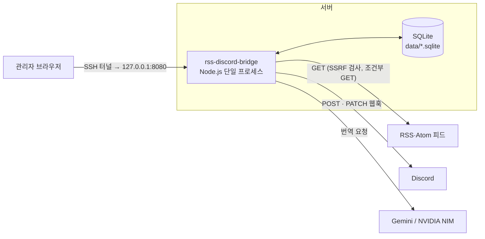
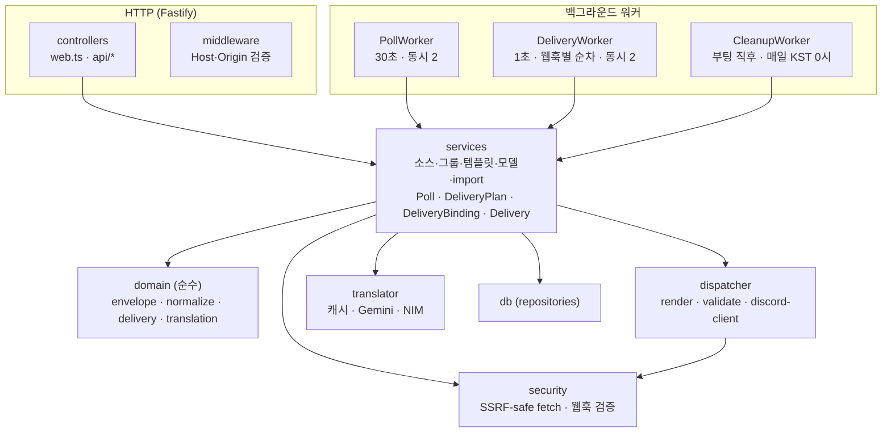
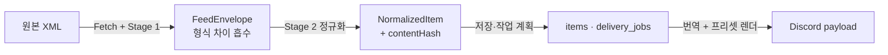

# 시스템 개요

> 검증 커밋 `6e53b7f` · 작성 2026-10-16 · 현재 동작 설명 문서(보호 대상 아님). 계약은 [Contracts](../Contracts/), 결정 배경은 [Decisions](../Decisions/)에 있다.

## 1. 무엇을 하는가

RSS 2.0·Atom 피드를 주기적으로 수집해 Discord 웹훅으로 보내는 셀프호스트 브리지다. 특히 status page(장애 공지) 피드를 안정적으로 중계하는 것이 목적이며, **소스를 등록하거나 웹훅을 바꾼 뒤 과거 항목이 다시 전송되는 문제를 구조적으로 막는다.**

관리자는 한 명이고, 관리 화면은 loopback(`127.0.0.1`)에만 열린다. 외부에서는 SSH 터널로 접속한다.

## 2. 시스템 경계

- 들어오는 요청: 관리 화면(Handlebars + htmx)과 JSON API, 로그 SSE. Host·Origin 검증과 rate limit(분당 120회)을 적용한다.
- 나가는 요청: 피드·웹훅 URL 모두 SSRF 검사를 거친다. 웹훅은 Discord 도메인만 허용한다.
- 비밀값: 번역 API 키는 환경 변수에만 있다. 웹훅 URL은 DB의 `groups.webhook_url`에만 있다.

## 3. 프로세스 안의 구성

의존 방향은 위에서 아래로만 흐른다. `domain/`은 I/O가 없는 순수 함수만 두고, 다른 계층을 import하지 않는다. 서비스는 런타임 컨테이너 전체가 아니라 필요한 repository만 받는다. 디렉터리별 책임은 [module-map.md](module-map.md)에 있다.

## 4. 데이터가 바뀌는 단계

- **Stage 1 (envelope)**: RSS·Atom의 구조 차이를 흡수해 같은 모양의 DTO를 만든다. 본문 HTML은 해석하지 않고 그대로 운반한다.
- **Stage 2 (normalize)**: 본문을 정제하고 `contentHash`를 계산한다. 같은 입력이면 항상 같은 결과를 내는 순수 함수다. 프로필(`generic`·`incident-io`·`atlassian-statuspage`)에 따라 정제 방식이 다르다.
- **인코딩 처리는 계층별로 나눈다**: charset 디코드는 fetch, 엔티티 디코드는 Stage 1, 태그 제거는 Stage 2.

## 5. 핵심 불변식

| 불변식 | 지키는 곳 |
| --- | --- |
| **형식과 내용의 분리**: Stage 1은 형식, Stage 2는 내용 | `domain/envelope`, `domain/normalize` |
| **식별 ≠ 변경**: 식별은 `(source_id, atom_id)`, 변경은 `content_hash`·`content_revision` | `items` UNIQUE, PollService |
| **결정적 정규화**: 같은 입력 → 같은 해시. incident 해시는 최신 segment만 | `domain/normalize` |
| **첫 수집은 보내지 않는다**: 소스의 첫 성공 수집은 모두 historical | `domain/delivery/cutoff.ts` |
| **새 연결은 과거 항목을 받지 않는다**: 연결 세대마다 baseline | `delivery_bindings`, DeliveryPlanService |
| **수정은 원래 보낸 연결에만** | `item_deliveries`, DeliveryPlanService |
| **결과가 불명확한 POST는 자동으로 다시 보내지 않는다** | DeliveryService, `recoverInterrupted` |

연결 세대와 발송 상태의 자세한 정의는 [DB 스키마 계약](../Contracts/db-schema.md) §4~§5에 있다.

## 6. 기술 스택

| 영역 | 사용 |
| --- | --- |
| 서버 | Node.js ≥ 20, TypeScript(ESM), Fastify 5 |
| 저장소 | better-sqlite3(WAL), 순번 SQL 마이그레이션 |
| 피드 | fast-xml-parser, undici(SSRF-safe Agent, 조건부 GET, TLS 1.2 재시도) |
| 렌더 | Handlebars(프리셋·화면), ajv(Discord payload 검증) |
| 화면 | 서버 렌더 Handlebars, htmx, CodeMirror, SSE. React·번들러·WebSocket·다크모드는 쓰지 않음 |
| 번역 | @google/genai(Gemini), NVIDIA NIM 폴백 |
| 빌드 | `tsc` + `copyfiles`(번들 아님). 로컬 import는 `.js` 확장자, 리소스 경로는 `import.meta.url` 기준 |

## 7. 더 읽을 문서

- 부팅·워커·종료: [runtime.md](runtime.md)
- 수집부터 발송까지의 흐름과 오류 처리: [pipeline.md](pipeline.md)
- 디렉터리·기능별 연결: [module-map.md](module-map.md)
- 테이블과 상태: [../Contracts/db-schema.md](../Contracts/db-schema.md)
