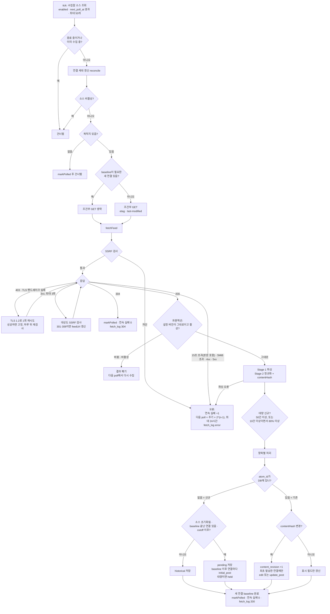
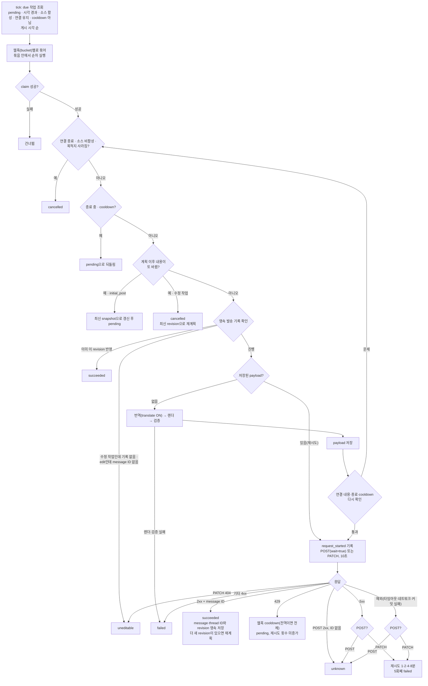
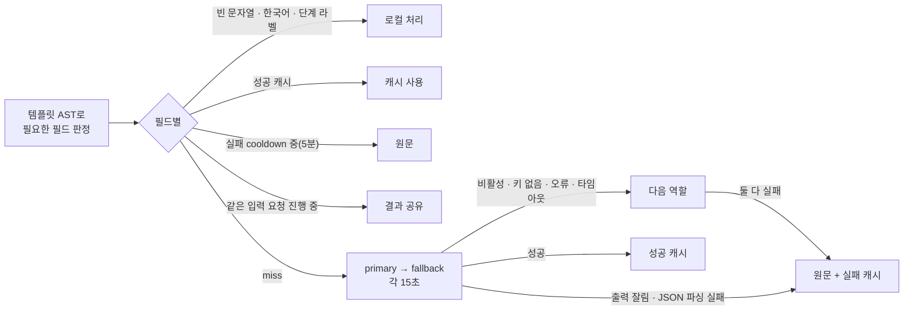
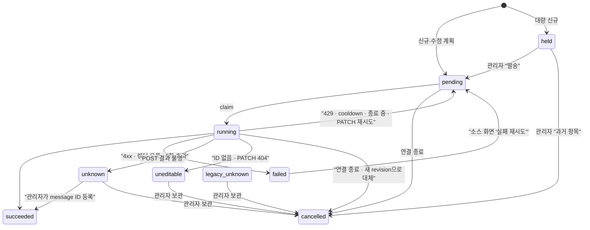
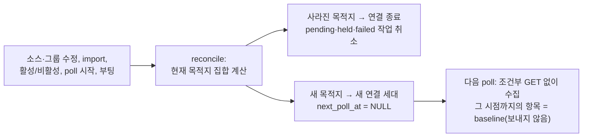

# 수집 → 발송 파이프라인과 오류 처리

> 검증 커밋 `6e53b7f` · 작성 2026-10-16 · 현재 동작 설명 문서(보호 대상 아님). 상태 값의 정의는 [DB 스키마 계약 §5](../Contracts/db-schema.md#5-상태-값)를 따른다.

수집(PollService)과 발송(DeliveryService)은 서로 다른 워커에서 돌고, DB의 `delivery_jobs`로만 연결된다.

## 1. 수집: 피드 → 항목 저장 → 작업 계획

코드: `workers/poll-worker.ts`, `services/poll.service.ts`, `security/ssrf-fetch.ts`, `domain/*`, `services/delivery-plan.service.ts`

### 수집 오류 처리 요약

| 상황 | 처리 | 기록 |
| --- | --- | --- |
| SSRF 차단, 4xx, 5xx, 타임아웃, 크기 초과, 파싱 실패 | 다음 poll을 지수적으로 미룸(최대 24시간) | `fetch_log` error, `sources.consecutive_failures` |
| 403·TLS 핸드셰이크 실패 | TLS 1.2로 한 번 재시도. 성공하면 `fetch_options`에 고정, 하루 뒤 기본 설정으로 재검사 | |
| 인증서 오류 | 재시도하지 않음 | error |
| 304 | 본문 없이 종료, 재감지 없음 | `fetch_log` 304 |
| poll 도중 설정 변경 | 결과를 버림(설정 버전 비교) | 없음 |
| 목적지 없는 소스 | 수집하지 않고 다음 주기로 | 없음 |

## 2. 발송: 작업 한 건 처리

코드: `workers/delivery-worker.ts`, `services/delivery.service.ts`, `dispatcher/*`, `db/delivery-job.repository.ts`

### 발송 오류 처리 요약

| 결과 | POST(`initial_post`·`update_post`) | PATCH(`edit`) |
| --- | --- | --- |
| 2xx | `succeeded`(ID 없으면 `unknown`) | `succeeded` |
| 429 | cooldown 후 재실행, 횟수 미증가 | 같음 |
| 5xx | `unknown` | 재시도 |
| 404 | `failed` | `uneditable` |
| 기타 4xx | `failed` | `failed` |
| 타임아웃·네트워크 오류 | `unknown` | 재시도 |
| 렌더·검증 오류 | `failed` | `failed` |
| SSRF·웹훅 검증 실패 | `failed`(guard_blocked) | 같음 |

`unknown`·`held`·`uneditable`·`legacy_unknown`은 자동으로 다시 보내지 않는다. 관리자가 `/delivery-jobs`에서 처리한다(§4).

## 3. 번역 (발송 중 payload를 만들 때)

코드: `translator/translation-cache.service.ts`, `translator/translator.ts`, `domain/translation/policy.ts`

- 캐시 미스인 필드는 한 번의 요청으로 묶는다.
- 번역에 실패해도 원문으로 렌더한 payload가 저장되므로, Discord 재시도 때 번역을 다시 호출하지 않는다.
- 미리보기는 번역하지 않는다.

## 4. 작업 상태와 관리자 조치

## 5. 설정 변경과 연결 세대

코드: `services/delivery-binding.service.ts`

- 그룹 이름·아바타 변경, 같은 웹훅을 가리키는 그룹 추가로는 새 세대가 생기지 않는다.
- feedUrl을 바꾸면 항목을 지우고 모든 연결을 새 세대로 시작한다.
- 웹훅만 바꿔도 이전 웹훅으로 보낸 메시지는 더 이상 수정하지 않는다(Discord는 메시지를 만든 웹훅으로만 수정할 수 있다).

## 6. 알려진 한계 (2026-10-16 검토, 후속 수정 대상)

| 위치 | 내용 |
| --- | --- |
| §2 예외 → POST → `unknown` | DNS 실패·연결 거부처럼 요청이 나가지 않은 경우도 `unknown`이 된다. `unknown`에는 재발송 조치가 없다 |
| §4 `held`·`unknown` | 건수 알림이 없어 `/delivery-jobs`에 들어가야 보인다 |
| §2 정렬 | 같은 poll의 날짜 없는 신규 항목은 피드 순서(보통 최신 글 먼저)대로 발송된다 |
| §1 항목별 처리 | poll마다 모든 항목의 `last_seen_at`을 개별 UPDATE한다 |
| 정리 | 0021 이전 항목은 `last_seen_at`이 NULL이라 본문이 정리되지 않는다. 성공 번역 캐시는 정리하지 않는다 |
