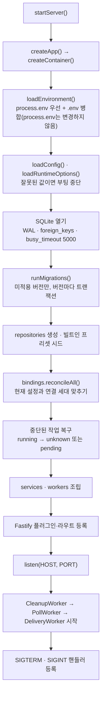
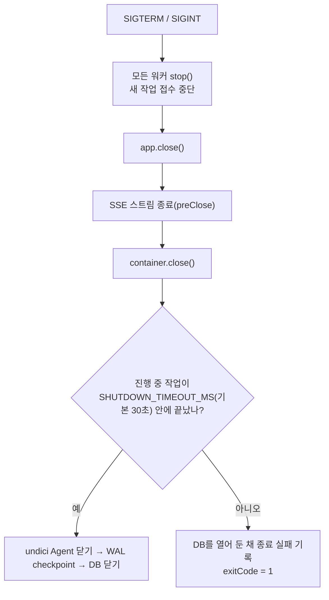

# 런타임: 부팅 · 워커 · 종료

> 검증 커밋 `6e53b7f` · 작성 2026-10-16 · 현재 동작 설명 문서(보호 대상 아님)

## 1. 진입점

| 명령 | 실행 |
| --- | --- |
| `npm run dev` | `tsx watch src/server/main.ts` |
| `npm start` | `node dist/server/main.js` |
| `npm run build` | `dist` 정리 → `tsc` → 리소스 복사(migrations·config·templates·presets) |

`main.ts`의 `startServer()`가 앱을 만들고, listen에 성공한 뒤에 워커를 시작한다. `app.ts`는 HTTP 구성만 담당한다.

## 2. 부팅 순서

- 같은 환경 병합 결과를 설정·번역기·모델 상태 서비스가 함께 쓴다. 그래서 `.env`에만 있는 API 키도 번역에 쓰인다.
- production(`NODE_ENV=production`)에서 HOST가 loopback이 아니면 부팅을 중단한다.
- **중단된 작업 복구**: `running` 상태로 남은 발송 작업 중 POST 요청을 이미 시작한 것(`request_started_at` 있음, `edit` 제외)은 `unknown`, 나머지는 `pending`으로 되돌린다. 중복 발송을 막기 위해서다.

## 3. 백그라운드 워커

| 워커 | 주기 | 동시성 | 하는 일 | 중복 방지 |
| --- | --- | --- | --- | --- |
| PollWorker | 30초 | `POLL_CONCURRENCY`(기본 2) | due 소스 최대 50개 수집 → PollService | 틱이 끝나기 전 다음 틱 건너뜀, 소스별 진행 중 Map |
| DeliveryWorker | 1초 | `DELIVERY_CONCURRENCY`(기본 2) | due 작업 최대 50개를 웹훅(bucket)별로 묶어 순차 실행 → DeliveryService | 틱 가드, bucket 진행 중 Set, DB claim(같은 항목×연결 동시 실행 금지) |
| CleanupWorker | 부팅 직후 + 매일 KST 0시 | 1 | 로그·캐시 정리, 항목 본문 tombstone | 실행 중 플래그 |

- 수집과 발송은 서로 기다리지 않는다. 느린 피드가 발송을 막지 않고, 느린 번역·Discord 응답이 수집을 막지 않는다.
- 모든 예약·수동 작업은 워커의 `TaskTracker`에 등록된다. 종료할 때 이 목록이 빌 때까지 기다린다.
- 수동 실행: 소스 화면의 "지금 수집"은 `PollWorker.triggerPoll()`로 같은 가드를 거친다.

## 4. 종료 순서

- 진행 중인 발송 작업은 HTTP 요청 직전에 종료 여부를 확인한다. 종료 중이면 요청을 보내지 않고 `pending`으로 되돌린다.
- 제한 시간을 넘기면 **사용 중인 DB를 닫지 않는다.** Discord 요청은 성공했는데 기록을 못 남기는 상황을 막기 위해서다.
- systemd의 `TimeoutStopSec`은 이 시간보다 길어야 한다(현재 예시 90초, [Deploy](../Deploy/)).

## 5. 설정값

환경 변수는 프로젝트 루트의 `.env`(gitignore)와 `default.env.example`(템플릿)에 둔다. 범위를 벗어난 값은 부팅을 중단시킨다.

| 변수 | 기본값 | 범위 | 용도 |
| --- | --- | --- | --- |
| `NODE_ENV` | — | | `production`이면 loopback 강제 |
| `HOST` | `127.0.0.1` | production은 loopback만 | |
| `PORT` | `8080` | 1–65535 | |
| `DATABASE_PATH` | `./data/rss-discord-bridge.sqlite` | | 실행 위치 기준 상대 경로 |
| `PRIMARY_MODEL_API_KEY` | — | | 비우면 primary 번역 비활성(`missing-key`) |
| `FALLBACK_MODEL_API_KEY` | — | | 비우면 fallback 번역 비활성 |
| `POLL_CONCURRENCY` | 2 | 1–16 | 동시에 수집할 소스 수 |
| `DELIVERY_CONCURRENCY` | 2 | 1–16 | 동시에 처리할 웹훅 bucket 수 |
| `SHUTDOWN_TIMEOUT_MS` | 30000 | 100–300000 | 종료 시 작업을 기다리는 시간 |
| `FEED_MAX_BYTES` | 5242880 | 1024–52428800 | 피드 응답 최대 크기 |
| `NEW_ITEMS_HOLD_COUNT` | 50 | 1–100000 | 한 poll의 신규가 이 수 이상이면 보류 |
| `NEW_ITEMS_HOLD_MIN` | 10 | 1–100000 | 비율 조건을 적용할 최소 신규 수 |
| `NEW_ITEMS_HOLD_RATIO` | 0.8 | 0 초과 1 이하 | 신규가 스냅샷에서 차지하는 비율 |
| `ITEM_CONTENT_RETENTION_DAYS` | 180 | 1–3650 | 피드에서 사라진 항목의 본문 보존 기간 |

모델 이름·대상 언어·프롬프트 기록 크기는 env가 아니라 DB `model_config`에서 관리한다(관리 화면 `/model`).

코드 내부 고정값: 피드 요청 타임아웃 15초(소스별 `fetch_options.timeoutMs`로 변경), 리다이렉트 최대 3회, Discord 요청 타임아웃 10초, 번역 provider 타임아웃 15초, 번역 실패 cooldown 5분, 발송 재시도 최대 5회(1·2·4·8분), 로그 보존 90일.
