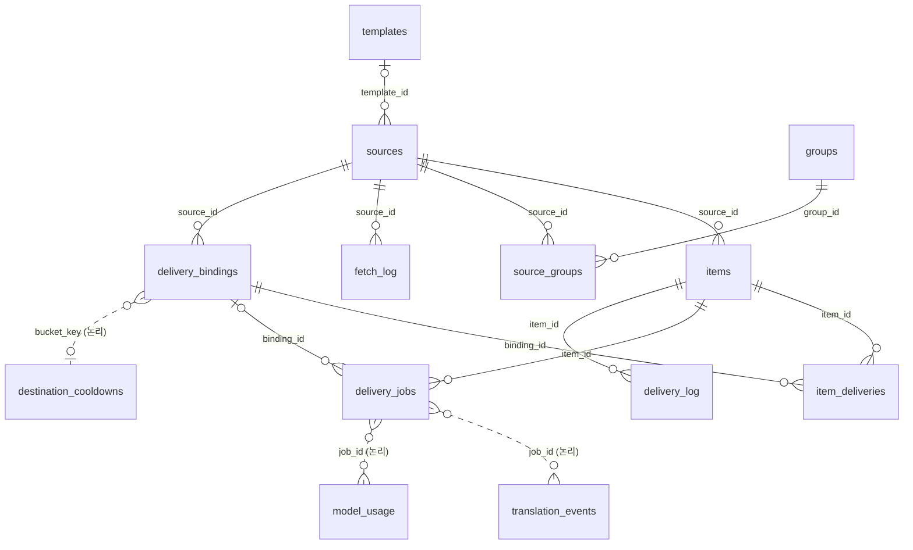

# DB 스키마 계약

> 🔒 **보호 문서**(`Docs/Contracts/`): 수정 전 파일·항목 단위 사용자 승인이 필요하다.
> 기준: 마이그레이션 `0001`~`0023` · 검증 커밋 `6e53b7f` · 작성 2026-10-16
> **진실원은 `src/resources/migrations/*.sql`이다.** 이 문서는 그 결과 스키마와 의미를 설명한다. 테이블·컬럼·인덱스·트리거 이름이 실제 스키마와 다르면 [db-schema-doc.test.ts](../../test/integration/docs/db-schema-doc.test.ts)가 실패한다.

## 1. 공통 규칙

- **엔진**: better-sqlite3, `journal_mode=WAL`, `foreign_keys=ON`, `busy_timeout=5000` (`runtime/container.ts`).
- **마이그레이션**: `resources/migrations/NNNN_*.sql`을 파일명 순서로, 버전마다 트랜잭션 하나로 적용한다. 적용 이력은 `schema_migrations`. **기존 파일은 수정하지 않고 새 번호로 추가한다.** 일부 버전은 SQL 뒤에 코드 backfill이 붙는다(`runtime/migrator.ts`의 `runPostMigrationBackfill`).
- **시각**: 모든 시각 컬럼은 ISO-8601 UTC 문자열(`YYYY-MM-DDTHH:MM:SS.sssZ`)이다. 비교는 TEXT 비교로 하고 SQLite datetime 산술을 쓰지 않는다. 일부 컬럼의 DEFAULT `datetime('now')`는 0001~0006 시절 값이며, 앱은 항상 ISO 값을 직접 넣는다(0010·0018에서 옛 행 보정).
- **불리언**: `INTEGER` 0/1.
- **JSON**: `sources.fetch_options`는 JSON 객체, `mention_role_ids`·`mention_user_ids`·`applied_tags`는 JSON 문자열 배열(TEXT, NULL 허용).
- **비밀값**: API 키는 DB에 저장하지 않는다(환경 변수 전용). 웹훅 URL 원문은 `groups.webhook_url`에만 있고, 발송 기록·작업·로그에는 해시(`destination_key`·`bucket_key`)만 남긴다.

## 2. ERD

실선은 FK, 점선은 FK 없는 논리적 연결이다. FK는 모두 `ON DELETE CASCADE`이고, `sources.template_id`만 `ON DELETE SET NULL`이다.

## 3. 영역별 테이블

| 영역 | 테이블 | 쓰는 쪽 |
| --- | --- | --- |
| 설정 | `sources`, `groups`, `source_groups`, `templates`, `model_config` | 관리 API(서비스), import |
| 수집 | `items`, `fetch_log` | PollService |
| 발송 | `delivery_bindings`, `item_deliveries`, `delivery_jobs`, `destination_cooldowns`, `delivery_log` | DeliveryBindingService, DeliveryPlanService, DeliveryService |
| 번역 | `translation_cache`, `translation_events`, `model_usage` | TranslationCacheService, ModelTranslator |
| 시스템 | `schema_migrations` | migrator |

---

### `sources`

RSS 소스 하나. 수집 상태와 발송 옵션을 함께 가진다.

| 컬럼 | 타입 | 제약·기본값 | 의미 |
| --- | --- | --- | --- |
| `id` | TEXT | PK | 소스 ID(UUID) |
| `feed_url` | TEXT | NOT NULL, UNIQUE | 피드 URL. 바꾸면 항목을 지우고 처음부터 다시 수집한다. 301·308 영구 리다이렉트는 poll 중 자동 반영 |
| `name` | TEXT | | 표시 이름 |
| `enabled` | INTEGER | NOT NULL, 1 | 수집·발송 활성 |
| `profile` | TEXT | NOT NULL, `'auto'` | 사용자 설정 프로필: `auto`·`generic`·`incident-io`·`atlassian-statuspage` |
| `detected_profile` | TEXT | | 첫 200 응답에서 한 번 감지해 저장. 304·빈 본문에서는 재감지하지 않음 |
| `initialized` | INTEGER | NOT NULL, 0 | 첫 성공 수집(전부 historical 저장)을 마쳤는지 |
| `delivery_cutoff_at` | TEXT | | 이 시각 이전에 게시된 신규 항목은 보내지 않음. 등록·재활성화·URL 변경 때 갱신 |
| `etag` | TEXT | | 조건부 GET |
| `last_modified` | TEXT | | 조건부 GET |
| `created_at` | TEXT | NOT NULL | |
| `template_id` | INTEGER | FK templates, SET NULL | 프리셋. NULL이면 `minimal` |
| `webhook_url` | TEXT | | **사용하지 않음.** D24 이후 웹훅은 그룹이 가진다. 0020에서 전부 NULL로 비움 |
| `poll_interval_seconds` | INTEGER | NOT NULL, 300, > 0 | 수집 주기 |
| `fetch_options` | TEXT | NOT NULL, `'{}'`, json_valid | charset·userAgent·timeoutMs·headers·tlsMaxVersion·tlsPinnedAt |
| `translate` | INTEGER | NOT NULL, 0 | 발송 시 한국어 번역 |
| `webhook_name` | TEXT | | 발송자 이름 override(그룹 값보다 우선) |
| `webhook_avatar_url` | TEXT | | 발송자 아바타 override |
| `last_polled_at` | TEXT | | 마지막 poll 시작 시각(claim) |
| `next_poll_at` | TEXT | | 다음 poll 시각. **due 판정의 기준**. NULL이면 즉시 대상 |
| `silent` | INTEGER | NOT NULL, 0 | Discord 알림 없이 보내기 |
| `mention_role_ids` | TEXT | JSON 배열 | 멘션할 역할 |
| `mention_user_ids` | TEXT | JSON 배열 | 멘션할 사용자 |
| `mention_everyone` | INTEGER | NOT NULL, 0 | @everyone |
| `thread_id` | TEXT | | 기존 스레드로 보내기. 목적지 식별에 포함 |
| `thread_name` | TEXT | | 포럼 새 스레드 제목 |
| `applied_tags` | TEXT | JSON 배열 | 포럼 태그 |
| `edit_in_place` | INTEGER | NOT NULL, 0 | 1: 기존 메시지 PATCH(`edit`), 0: 같은 연결에 변경 알림 POST(`update_post`) |
| `mention_here` | INTEGER | NOT NULL, 0 | @here |
| `config_revision` | INTEGER | NOT NULL, 1 | 설정 버전. 트리거가 올린다. poll 결과 커밋 때 시작 시점 값과 비교해 다르면 결과를 버린다 |
| `consecutive_failures` | INTEGER | NOT NULL, 0 | 연속 poll 실패 수. 실패 시 다음 poll = 주기 × 2^(n-1), 최대 24시간 |

인덱스: `idx_sources_feed_url_unique`(UNIQUE `feed_url`), `idx_sources_enabled_next_poll`(`enabled, next_poll_at`), `idx_sources_template_id`.

트리거 `sources_config_revision`: `feed_url, profile, enabled, thread_id, thread_name, applied_tags, template_id, translate, silent, mention_role_ids, mention_user_ids, mention_everyone, mention_here, webhook_name, webhook_avatar_url, edit_in_place, fetch_options, poll_interval_seconds` 중 하나가 바뀌면 `config_revision + 1`(0023에서 마지막 두 컬럼 추가).

### `groups`

재사용하는 Discord 전송 채널(D24). **웹훅 URL의 유일한 저장 위치.**

| 컬럼 | 타입 | 제약·기본값 | 의미 |
| --- | --- | --- | --- |
| `id` | INTEGER | PK AUTOINCREMENT | |
| `name` | TEXT | NOT NULL, UNIQUE(NOCASE) | 그룹 이름 |
| `webhook_url` | TEXT | | Discord 웹훅 URL(비밀값). 저장 전 SSRF·형식 검증 |
| `webhook_name` | TEXT | | 기본 발송자 이름 |
| `webhook_avatar_url` | TEXT | | 기본 발송자 아바타 |
| `created_at` | TEXT | NOT NULL | |
| `updated_at` | TEXT | NOT NULL | |

인덱스: `idx_groups_name_nocase`(UNIQUE `name COLLATE NOCASE`).

트리거 `groups_config_update`: `webhook_url`이 바뀌면 이 그룹에 속한 모든 소스의 `config_revision + 1`.

### `source_groups`

소스와 그룹의 N:M 멤버십. 소스는 그룹을 최소 1개 가져야 한다(서비스 검증).

| 컬럼 | 타입 | 제약·기본값 | 의미 |
| --- | --- | --- | --- |
| `source_id` | TEXT | PK, FK sources | |
| `group_id` | INTEGER | PK, FK groups | |

인덱스: `idx_source_groups_group`(`group_id`).

트리거 `source_groups_config_insert`, `source_groups_config_delete`: 멤버십이 바뀌면 해당 소스의 `config_revision + 1`. `setGroups()`는 전체 삭제 후 재삽입하므로, **연결 세대는 이 행이 아니라 해석된 목적지 집합으로 판단한다**(`delivery_bindings` 참고).

### `templates`

Discord payload를 만드는 Handlebars 프리셋.

| 컬럼 | 타입 | 제약·기본값 | 의미 |
| --- | --- | --- | --- |
| `id` | INTEGER | PK AUTOINCREMENT | |
| `name` | TEXT | NOT NULL, UNIQUE | 슬러그. 빌트인 4종: `incident-active`·`news-article`·`link-discussion`·`minimal` |
| `label` | TEXT | NOT NULL | 표시 이름 |
| `body` | TEXT | NOT NULL | Handlebars 본문(렌더 결과는 JSON payload) |
| `is_builtin` | INTEGER | NOT NULL, 0 | 빌트인은 부팅 때 시드되며 삭제 불가 |
| `created_at` | TEXT | NOT NULL | |
| `updated_at` | TEXT | NOT NULL | |

인덱스: `idx_templates_builtin_name`(`is_builtin, name`).

### `items`

피드 항목 하나. **식별은 `(source_id, atom_id)`, 변경 감지는 `content_hash`**(3대 불변식).

| 컬럼 | 타입 | 제약·기본값 | 의미 |
| --- | --- | --- | --- |
| `id` | INTEGER | PK AUTOINCREMENT | 증가 순서가 baseline 경계로 쓰인다(`delivery_bindings.baseline_item_id`) |
| `source_id` | TEXT | NOT NULL, FK sources | |
| `atom_id` | TEXT | NOT NULL, UNIQUE(`source_id, atom_id`) | Atom `<id>` / RSS `<guid>` / `<link>` 순서로 고른 불변 식별자 |
| `title` | TEXT | | 정규화한 제목 |
| `summary` | TEXT | | 정규화한 본문(incident는 최신 segment). 보존 기간이 지나면 NULL(tombstone) |
| `content_hash` | TEXT | | generic: `sha256(title\nlink)`, incident: `sha256(stage\nsummary)` |
| `incident_stage` | TEXT | | incident 진행 단계 |
| `published_at` | TEXT | | `published ?? updated`. cutoff 판정과 발송 순서 |
| `updated_at` | TEXT | | 피드의 `<updated>` |
| `delivered_at` | TEXT | | 첫 성공 발송 시각(요약) |
| `next_attempt_at` | TEXT | | 요약용: 대기 중 작업의 가장 빠른 시각 |
| `created_at` | TEXT | NOT NULL | 처음 저장한 시각 |
| `link` | TEXT | NOT NULL, `''` | |
| `author` | TEXT | | |
| `comments_url` | TEXT | | |
| `image` | TEXT | | tombstone 때 NULL |
| `delivery_status` | TEXT | NOT NULL, `'pending'` | **호환용 요약값.** 실행 판단에 쓰지 않는다. §5 참고 |
| `attempt_count` | INTEGER | NOT NULL, 0 | 요약: 작업들의 최대 시도 수 |
| `failed_at` | TEXT | | 요약 |
| `failure_reason` | TEXT | | 요약(대표 작업의 오류) |
| `translated_title` | TEXT | | 마지막 성공 번역(표시용). 실제 재사용은 `translation_cache` |
| `translated_summary` | TEXT | | 〃 |
| `translated_at` | TEXT | | 〃 |
| `content_revision` | INTEGER | NOT NULL, 1 | `content_hash`가 바뀔 때마다 +1. 발송 반영 판단 기준(H1→H2→H1도 1→2→3) |
| `last_seen_at` | TEXT | | 피드에서 마지막으로 관측한 시각. 본문 보존 기간 기준 |
| `content_pruned` | INTEGER | NOT NULL, 0 | 1이면 본문이 정리된 tombstone. 다시 관측되면 복원 |

인덱스: `idx_items_source`(`source_id`), `idx_items_pending_next_attempt`(`next_attempt_at` WHERE `delivery_status='pending'`).

### `fetch_log`

poll 1회의 결과. 감사·화면용.

| 컬럼 | 타입 | 제약·기본값 | 의미 |
| --- | --- | --- | --- |
| `id` | INTEGER | PK AUTOINCREMENT | SSE cursor로 쓰인다 |
| `source_id` | TEXT | NOT NULL, FK sources | |
| `outcome` | TEXT | NOT NULL, `200`·`304`·`error` | |
| `http_status` | INTEGER | | |
| `items_new` | INTEGER | NOT NULL, 0 | 발송 대상 신규 |
| `items_historical` | INTEGER | NOT NULL, 0 | 저장만 한 신규 |
| `items_changed` | INTEGER | NOT NULL, 0 | 해시가 바뀐 기존 항목 |
| `items_skipped` | INTEGER | NOT NULL, 0 | 변화 없는 기존 항목 |
| `duration_ms` | INTEGER | | |
| `error` | TEXT | | 오류 메시지 |
| `created_at` | TEXT | NOT NULL | |

인덱스: `idx_fetch_log_source_created`, `idx_fetch_log_created`, `idx_fetch_log_outcome_created`.
보존: 90일 후 삭제(CleanupWorker).

### `delivery_bindings`

**연결 세대**: 소스 하나가 목적지(웹훅 + 스레드) 하나에 연결되어 있던 기간. 설정에서 파생되며 `DeliveryBindingService.reconcile()`만 만들고 종료한다.

| 컬럼 | 타입 | 제약·기본값 | 의미 |
| --- | --- | --- | --- |
| `id` | INTEGER | PK AUTOINCREMENT | 세대 ID. 같은 목적지라도 재연결하면 새 ID |
| `source_id` | TEXT | NOT NULL, FK sources | |
| `destination_key` | TEXT | NOT NULL | `sha256(canonical 웹훅 URL [+ "\n" + thread_id])` |
| `bucket_key` | TEXT | NOT NULL | `sha256(canonical 웹훅 URL)`. 같은 웹훅의 스레드들이 rate limit을 공유하는 단위 |
| `label` | TEXT | NOT NULL, `''` | 화면 표시(그룹 이름 + 스레드) |
| `created_at` | TEXT | NOT NULL | 연결 시작 |
| `ended_at` | TEXT | | 연결 종료. NULL이면 활성 |
| `baseline_item_id` | INTEGER | | baseline 완료 시점의 `MAX(items.id)`. 이보다 큰 항목만 이 연결로 최초 발송 |
| `baseline_at` | TEXT | | baseline 완료 시각. NULL이면 다음 poll이 조건부 GET 없이 본문 전체를 받아 baseline을 잡는다 |

인덱스: `idx_bindings_active`(UNIQUE `source_id, destination_key` WHERE `ended_at IS NULL`) — 소스·목적지당 활성 세대는 하나.

새 세대가 생기는 경우: 웹훅 URL·스레드 변경, 연결 해제 후 재연결, 소스 비활성화 후 재활성화, feedUrl 변경. 그룹 이름·아바타 변경, 같은 웹훅을 가리키는 그룹 추가로는 생기지 않는다. 종료하면 그 세대의 `pending`·`held`·`failed` 작업을 취소한다.

0021 이관 때 옛 성공 로그에서 만든 세대는 생성과 동시에 종료된 상태다(`bucket_key = destination_key`).

### `item_deliveries`

항목 × 연결 세대별 **영속 발송 기록**. 로그가 정리되어도 남는다.

| 컬럼 | 타입 | 제약·기본값 | 의미 |
| --- | --- | --- | --- |
| `item_id` | INTEGER | PK, FK items | |
| `binding_id` | INTEGER | PK, FK delivery_bindings | |
| `message_id` | TEXT | | Discord 메시지 ID(`wait=true` 응답) |
| `channel_id` | TEXT | | |
| `thread_id` | TEXT | | 포럼에 새로 만든 스레드면 그 ID. PATCH 때 사용 |
| `applied_revision` | INTEGER | NOT NULL, 0 | 이 연결에 마지막으로 반영한 `content_revision`. 더 낮은 값으로는 덮어쓰지 않음 |
| `first_delivered_at` | TEXT | NOT NULL | |

이 행이 있는 연결에만 기존 항목의 수정(`edit`·`update_post`)을 계획한다.

### `delivery_jobs`

발송 작업. 대상 연결과 revision을 **계획 시점에 고정**한다.

| 컬럼 | 타입 | 제약·기본값 | 의미 |
| --- | --- | --- | --- |
| `id` | INTEGER | PK AUTOINCREMENT | |
| `item_id` | INTEGER | NOT NULL, FK items | |
| `binding_id` | INTEGER | FK delivery_bindings | NULL은 `legacy_unknown`·`cancelled`만 허용(CHECK) |
| `operation` | TEXT | NOT NULL, `initial_post`·`edit`·`update_post` | §5 |
| `revision` | INTEGER | NOT NULL | 대상 `content_revision` |
| `state` | TEXT | NOT NULL, `'pending'` | §5 |
| `item_snapshot` | TEXT | NOT NULL | 계획 시점 항목 JSON. 90일 지난 완료 작업은 `'{}'`로 비움 |
| `source_snapshot` | TEXT | NOT NULL | 계획 시점 소스 JSON(웹훅 URL·fetch 옵션 제외) |
| `template_body` | TEXT | NOT NULL | 계획 시점 프리셋 본문 |
| `payload` | TEXT | | 렌더 결과 JSON. 저장 후 재시도는 번역·렌더 없이 재사용 |
| `attempt_count` | INTEGER | NOT NULL, 0 | 일반 실패 횟수(429 제외). 5회면 `failed` |
| `next_attempt_at` | TEXT | | |
| `claim_token` | TEXT | | 실행 중 소유 토큰. 완료 갱신은 이 토큰이 맞을 때만 |
| `request_started_at` | TEXT | | HTTP 요청 직전 기록. 재시작 때 POST가 시작됐는지 판단 |
| `error` | TEXT | | |
| `created_at` | TEXT | NOT NULL | |
| `completed_at` | TEXT | | |

제약·인덱스:
- UNIQUE(`item_id, binding_id, operation, revision`)
- `idx_initial_job`: UNIQUE(`item_id, binding_id`) WHERE `operation='initial_post'` — 연결당 최초 발송은 한 번
- `idx_legacy_unknown`: UNIQUE(`item_id`) WHERE `state='legacy_unknown'`
- `idx_delivery_job_running`: UNIQUE(`item_id, binding_id`) WHERE `state='running'` — 같은 항목×연결은 동시에 하나만 실행
- `idx_delivery_jobs_due`(`state, next_attempt_at, id`), `idx_delivery_jobs_binding`(`binding_id, item_id, state`)

행은 삭제하지 않는다(최초 발송 유일성의 근거).

### `destination_cooldowns`

Discord rate limit 대기. `bucket_key = '__discord_global__'`은 전역 제한.

| 컬럼 | 타입 | 제약·기본값 | 의미 |
| --- | --- | --- | --- |
| `bucket_key` | TEXT | PK | `delivery_bindings.bucket_key` 또는 `__discord_global__` |
| `until_at` | TEXT | NOT NULL | 이 시각까지 해당 웹훅으로 보내지 않음 |

지난 행은 CleanupWorker가 지운다.

### `delivery_log`

발송 시도의 **감사 로그**. 실행 판단에 쓰지 않으며 90일 후 삭제된다.

| 컬럼 | 타입 | 제약·기본값 | 의미 |
| --- | --- | --- | --- |
| `id` | INTEGER | PK AUTOINCREMENT | SSE cursor |
| `item_id` | INTEGER | NOT NULL, FK items | |
| `attempt_no` | INTEGER | NOT NULL, > 0 | |
| `status` | TEXT | NOT NULL, `success`·`failed`·`skipped` | |
| `http_status` | INTEGER | | |
| `error` | TEXT | | |
| `rendered_bytes` | INTEGER | | |
| `created_at` | TEXT | NOT NULL | |
| `destination_key` | TEXT | | 연결 세대의 `destination_key` |
| `content_hash` | TEXT | | 발송한 내용의 해시 |
| `failure_reason` | TEXT | | `render`·`validate`·`no_destination`·`webhook_rejected`·`guard_blocked`·`network`·`rate_limited`·`max_retries`·`unknown` |
| `discord_message_id` | TEXT | | 성공 시 메시지 ID(영속 값은 `item_deliveries`) |

인덱스: `idx_delivery_log_item_created`, `idx_delivery_log_created`, `idx_delivery_log_status_created`, `idx_delivery_log_resolution`(`item_id, destination_key, content_hash, status, failure_reason`), `idx_delivery_log_message`(`item_id, destination_key`).

### `model_config`

번역 모델 설정. 역할(`primary`·`fallback`)당 한 행. **API 키는 저장하지 않는다**(env `PRIMARY_MODEL_API_KEY`·`FALLBACK_MODEL_API_KEY`).

| 컬럼 | 타입 | 제약·기본값 | 의미 |
| --- | --- | --- | --- |
| `id` | INTEGER | PK AUTOINCREMENT | |
| `role` | TEXT | NOT NULL, UNIQUE, `primary`·`fallback` | |
| `provider` | TEXT | NOT NULL, `gemini`·`nvidia-nim` | |
| `model` | TEXT | NOT NULL | 모델 이름 |
| `enabled` | INTEGER | NOT NULL, 1 | |
| `target_lang` | TEXT | NOT NULL, `'ko'` | |
| `prompt_log_max_bytes` | INTEGER | NOT NULL, 32768, ≥ 0 | `model_usage.prompt_log` 최대 크기 |
| `created_at` | TEXT | NOT NULL | |
| `updated_at` | TEXT | NOT NULL | |

시드: 0005, 0009(primary = Gemini `gemini-3.1-flash-lite`, fallback = NIM, 비활성).

### `model_usage`

번역 모델 호출 기록.

| 컬럼 | 타입 | 제약·기본값 | 의미 |
| --- | --- | --- | --- |
| `id` | INTEGER | PK AUTOINCREMENT | |
| `role` | TEXT | NOT NULL | |
| `provider` | TEXT | NOT NULL | |
| `model` | TEXT | NOT NULL | |
| `input_tokens` | INTEGER | | |
| `output_tokens` | INTEGER | | |
| `latency_ms` | INTEGER | | |
| `error` | TEXT | | 오류 분류 코드(`disabled`·`missing-key`·`length`·`timeout` 등). provider 예외 원문은 저장하지 않음 |
| `prompt_log` | TEXT | | 프롬프트·응답 기록(크기 제한) |
| `created_at` | TEXT | NOT NULL | |
| `http_requested` | INTEGER | NOT NULL, 1 | 0이면 실제 HTTP 요청 없음(`disabled`·`missing-key`) |
| `item_id` | INTEGER | | 논리 연결(FK 없음) |
| `job_id` | INTEGER | | 논리 연결(FK 없음) |

인덱스: `idx_model_usage_role_created`, `idx_model_usage_provider_created`, `idx_model_usage_created`.
보존: 90일 후 삭제.

### `translation_cache`

필드 단위 공유 번역 캐시. 키에 항목·작업·웹훅 ID를 넣지 않는다.

| 컬럼 | 타입 | 제약·기본값 | 의미 |
| --- | --- | --- | --- |
| `cache_key` | TEXT | PK | `sha256(JSON{policyVersion, targetLang, field, contextProfile, glossaryVersion, inputText})`. **contentHash와 다르다** |
| `field` | TEXT | NOT NULL, `title`·`summary` | |
| `status` | TEXT | NOT NULL, `success`·`failed` | |
| `value` | TEXT | | 성공한 번역문 |
| `last_error` | TEXT | | |
| `retry_after` | TEXT | | 실패 cooldown(기본 5분) 끝 시각 |
| `updated_at` | TEXT | NOT NULL | |

보존: `failed` 행은 90일 후 삭제. `success` 행은 현재 정리하지 않는다.

### `translation_events`

번역 캐시 동작 집계용 이벤트.

| 컬럼 | 타입 | 제약·기본값 | 의미 |
| --- | --- | --- | --- |
| `id` | INTEGER | PK AUTOINCREMENT | |
| `kind` | TEXT | NOT NULL | `cache_hit`·`local_skip`·`single_flight`·`failure_cooldown` |
| `item_id` | INTEGER | | 논리 연결 |
| `job_id` | INTEGER | | 논리 연결 |
| `created_at` | TEXT | NOT NULL | |

인덱스: `idx_translation_events_created`. 보존: 90일 후 삭제.

### `schema_migrations`

마이그레이션 적용 이력(`runtime/migrator.ts`가 만든다).

| 컬럼 | 타입 | 제약·기본값 | 의미 |
| --- | --- | --- | --- |
| `version` | TEXT | PK | 파일명에서 `.sql`을 뺀 값 |
| `applied_at` | TEXT | NOT NULL | |

---

## 4. 불변식

1. **식별 ≠ 변경**: `(items.source_id, items.atom_id)`는 바뀌지 않는 식별자다. 변경은 `content_hash`와 `content_revision`으로만 판단한다.
2. **historical은 자동으로 보내지 않는다**: 소스 첫 수집과 cutoff 이전 항목은 `historical`이며, 이후 내용이 바뀌어도 작업을 만들지 않는다.
3. **새 연결은 과거 항목을 받지 않는다**: `initial_post`는 `items.id > baseline_item_id`인 항목에만 만든다.
4. **수정은 원래 연결에만**: `edit`·`update_post`는 `item_deliveries` 행이 있는 활성 연결에만 만든다.
5. **작업 대상은 고정**: 작업은 계획 시점의 `binding_id`로만 실행되며, 연결이 끝나면 취소되고 다른 연결로 옮겨지지 않는다.
6. **최초 POST 결과가 불명확하면 자동 재전송하지 않는다**: `request_started_at` 이후 결과를 모르면 `unknown`.
7. **로그는 판단 근거가 아니다**: `delivery_log` 삭제는 발송 판단에 영향을 주지 않는다. 판단은 `item_deliveries`·`delivery_jobs`.
8. **비밀값 격리**: API 키는 DB에 없고, 웹훅 URL 원문은 `groups.webhook_url`에만 있다.

## 5. 상태 값

### `delivery_jobs.operation`

| 값 | 의미 |
| --- | --- |
| `initial_post` | 이 연결로 항목을 처음 보냄. 연결당 한 번 |
| `edit` | 기존 메시지 PATCH(`edit_in_place=1`). message ID가 있어야 함 |
| `update_post` | 같은 연결에 변경 알림 POST(`edit_in_place=0`) |

### `delivery_jobs.state`

| 값 | 의미 | 다음 |
| --- | --- | --- |
| `pending` | 실행 대기 | `running` |
| `running` | 워커가 실행 중(`claim_token`) | 결과에 따라 |
| `succeeded` | 반영 완료 | 끝 |
| `failed` | 4xx·렌더·검증 오류, 재시도 5회 초과 | 소스의 "실패 재시도" → `pending` |
| `cancelled` | 연결 종료, 새 revision으로 대체, 관리자 보관 | 끝 |
| `held` | 대량 신규 보류 | 관리자 발송 → `pending` / 과거 항목 → `cancelled` |
| `unknown` | POST 결과 불명 | 관리자 message ID 등록 → `succeeded` / 보관 → `cancelled` |
| `legacy_unknown` | 0021 이관 시 원래 목적지를 증명할 수 없던 pending·failed | 관리자 보관 → `cancelled` |
| `uneditable` | 수정 대상 메시지 없음(ID 미상, PATCH 404) | 관리자 보관 → `cancelled` |

재시작 시 `running`은 POST가 시작됐으면 `unknown`, 아니면 `pending`으로 복구한다.

### `items.delivery_status` (요약값)

`DeliveryJobRepository.syncItemState()`가 작업들로부터 계산한다.

| 값 | 조건 |
| --- | --- |
| `pending` | `pending`·`running`·`held` 작업이 있음 |
| `failed` | 그 외에 `failed`·`unknown`·`legacy_unknown`·`uneditable` 작업이 있음 |
| `delivered` | 그 외에 `succeeded` 작업이 있음 |
| `historical` | 작업이 없거나 전부 취소됨 |

## 6. 보존과 정리 (CleanupWorker, 부팅 직후와 매일 KST 0시)

| 대상 | 규칙 |
| --- | --- |
| `delivery_log`, `fetch_log`, `model_usage`, `translation_events` | 90일 지나면 삭제 |
| `translation_cache` | `failed`만 90일 후 삭제 |
| `delivery_jobs` | `succeeded`·`cancelled`이고 90일 지난 행의 snapshot·payload만 비움(행 유지) |
| `items` 본문 | `last_seen_at`이 `ITEM_CONTENT_RETENTION_DAYS`(기본 180일) 지났고 미완료 작업이 없으면 `summary`·번역·`image`를 비우고 `content_pruned=1` |
| `destination_cooldowns` | 지난 행 삭제 |

## 7. 마이그레이션 이력

| 버전 | 내용 |
| --- | --- |
| 0001_init | `sources`, `items`(`(source_id, atom_id)` UNIQUE) |
| 0002_templates | `templates`, 소스 프리셋·주기·fetch 옵션·번역 컬럼 |
| 0003_delivery_log | `delivery_log` |
| 0004_fetch_log | `fetch_log` |
| 0005_model | `model_config`, `model_usage`, 초기 모델 시드 |
| 0006_groups | `groups`, `source_groups`, 소스 발송자 override |
| 0007_sources_poll_state | `last_polled_at`, `next_poll_at`, due 인덱스 |
| 0008_delivery_state | 항목 렌더 필드·발송 상태·번역 캐시 컬럼, 로그 목적지 키 |
| 0009_reseed_model | 기본 모델 갱신 |
| 0010_iso_timestamp_backfill | 모델·이력 시각 ISO 보정 |
| 0011_webhook_features | 조용히 보내기·멘션·스레드·태그·수정 옵션, 로그 메시지 ID |
| 0012_mention_here | @here |
| 0013_merge_incident_presets | `incident-resolved` → `incident-active` 통합 |
| 0014_generic_content_hash_title_link | (코드 backfill) generic 해시를 `title\nlink`로 재계산 |
| 0015_source_destinations | D23 소스별 목적지 (0019에서 폐기) |
| 0016_sources_feed_url_unique | feed URL 유일 |
| 0017_source_destinations_canonical_unique | D23 목적지 유일 (0019에서 폐기) |
| 0018_runtime_timestamp_iso_z_backfill | 런타임 시각 ISO 보정 |
| 0019_drop_source_destinations | D24: 소스별 목적지 제거, 그룹이 채널 |
| 0020_scrub_source_webhook_url | `sources.webhook_url` 비우기 |
| 0021_delivery_jobs | D25: 연결 세대·영속 발송 기록·작업·cooldown, 설정 버전 트리거, 기존 pending·failed → `legacy_unknown`. (코드 backfill) 옛 성공 로그에서 종료된 세대와 `item_deliveries` 복원 |
| 0022_translation_cache | 번역 캐시·이벤트, `model_usage` 요청 여부·항목·작업 연결 |
| 0023_source_fetch_revision | 설정 버전 트리거에 `fetch_options`, `poll_interval_seconds` 추가 |
