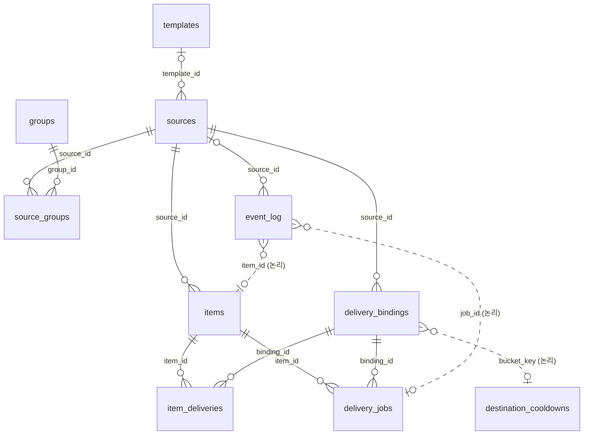

# DB 스키마

> 🔒 수정 전에 사용자 승인을 받는다. 기준은 마이그레이션 `0001_init`이다.
> **진실원은 `src/resources/migrations/*.sql`이다.** 테이블·컬럼·인덱스·트리거 이름이 이 문서와 다르면 [db-schema-doc.test.ts](../test/core/db-schema-doc.test.ts)가 실패한다.

## 1. 공통 규칙

| 항목 | 규칙 |
| --- | --- |
| 엔진 | better-sqlite3, `journal_mode=WAL`, `foreign_keys=ON`, `busy_timeout=5000` |
| 마이그레이션 | `NNNN_*.sql`을 파일명 순서로, 버전마다 트랜잭션 하나로 적용한다. 운영 DB가 생긴 뒤에는 기존 파일을 고치지 않고 새 번호로 추가한다 |
| 시각 | ISO-8601 UTC 문자열(`YYYY-MM-DDTHH:MM:SS.sssZ`). 비교는 문자열 비교 |
| 불리언 | `INTEGER` 0/1, `CHECK (… IN (0, 1))` |
| JSON | `fetch_options`는 객체, `mention_role_ids` · `mention_user_ids` · `applied_tags`는 문자열 배열. 모두 `json_valid` CHECK |
| 비밀값 | API 키·모델 이름은 DB에 두지 않는다. 웹훅 URL 원문은 `groups.webhook_url`에만 있고, 다른 곳에는 해시만 남긴다 |
| 삭제 | FK는 모두 `ON DELETE CASCADE`. `sources.template_id`만 `SET NULL` |

## 2. 관계도

실선은 FK, 점선은 FK 없는 논리 연결이다.

## 3. 테이블

| 영역 | 테이블 |
| --- | --- |
| 설정 | `sources` · `groups` · `source_groups` · `templates` |
| 수집 | `items` |
| 발송 | `delivery_bindings` · `item_deliveries` · `delivery_jobs` · `destination_cooldowns` |
| 번역·로그 | `translation_cache` · `event_log` |
| 시스템 | `schema_migrations` |

### `sources`

수집 소스. 수집 상태와 메시지 옵션을 함께 가진다.

| 컬럼 | 타입 | 제약·기본값 | 의미 |
| --- | --- | --- | --- |
| `id` | TEXT | PK | UUID |
| `feed_url` | TEXT | NOT NULL, UNIQUE | 피드 URL. 바꾸면 항목을 지우고 처음부터 수집. 301·308은 자동 반영 |
| `name` | TEXT | | 표시 이름 |
| `enabled` | INTEGER | NOT NULL, 1 | 수집·발송 활성 |
| `profile` | TEXT | NOT NULL, `'auto'` | `auto` · `generic` · `incident-io` · `atlassian-statuspage` |
| `detected_profile` | TEXT | | 첫 200 응답에서 감지한 프로필 |
| `initialized` | INTEGER | NOT NULL, 0 | 첫 수집(전부 과거 항목)을 마쳤는지 |
| `delivery_cutoff_at` | TEXT | | 이 시각 이전 게시물은 보내지 않음. 등록·재활성화·URL 변경 때 갱신 |
| `etag` | TEXT | | 조건부 GET |
| `last_modified` | TEXT | | 조건부 GET |
| `last_polled_at` | TEXT | | 마지막 수집 시작 |
| `next_poll_at` | TEXT | | 다음 수집 시각. NULL이면 즉시 |
| `poll_interval_seconds` | INTEGER | NOT NULL, 300, > 0 | 수집 주기 |
| `fetch_options` | TEXT | NOT NULL, `'{}'` | charset · userAgent · timeoutMs · headers · tlsMaxVersion · tlsPinnedAt |
| `consecutive_failures` | INTEGER | NOT NULL, 0 | 연속 실패 수. 다음 수집 = 주기 × 2^(n-1), 최대 24시간 |
| `template_id` | INTEGER | FK templates | 프리셋. NULL이면 `minimal` |
| `translate` | INTEGER | NOT NULL, 0 | 한국어 번역 |
| `webhook_name` | TEXT | | 발신 이름(그룹 값보다 우선) |
| `webhook_avatar_url` | TEXT | | 발신 아바타(그룹 값보다 우선) |
| `silent` | INTEGER | NOT NULL, 0 | 알림 없이 보내기 |
| `mention_role_ids` | TEXT | JSON 배열 | 멘션할 역할 |
| `mention_user_ids` | TEXT | JSON 배열 | 멘션할 사용자 |
| `mention_everyone` | INTEGER | NOT NULL, 0 | @everyone |
| `mention_here` | INTEGER | NOT NULL, 0 | @here |
| `thread_id` | TEXT | | 기존 스레드. 목적지 구분에 포함 |
| `thread_name` | TEXT | | 포럼 새 스레드 제목 |
| `applied_tags` | TEXT | JSON 배열 | 포럼 태그 |
| `edit_in_place` | INTEGER | NOT NULL, 0 | 1: 기존 메시지 수정(`edit`), 0: 변경 알림 새로 보내기(`update_post`) |
| `config_revision` | INTEGER | NOT NULL, 1 | 설정 버전. 수집 도중 바뀌면 그 결과를 버린다 |
| `created_at` | TEXT | NOT NULL | |

- 인덱스: `idx_sources_feed_url_unique`(UNIQUE `feed_url`), `idx_sources_enabled_next_poll`(`enabled, next_poll_at`), `idx_sources_template_id`
- 트리거 `sources_config_revision`: 아래 컬럼 중 하나가 바뀌면 `config_revision + 1`
  - 수집: `feed_url`, `profile`, `enabled`, `poll_interval_seconds`, `fetch_options`
  - 발송: `template_id`, `translate`, `silent`, `mention_role_ids`, `mention_user_ids`, `mention_everyone`, `mention_here`, `webhook_name`, `webhook_avatar_url`, `thread_id`, `thread_name`, `applied_tags`, `edit_in_place`

### `groups`

여러 소스가 함께 쓰는 Discord 전송 채널. **웹훅 URL을 저장하는 유일한 곳이다.**

| 컬럼 | 타입 | 제약·기본값 | 의미 |
| --- | --- | --- | --- |
| `id` | INTEGER | PK AUTOINCREMENT | |
| `name` | TEXT | NOT NULL, UNIQUE(NOCASE) | 그룹 이름 |
| `webhook_url` | TEXT | | 웹훅 URL(비밀값). 저장 전 형식·SSRF 검사 |
| `webhook_name` | TEXT | | 기본 발신 이름 |
| `webhook_avatar_url` | TEXT | | 기본 발신 아바타 |
| `created_at` | TEXT | NOT NULL | |
| `updated_at` | TEXT | NOT NULL | |

- 인덱스: `idx_groups_name_nocase`(UNIQUE `name COLLATE NOCASE`)
- 트리거 `groups_config_update`: `webhook_url`이 바뀌면 소속 소스의 `config_revision + 1`

### `source_groups`

소스와 그룹의 N:M 관계. 소스는 그룹이 하나 이상 있어야 한다(서비스에서 검사).

| 컬럼 | 타입 | 제약·기본값 | 의미 |
| --- | --- | --- | --- |
| `source_id` | TEXT | PK, FK sources | |
| `group_id` | INTEGER | PK, FK groups | |

- 인덱스: `idx_source_groups_group`(`group_id`)
- 트리거 `source_groups_config_insert`, `source_groups_config_delete`: 관계가 바뀌면 소스의 `config_revision + 1`
- 저장할 때 전체 삭제 후 다시 넣으므로, 연결 세대는 이 행이 아니라 계산한 목적지 집합으로 판단한다.

### `templates`

Discord payload를 만드는 Handlebars 프리셋.

| 컬럼 | 타입 | 제약·기본값 | 의미 |
| --- | --- | --- | --- |
| `id` | INTEGER | PK AUTOINCREMENT | |
| `name` | TEXT | NOT NULL, UNIQUE | 슬러그. 내장: `incident-active` · `news-article` · `link-discussion` · `minimal` |
| `label` | TEXT | NOT NULL | 표시 이름 |
| `body` | TEXT | NOT NULL | Handlebars 본문(결과는 JSON) |
| `is_builtin` | INTEGER | NOT NULL, 0 | 내장 프리셋. 부팅 때 시드, 삭제 불가 |
| `created_at` | TEXT | NOT NULL | |
| `updated_at` | TEXT | NOT NULL | |

- 인덱스: `idx_templates_builtin_name`(`is_builtin, name`)

### `items`

피드 항목. 내용과 버전만 가진다. 발송 상태는 `delivery_jobs` · `item_deliveries`에, 번역은 `translation_cache`와 작업 `payload`에만 있다.

| 컬럼 | 타입 | 제약·기본값 | 의미 |
| --- | --- | --- | --- |
| `id` | INTEGER | PK AUTOINCREMENT | 증가 순서가 기준선 경계로 쓰인다 |
| `source_id` | TEXT | NOT NULL, FK sources | |
| `atom_id` | TEXT | NOT NULL, UNIQUE(`source_id, atom_id`) | 식별자. Atom `<id>` → RSS `<guid>` → `<link>` 순으로 고른다 |
| `title` | TEXT | | 정규화한 제목 |
| `summary` | TEXT | | 정규화한 본문(장애 공지는 최신 단계). 보존 기간이 지나면 NULL |
| `link` | TEXT | NOT NULL, `''` | |
| `author` | TEXT | | |
| `comments_url` | TEXT | | |
| `image` | TEXT | | 보존 기간이 지나면 NULL |
| `incident_stage` | TEXT | | 장애 진행 단계 |
| `published_at` | TEXT | | `published ?? updated`. cutoff 판정과 발송 순서 |
| `updated_at` | TEXT | | 피드의 `<updated>` |
| `content_hash` | TEXT | NOT NULL | 일반: `sha256(title\nlink)`, 장애 공지: `sha256(stage\nsummary)` |
| `content_revision` | INTEGER | NOT NULL, 1 | 해시가 바뀔 때마다 +1 |
| `historical` | INTEGER | NOT NULL, 0 | 1이면 과거 항목. 나중에 바뀌어도 보내지 않는다 |
| `content_pruned` | INTEGER | NOT NULL, 0 | 1이면 본문을 정리한 상태. 다시 보이면 복원 |
| `last_seen_at` | TEXT | | 피드에서 마지막으로 본 시각. 본문 보존 기간 기준 |
| `created_at` | TEXT | NOT NULL | |

### `delivery_bindings`

**연결 세대.** 소스가 목적지(웹훅 + 스레드) 하나에 연결되어 있던 기간이다. 연결 세대 서비스(`delivery/bindings.ts`)만 만들고 끝낸다.

| 컬럼 | 타입 | 제약·기본값 | 의미 |
| --- | --- | --- | --- |
| `id` | INTEGER | PK AUTOINCREMENT | 세대 ID. 다시 연결하면 새 ID |
| `source_id` | TEXT | NOT NULL, FK sources | |
| `destination_key` | TEXT | NOT NULL | `sha256(웹훅 URL [+ "\n" + thread_id])` |
| `bucket_key` | TEXT | NOT NULL | `sha256(웹훅 URL)`. rate limit을 함께 쓰는 단위 |
| `label` | TEXT | NOT NULL, `''` | 화면 표시(그룹 이름 + 스레드) |
| `created_at` | TEXT | NOT NULL | 연결 시작 |
| `ended_at` | TEXT | | 연결 종료. NULL이면 활성 |
| `baseline_item_id` | INTEGER | | 기준선 시점의 `MAX(items.id)`. 이보다 큰 항목만 보낸다 |
| `baseline_at` | TEXT | | 기준선 시각. NULL이면 다음 수집이 기준선을 잡는다 |

- 인덱스: `idx_bindings_active`(UNIQUE `source_id, destination_key` WHERE `ended_at IS NULL`). 활성 세대는 소스·목적지당 하나다.

### `item_deliveries`

항목 × 연결 세대별 **발송 기록**. 로그를 지워도 남고, 메시지 수정의 근거가 된다.

| 컬럼 | 타입 | 제약·기본값 | 의미 |
| --- | --- | --- | --- |
| `item_id` | INTEGER | PK, FK items | |
| `binding_id` | INTEGER | PK, FK delivery_bindings | |
| `message_id` | TEXT | | Discord 메시지 ID. 수정 대상 |
| `channel_id` | TEXT | | |
| `thread_id` | TEXT | | 포럼에 새로 만든 스레드 ID |
| `applied_revision` | INTEGER | NOT NULL, 0 | 마지막으로 반영한 `content_revision`. 낮은 값으로 덮어쓰지 않는다 |
| `first_delivered_at` | TEXT | NOT NULL | |

### `delivery_jobs`

발송 작업. 대상 연결과 revision을 **계획할 때 고정**한다. 행은 지우지 않는다.

| 컬럼 | 타입 | 제약·기본값 | 의미 |
| --- | --- | --- | --- |
| `id` | INTEGER | PK AUTOINCREMENT | |
| `item_id` | INTEGER | NOT NULL, FK items | |
| `binding_id` | INTEGER | NOT NULL, FK delivery_bindings | |
| `operation` | TEXT | NOT NULL | §5 |
| `revision` | INTEGER | NOT NULL | 대상 `content_revision` |
| `state` | TEXT | NOT NULL, `'pending'` | §5 |
| `item_snapshot` | TEXT | NOT NULL | 계획 시점 항목 JSON. 완료 90일 뒤 `'{}'` |
| `source_snapshot` | TEXT | NOT NULL | 계획 시점 소스 JSON |
| `template_body` | TEXT | NOT NULL | 계획 시점 프리셋 |
| `payload` | TEXT | | 렌더 결과(번역 포함). 재시도 때 다시 쓴다 |
| `attempt_count` | INTEGER | NOT NULL, 0 | 실패 횟수(429 제외). 5회면 `failed` |
| `next_attempt_at` | TEXT | | |
| `claim_token` | TEXT | | 실행 중인 워커의 토큰 |
| `request_started_at` | TEXT | | 요청 직전 기록. 재시작 때 POST 시작 여부 판단 |
| `error` | TEXT | | |
| `created_at` | TEXT | NOT NULL | |
| `completed_at` | TEXT | | |

- UNIQUE(`item_id, binding_id, operation, revision`)
- `idx_initial_job`: UNIQUE(`item_id, binding_id`) WHERE `operation='initial_post'`. 연결당 첫 발송은 한 번뿐이다.
- `idx_delivery_job_running`: UNIQUE(`item_id, binding_id`) WHERE `state='running'`. 같은 항목·연결은 동시에 하나만 실행한다.
- `idx_delivery_jobs_due`(`state, next_attempt_at, id`), `idx_delivery_jobs_binding`(`binding_id, item_id, state`)

### `destination_cooldowns`

Discord rate limit 대기. `__discord_global__`은 전역 제한이다. 지난 행은 정리 워커가 지운다.

| 컬럼 | 타입 | 제약·기본값 | 의미 |
| --- | --- | --- | --- |
| `bucket_key` | TEXT | PK | `delivery_bindings.bucket_key` 또는 `__discord_global__` |
| `until_at` | TEXT | NOT NULL | 이 시각까지 보내지 않음 |

### `translation_cache`

필드 단위 공유 번역 캐시. 키에는 항목·작업·웹훅 ID가 들어가지 않는다. 대상 언어는 `ko`다.

| 컬럼 | 타입 | 제약·기본값 | 의미 |
| --- | --- | --- | --- |
| `cache_key` | TEXT | PK | `sha256(정책 버전·대상 언어·필드·문맥·용어집 버전·입력)`. 항목 해시와 다르다 |
| `field` | TEXT | NOT NULL | `title` · `summary` |
| `status` | TEXT | NOT NULL | `success` · `failed` |
| `value` | TEXT | | 번역문 |
| `last_error` | TEXT | | |
| `retry_after` | TEXT | | 실패 대기(5분) 종료 시각 |
| `updated_at` | TEXT | NOT NULL | |

### `event_log`

수집·발송·번역 결과를 남기는 **운영 로그**. 로그 화면, 실시간 스트림, 소스의 마지막 수집 결과, 번역 상태가 읽는다. 발송 판단에는 쓰지 않는다.

| 컬럼 | 타입 | 제약·기본값 | 의미 |
| --- | --- | --- | --- |
| `id` | INTEGER | PK AUTOINCREMENT | 실시간 스트림 커서(`Last-Event-ID`) |
| `created_at` | TEXT | NOT NULL | |
| `kind` | TEXT | NOT NULL | `fetch` · `delivery` · `translation` |
| `status` | TEXT | NOT NULL, 종류별 CHECK | §5 |
| `source_id` | TEXT | FK sources | 비우면 `item_id`의 소스로 채운다 |
| `item_id` | INTEGER | | 논리 연결 |
| `job_id` | INTEGER | | 논리 연결 |
| `http_status` | INTEGER | | |
| `duration_ms` | INTEGER | | 요청 소요 시간 |
| `item_count` | INTEGER | | `fetch`: 새로 발송 대상이 된 항목 수 |
| `detail` | TEXT | | 오류 분류나 짧은 요약(최대 1000자). 번역 오류 원문은 저장하지 않는다 |

- 인덱스: `idx_event_log_kind`(`kind, id DESC`) — 로그 탭 조회, `idx_event_log_source`(`source_id, kind, id DESC`) — 소스별 마지막 결과

### `schema_migrations`

마이그레이션 적용 이력.

| 컬럼 | 타입 | 제약·기본값 | 의미 |
| --- | --- | --- | --- |
| `version` | TEXT | PK | 파일명에서 `.sql`을 뺀 값 |
| `applied_at` | TEXT | NOT NULL | |

## 4. 불변식

1. **식별 ≠ 변경:** `(source_id, atom_id)`는 바뀌지 않는다. 변경은 `content_hash` · `content_revision`으로만 판단한다.
2. **과거 항목은 보내지 않는다:** `historical = 1`인 항목은 나중에 바뀌어도 작업을 만들지 않는다.
3. **새 연결은 과거를 받지 않는다:** `initial_post`는 `items.id > baseline_item_id`인 항목에만 만든다.
4. **수정은 원래 연결에만:** `edit` · `update_post`는 `item_deliveries` 행이 있는 활성 연결에만 만든다.
5. **작업 대상은 고정:** 연결이 끝나면 작업을 취소하고 다른 연결로 옮기지 않는다.
6. **결과 모르는 POST는 재전송하지 않는다:** `request_started_at` 이후 결과를 모르면 `unknown`.
7. **로그는 판단 근거가 아니다:** 판단은 `item_deliveries` · `delivery_jobs`로만 한다.
8. **상태는 한 곳에만:** 항목에 발송·번역 결과 사본을 두지 않는다.

## 5. 상태 값

**`delivery_jobs.operation`**

| 값 | 의미 |
| --- | --- |
| `initial_post` | 이 연결로 처음 보냄. 연결당 한 번 |
| `edit` | 기존 메시지 수정(PATCH). 메시지 ID 필요 |
| `update_post` | 같은 연결에 변경 알림 새로 보냄(POST) |

**`delivery_jobs.state`**

| 값 | 의미 | 다음 상태 |
| --- | --- | --- |
| `pending` | 실행 대기 | `running` |
| `running` | 실행 중 | 결과에 따라 |
| `succeeded` | 완료 | — |
| `failed` | 4xx·렌더·검증 오류, 5회 초과 | "실패 재시도" → `pending` |
| `cancelled` | 연결 종료, 새 revision으로 대체, 관리자 보관 | — |
| `held` | 대량 신규 보류 | 발송 → `pending` / 보관 → `cancelled` |
| `unknown` | POST 결과 불명 | 메시지 ID 등록 → `succeeded` / 보관 → `cancelled` |
| `uneditable` | 수정할 메시지 없음(ID 없음, PATCH 404) | 보관 → `cancelled` |

재시작하면 `running`은 POST를 시작했으면 `unknown`, 아니면 `pending`이 된다.

**`event_log.status`**

| `kind` | 값 | 의미 |
| --- | --- | --- |
| `fetch` | `ok` | 200 처리. `item_count` = 새 발송 대상 수 |
| `fetch` | `not_modified` | 304 |
| `fetch` | `error` | 수집 실패 |
| `delivery` | `success` | 발송·수정 성공 |
| `delivery` | `failed` | 실패·결과 불명·수정 불가·rate limit. 검토가 필요하면 `unknown:` · `uneditable:` 접두 |
| `translation` | `success` | 모델 요청 성공 |
| `translation` | `failed` | 모델 요청 실패 → 원문 사용 |
| `translation` | `cache_hit` | 캐시 사용 또는 같은 요청 합침 |
| `translation` | `skipped` | 요청하지 않음(키 없음, 한국어·빈 값, 실패 대기) |

## 6. 보존과 정리

정리 워커가 부팅 직후와 매일 KST 0시에 실행한다.

| 대상 | 규칙 |
| --- | --- |
| `event_log` | 30일 뒤 삭제 |
| `translation_cache` | `failed`만 90일 뒤 삭제 |
| `delivery_jobs` | 완료·취소 후 90일 지난 행의 사본·payload만 비움 |
| `items` 본문 | 피드에서 사라지고 `ITEM_CONTENT_RETENTION_DAYS`(180일) 지나면 `summary` · `image`를 비움 |
| `destination_cooldowns` | 지난 행 삭제 |
| DB 파일 | 정리 뒤 빈 공간이 25% 이상이고 8MiB 이상이면 `VACUUM`과 WAL 비우기로 파일을 줄인다 |

## 7. 마이그레이션 이력

| 버전 | 내용 |
| --- | --- |
| `0001_init` | 전체 스키마. 2026-10-17에 이전 파일들을 하나로 합쳤고, 운영 DB가 없던 2026-10-18에 직접 정리했다(D28) |

통합 이전 DB는 시작을 거부한다. 2026-10-17판 `0001_init`으로 만든 DB는 이름이 같아 거부되지 않으므로 새로 만들어야 한다.
