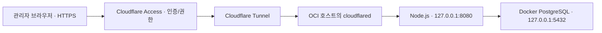

# Cloudflare Access + Tunnel 도입 검토안

작성·요금 확인일: 2026-10-16 (Asia/Seoul)

상태: **검토안, 미도입**. Cloudflare 계정·도메인·OCI 방화벽·앱 코드를 변경하지 않았다. 명령을 그대로 실행하는 설치 런북이 아니라 도입에 필요한 구성과 검증 항목을 기록한다.

전체 개편 현황: [프로젝트 개편 요약](../Report/2026-10-16-reorganization-summary.md).

## 1. 현재 접근 방식과 목표

현재는 SSH 터널을 연결한 후 `http://localhost:특정포트`로 관리 화면에 접근한다. 앱은 기본 `127.0.0.1:8080`에 바인딩하고 production에서는 비-loopback 바인딩을 거부한다. 앱 자체의 사용자 로그인 기능은 없다.

목표는 관리자가 SSH 터널 없이 HTTPS 도메인에서 로그인해 접속하되, **Node.js와 PostgreSQL의 포트는 인터넷에 직접 공개하지 않는 것**이다.

| 항목 | 현재 SSH 터널 | Access + Tunnel 제안 |
| --- | --- | --- |
| 접속 주소 | localhost의 전달 포트 | `https://rss.example.com` 같은 도메인 |
| 인증 | SSH 키/서버 계정 | 허용한 계정의 로그인과 Access 정책 |
| 접속 준비 | SSH 연결 필요 | 일반 브라우저 로그인 |
| 앱 포트 | 비공개 | 계속 비공개 |
| 외부 의존 | Cloudflare 불필요 | Cloudflare를 통해 접속 |

`rss.example.com`은 설명용 예시이며 실제 사용할 도메인이 아니다. 기존 SSH 방식도 적절한 접근 제어 방식이며, 이번 제안은 접속 편의성과 계정별 권한 관리 방식을 바꾸는 것이다.

## 2. 권장 연결 구조

- **Access:** 누가 관리 앱을 이용할 수 있는지 정책으로 검사한다. 허용 정책에 일치해야 접속할 수 있다. [Access 애플리케이션 안내](https://developers.cloudflare.com/cloudflare-one/access-controls/applications/http-apps/self-hosted-public-app/)
- **Tunnel:** OCI의 `cloudflared`가 Cloudflare로 외부 연결을 열고 내부 HTTP 서비스로 요청을 전달한다. 이 방식은 앱 웹 포트를 인바운드로 개방하지 않고 사용할 수 있다. [Tunnel 공식 안내](https://developers.cloudflare.com/cloudflare-one/networks/connectors/cloudflare-tunnel/)

Access와 Tunnel은 별도 역할이다. Tunnel 연결만 설정했다고 허용 계정 인증까지 적용되는 것은 아니다.

1차 운영 배치는 Node.js와 cloudflared를 같은 OCI 호스트에서 실행하고 PostgreSQL만 Docker Compose로 관리하는 방안을 권장한다. 이때 cloudflared의 upstream은 `http://127.0.0.1:8080`이다. 앱의 현재 loopback 제약과 맞는다.

이후 앱/터널도 Docker로 옮길 경우, 컨테이너마다 localhost가 별개라는 점을 반영해 네트워크 구성을 다시 정한다. 서로 다른 컨테이너에서 단순히 `127.0.0.1`을 지정하는 것으로 연결된다고 가정하지 않는다.

## 3. 비용과 도입 전 정할 값

2026-10-16에 확인한 공식 Access 안내:

| 플랜 | 안내 요금 | 대상 |
| --- | --- | --- |
| Free | US$0 | 50명 미만 소규모 팀 또는 개념 검증 |
| Pay-as-you-go | 사용자당 월 US$7, 연간 결제 기준 | 더 큰 팀/유료 기능 요구 |
| Contract | 별도 견적 | 기업 요구 |

본인 또는 소수 관리자만 사용하는 용도는 Free 플랜으로 시작할 수 있다. 도메인을 새로 구매하면 등록·갱신 비용은 별도다. 실제 신청 시 선택하는 플랜과 부가 기능 요금은 공식 화면에서 다시 확인한다. [공식 Access 요금 안내](https://www.cloudflare.com/en-gb/sase/products/access/)

아직 정하지 않은 값:

- Cloudflare 계정/Zero Trust 조직, 관리할 공개 도메인과 DNS 방식.
- 실제 접속을 허용할 관리자 계정 목록.
- 로그인 제공자와 해당 제공자의 MFA 적용 방식.
- 세션 유효시간과 계정 회수 절차.
- Tunnel의 실행 방식, 토큰 보관·교체 방식.
- Access 발급자와 애플리케이션 audience, 공개 HTTPS origin 설정.

## 4. Access 정책 제안

1. 관리 앱의 전체 hostname을 보호한다. HTML 화면뿐 아니라 `/api/*`, import/export, 로그 SSE, 정적 자산까지 같은 보호 범위에 둔다.
2. 명시한 관리자 계정만 Allow한다. 특정 로그인 제공자로 로그인했다는 이유만으로 그 제공자의 모든 사용자를 허용하지 않는다.
3. 기본 거부 정책을 유지하고, 인증 제공자가 지원하는 MFA를 적용한다. 이메일 일회용 코드만을 별도의 다중 인증과 동일하게 설명하지 않는다.
4. 공개 hostname에 인증 우회 정책을 만들지 않는다. 헬스체크 예외가 필요하면 노출 경로와 범위를 별도로 검토한다.
5. 비브라우저 자동화가 필요해지면 서비스 토큰 정책을 별도로 설계한다. 현재 제안은 관리자 브라우저 접속이 기본이다.

도입 시 Access 보호를 먼저 준비하고 Tunnel의 공개 hostname을 연결한다. 로그아웃 상태와 비허용 계정으로 모든 관리/API 경로가 차단되는지 확인한 후 사용한다.

## 5. 현재 코드에서 필요한 변경

### 5.1 Loopback 바인딩 유지

[config.ts](../../src/server/config.ts)는 production에서 loopback 이외의 HOST를 거부한다. 같은 호스트의 cloudflared를 사용하면 이 규칙을 유지할 수 있다. 공개 접속을 위해 앱을 `0.0.0.0`으로 바꾸는 것을 기본안으로 삼지 않는다.

### 5.2 공개 Host·Origin 설정

[admin-origin.ts](../../src/server/middleware/admin-origin.ts)는 localhost 기준으로 Host·Origin을 검증한다. 추가 allowedHosts 옵션은 있지만 [app.ts](../../src/server/app.ts)의 등록 호출은 현재 port만 전달한다.

따라서 공개 도메인을 설정으로 전달하고 허용 목록에 연결해야 한다. 외부 origin은 scheme·host·port를 포함한 정식 HTTPS origin으로 엄격하게 검증하는 방향을 권장한다. 프록시가 Host를 localhost로 바꾸는 것만으로는 브라우저의 외부 Origin 문제가 해결되지 않는다.

이 검증은 사용자 인증과 다르다. 현재 코드가 Origin/Referer 없는 비브라우저 요청을 허용한다는 사실도 인터넷 사용자 인증으로 해석하면 안 된다. Host/Origin 검증을 제거하거나 CORS를 전체 허용하는 것으로 Access 도입을 대신하지 않는다.

### 5.3 Access JWT 검증

앱에서 `Cf-Access-Jwt-Assertion`의 서명, 발급자, 애플리케이션 audience, 유효기간을 검증하는 middleware를 두는 방안을 권장한다. 토큰이 없거나 잘못되면 관리 기능 실행 전에 차단한다. Cloudflare의 공개 키는 적절히 캐시하고 교체를 처리한다. 단순 이메일/사용자 헤더가 있다는 사실만으로 인증하지 않는다. [Cloudflare JWT 검증 안내](https://developers.cloudflare.com/cloudflare-one/access-controls/applications/http-apps/authorization-cookie/validating-json/)

검증 범위는 HTML·API·SSE 경로를 함께 포함해야 한다. 헤더/토큰 원문을 로그에 남기지 않는다. 새로운 설정 이름과 환경 변수는 구현 시 확정하고 `default.env.example` 및 운영 문서에 함께 반영한다. 현재 해당 설정이 구현되어 있다고 가정하지 않는다.

### 5.4 프록시와 브라우저 동작

- 실제 클라이언트 IP를 쓰려면 신뢰할 프록시 범위를 명확히 한다. 임의 전달 헤더를 신뢰하거나 모든 프록시를 일괄 신뢰하지 않는다.
- 현재 rate limit이 프록시의 loopback IP 한 개로 모든 사용자를 합산하지 않는지 확인한다.
- htmx 요청 중 세션 만료/로그인 리다이렉트가 발생했을 때 로그인 HTML을 화면 fragment로 잘못 삽입하지 않도록 처리한다.
- `/api/logs/stream`의 SSE 연결·재연결·세션 만료 동작을 검증한다. 인증 갱신이 필요하면 사용자에게 재로그인을 안내한다.
- 기존 Handlebars·htmx·CodeMirror·SSE 구조와 번역 없는 미리보기 정책은 유지한다. 앱 자체의 회원가입 시스템은 이번 기본안에 추가하지 않는다.

## 6. OCI·Docker 운영 경계

- Node.js 8080과 PostgreSQL 5432는 OCI 외부 인바운드로 개방하지 않는다. 직접 origin 접속으로 Access를 우회할 경로를 두지 않는다.
- Tunnel용 outbound 통신을 허용한다. 이 구성의 웹 접속만을 위해 OCI에 인바운드 80/443을 열 필요는 없다.
- SSH는 서버 유지보수 경로로 별도 관리한다. SSH 운영 정책을 이번 웹 인증 변경과 혼동하지 않는다.
- 호스트 앱에서 Docker PostgreSQL로 연결할 경우 DB published port는 `127.0.0.1:5432`로 제한한다.
- Tunnel 토큰, DB 비밀번호, 모델 API 키와 실제 웹훅 URL은 저장소·일반 로그·공개 문서에 넣지 않는다.
- PostgreSQL 백업/복원과 major upgrade, Docker 데이터 볼륨 관리는 Access와 별도의 운영 책임이다.
- Access/Tunnel 장애 시 인증 없는 공개 경로로 자동 전환하지 않는다. OCI와 앱이 정상이고 별도의 네트워크 장애가 없다면 백그라운드 RSS 수집·발송은 웹 UI 접근과 독립적으로 계속할 수 있다.

## 7. 도입 순서와 완료 기준

1. 실제 도메인·관리자·로그인 제공자·세션 정책을 정한다.
2. 공개 origin, JWT 검증, 프록시 신뢰 범위, htmx/SSE 세션 처리의 코드/설정 변경안을 확정한다.
3. 보호 설계 문서의 접근 모델 변경을 파일·항목별로 검토하고 구현한다.
4. Access 애플리케이션과 Allow 정책을 준비하고 Tunnel을 연결한다.
5. 실제 외부 환경에서 아래 기준을 검증한다.

| 검증 | 완료 기준 |
| --- | --- |
| 로그인하지 않은 브라우저·HTTP 클라이언트 | 관리 화면과 API 실행 차단 |
| 허용되지 않은 계정 | 로그인 여부와 무관하게 접근 거부 |
| 허용 계정 | 화면·소스/그룹/템플릿 변경·import/export 정상 |
| JWT 없음·위조·만료·다른 audience | 관리 기능 실행 전 거부 |
| Host·Origin·프록시 헤더 위조 | 허용 목록/신뢰 경계 밖의 요청 거부 |
| SSE 및 htmx | 정상 사용·재연결·세션 만료 처리 확인 |
| OCI IP의 앱/DB 포트 직접 접속 | 외부에서 접속 불가 |
| 재부팅·터널 재시작 | 인증이 유지되는 정상 접속 경로 복구 |
| 백그라운드 워커 | 웹 UI 세션과 관계없이 기존 처리 정책 유지 |

현재 위 검증을 실제 Cloudflare/OCI에서 실행하지 않았다. 공개 DNS나 서버 설정을 변경한 상태도 아니다.

## 8. 대안과 설계 문서 관계

- Cloudflare에 의존하지 않고 인증 프록시를 운영하려면 Nginx/Caddy + [OAuth2 Proxy](https://oauth2-proxy.github.io/oauth2-proxy/) 같은 구성을 검토할 수 있다. 인증 제공자·TLS·프록시 운영 범위가 늘어난다.
- 공개 도메인이 필요 없고 허용한 기기에서만 접속하면 된다면 [Tailscale Serve](https://tailscale.com/docs/features/tailscale-serve)도 대안이다. Serve는 tailnet 내부 접근용이며 공개 인터넷 서비스와 구분한다.

현재 보호 스펙은 내부 단일 관리자·SSH/loopback 접근을 전제로 한다. 후속 구현 시 backend-spec의 config/접근 제어·middleware·프록시 계약과 frontend-spec의 로그인 리다이렉트/세션 동작 관련 항목을 검토해야 한다. 기존 [SSH 배포 가이드](DEPLOY.md)도 실제 도입 후 운영 방식에 맞게 갱신한다.

이 문서는 보호 스펙을 수정하거나 외부 공개를 실행하는 승인이 아니다. 이번 요청에 따라 검토 내용을 Markdown으로 기록했으며, 보호 설계 문서와 기존 배포 가이드는 변경하지 않았다.
