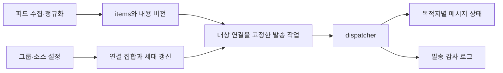

# 목적지별 발송 상태 개선 조사와 적용 제안

조사일: 2026-10-16 (Asia/Seoul)

## 1. 권고

**발송 대기·성공·실패를 RSS 항목 하나에서 판단하는 구조를, 항목 × 목적지 연결별 발송 작업으로 옮긴다.** 목적지 연결의 수명, 실제 발송한 메시지, 실행할 작업, 감사 로그를 구분해야 한다.

현재 Fastify·SQLite·Handlebars와 단일 프로세스 구조에서 구현할 수 있다. 별도 큐 서버나 프레임워크 변경은 필요하지 않다. 그룹이 웹훅 설정을 보유하는 D24 모델도 유지한다. 새 테이블은 설정을 대체하는 목적지 CRUD가 아니라 설정으로부터 파생한 연결 및 발송 이력이다.

이번 요청의 범위는 조사와 수정안 작성이다. 애플리케이션 코드·기존 테스트·마이그레이션·보호 설계 문서는 변경하지 않았다. 이전 진단 스크립트에 추가 재현만 넣었다.

## 2. 확인된 문제와 단순 수정의 한계

| 현재 동작 | 관련 코드 | 필요한 개선 |
| --- | --- | --- |
| delivered의 해시 변경을 항목 전체 pending으로 전환 | `scheduler/change-detect.ts:6`, `scheduler/poller.ts:243` | 변경을 받아야 하는 기존 목적지별 작업 생성 |
| 전송 직전에 현재 그룹 전체를 다시 선택 | `dispatcher/webhook.ts:111` | 작업 생성 시 대상 연결을 고정하고 실행 시 유효성만 재검증 |
| 재시도 시각·횟수·최종 실패가 item 하나에 저장 | `db/item.repository.ts:141`, `dispatcher/webhook.ts:332` | 목적지별 성공/실패와 재시도 분리 |
| 메시지 ID와 성공 판단을 정리 가능한 로그에서 조회 | `db/delivery-log.repository.ts:133`, `:152`, `workers/cleanup-worker.ts:21` | 영속 발송 상태와 감사 로그 분리 |
| 수정 대상 ID가 없거나 PATCH 404이면 자동 POST | `dispatcher/webhook.ts:229` | 기존 메시지 수정과 새 메시지 생성을 다른 작업으로 표현 |
| 과거 같은 해시의 성공을 현재 반영 완료로 간주 | `db/delivery-log.repository.ts:133` | 마지막 반영 버전과 현재 관측 버전 비교 |
| 일반 설정 서비스와 import의 갱신 경로가 다름 | `services/export-import.service.ts:134` | 공통 연결 갱신 규칙을 모든 변경 경로에 적용 |

다음 방식만으로는 충분하지 않다.

- 소스의 `deliveryCutoffAt`만 변경: 기존 항목 변경과 기존 pending에는 cutoff 검사가 적용되지 않는다.
- 그룹의 `updatedAt`과 게시 시각 비교: 이름·아바타 변경도 updatedAt을 바꾸며, 날짜 없는 피드와 재연결 세대를 구분할 수 없다.
- 이미 성공한 로그가 있는 목적지에만 전송: 아직 최초 발송 전인 정상 신규 항목을 처리할 수 없고, 로그 정리 후 판정 근거가 사라진다.
- 목적지별 상태 테이블만 추가하고 실행 때 현재 그룹으로 재확장: 기존 대기열의 새 목적지 유입이 그대로 남는다.

## 3. 권장 동작 계약

| 상황 | 권장 동작 |
| --- | --- |
| 새 RSS 소스 첫 수집 | 현재 계약대로 historical 저장, 전송 없음 |
| 새 웹훅/스레드 연결 | 그 연결의 baseline을 별도로 확립하고 과거 항목 작업은 만들지 않음 |
| A→B 교체 | A의 미실행 작업 취소. B에 과거 작업을 복제하거나 이전하지 않음 |
| A 유지+B 추가 | A의 기존 작업은 유지. B에는 과거 항목의 수정/추가알림 작업을 만들지 않음 |
| 기존 글 변경 | 최초 발송 대상이었던 연결 중 현재도 유효한 연결에만 갱신 작업 생성 |
| A 일부 성공, B 일시 실패 | B의 원래 작업만 재시도. 새로 연결된 C는 포함하지 않음 |
| 연결 해제 후 같은 URL 재연결 | 새 연결 세대로 취급. 해제 전 대기열 자동 부활 없음 |
| 수정할 메시지 ID 미상 또는 PATCH 404 | 수정 불가 상태를 기록. 자동 새 POST 없음 |
| 로그 보존기간 만료 | 메시지 ID·최종 반영 버전·발송 완료 여부 유지 |
| 수동 실패 재시도 | 기존의 실패 작업만 동일 목적지·동일 작업 종류로 재실행 |
| 소스 비활성화/재활성화 | 일시 정지한 기존 유효 연결의 작업만 재개. 목적지 재확장 없음 |

### 신규 연결의 baseline

안전한 기본안은 **신규 연결의 첫 성공적인 피드 스냅샷을 묵음 baseline으로 삼는 것**이다. 소스 최초 등록의 규칙을 연결에도 적용한다. 아직 DB에 없는 날짜 없는 과거 항목까지 첫 스냅샷에 포함되면 그 연결에는 보내지 않는다. 다른 기존 연결의 정상 처리는 유지한다.

구현은 baseline 처리 완료 트랜잭션의 `MAX(items.id)`를 해당 소스 연결의 관측 경계로 기록할 수 있다. item ID는 기존 AUTOINCREMENT를 사용한다. 이후 처음 저장된 항목 중 경계 이후인 항목에만 최초 발송 작업을 만든다. 날짜가 있는 항목에는 기존 소스 cutoff와 연결 시작 시각을 추가로 적용해 뒤늦게 나타난 과거 글도 거른다.

- 초기화 전 연결이 있으면 해당 소스 요청의 조건부 GET을 한 번 생략해 본문 스냅샷을 확보한다. 본문 없는 304나 파싱 실패만으로 초기화하지 않는다.
- 유효한 빈 피드는 빈 baseline으로 초기화할 수 있다.
- 이미 관측한 item이 나중에 바뀌어도 새 연결의 최초 발송 작업을 만들지 않는다.
- 이 기본안은 연결 직후 첫 수집까지 발생한 진짜 새 글도 묵음으로 처리할 수 있다. 연결 후 곧바로 baseline poll을 예약하고 UI에 첫 수집의 의미를 안내한다. 첫 수집부터 날짜가 새 글을 보내는 대안은 가능하지만 날짜 없는 과거 글을 확실히 구분할 수 없다.
- baseline 이후에 처음 나타나는 날짜 없는 항목은 최초 관측을 신규의 기준으로 삼는다. 실제로는 오래된 글이 뒤늦게 피드에 추가된 경우까지 구분할 수는 없다. 피드가 제공하지 않는 게시 시각이나 이력을 복원한다고 보장하지 않는다.

이 baseline 확대는 현재 설계에 없는 정책 제안이다. 실제 구현 전에 보호 스펙에 동작과 위 절충점을 명시해야 한다.

## 4. 저장 모델

권장 모델은 파생 연결 1개와 발송 상태/작업 2개 테이블이다. 명칭은 예시이며 실제 구현 시 확정한다.

| 데이터 | 주요 필드와 책임 |
| --- | --- |
| 기존 `items` | `(source_id, atom_id)`와 정규화 내용·historical 여부. `content_revision` 추가, 해시 변경 때마다 증가 |
| 신규 `delivery_bindings` | `id`, `source_id`, `destination_key`, `created_at`, `closed_at`, `baseline_item_id`. id가 불변 연결 세대 식별자 |
| 신규 `item_deliveries` | `(item_id, binding_id)` UNIQUE, 최초 발송 여부·시각, 마지막 반영 revision/hash, Discord message/channel ID, 메시지 존재 상태 |
| 신규 `delivery_jobs` | 발송 상태 FK, 작업 종류, 대상 revision·렌더 입력 snapshot, 상태, 목적지별 재시도 횟수/시각, 실행 식별자 |
| 기존 `delivery_log` | job/연결/항목/버전별 시도 이력. 삭제해도 실행 판단과 메시지 ID는 유지 |

`items.delivery_status` 등 기존 컬럼은 전환 중 호환용 요약으로 유지할 수 있다. **발송 작업 생성이나 재시도의 권위로 다시 사용하지 않는다.** 성공 여부와 실패 복구는 개별 job·item_delivery에서 판단한다. UI에 부분 성공이 필요하면 목적지별 결과에서 집계한다.

### 연결 수명과 중복 그룹

- 활성 연결은 `(source_id, destination_key)`당 1개만 허용하는 부분 UNIQUE 인덱스를 둔다.
- 동일 목적지를 가리키는 그룹을 추가하거나 그중 하나만 제거한 경우 실제 목적지 집합이 같다면 세대를 바꾸지 않는다. 이름·아바타만 바뀌어도 새 연결이 아니다.
- URL 또는 실제 지정 threadId가 바뀌거나, 대상이 완전히 사라졌다가 다시 생기면 새 binding ID를 발급한다. A→B→A에서도 이전 A의 job을 되살리지 않는다.
- 현재 `source_groups.setGroups()`는 전체 삭제/재삽입이다. 이 행의 생성 순서를 연결 수명으로 삼지 말고 **변경 전후의 해석된 목적지 집합**을 비교한다.
- 기존 `destination_key` 형식은 로그 이관을 위해 유지하되, 세대 구분은 binding ID로 한다. 그룹 ID만으로 작업을 추적하면 같은 그룹의 URL 교체 때 오발송이 재발한다.
- 웹훅 원문 URL/토큰을 jobs·logs에 복제하지 않는다. 발송 전 현재 그룹 설정에서 URL을 찾아 작업에 고정된 목적지 fingerprint와 일치하는지 검사한다. 불일치하면 취소하고 새 URL로 대체하지 않는다.

### 작업 종류와 고유성

1차 범위에서는 기존 `editInPlace` OFF의 의미를 조용히 바꾸지 않는다. 다음을 내부 작업 종류로 분리할 수 있다.

- `initial_post`: 해당 item을 해당 연결에 최초 발송. 신규 판정을 통과할 때만 생성.
- `edit`: 기존에 발송한 메시지 수정. message ID가 확인된 경우만 PATCH.
- `update_post`: 현재 OFF 옵션의 변경 내용 추가 알림. 이미 최초 발송했던 동일 연결에만 새 POST를 허용.

`initial_post`는 `(item_delivery_id)`당 한 논리 작업만 허용한다. `edit`/`update_post`는 `(item_delivery_id, operation, content_revision)`를 고유하게 만든다. 초기 작업을 재시도할 때 새 작업을 계속 만들지 않는다. 초기 작업의 고유성 근거는 item 생존 동안 유지한다. 완료 job 정리를 추가할 때도 영속 상태에 최초 생성 여부를 남겨야 한다.

`editInPlace=false`를 신규 전용으로 바꾸거나 `new_only` 옵션을 추가하는 일은 별도 UX/이관 정책이다. 핵심 오류 수정의 선행 조건으로 삼지 않는다. 명시적 과거 재전송 UI도 1차 범위에서 추가하지 않는다.

## 5. 처리 흐름과 트랜잭션

### Poller / 작업 계획

fetch·Stage 1/2는 현재 분리를 유지한다. 수집 후 트랜잭션에서 item 변경, revision 증가, 연결별 최초 발송/갱신 작업, fetch_log를 함께 저장한다. 실행 대상은 이때 확정한다. historical 항목에는 자동 initial_post를 만들지 않는다. 일부 목적지 실패로 item 전체가 failed였다는 이유로 다른 성공 목적지의 정상 갱신까지 막지 않는다.

내용이 H1→H2→H1로 돌아오면 revision은 1→2→3으로 증가한다. 해시는 내용 동일성 검사용이고, 작업의 완료 기준은 **그 목적지에 마지막으로 반영한 revision**이다. 과거 H1 성공 로그를 보고 revision 3을 완료 처리하지 않는다.

발송 전 내용이 다시 바뀌면 미실행 수정 작업은 최신 버전으로 합칠 수 있다. 최초 POST 전인 item은 initial_post를 복제하지 않고 미실행 작업의 snapshot만 갱신한다. 이미 실행 중이면 같은 item_delivery의 작업을 순차 실행하고 완료 후 최신 버전을 별도 반영한다.

### Dispatcher

1. item due가 아닌 job due를 조회하고 job을 claim한다. 동일 item_delivery의 작업은 직렬 실행한다.
2. 소스 활성화·연결 종료 여부·현재 URL/thread fingerprint 일치를 확인한다.
3. 고정된 revision의 렌더 입력으로 번역·렌더한다. 결과 payload를 작업에 보관하여 재시도에 재사용한다. 같은 revision의 여러 대상은 공통 번역/기본 렌더를 공유한다.
4. 번역 등 await 이후 실제 HTTP 요청 직전에 연결을 다시 확인한다. 취소된 연결이면 POST/PATCH하지 않는다.
5. 목적지 한 곳의 응답 직후 그 job 결과·item_delivery 상태·로그를 같은 짧은 DB 트랜잭션에 기록한다. 모든 목적지 HTTP가 끝날 때까지 성공 기록을 미루지 않는다.
6. 완료 갱신은 job ID·실행 식별자·계획 revision에 조건을 건다. 옛 버전의 응답이 최신 버전을 완료로 덮어쓰지 않는다.

번역 중 item의 revision이 바뀔 수 있으므로 현재 `saveTranslation(item.id, ...)`에도 버전 조건이 필요하다. 옛 번역을 최신 item 캐시에 덮어쓰지 않고 그 job의 snapshot 결과로 보관한다. 번역 실패 정책 전체 변경은 이번 핵심 수정과 분리할 수 있다.

네트워크 I/O는 DB 트랜잭션 밖에 둔다. SQLite 트랜잭션은 DB 안의 변경을 묶을 수 있지만 Discord 요청을 함께 원자적으로 만들지는 않는다. [SQLite 트랜잭션 문서](https://www.sqlite.org/lang_transaction.html)를 기준으로, 외부 HTTP와 DB 간 원자성 한계는 별도로 다룬다.

이미 HTTP 요청을 보낸 순간 연결이 해제되는 경우 그 요청을 소급 취소한다고 보장할 수 없다. 응답은 원래 binding에 기록하고 새 binding의 상태로 옮기지 않는다.

## 6. Discord 메시지·스레드 처리

- 최초 발송부터 `wait=true`로 응답 메시지를 받아 message ID를 영속 상태에 저장한다. 수정 옵션을 켰을 때만 ID를 수집하는 현재 제한을 없앤다. [Discord Execute Webhook](https://docs.discord.com/developers/resources/webhook#execute-webhook)
- 응답의 `id`와 `channel_id`를 함께 보관한다. 포럼에 새 스레드를 만든 경우 수정 요청에 사용할 실제 스레드/채널 ID를 검증해 저장한다. 기존 지정 threadId와 새로 생성된 thread ID를 구분한다. [Discord Message Object](https://docs.discord.com/developers/resources/message#message-object)
- 수정은 기존 webhook/token의 기존 message에 수행한다. 새 웹훅에 옛 message ID를 그대로 이관하지 않는다. PATCH 404는 `message_missing`으로 처리하고 자동 POST하지 않는다. [Discord Edit Webhook Message](https://docs.discord.com/developers/resources/webhook#edit-webhook-message)
- `thread_name`·`applied_tags` 같은 생성 전용 옵션은 PATCH에서 제외하고 endpoint별 payload를 구분한다. 멘션 제어는 수정 요청에서도 명시한다.

응답이 유실되거나 발송 성공 후 DB 커밋에 실패하면 최초 POST의 결과를 모를 수 있다. 이 경우 자동 재POST를 반복하면 중복될 수 있다. 중복 방지를 우선하는 기본안은 `unknown`으로 분리해 자동 POST 재시도를 멈추고 운영자가 확인하게 하는 것이다. 명확한 429 거부 등과 성공 여부가 불명확한 timeout/연결 종료를 같은 결과로 취급하지 않는다. 5xx도 최초 POST의 미발송을 확정할 수 없다면 unknown으로 분류하며, 현재 모든 5xx에 적용하는 자동 재POST 정책과 구분한다.

이 정책은 중복 대신 확인이 필요한 미확정 작업을 만들 수 있다. 현재 시스템만으로 정확히 한 번 발송을 보장한다고 설명해서는 안 된다. 프로세스 재시작 시 실행 중이던 initial_post도 이 규칙으로 복구한다. 이미 알려진 message ID로 같은 snapshot을 PATCH하는 재시도는 별도로 처리한다.

## 7. 수정할 코드 경계

| 위치 | 변경 책임 |
| --- | --- |
| `domain/delivery/` 신규 | 최초 발송·기존 갱신의 순수 대상 판정, 버전/상태 전이 |
| `services/delivery-binding.service.ts` 신규 | 설정 변경 전후 목적지 집합 비교, 연결 종료·신규 baseline·대기 작업 취소 |
| `services/source.service.ts` | 그룹/threadId/feedUrl 변경과 바인딩 갱신을 하나의 DB 트랜잭션으로 처리. retry-failed는 기존 실패 job만 선택 |
| `services/group.service.ts` | URL 변경/해제/그룹 삭제가 영향을 주는 모든 소스 연결을 같은 규칙으로 갱신 |
| `services/export-import.service.ts` | import overwrite에서도 공통 연결 갱신 적용. 일반 서비스의 HTTP 검증을 트랜잭션 안에서 다시 호출하지 않고 순수 계획/동기 적용 로직 공유 |
| `db/delivery-binding.repository.ts` 신규 | 활성 연결·baseline·수명 저장 |
| `db/item-delivery.repository.ts` 신규 | message/thread ID와 마지막 반영 버전의 영속 저장 |
| `db/delivery-job.repository.ts` 신규 | 목적지별 due·claim·완료·취소·재시도 |
| `scheduler/poller.ts`, `scheduler/change-detect.ts` | item 전체 requeue를 대상별 job 계획으로 변경 |
| `dispatcher/webhook.ts` | job 실행·결과 기록. 현재 목적지 전체 fan-out 제거 |
| `dispatcher/discord-client.ts` 신규 | POST/PATCH, ID 응답 파싱·실패 분류를 분리 |
| `runtime/container.ts` | 새 repository/service 연결. 필요한 작은 인터페이스를 주입 |
| `workers/cleanup-worker.ts` | 감사 로그만 보존기간에 따라 정리. 발송 정체성은 삭제하지 않음 |
| `contracts/api.ts`, 직렬화/로그·화면 | 실패 재시도 결과와 필요 시 목적지별 결과/미확정 사유 표시 |

단일 프로세스를 유지하면서 기존 tick에서 job dispatcher를 호출할 수 있다. poll과 delivery 타이머 분리·다중 프로세스 lease·대규모 폴더 이동은 1차 수정의 필수 항목이 아니다. 현재 in-memory 가드와 영속 job 상태로 단일 실행을 제어하고 재시작 시 running을 안전하게 복구한다.

`retry-failed` 기존 응답의 건수 의미도 유지해야 한다. 기존 UI가 항목 수를 기대한다면 내부적으로 job을 재시도하더라도 서로 다른 item 수를 반환하고, 목적지 작업 수는 별도 필드/안내로 추가한다. 실패한 edit를 initial_post로 바꾸거나 해제된 연결을 다시 활성화하지 않는다.

## 8. 기존 데이터 이관

현재 최신 마이그레이션은 `0020_scrub_source_webhook_url.sql`이다. 실제 구현 시 번호를 다시 확인하고 `0021_...` 이후 새 파일로 테이블/컬럼/인덱스를 추가한다. 기존 마이그레이션은 수정하지 않는다.

권장 기본 이관은 다음과 같다.

1. 앱을 정지하고 DB 및 WAL 상태가 일관된 백업을 만든 후 이관한다. 마이그레이션 자체에서 Discord 발송을 하지 않는다.
2. existing historical과 이미 완료된 항목은 새 initial_post 대상으로 만들지 않는다. 현재 설정을 모든 과거 item과 곱해서 작업을 생성하지 않는다.
3. 남은 성공 로그에서 목적지 키·message ID·마지막 버전을 복원할 수 있는 정보만 옮긴다. 삭제된 로그/ID는 추측하지 않는다.
4. 예전 스키마에는 연결 세대와 최초 계획 대상이 없으므로, URL 해시가 같다는 사실만으로 현재 연결과 과거 연결의 연속성을 확정할 수 없다. 출처가 불명확한 상태는 legacy로 보존하고 자동 새 POST를 금지한다.
5. 특히 기존 pending/failed를 **현재 그룹 전체로** 자동 변환하지 않는다. 원래 목적지가 증명되지 않는 작업은 `legacy_unknown`으로 분리하고 검토 대상으로 남긴다.
6. 새 활성 연결은 baseline부터 시작한다. 기존 메시지의 상태 갱신을 이어갈 필요가 있다면 확인 가능한 기존 목적지/메시지의 연결 채택을 별도 명시적 이관 작업으로 처리한다.

이 기본안은 과거 진행 중인 장애 메시지의 자동 갱신이나 기존 대기 발송을 일부 멈출 수 있다. 오발송 방지와 진행 중 작업 보존의 절충이므로, 이관 전 대상별 건수와 미확정 목록을 제시해야 한다. 이번 로컬 DB가 비어 있다는 사실은 운영 데이터 이관이 불필요하다는 근거가 아니다.

## 9. 필요한 회귀 테스트

| 테스트 | 통과 기준 |
| --- | --- |
| 새 소스 첫 수집 | 전체 historical, POST 0 |
| A→B 교체 후 과거 글 변경 | B POST 0 |
| A 유지+B 추가 후 과거 글 변경 | A에 설정에 맞는 갱신, B POST 0 |
| 신규 연결 baseline 후 신규 글 | 해당 활성 연결에 initial_post 정확히 1개 |
| 기존 pending/부분 성공 중 연결 변경 | 새 연결로 작업 복제 0, 원래 실패 대상만 재시도 |
| 같은 웹훅 다른 threadId로 변경 | 새 binding 생성, 이전 스레드의 과거 작업 이전 0 |
| A→B→A 및 동일 목적지 중복 그룹 | 해제 전 큐 부활 0, 동일 활성 목적지 중복 발송 0 |
| 로그 보존기간 정리 후 글 변경 | 영속 ID로 PATCH, 로그 삭제를 이유로 신규 POST 0 |
| 내용 H1→H2→H1 | 반영 revision 1→2→3, 마지막 H1 수정 누락 0 |
| 메시지 ID 미상·PATCH 404 | 자동 POST 0, 수정 불가 사유 기록 |
| 한 목적지 성공·다른 목적지 최종 실패 | 성공 목적지의 새 내용 갱신 가능, 실패 대상의 재시도 독립 |
| 번역/HTTP 중 내용·연결 변경 | 옛 응답이 최신 revision/새 binding 상태를 완료로 덮지 않음 |
| import overwrite·그룹 삭제·webhook 해제 | 일반 편집과 같은 연결 취소/baseline 규칙 |
| 비활성화·재활성화·수동 실패 재시도 | 기존 유효 job만 재개, 새 대상/새 initial_post 생성 0 |
| 최초 POST 결과 불명·완료 직전 재시작 | unknown 상태, 무조건 재POST하지 않음 |
| 구버전 DB 이관 | historical/완료 건 재큐 0, 원래 대상 미상 pending 격리 |

기존 테스트 중 전체 항목 재큐, 옵션 OFF면 message ID 미수집, PATCH 404 자동 POST를 정상으로 기대하는 부분은 새 계약에 맞춰 바꿔야 한다. 기존 테스트를 그대로 통과하는 것만으로 수정 완료를 판단할 수 없다.

## 10. 적용 순서와 완료 조건

1. 아래 보호 스펙 항목의 동작 계약과 baseline·기존 데이터 처리 방침을 확정한다.
2. 새 DB 구조와 보수적 이관을 구현하고 마이그레이션 통합 테스트를 추가한다.
3. source/group/import의 연결 갱신과 poller의 대상별 job 계획을 구현한다.
4. dispatcher를 job 기준으로 전환하고 message ID 영속 저장·404/unknown 정책을 적용한다. **작업 계획과 실행을 함께 전환하기 전에는 기존 발송 경로와 혼합 배포하지 않는다.**
5. 실패 재시도·로그·필요한 UI 안내를 맞추고 전체 검증 후 운영 DB 사본으로 이관 결과를 검토한다.

완료 조건은 새 목적지 과거 POST 0, 신규 item 정상 발송, 기존 목적지 갱신 유지, 목적지별 실패 격리, 로그 삭제 후 상태 유지, 운영 데이터 이관의 소급 발송 0이다.

긴급 완화가 먼저 필요하면 새 웹훅에 대한 과거 갱신 POST를 차단하고 기존 큐를 검토하는 제한을 둘 수 있다. 이는 기존 pending 대상 복원·미확정 발송·영속 상태까지 해결한 최종 수정으로 취급하지 않는다.

## 11. 보호 설계 문서 변경안

편집하지 않은 제안 항목:

- `Docs/Architecture/backend-spec.md` §4.2: item 상태와 목적지별 발송 상태·작업·감사 로그의 역할, 새 repository 및 migration/backfill 계약.
- 같은 파일 §4.4 #6~8: 연결 baseline, 신규 작업과 기존 갱신 작업 분리, 항목 전체 requeue 제거.
- 같은 파일 §4.6: 작업 대상 고정, 원래 목적지 갱신 제한, 목적지별 재시도, 영속 message/thread ID, PATCH 404와 미확정 POST 처리.
- 같은 파일 §4.7: 번역 결과 저장의 item revision 조건과 작업 snapshot 재사용.
- 같은 파일 §4.9·§4.11 및 API 계약: 그룹/소스/import의 연결 변경, 기존 실패 작업만 재시도, D24 설정 소유권 유지.
- `Docs/Architecture/frontend-spec.md` §4.3·§4.4: 첫 연결 baseline 안내, 기존 수정 토글의 실제 동작, 실패 재시도·미확정/수정 불가 표시.

AGENTS.md는 “보호 문서는 파일·항목 단위의 명시 승인이 있을 때만 수정”하도록 정한다. 위 목록은 후속 구현에 필요한 검토안이며, 이 조사에서는 보호 문서를 변경하지 않았다.

## 12. 이번 검증

이전 진단 `2026-10-16-webhook-history-repro.mjs`를 현재 source 기반 메모리 SQLite·모의 POST/PATCH로 실행했다. 기존 6개와 아래 추가 3개, 총 9개 시나리오의 assertion이 통과했다.

| 추가 확인 | 실제 결과 |
| --- | --- |
| A 성공 로그 삭제 후 내용 변경, editInPlace ON | 기존 A에 새 POST 3회, PATCH 0회 |
| 내용 H1→H2로 수정 성공 후 H1로 복귀 | 필요한 PATCH 3회가 모두 생략됨 |
| 재연결 후 첫 스냅샷에 처음 보는 날짜 없는 항목 3개 포함 | B에 POST 3회. 게시 시각만으로 과거 여부를 판별할 수 없음 |

추가 재현은 위 설계 필요성을 확인한 것이다. 제안한 새 모델의 구현/검증은 아직 수행하지 않았다. 애플리케이션 코드 변경이 없으므로 앞선 서버·테스트 타입검사 결과를 사용하며, 새 타입검사 통과를 주장하지 않는다. 현재 Windows의 better-sqlite3/rolldown 네이티브 의존성 문제로 기존 Vitest 실행이 막혀 있으므로 구현 단계에서 실행 환경을 정비하고 실제 better-sqlite3 기반 통합 테스트를 수행해야 한다. 메모리 어댑터 검증을 전체 테스트 통과로 대신하지 않는다.

외부 RSS·Discord 발송이나 운영 서버 재시작은 하지 않았다. Discord/SQLite 공식 문서는 API 응답·수정·트랜잭션 특성을 확인하는 데 사용했으며, 연결 baseline/작업 모델/미확정 상태 정책은 이 프로젝트에 대한 설계 제안이다.
