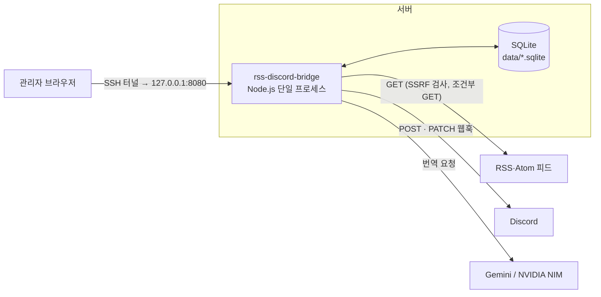
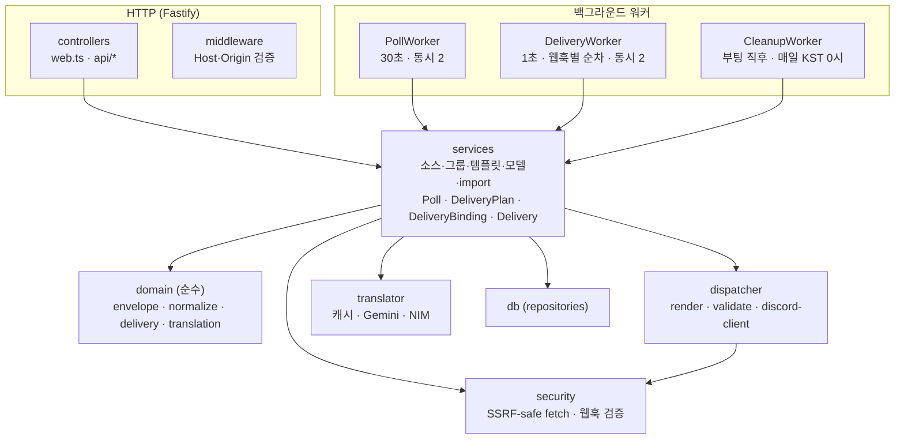
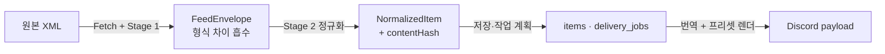
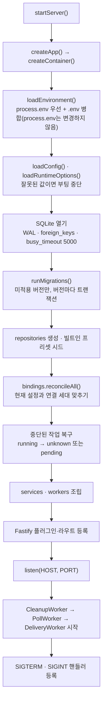
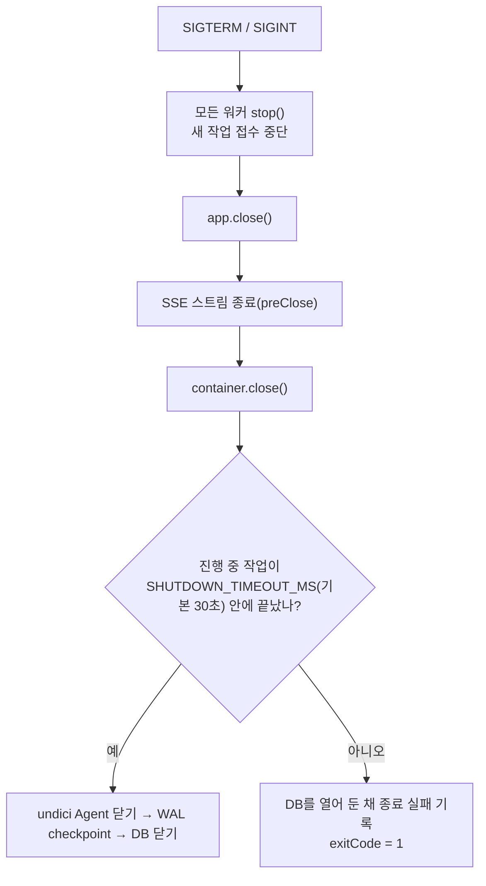
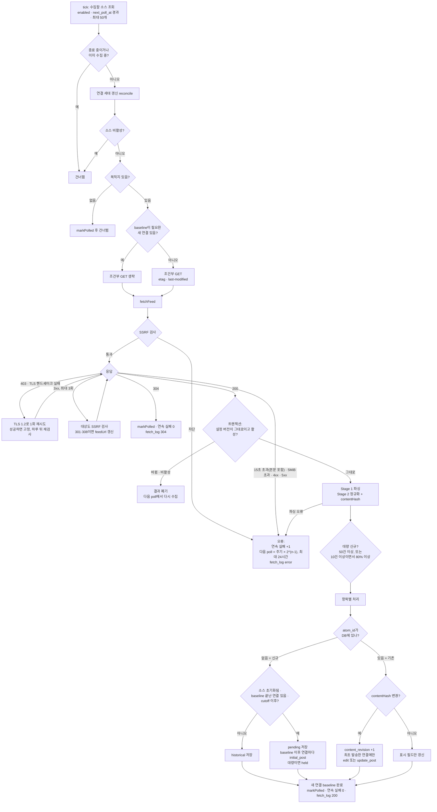
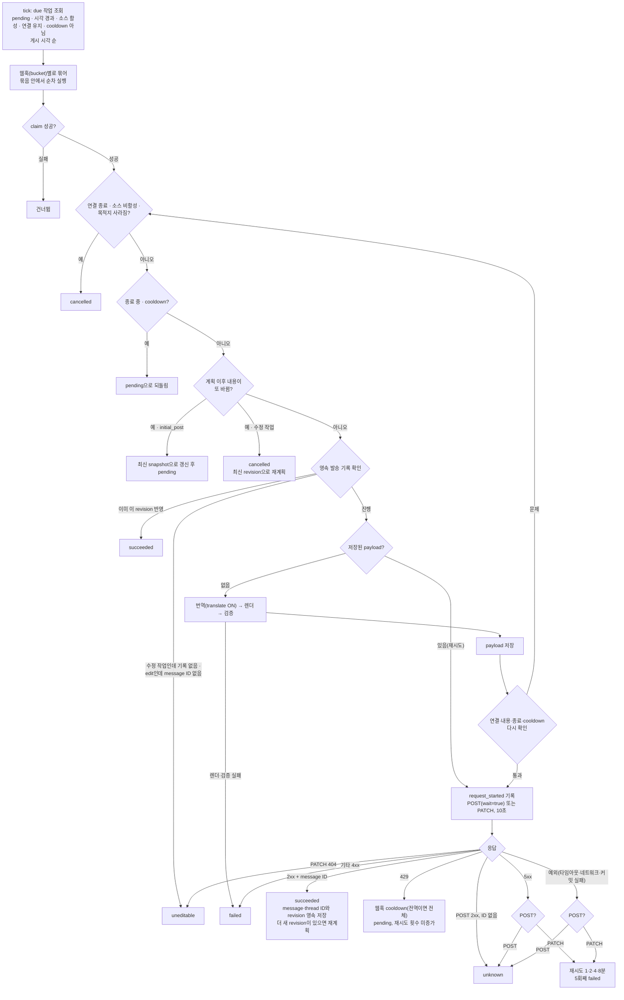
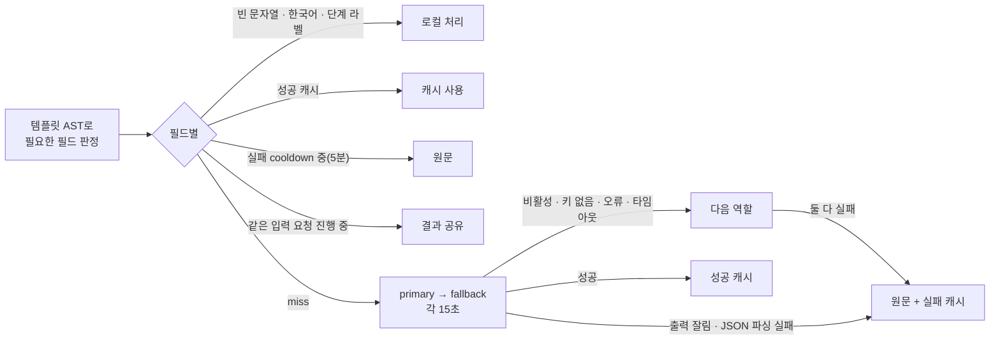
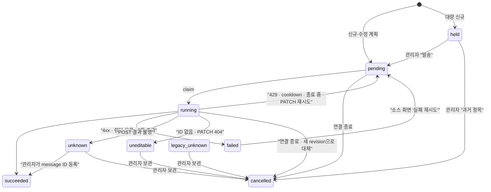
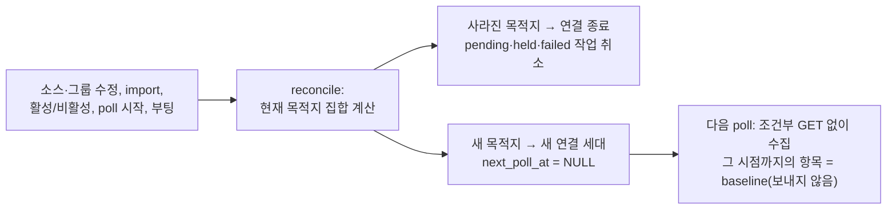

# 아키텍처

> 검증 커밋 `6e53b7f` · 작성 2026-10-16 · 현재 동작만 적는다. 테이블과 상태 값의 정의는 [db-schema.md](db-schema.md), 결정 배경은 [decisions.md](decisions.md)에 있다.

## 1. 무엇을 하는가

RSS 2.0·Atom 피드를 주기적으로 수집해 Discord 웹훅으로 보내는 셀프호스트 브리지다. 특히 status page(장애 공지) 피드를 안정적으로 중계하는 것이 목적이며, **소스를 등록하거나 웹훅을 바꾼 뒤 과거 항목이 다시 전송되는 문제를 구조적으로 막는다.**

관리자는 한 명이고, 관리 화면은 loopback(`127.0.0.1`)에만 열린다. 외부에서는 SSH 터널로 접속한다.



- 들어오는 요청: 관리 화면(Handlebars + htmx)과 JSON API, 로그 SSE. Host·Origin 검증과 rate limit(분당 120회)을 적용한다.
- 나가는 요청: 피드·웹훅 URL 모두 SSRF 검사를 거친다. 웹훅은 Discord 도메인만 허용한다.
- 비밀값: 번역 API 키는 환경 변수에만 있다. 웹훅 URL은 DB의 `groups.webhook_url`에만 있다.

## 2. 프로세스 구성과 디렉터리



의존 방향은 위에서 아래로만 흐른다. `domain/`은 I/O가 없는 순수 함수만 두고, 다른 계층을 import하지 않는다. 서비스는 런타임 컨테이너 전체가 아니라 필요한 repository만 받는다.

| 경로 | 책임 | 의존해도 되는 것 |
| --- | --- | --- |
| `src/server/main.ts` | 부팅, listen, 워커 시작, 시그널 처리 | app |
| `src/server/app.ts` | Fastify 구성: 파서·오류 처리·미들웨어·rate limit·뷰·라우트 등록, `/healthz`·`/ready` | runtime, controllers |
| `src/server/config.ts` | HOST·PORT·DB 경로 검증 | runtime/environment |
| `runtime/` | 환경 병합(`environment`), 실행 제한값(`options`), DI 조립(`container`), 마이그레이션(`migrator`, `delivery-backfill`), 종료 대기(`lifecycle`) | 전부 |
| `controllers/` | HTTP 어댑터. `web.ts`는 페이지, `api/*`는 JSON·htmx·SSE. 입력을 서비스에 넘기고 결과를 렌더 | services, contracts |
| `middleware/` | 들어오는 요청의 Host·Origin 검증 | — |
| `contracts/` | 프런트·백엔드 계약 타입: API DTO, view-model, 프리셋 render context | — |
| `services/` | 유스케이스. 관리 기능과 수집·발송 오케스트레이션 | domain, db, dispatcher, translator, security |
| `domain/` | **순수 함수**만. `envelope`(Stage 1), `normalize`(Stage 2·프로필), `delivery`(cutoff·보류·순서·재시도 간격), `translation`(필드 판정·캐시 키·로컬 처리), `text` | 없음 |
| `dispatcher/` | 프리셋 렌더, payload 검증, 웹훅 옵션 적용, 목적지 해석, Discord HTTP(`discord-client`), 빌트인 프리셋 시드 | security, contracts |
| `translator/` | 번역 캐시·single-flight(`translation-cache.service`), provider 순회·타임아웃(`translator`), 프롬프트, 키 해석, Gemini·NIM 어댑터 | domain, db |
| `security/` | 나가는 요청 보안: SSRF-safe fetch(크기·시간 제한, TLS 재시도, 리다이렉트), IP 검사, Agent 캐시, 웹훅 URL 검증 | — |
| `db/` | repository. SQL과 행 ↔ 레코드 매핑만, 비즈니스 규칙 없음 | — |
| `workers/` | 주기 실행과 동시성·진행 중 작업 추적(`TaskTracker`). 실제 일은 서비스에 위임 | services |
| `scheduler/` | 이전 경로 호환용 재수출 | — |
| `src/resources/migrations/` | 순번 SQL 마이그레이션 | |
| `src/resources/templates/` | 관리 화면 Handlebars(`layouts`·`pages`·`partials`)와 정적 자산(htmx, CodeMirror, app.js·css) | |
| `src/resources/presets/` | Discord 프리셋 4종 `.hbs` | |
| `Archive/` | 교체된 이전 구현과 테스트 보관본. 빌드·테스트 대상 아님 | |

## 3. 데이터 변환과 핵심 불변식



- **Stage 1 (envelope)**: RSS·Atom의 구조 차이를 흡수해 같은 모양의 DTO를 만든다. 본문 HTML은 해석하지 않고 그대로 운반한다.
- **Stage 2 (normalize)**: 본문을 정제하고 `contentHash`를 계산한다. 같은 입력이면 항상 같은 결과를 내는 순수 함수다. 프로필(`generic`·`incident-io`·`atlassian-statuspage`)에 따라 정제 방식이 다르다.
- **인코딩 처리는 계층별로 나눈다**: charset 디코드는 fetch, 엔티티 디코드는 Stage 1, 태그 제거는 Stage 2.

| 불변식 | 지키는 곳 |
| --- | --- |
| **형식과 내용의 분리**: Stage 1은 형식, Stage 2는 내용 | `domain/envelope`, `domain/normalize` |
| **식별 ≠ 변경**: 식별은 `(source_id, atom_id)`, 변경은 `content_hash`·`content_revision` | `items` UNIQUE, PollService |
| **결정적 정규화**: 같은 입력 → 같은 해시. incident 해시는 최신 segment만 | `domain/normalize` |
| **첫 수집은 보내지 않는다**: 소스의 첫 성공 수집은 모두 historical | `domain/delivery/cutoff.ts` |
| **새 연결은 과거 항목을 받지 않는다**: 연결 세대마다 baseline | `delivery_bindings`, DeliveryPlanService |
| **수정은 원래 보낸 연결에만** | `item_deliveries`, DeliveryPlanService |
| **결과가 불명확한 POST는 자동으로 다시 보내지 않는다** | DeliveryService, `recoverInterrupted` |

연결 세대와 발송 상태의 자세한 정의는 [db-schema.md](db-schema.md) §4~§5에 있다.

## 4. 런타임: 부팅 · 워커 · 종료

| 명령 | 실행 |
| --- | --- |
| `npm run dev` | `tsx watch src/server/main.ts` |
| `npm start` | `node dist/server/main.js` |
| `npm run build` | `dist` 정리 → `tsc` → 리소스 복사(migrations·config·templates·presets). 번들러는 쓰지 않는다. 로컬 import는 `.js` 확장자, 리소스 경로는 `import.meta.url` 기준 |

`main.ts`의 `startServer()`가 앱을 만들고, listen에 성공한 뒤에 워커를 시작한다. `app.ts`는 HTTP 구성만 담당한다.

### 부팅 순서



- 같은 환경 병합 결과를 설정·번역기·모델 상태 서비스가 함께 쓴다. 그래서 `.env`에만 있는 API 키도 번역에 쓰인다.
- production(`NODE_ENV=production`)에서 HOST가 loopback이 아니면 부팅을 중단한다.
- **중단된 작업 복구**: `running` 상태로 남은 발송 작업 중 POST 요청을 이미 시작한 것(`request_started_at` 있음, `edit` 제외)은 `unknown`, 나머지는 `pending`으로 되돌린다. 중복 발송을 막기 위해서다.

### 백그라운드 워커

| 워커 | 주기 | 동시성 | 하는 일 | 중복 방지 |
| --- | --- | --- | --- | --- |
| PollWorker | 30초 | `POLL_CONCURRENCY`(기본 2) | due 소스 최대 50개 수집 → PollService | 틱이 끝나기 전 다음 틱 건너뜀, 소스별 진행 중 Map |
| DeliveryWorker | 1초 | `DELIVERY_CONCURRENCY`(기본 2) | due 작업 최대 50개를 웹훅(bucket)별로 묶어 순차 실행 → DeliveryService | 틱 가드, bucket 진행 중 Set, DB claim(같은 항목×연결 동시 실행 금지) |
| CleanupWorker | 부팅 직후 + 매일 KST 0시 | 1 | 로그·캐시 정리, 항목 본문 tombstone | 실행 중 플래그 |

- 수집과 발송은 서로 기다리지 않는다. 느린 피드가 발송을 막지 않고, 느린 번역·Discord 응답이 수집을 막지 않는다. 둘은 DB의 `delivery_jobs`로만 연결된다.
- 모든 예약·수동 작업은 워커의 `TaskTracker`에 등록된다. 종료할 때 이 목록이 빌 때까지 기다린다.
- 수동 실행: 소스 화면의 "지금 수집"은 `PollWorker.triggerPoll()`로 같은 가드를 거친다.

### 종료 순서



- 진행 중인 발송 작업은 HTTP 요청 직전에 종료 여부를 확인한다. 종료 중이면 요청을 보내지 않고 `pending`으로 되돌린다.
- 제한 시간을 넘기면 **사용 중인 DB를 닫지 않는다.** Discord 요청은 성공했는데 기록을 못 남기는 상황을 막기 위해서다.
- systemd의 `TimeoutStopSec`은 이 시간보다 길어야 한다(현재 예시 90초, [deploy.md](deploy.md)).

## 5. 수집: 피드 → 항목 저장 → 작업 계획

코드: `workers/poll-worker.ts`, `services/poll.service.ts`, `security/ssrf-fetch.ts`, `domain/*`, `services/delivery-plan.service.ts`



| 상황 | 처리 | 기록 |
| --- | --- | --- |
| SSRF 차단, 4xx, 5xx, 타임아웃, 크기 초과, 파싱 실패 | 다음 poll을 지수적으로 미룸(최대 24시간) | `fetch_log` error, `sources.consecutive_failures` |
| 403·TLS 핸드셰이크 실패 | TLS 1.2로 한 번 재시도. 성공하면 `fetch_options`에 고정, 하루 뒤 기본 설정으로 재검사 | |
| 인증서 오류 | 재시도하지 않음 | error |
| 304 | 본문 없이 종료, 재감지 없음 | `fetch_log` 304 |
| poll 도중 설정 변경 | 결과를 버림(설정 버전 비교) | 없음 |
| 목적지 없는 소스 | 수집하지 않고 다음 주기로 | 없음 |

## 6. 발송: 작업 한 건 처리

코드: `workers/delivery-worker.ts`, `services/delivery.service.ts`, `dispatcher/*`, `db/delivery-job.repository.ts`



| 결과 | POST(`initial_post`·`update_post`) | PATCH(`edit`) |
| --- | --- | --- |
| 2xx | `succeeded`(ID 없으면 `unknown`) | `succeeded` |
| 429 | cooldown 후 재실행, 횟수 미증가 | 같음 |
| 5xx | `unknown` | 재시도 |
| 404 | `failed` | `uneditable` |
| 기타 4xx | `failed` | `failed` |
| 타임아웃·네트워크 오류 | `unknown` | 재시도 |
| 렌더·검증 오류 | `failed` | `failed` |
| SSRF·웹훅 검증 실패 | `failed`(guard_blocked) | 같음 |

`unknown`·`held`·`uneditable`·`legacy_unknown`은 자동으로 다시 보내지 않는다. 관리자가 `/delivery-jobs`에서 처리한다(§8).

## 7. 번역 (발송 중 payload를 만들 때)

코드: `translator/translation-cache.service.ts`, `translator/translator.ts`, `domain/translation/policy.ts`



- 캐시 미스인 필드는 한 번의 요청으로 묶는다.
- 번역에 실패해도 원문으로 렌더한 payload가 저장되므로, Discord 재시도 때 번역을 다시 호출하지 않는다.
- 미리보기는 번역하지 않는다.

## 8. 작업 상태와 관리자 조치



## 9. 설정 변경과 연결 세대

코드: `services/delivery-binding.service.ts`



- 그룹 이름·아바타 변경, 같은 웹훅을 가리키는 그룹 추가로는 새 세대가 생기지 않는다.
- feedUrl을 바꾸면 항목을 지우고 모든 연결을 새 세대로 시작한다.
- 웹훅만 바꿔도 이전 웹훅으로 보낸 메시지는 더 이상 수정하지 않는다(Discord는 메시지를 만든 웹훅으로만 수정할 수 있다).

## 10. 기능별 연결

| 기능 | 화면 | API | 서비스 | 워커 | 테이블 | 테스트 |
| --- | --- | --- | --- | --- | --- | --- |
| 소스 관리 | `/sources`, `/sources/new`, `/sources/:id` (`sources.hbs`, `source-form.hbs`) | `GET·POST /api/sources`, `GET·PATCH·DELETE /api/sources/:id`, `PATCH …/enabled`, `POST …/poll`, `POST …/test`, `POST …/retry-failed`, `GET …/sample-item` | SourceService(`source-input`), SchedulerService, TestSendService, PreviewService | PollWorker(수동 수집) | `sources`, `source_groups` | api.routes, web.routes, configuration-bindings |
| 그룹·연결 세대 | `/groups` (`groups.hbs`) | `GET·POST /api/groups`, `PATCH·DELETE /api/groups/:id` | GroupService, DeliveryBindingService | — | `groups`, `source_groups`, `delivery_bindings` | configuration-bindings, resolve-destinations |
| 수집 | 대시보드 상태, 소스 행 연속 실패 | — | PollService, DeliveryPlanService | PollWorker | `sources`, `items`, `fetch_log` | poll-service, feed-limits, parser, normalize, security |
| 발송 | — | — | DeliveryService, DeliveryPlanService | DeliveryWorker | `delivery_jobs`, `item_deliveries`, `delivery_bindings`, `destination_cooldowns`, `delivery_log` | delivery-jobs, discord-client, render, validate |
| 발송 작업 검토 | `/delivery-jobs` (`delivery-jobs.hbs`) | `GET /api/delivery-jobs`, `POST /api/delivery-jobs/:id/review` | DeliveryManagementService | — | `delivery_jobs`, `item_deliveries` | delivery-management |
| 번역·모델 | `/model` (`model.hbs`, `model-diagnostics`, `translation-diagnostic`) | `GET·PATCH /api/model/config`, `GET /api/model/status`, `GET /api/model/diagnostics`, `POST /api/model/diagnose`, `GET /api/model/usage` | ModelService, TranslationCacheService, DispatchTranslationService, ModelTranslator | DeliveryWorker(발송 시) | `model_config`, `model_usage`, `translation_cache`, `translation_events` | translation-cache, translator, gemini-adapter |
| 템플릿·미리보기 | `/templates`, `/templates/:id` (`template-editor.hbs`) | `GET·POST /api/templates`, `GET·PATCH·DELETE /api/templates/:id`, `POST /api/preview` | TemplateService, PreviewService | — | `templates` | presets, render, frontend-contracts |
| 로그 | `/logs` (`logs.hbs`, `log-entry`) | `GET /api/logs`, `GET /api/logs/stream`(SSE) | LogService | — | `delivery_log`, `fetch_log` | log-stream |
| Export·Import | 소스 화면 | `GET /api/export`, `POST /api/import/dry-run`, `POST /api/import` | ExportImportService(`export-import.document`), DeliveryBindingService | — | `sources`, `groups`, `source_groups`, `templates` | api.routes |
| 정리 | — | — | CleanupService | CleanupWorker | 로그·캐시·`items` 본문·`delivery_jobs` snapshot | cleanup-worker |
| 런타임 | — | `/healthz`, `/ready` | — | 전체 | `schema_migrations` | environment, shutdown, migrator, delivery-migration, config, db-schema-doc |

테스트 이름은 `test/{unit,integration}/**/<이름>.test.ts`를 줄여 적었다.

### 주요 호출 경로

```text
소스 저장
PATCH /api/sources/:id → SourceService.update()
  └ 트랜잭션: sources.update · source_groups.setGroups
      └ (트리거) sources.config_revision +1
      └ DeliveryBindingService.reconcile(feedUrl이 바뀌면 전체 재시작)

수집 한 번
PollWorker.runDuePolls → PollService.poll
  ├ DeliveryBindingService.reconcile
  ├ security.fetchFeed
  └ 트랜잭션: domain.parseFeed → domain.normalize
              → items insert/update → DeliveryPlanService.planNew / planUpdate
              → DeliveryBindingService.completeBaselines → fetch_log

발송 한 건
DeliveryWorker.runDueDeliveries → DeliveryService.processJob
  ├ delivery_jobs.claim
  ├ DispatchTranslationService → TranslationCacheService → ModelTranslator
  ├ dispatcher.render · validate → delivery_jobs.savePayload
  ├ dispatcher.discord-client (POST / PATCH)
  └ 트랜잭션: delivery_jobs.finish · item_deliveries.save · delivery_log · syncItemState
```

## 11. 설정값

환경 변수는 프로젝트 루트의 `.env`(gitignore)와 `default.env.example`(템플릿)에 둔다. 범위를 벗어난 값은 부팅을 중단시킨다.

| 변수 | 기본값 | 범위 | 용도 |
| --- | --- | --- | --- |
| `NODE_ENV` | — | | `production`이면 loopback 강제 |
| `HOST` | `127.0.0.1` | production은 loopback만 | |
| `PORT` | `8080` | 1–65535 | |
| `DATABASE_PATH` | `./data/rss-discord-bridge.sqlite` | | 실행 위치 기준 상대 경로 |
| `PRIMARY_MODEL_API_KEY` | — | | 비우면 primary 번역 비활성(`missing-key`) |
| `FALLBACK_MODEL_API_KEY` | — | | 비우면 fallback 번역 비활성 |
| `POLL_CONCURRENCY` | 2 | 1–16 | 동시에 수집할 소스 수 |
| `DELIVERY_CONCURRENCY` | 2 | 1–16 | 동시에 처리할 웹훅 bucket 수 |
| `SHUTDOWN_TIMEOUT_MS` | 30000 | 100–300000 | 종료 시 작업을 기다리는 시간 |
| `FEED_MAX_BYTES` | 5242880 | 1024–52428800 | 피드 응답 최대 크기 |
| `NEW_ITEMS_HOLD_COUNT` | 50 | 1–100000 | 한 poll의 신규가 이 수 이상이면 보류 |
| `NEW_ITEMS_HOLD_MIN` | 10 | 1–100000 | 비율 조건을 적용할 최소 신규 수 |
| `NEW_ITEMS_HOLD_RATIO` | 0.8 | 0 초과 1 이하 | 신규가 스냅샷에서 차지하는 비율 |
| `ITEM_CONTENT_RETENTION_DAYS` | 180 | 1–3650 | 피드에서 사라진 항목의 본문 보존 기간 |

모델 이름·대상 언어·프롬프트 기록 크기는 env가 아니라 DB `model_config`에서 관리한다(관리 화면 `/model`).

코드 내부 고정값: 피드 요청 타임아웃 15초(소스별 `fetch_options.timeoutMs`로 변경), 리다이렉트 최대 3회, Discord 요청 타임아웃 10초, 번역 provider 타임아웃 15초, 번역 실패 cooldown 5분, 발송 재시도 최대 5회(1·2·4·8분), 로그 보존 90일.

## 12. 계약 위치

계약은 코드가 진실원이다. 문서는 의미만 설명하고, 이름이 어긋나면 테스트가 잡는다.

| 계약 | 코드 | 문서 |
| --- | --- | --- |
| DB 스키마 | `src/resources/migrations/*.sql` | [db-schema.md](db-schema.md) (`test/integration/docs/db-schema-doc.test.ts`로 검증) |
| JSON API | `src/server/contracts/api.ts` | 코드 주석 |
| 페이지 view-model | `src/server/contracts/view-models.ts` | 코드 주석 |
| 프리셋 render context | `src/server/contracts/render-context.ts` | 코드 주석 |
| 환경 변수 | `config.ts`, `runtime/options.ts`, `translator/keys.ts` | §11 |

## 13. 알려진 한계 (2026-10-16 검토, 후속 수정 대상)

| 위치 | 내용 |
| --- | --- |
| §6 예외 → POST → `unknown` | DNS 실패·연결 거부처럼 요청이 나가지 않은 경우도 `unknown`이 된다. `unknown`에는 재발송 조치가 없다 |
| §8 `held`·`unknown` | 건수 알림이 없어 `/delivery-jobs`에 들어가야 보인다 |
| §6 정렬 | 같은 poll의 날짜 없는 신규 항목은 피드 순서(보통 최신 글 먼저)대로 발송된다 |
| §5 항목별 처리 | poll마다 모든 항목의 `last_seen_at`을 개별 UPDATE한다 |
| 정리 | 0021 이전 항목은 `last_seen_at`이 NULL이라 본문이 정리되지 않는다. 성공 번역 캐시는 정리하지 않는다 |
