# rss-discord-bridge 설계 통합 문서

> **⚠️ 역사 기록 — 현재 기준이 아니다.** 2026-10-16 앱 루트 `README_DEV.md`(로컬 전용)에서 이 위치로 옮겨 저장소에 추적하기 시작했다. 본문은 옮기기 전 그대로이며 D1~D24 시점의 설계다. 이후 변경(D25 발송·번역·실행 계약, 마이그레이션 0021~0023)은 반영되지 않았다. 현재 동작은 [문서 지도](../../README.md)에서 찾는다. 본문 안의 상대 링크는 옛 위치(앱 루트) 기준이다.

> 작성: 2026-05-28 · 대상: rss-discord-bridge **재작성(rewrite)** · 상태: 설계 D1~D24 + 열린항목 A1~A4 ✅ 확정, **구현 진행 중**(마이그 0001~0020 적용)
> 이 문서는 rss-discord-bridge **재작성 설계**(구 5개 문서 통합, §1~§17) + **원본(삭제) 코드베이스 분석(부록 A)** 을 합친 마스터 README다.
> 동반 문서: 백엔드(Codex) → [backend-spec.md](backend-spec.md) · 프런트(Gemini) → [frontend-spec.md](frontend-spec.md). (Stage 2 정규화 명세는 §7에 통합)
> 픽스처: `rss-discord-bridge/test/mocks/feeds/` (CISA·OpenAI·Claude·CVEFeed·GeekNews·TheHackersNews) — 2026-06-03 `Docs/Mock/`에서 이관
> **열린 항목 A1~A4 전부 ✅ 확정**(2026-05-28). 남은 건 B(검증)·C(소소)·구현.

## 0. 2026-05-28 변경 이력 (통합 시 반영)
- **cisa-advisory 프로필/노멀라이저 제거** — CISA는 `generic`으로 처리. TLS는 transport(`fetch_options`)로 분리 해결되므로 content 프로필 불필요. CVSS/advisoryId 의미추출(부가가치)만 포기. 필요해지면 profile 1개로 재도입 가능.
- **`security-advisory` 프리셋 제거 → 프리셋 5종** — cvss/severity 바인딩이 사라져 news-article과 중복. 보안위협 그룹은 news-article 사용.
- **incident 노멀라이즈 2분기 확정**(실측): incident-io(현재상태 스냅샷) / atlassian(누적·최신순). 타임스탬프 연말보정은 표시용 보조로 격하.
- **CISA TLS 핑거프린트 발견**: 403 원인은 IP가 아니라 Akamai TLS(JA3/JA4). TLS 1.2 캡으로 해결(§9).
- **열린 항목 확정(통합 이후)**: A1 프리셋 5종 유지 · A2 CVE=generic · A3 **그룹 `groups`+`source_groups` N:M(0006, 소속 선택적)**, webhook 3종·소스 우선·프리셋은 소스 전용 · A4 **번역 소스별 토글→한국어**(`sources.translate`). *(A3의 "소속 선택적·소스 우선 webhook"은 2026-06-09 **D24로 폐기** — 그룹=채널 통일·소스 그룹 최소 1개 필수·소스 webhook URL 제거. 아래 D24 항목 참조.)*
- **Stage 2 구현 명세**: §7(파싱 & 정규화)에 통합 — 계약·알고리즘·테스트·구현 순서 포함(구 `stage2-normalize.md` 흡수·삭제, 2026-05-29).
- **2026-05-31 구현 보완**: ① 메시지 템플릿 **식별자(`name`) 시스템 자동 부여**(사용자는 label만 입력 — backend-spec §3.1/§4.9, frontend-spec §4.5) ② 내장 프리셋 **label 한국어화**(장애 발생/장애 해결/뉴스 기사/링크·토론/심플; 슬러그 `name`은 불변) ③ **웹훅 테스트 전송** `POST /api/{sources|groups}/:id/test`(딜리버리 로그·item 상태 미기록 — backend-spec §3.1/§4.9) ④ destination 폴백을 빈 문자열·공백까지 확장(blankToNull — §5.4 ⑧, backend-spec §4.6) ⑤ UI: 목록 **빈 상태** 행·그룹 아바타 **원형 썸네일**(frontend-spec §3/§4.4/§10).
- **2026-06-02 incident 프리셋 통합(5종→4종)**: `incident-active`/`incident-resolved` 2종을 **단일 `incident-active`(label "장애")로 통합**. 근거 — 소스는 템플릿을 1개만 바인딩하는데 한 incident 소스가 진행중·해결 메시지를 모두 보내므로 분리가 무의미했고, `stageColor`가 이미 stage별 색(진행중 빨강↔해결 초록)을 칠해 resolved 프리셋이 중복·열등(활성 업데이트까지 초록)이었다. 마이그레이션 `0013_merge_incident_presets`가 resolved 사용 소스를 active로 repoint 후 빌트인 행 삭제(idempotent). 더해 **진행 단계 한국어 표시**용 `stageLabel` 헬퍼 추가(렌더 단계 결정적 매핑 — AI 번역은 stage 제외: 입력은 title/summary뿐, prompt도 stage 라벨 보존 지시) — Investigating→조사 중/Identified→원인 확인/Monitoring→모니터링 중/Resolved→해결됨/Update→업데이트, 미매칭 원문은 통과(§10, D17).
- **2026-06-03 코드 정합화 + Mock 이관**: ① 실측 피드 픽스처 6종을 `Docs/Mock/` → `rss-discord-bridge/test/mocks/feeds/`로 이관(테스트와 동일 repo, 크로스-repo 의존 제거). ② D22(웹훅 기능 확장)·`@here`(0012)·incident 통합(0013) **구현 완료** 반영 — 마이그 0010(ISO 타임스탬프 백필)·0011(웹훅 기능 D22)·0012(@here)·0013(incident 통합) 적용. ③ README·backend-spec을 현재 코드 사실에 맞춰 정정(컨트롤러 경로·view-model 키·헬퍼 `stageLabel`·실패 사유 enum 등).
- **2026-06-04 generic contentHash 축소(재전송 버그 수정)**: generic 프로필의 `contentHash`를 `title+link+summary` → **`title+link`**로 좁힘(택일안 A). summary(본문)는 표시·저장만 하고 변경 감지에서 제외 — 발행 후 본문 churn(CVE description 보강·댓글수·타임스탬프·CDN 바이트 차이 등 독자에게 안 보이는 변화)이 해시를 뒤집어 "동일 내용이 새 메시지로 재발행"되던 버그를 차단(§5.4 ⑦·§7.5). generic 항목은 제목·링크 변경 시에만 재전송(사실상 불변); 본문 업데이트 반영은 `edit_in_place` 옵션. **incident 해시(최신 segment+stage)는 영향 없음.** 구현 델타는 `domain/normalize/content-hash.ts`(`computeGenericContentHash`에서 summary 항 제거)·`generic.ts`(호출부)뿐, 다운스트림 불변. 상세·근거·대안(B/C) = §7.5.
- **2026-06-09 D24 전송 채널 모델 전환**: **그룹을 재사용 가능한 전송 채널로 통일** — 그룹이 webhook(`webhook_url`/name/avatar)을 보유하는 **유일 주체**가 되고, 여러 소스가 그룹을 재사용한다. ① **소스 자체 webhook URL 제거**: `sources.webhook_url`을 마이그 `0020_scrub_source_webhook_url.sql`로 전부 NULL scrub(물리 DROP은 후속 0021 예정). 소스가 가진 webhook 관련 필드는 `webhook_name`/`webhook_avatar_url` **표시용 override뿐**(그룹 webhook에 얹는 username/avatar이지 URL이 아님). ② **전송 대상 해석 = 소속 그룹마다 destination**(`dispatcher/resolve-destinations.ts` `resolveDestinationsForSource`): `webhook_url`이 있는 소속 그룹마다 destination 1개, name/avatar = `blankToNull(source.X) ?? group.X`(URL은 그룹 소유), threadId=source 소유, canonical(url)+threadId로 dedup. **"그룹 0개면 소스 자체 webhook 폴백"은 폐기.** ③ **소스는 그룹 최소 1개 필수(C 가드)**: `services/source.service.ts`의 `assertRequiredGroups` — create/update 시 groupIds 비면 `validation_error`("전송할 그룹을 최소 1개 선택해야 합니다."). 옛 "소속 선택적·0개 가능"(A3)은 폐기. ④ **destination 0개는 운영 skip(C)**: poller가 폴 전 destination 0개면 fetch/cutoff/log 없이 skip, dispatcher도 0개면 failItem 대신 **skipped** 반환(pending 보존) → "유효 destination 0개 → failed(no_destination) 종결"은 생성 차단+운영 skip으로 **사실상 도달 불가**(`no_destination` 타입은 과거 로그 호환으로만 잔존). ⑤ **`destination_key` 공식 불변**: `sha256(canonical(group.webhook_url) [+ "\n" + source.threadId])` — delivery_log skip/edit 이력 연속성 보존(byte-identical). ⑥ **D23 폐기**: D23(소스–목적지 개편, `source_destinations` 테이블)을 D24가 뒤집어 **`source_destinations`는 0019로 DROP**, 소스 webhook은 0020으로 제거. 메시지 옵션(silent/멘션/thread/applied_tags/edit_in_place)은 D22대로 **소스 소유 유지**. (F1=그룹 필수 가드·F2=destination 0개 운영 skip; 마이그 0014~0020 — §2·§5.4 ⑧·§11)

---

# 1. 배경 & 목표

기존 `rss-discord-bridge`는 RSS(특히 status page)를 폴링해 Discord로 보내는 서비스 + React 관리 UI를 가진 풀스택 앱이었다. 재작성 목표:
1. 디렉터리 구조를 Java/Spring 스타일로 정리
2. 과했던 프런트엔드 체급을 도구 성격(내부·루프백 전용 단일 관리자 UI)에 맞게 축소

원래 조사하던 버그: "Status Page Option이 RSS 등록 후 이전 날짜 이벤트까지 재전송". 근본 원인 = on_change 분기가 cutoff를 우회 + contentHash 불안정. → 재작성의 핵심 해법은 **identity(atom_id) ≠ change(contentHash) 분리** + **순수·결정적 정규화**(§7).

---

# 2. 결정 요약 (D1~D24)

| # | 결정 | 상태 |
|---|------|------|
| D1 | 최상위 `src/` + `test/`, 백엔드 `src/server`, 프런트 `src/resources/templates` | ✅ |
| D2 | 템플릿(Discord)은 **DB 저장 + 런타임 편집** | ✅ |
| D3 | 마이그레이션은 `resources/migrations/*.sql` 순번 파일 | ✅ |
| D4 | 도메인 순수 로직 `src/server/domain/` 분리, `services/`는 얇게 | ✅ |
| D5 | **DnD 빌더 제거** → 프리셋 + JSON 편집 | ✅ |
| D6 | **React/Vite 제거** → 서버 렌더 + htmx + CodeMirror | ✅ |
| D7 | **WebSocket 실시간 미리보기 제거** → debounce REST | ✅ |
| D8 | 미리보기 = **서버 Handlebars 렌더**(렌더러 1개), 헬퍼·조건문 허용 | ✅ |
| D9 | 빌드 = **`tsc` + copy 스텝**(번들 아님) | ✅ |
| D10 | Status Page 입력은 **Atom 규격** | ✅ |
| D11 | incident 식별 = **Atom `<id>` 통째** → `(source_id, atom_id)`; `published`(cutoff)/`updated`(reference) 분리 | ✅ |
| D12 | **Provider Profile + 자동 감지(캐스케이드)**; 미지 vendor → `generic`; 1회 감지 후 persist, 304 재감지 금지, 수동 override 우선 | ✅ |
| D13 | Logs/Model Usage는 **React 없이** — JSON 조회 app.js fetch + 라이브 로그 **SSE**(단방향) | ✅ |
| D14 | **미리보기에 번역 미적용**(AI 호출 절감), 번역은 실제 전송 때만 | ✅ |
| D15 | "실제 RSS" 미리보기는 **서버 1회 왕복 필수**(피드 fetch가 CORS/SSRF로 서버 전용), 정규화도 서버 | ✅ |
| D16 | **2단계 파싱** — Stage 1(Envelope) / Stage 2(Content 정규화). 기본 floor=generic HTML 세정. 순수·결정적 | ✅ |
| D17 | **프리셋 4종**: `incident-active`/`news-article`/`link-discussion`/`minimal` (security-advisory 제거 + incident-active/resolved 통합 2026-06-02 → §0) | ✅ |
| D18 | **인코딩 계층 분리**: charset=Fetch 옵션, 엔티티=Stage 1, 태그=Stage 2. raw HTML은 Stage 2까지 불투명 운반. `FetchOptions.tlsMaxVersion` 포함 | ✅ |
| D19 | **프로필 능력은 코드 모듈로 암묵 표현** — 능력 플래그 객체 미도입. normalizer가 채우는 optional 필드 = 능력. DTO에 능력 메타 미포함 | ✅ |
| D20 | **Fetch 2-layer + auto-detect & persist** — 연결층(Agent: TLS·SSRF)/요청층(헤더). default→403/handshake실패시 TLS1.2 재시도→`fetch_options` persist | ✅ |
| D21 | **Export/Import**(설정 백업·이전) — 소스+그룹을 JSON 1파일로 내보내기/가져오기. **webhook URL 제외(secret)**, import은 **신규 insert 소스만 신규 등록 취급**(`cutoff=now`·`initialized=0` → 과거 재전송 차단; overwrite는 기존 cutoff/items 보존)·feedUrl SSRF 재검증·conflict skip 기본. 스키마 무변경. 상세 §17 | ✅ |
| D22 | **Discord 웹훅 기능 확장(REST)** — 조용히 보내기(`flags` 4096)·멘션(`content`+`allowed_mentions`)·Forum 전송(`thread_*`·`applied_tags`)·메시지 **수정**(edit-in-place: `?wait=true`+`message_id`). **신규 설정 전부 source 소유**(마이그 0011 + 0012 `@here`). destination_key는 thread_id 포함으로 확장(thread 미사용 키 불변). **삭제·웹훅 생성/수정/삭제 제외.** 상세 = Report `discord-webhook-feature-expansion-plan` + backend-spec §3.1/§4.5/§4.6 | ✅ |
| D23 | **소스–목적지 개편** — 소스가 목적지를 직접 소유하도록 `source_destinations` 테이블 도입(0015 additive + 0017 canonical unique), 전송설정을 목적지별로 분리(Phase 2·3 예정)하려던 방향 | ⛔ **D24로 폐기** (0019 DROP) |
| D24 | **전송 채널 모델** — **그룹=재사용 전송 채널로 통일**: 그룹이 webhook(`webhook_url`/name/avatar) 보유 유일 주체, 여러 소스가 그룹 재사용. **소스 자체 webhook URL 제거**(0020 scrub, 후속 0021 DROP 예정 — 소스엔 표시용 `webhook_name`/`webhook_avatar_url` override만), **`source_destinations` 제거**(0019, D23 폐기), **소스 그룹 최소 1개 필수**(`assertRequiredGroups`). destination 0개는 **운영 skip**(no_destination 종결 사실상 도달 불가). `destination_key` 공식·메시지 옵션(D22, source 소유)은 불변. F1/F2 = §5.4 ⑧·§11 | ✅ |

### 운영/구현 디테일 (D 아래 레벨, ②~⑥)
| # | 디테일 | 확정값 |
|---|--------|--------|
| ② | 폴링 주기 | `sources.poll_interval_seconds`, 전역 default **300초(5분)**, source override |
| ③ | Discord 재시도 | 429→`retry-after` 준수 / 5xx·네트워크→지수백오프 **1·2·4·8분(4회 대기)·총 5회 시도**→`failed` 종결. `attempt_count`=완료된 실패 횟수(1→1·2→2·3→4·4→8분, 5회차 실패 시 종결 — backend §4.6). 멀티-destination은 **item 단위 재시도 + 성공 destination 스킵**(`delivery_log`의 `(item_id, destination_key, content_hash=현재)` success 행 존재 시 스킵; 중복 방지) |
| ④ | 로그 retention | delivery/fetch/model_usage **90일**, 매일 자정 cleanup |
| ⑤ | env 위치 | **프로젝트 루트** (`default.env.example`+`.env`) |
| ⑥ | 워커 모델 | **단일 인-프로세스 scheduler**(setInterval **틱 기본 30초, 폴 간격과 별개**; 매 틱 DB due 조회 = 폴 due `next_poll_at<=now`(0007) / 전송 due predicate, 인메모리 큐 없음). **동시성**: 폴 시작 시 `last_polled_at` 선점(claim-on-start)+in-flight 가드+틱 재진입 가드로 중복 폴 차단, 소스 단위 실패 격리. 전송도 **DB 상태**(전송 due predicate = `delivery_status='pending' AND next_attempt_at IS NOT NULL AND next_attempt_at<=now AND source.enabled=1`)로만 표현(첫 전송·재시도 단일 경로, **재시도도 같은 틱의 전송 단계로 통합 — 별도 worker 없음**). `worker_threads` 없음 |

---

# 3. 디렉터리 구조 (D1~D4)

```
rss-discord-bridge/
├── src/
│   ├── server/                # 백엔드 (Spring의 src/main/java)
│   │   ├── controllers/ contracts/ services/ db/ domain/ scheduler/
│   │   ├── dispatcher/ translator/ workers/ middleware/ security/ runtime/
│   │   └── app.ts
│   └── resources/             # Spring의 src/main/resources
│       ├── templates/         # 관리 UI 서버 렌더 뷰(.hbs) + 정적자산(htmx, CodeMirror)
│       ├── presets/           # *.hbs 프리셋 시드(D17) → 부팅 시 DB seed
│       └── migrations/        # 0001_init.sql … (D3)
├── default.env.example        # env 템플릿(루트, dotenv 관례) — 추적
├── .env                       # 실제 값 — gitignore
├── data/                      # ★ SQLite DB (*.sqlite/-wal/-shm) — gitignore
├── test/{unit,integration,mocks}/
└── (빌드) dist/server/… + dist/resources/{migrations,templates,presets}/…
```

**근거**
- Node엔 classpath 자동 번들이 없어 `resources/`는 **빌드 시 copy 스텝**(`copyfiles -u 1`). 런타임 경로 `new URL('../../resources/...', import.meta.url)`.
- `resources/templates` = React SPA가 아니라 **서버 렌더 .hbs + 정적자산** → `vite.config.ts`·`tsconfig.web.json` 제거.
- `domain/` = I/O 없는 순수 로직(정규화·cutoff). `services/`는 오케스트레이션만(얇게).
- **SQLite는 `data/`**(가변 런타임 데이터, gitignore), resources엔 "DB를 만드는 .sql"만.

### 데이터/런타임 파일 위치
| 종류 | 위치 | git |
|------|------|-----|
| 소스 코드 | `src/` | 추적 |
| 정적 자산(.sql, .hbs) | `src/resources/` → `dist/resources/` | 추적 |
| env 템플릿(`default.env.example`) | **루트** | 추적 |
| env 실제값(`.env`) | **루트** | 무시 |
| SQLite DB(`*.sqlite/-wal/-shm`) | **`data/`** | 무시 |
| 빌드 산출물 | `dist/` | 무시 |

---

# 4. 프런트엔드 스택 (D5~D8)

### 왜 React를 뺐나
기존 React 정당화 이유는 SPA가 아니라 **① DnD 빌더 ② Monaco ③ 실시간 ④ 동적 폼**. DnD를 빼고 **프리셋+JSON 편집**(D5)으로 가면 가장 큰 명분이 사라짐. 내부·루프백 단일 관리자 도구라 SEO·트래픽 명분도 무관.

### 미리보기 = 서버 Handlebars 렌더 (D8)
| | 클라 placeholder 치환 | **서버 Handlebars(채택)** |
|---|---|---|
| 정확성 | 흉내 → drift 위험 | 렌더러 1개 → 전송과 100% 동일 |
| 표현력 | `{{변수}}`만 | 조건문·반복·날짜 포맷 |
| 번역/정규화 | 곤란 | 자연 포함 |
| 비용 | 0 | REST 1회(debounce 300ms) |

- 잃는 건 "0ms 즉시 미리보기"뿐 → debounce 300ms + app.js fetch 렌더(`POST /api/preview` JSON, C-1)로 충분. React 불필요.
- 실시간 갱신(Logs)은 **SSE(단방향)**, Model Usage는 app.js fetch 주기 폴링(D13).

### Handlebars 표현 단계
1. placeholder `{{title}}` — 단순 치환
2. helper `{{truncate summary 200}}` — 서버 등록 함수
3. conditional/block `{{#if incidentStage}}…{{/if}}`

---

# 5. RSS 파이프라인 End-to-End

## 5.1 마스터 흐름 (8단계)
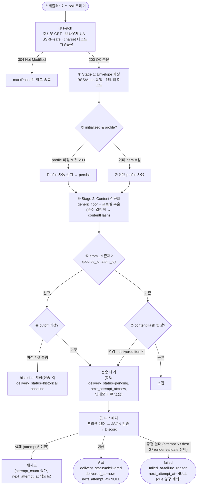

## 5.2 데이터 변환 (4개 형태)
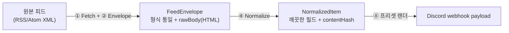

| 형태 | 누가 만듦 | 핵심 필드 |
|------|-----------|-----------|
| 원본 XML | 외부 피드 | vendor·형식마다 제각각 |
| **FeedEnvelope** | Stage 1 | `atomId, title, link, publishedAt, updatedAt, author, commentsUrl?, image?, rawBody(HTML), categories` |
| **NormalizedItem** | Stage 2 | `+ summary(정제), commentsUrl?, image?, incidentStage?, contentHash` |
| webhook payload | Dispatcher | `{ embeds: [{ title, description, color, fields, footer }] }` |

## 5.3 계층 / 책임 맵
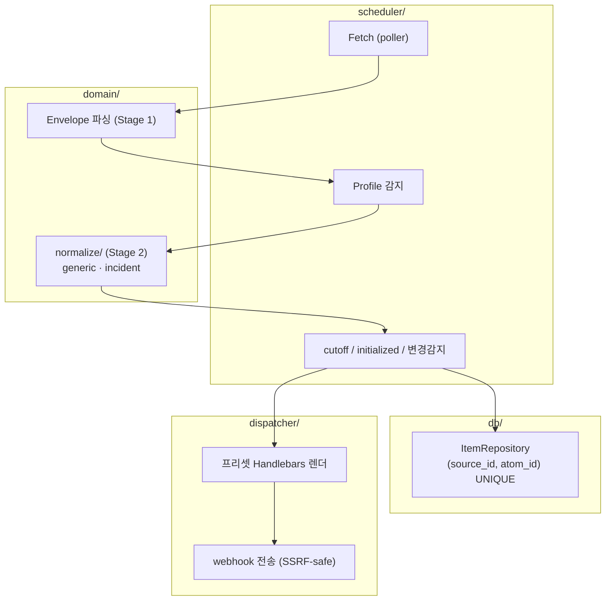

| 계층 | 책임 | 결정 |
|------|------|------|
| Fetch | 전송·charset·SSRF·조건부요청·TLS | D18/D20 |
| Envelope (Stage 1) | 형식 통일·엔티티 디코드 | D10/D16 |
| normalize (Stage 2) | HTML→깨끗한 필드·해시 (순수·결정적) + 번역 캐시 | D11/D16/D14-translate-cache |
| Repository | 식별·dedup + 성공 스킵(동일 hash) | D11/D-Q1 |
| scheduler | cutoff·initialized·변경감지 | — |
| dispatcher | 프리셋 렌더·전송·재시도 + 멀티-dest 스킵 | D8/D17 |

## 5.4 단계별 상세
- **① Fetch** — 조건부 GET(`etag`/`last_modified`→304면 본문없이 종료). FetchOptions(charset·UA·headers·timeout·`tlsMaxVersion`). SSRF-safe fetch(연결 시점 재검증).
- **② Stage 1 Envelope** — `<rss>`/`<feed>` 감지 → 공통 `FeedEnvelope`. `rawBody`=`content:encoded > content > description`. HTML은 해석 안 하고 문자열로 운반. (상세 §6)
- **③ Profile 감지** — 캐스케이드(generator/메타 → 구조·마커 → generic). 첫 200에서 1회 persist, 304 재감지 금지, 수동 override 우선.
- **④ Stage 2 정규화** — generic floor(HTML strip+디코드+truncate) → 프로필 추출(incident: 최신 segment+stage). 순수·결정적 → contentHash 안정.
- **⑤ 식별 & dedup** — `(source_id, atom_id)` UNIQUE. identity ≠ change.
- **⑥ cutoff / initialized** — `publishedAt = published ?? updated`; **둘 다 없으면(NULL) "cutoff 이전 아님"으로 취급**(N5, 즉 cutoff 비교에서 historical로 강등하지 않음). 첫 폴링: 기존 전부 historical(저장만, `delivery_status='historical'` baseline)→`initialized=true`. 이후: `publishedAt < deliveryCutoffAt`이면 historical.
- **⑦ 변경 감지** — 기존 항목은 `contentHash` 비교(**generic 해시 = `title+link`, 본문 summary 제외** → 본문만 churn하면 해시 불변·`skipped`라 재전송 없음, §7.5). **`historical`**(저장만·미전송) 및 `failed` 항목의 `contentHash` 변경은 **재전송하지 않는다**. **재전송 대상은 `delivery_status='delivered'`(실제 전송됨) item의 `contentHash` 변경분만**(N6 — `publishedAt` 게이트는 첫 등장 dispatch ⑥에만, R5-baseline) → `delivery_status='pending'`·`next_attempt_at=now` 마킹. **성공 스킵 모델**: 부분 실패 후 재시도 시, 이미 성공한 destination은 `(item_id, destination_key, content_hash=현재)` 행 기준으로 스킵 — 번역 비결정성에 대응하여 **item별 번역 결과를 1회 계산 후 영속/캐시**(예: `items.translated_title`·`items.translated_summary` 또는 payload snapshot)하면 재시도가 동일 번역을 재사용하고 destination별 번역 불일치·중복 호출(최대 5회) 차단 가능. **비소급 운영정책**: 템플릿·표시설정·번역 텍스트 변경은 이미 success한 item에 재전송하지 않음(스킵 키 `content_hash`에 이들 변경이 미포함되므로 당연함).
- **⑧ 디스패치** — (`source.translate=1`이면 title+summary를 **한국어로 번역**, A4) → 프리셋 선택(사용자 지정) → Handlebars 렌더 → `JSON.parse` → ajv 한도 검증 → **전송 대상 해석**(**D24**: `webhook_url`이 있는 **소속 그룹마다 destination**·webhook URL은 그룹 소유·name/avatar는 `blankToNull(source.X) ?? group.X`(빈 문자열·공백도 그룹값으로 폴백)·threadId=source 소유·canonical(url)+threadId dedup) → 각 destination에 Discord webhook(`username`/`avatar_url` 포함). 전송 due predicate = `delivery_status='pending' AND next_attempt_at IS NOT NULL AND next_attempt_at<=now AND source.enabled=1`. 성공 시 `delivery_status='delivered'`·`delivered_at=now`·`next_attempt_at=NULL`. 종결 실패(`attempt_count==5` / render·validate 실패) 시 `delivery_status='failed'`·`failed_at`·`failure_reason`·`next_attempt_at=NULL`(due 영구 제외). **destination 0개는 종결 실패가 아니라 운영 skip**(failItem 대신 `skipped` 반환, pending 보존; 생성 단계에서 그룹 최소 1개 필수라 사실상 도달 불가 — `no_destination`은 과거 로그 호환 잔존). 재시도(②③ 정책, `attempt_count` 단계별 백오프). 번역·전송은 실제 전송 때만(D14), 미리보기엔 번역 미적용.

## 5.5 시퀀스
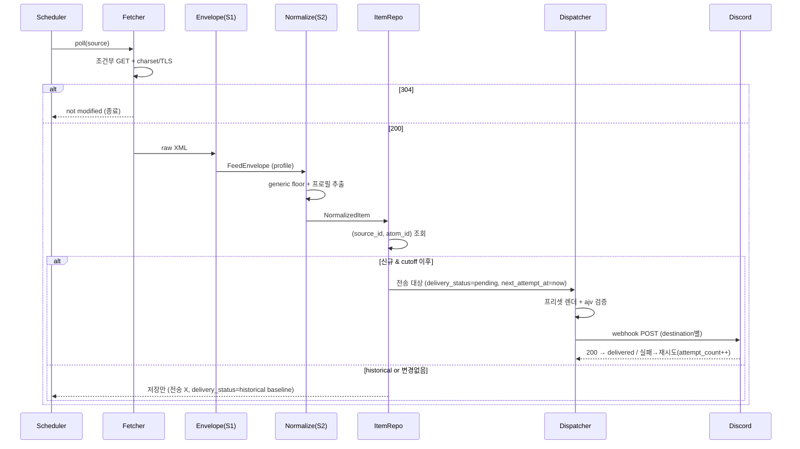

## 5.6 소스 lifecycle
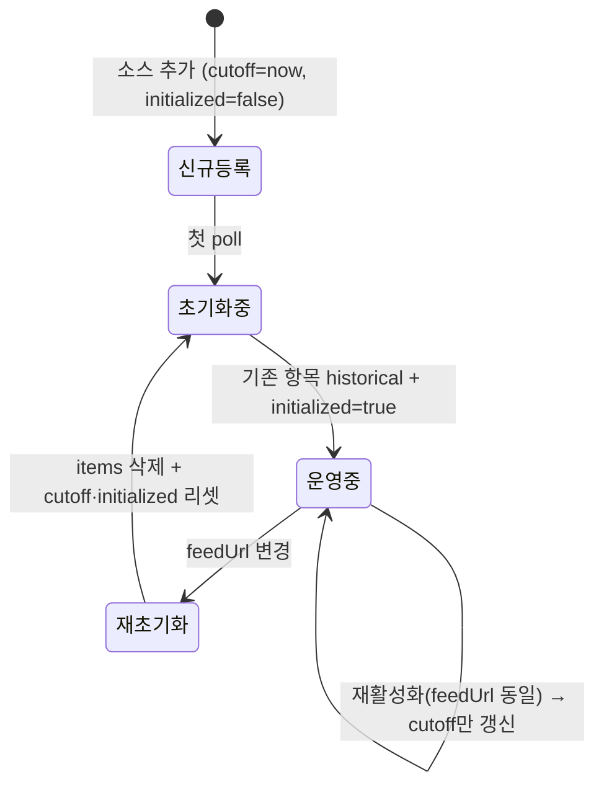

- **재초기화**: `feedUrl`이 실제로 바뀌면 기존 `items` 삭제 후 첫 poll처럼 새 피드를 historical 재시드(과거 backlog 폭주 차단). 단순 재활성화(feedUrl 동일)는 cutoff만 갱신.
- **enable/disable 토글** (D-Q2): `enabled` 토글이 `delivery_cutoff_at=now` 리셋(과거 묵음). disable 시 pending item은 due에서만 빠져 보류로 남음. re-enable 시 `next_attempt_at=now` 리셋(스케줄러 틱당 전송 상한으로 폭발 방지). **설정 수정으로 고친 failed item은 자동 재큐 안 함 — 수동 `POST /api/sources/:id/retry-failed` 엔드포인트로만 부활**. disabled 소스는 **폴링도 중단**(findDuePoll predicate에 `AND enabled=1`, 0007 인덱스 `(enabled, next_poll_at)` 정합).
- **cutoff/historical 처리 규칙**(N5·N6):
  - `published_at = published ?? updated`로 저장. **둘 다 NULL이면 "cutoff 이전 아님"**(N5) — 날짜 미상 항목을 cutoff 비교만으로 historical 강등하지 않는다.
  - 첫 poll로 적재된 baseline 항목은 `delivery_status='historical'`(저장됐으나 전송된 적 없음 — `delivered`[실제 POST됨]와 구분)로 둔다. **변경 재큐는 `delivered` 항목에만 적용하고, `historical`(및 `failed`)은 비전송으로 유지한다.** 즉 이 historical의 `contentHash` 변경은 재전송하지 않는다(R5-baseline).
  - **변경 재전송 대상은 `delivery_status='delivered'`(실제 전송됨) item의 contentHash 변경분만**(N6 — `published_at` 게이트는 *첫 등장 dispatch*에만 적용하고, 변경 재큐엔 걸지 않는다; `historical`·`failed`은 제외, R5-baseline). 이로써 "등록 후 과거 이벤트 재전송" 버그를 런타임에서 차단하면서, 과거 Status Page 업데이트 누락도 막는다(설계 동기, §1·§16).

---

# 6. ★ Envelope 상세 (FeedEnvelope)

## 6.1 정의 & 위치
**FeedEnvelope = Stage 1의 산출물.** RSS 2.0와 Atom의 형식 차이(태그 이름·id·날짜 위치)를 흡수해 **모든 피드를 같은 모양의 봉투**로 만든다. 이후 단계(정규화/식별/cutoff/전송)는 vendor를 몰라도 된다.

> 한 줄: Envelope는 **"형식의 어려움"을 한 곳에 격리**하는 어댑터. "내용의 어려움"은 건드리지 않고 그대로(rawBody) 다음 단계로 넘긴다.

## 6.2 구조
```ts
interface FeedEnvelope {
  atomId:       string;        // 식별 키 (Atom <id> / RSS <guid>→link→skip)  ★불변
  title:        string;
  link:         string;        // 원문 URL — ★앱-필수(전 프리셋 필수 + atomId 폴백 source)
  publishedAt?: string;        // ISO8601 (cutoff 판정용)
  updatedAt?:   string;        // ISO8601 (referenceDate·변경 힌트)
  author?:      string;        // author / dc:creator
  commentsUrl?: string;        // HN/GeekNews 등 discussion 링크
  image?:       string;        // enclosure/media thumbnail
  rawBody:      string;        // ★ HTML 문자열 (불투명 패스스루 — 해석 안 함)
  categories:   string[];      // category / dc:subject
}
```

| 필드 | Atom 출처 | RSS 출처 | 비고 |
|------|-----------|----------|------|
| `atomId` | `<entry><id>` | `<guid>` → 없으면 `<link>` → 둘 다 없으면 스킵 | RFC 4287 영구 유일 IRI. 통째 사용(추출 X). **합성 해시 금지**(identity≠change) |
| `title` | `<title>` (CDATA 가능) | `<title>` | |
| `link` | `<link href>` | `<link>` | **★앱-필수**: 모든 프리셋이 참조하고 RSS에선 `atomId` 폴백 source이기도 하다(`<guid>` 없으면 `link`가 식별 키). `items.link` 컬럼으로 영속(0008) |
| `publishedAt` | `<published>` | `<pubDate>` | 없으면 `updated` 폴백 |
| `updatedAt` | `<updated>` | `<pubDate>` | |
| `author` | `<author><name>` | `<dc:creator>` | 없으면 빈값 |
| `commentsUrl` | `<link rel="replies">` 등 | vendor별 comments 링크 | 없으면 미설정 |
| `image` | media/enclosure 계열 | enclosure/media thumbnail | 없으면 미설정 |
| `rawBody` | `<content:encoded> > <content> > <summary> > <description>` | `<content:encoded> > <content> > <description>` | **HTML 그대로**(RSS/Atom 분기별 폴백) |
| `categories` | `<category term>` | `<category>`/`<dc:subject>` | |

## 6.3 생성 과정 (Stage 1)
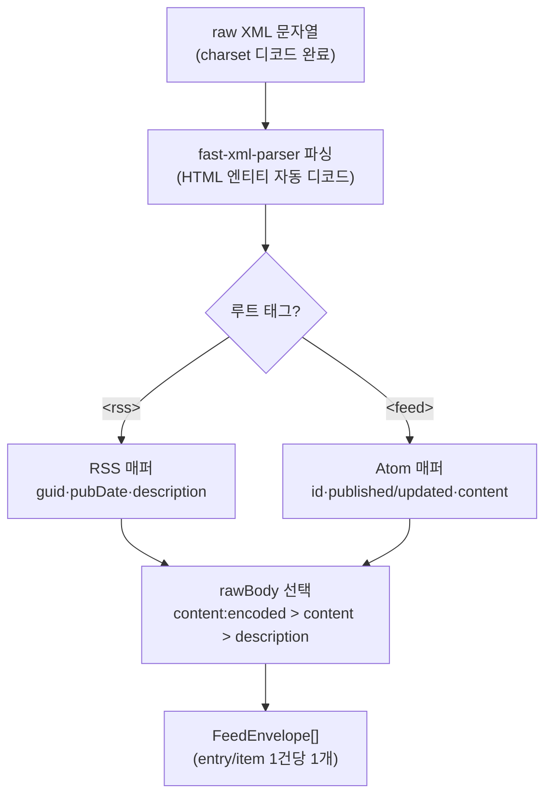

**Stage 1이 하는 유일한 판단**: 어느 필드를 `rawBody`로 쓸지 — RSS는 `content:encoded > content > description`, Atom은 `content:encoded > content > summary > description`. 그 외엔 기계적 매핑. **HTML 내부는 절대 파싱하지 않음** → 로직 부담 0.

## 6.4 어떤 프로세스에 쓰이고 어떻게 흐르나
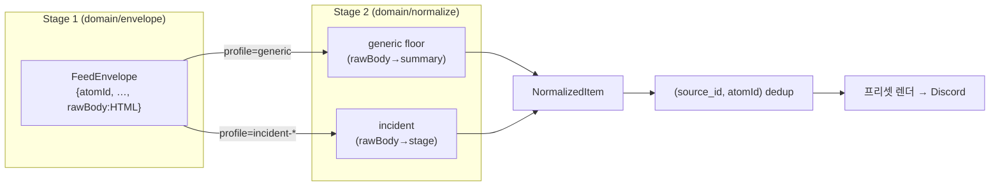

- **소비처는 Stage 2(normalize)뿐.** Envelope의 `rawBody`(HTML)를 profile별 normalizer가 비로소 해석한다.
- `atomId`는 Envelope→Repository까지 **그대로 흘러 식별 키**가 된다(불변).
- `publishedAt`/`updatedAt`은 scheduler의 cutoff·referenceDate로 흐른다.

## 6.5 실측 예시 (Mock 피드 → FeedEnvelope)

> 아래 셋은 **같은 `FeedEnvelope` 타입·다른 값**이다(봉투 3종이 아님). 어느 optional 필드가 채워지는지·`rawBody` HTML 모양만 다르고, **source별 분기는 Stage 2에서** 일어난다(§6.8).

**OpenAI** (`OpenAI.atom`, incident.io, Atom)
```jsonc
{
  "atomId":     "https://status.openai.com//incidents/01KSN9ATSF1WCJ5ZTQSR1H9CC7",
  "title":      "Codex Context Compaction Latency",
  "link":       "https://status.openai.com//incidents/01KSN9ATSF1WCJ5ZTQSR1H9CC7",
  "publishedAt": null,                         // OpenAI는 published 미제공
  "updatedAt":  "2026-05-28T02:31:07.673Z",    // → publishedAt 폴백에 사용
  "rawBody":    "<b>Status: Identified</b><br/><br/>We've identified … <ul><li>App …</li></ul>"
}
```

**Claude** (`Claude.atom`, atlassian, Atom)
```jsonc
{
  "atomId":     "tag:status.claude.com,2005:Incident/30330163",
  "title":      "Elevated errors on Claude Opus 4.7",
  "publishedAt":"2026-05-27T09:41:14Z",
  "updatedAt":  "2026-05-27T09:41:14Z",
  "rawBody":    "<p><small>May 27, 09:41 UTC</small><br><strong>Resolved</strong> - … </p><p>…Monitoring…</p><p>…Investigating…</p>"
}
```

**CISA** (`CISA.xml`, RSS 2.0)
```jsonc
{
  "atomId":     "/node/24943",                 // RSS guid (상대 node 경로, 항목마다 고유)
  "title":      "(제품명)",
  "link":       "https://www.cisa.gov/news-events/ics-advisories/icsa-26-146-05",
  "publishedAt":"(pubDate)",
  "author":     "CISA",                         // dc:creator
  "rawBody":    "<p><a …>View CSAF</a></p><h2>Summary</h2><p><strong>…</strong></p><table class=\"tablesaw\">… v3 9.8 …</table>"
}
```

## 6.6 원칙: rawBody는 "읽지 않고 운반만"
- raw HTML은 **Stage 2까지 반드시 살아남아야 함** — incident는 `<b>/<strong>` 태그로 단계를 찾고, (구)CISA는 `<table>`로 CVSS를 찾는다. Stage 1에서 태그를 벗기면 Stage 2가 추출 불가.
- 그래서 Envelope는 `rawBody`를 **불투명 문자열로 패스스루**. "어려운 HTML을 봉투에 강제로 욱여넣는" 게 아니라, charset(Fetch)+엔티티(파서) 디코드를 거친 **이미 깨끗한 HTML 문자열**을 그대로 담을 뿐.

## 6.7 Envelope → NormalizedItem 매핑 (Stage 2가 실제로 하는 일)

대부분 필드는 통과하고, **핵심은 `rawBody`(원본 HTML)가 `summary`로 "변환"되고 `rawBody`는 버려진다**는 점이다. 순수 추가가 아니라 *통과 + 변환 + 폐기 + 해시*.

| NormalizedItem | Envelope에서 | 처리 |
|----------------|--------------|------|
| `atomId` `title` `link` `publishedAt` `updatedAt` `author` `commentsUrl` `image` | 동일 필드 | ⏩ 통과(pass-through). **단 `title`은 HTML 태그/엔티티가 있으면 Stage 2 floor에서 제거·디코드·trim**(§7.5 — RSS title 마크업 제거). **`link`(앱-필수)·`author`·`commentsUrl`·`image`는 렌더 데이터로 `items` 컬럼에 영속**(0008) — 전송/재전송 시 재파싱 없이 동일 페이로드 재현 |
| `summary` | **`rawBody`** | ★ 변환 (HTML → 정제 텍스트) |
| `incidentStage` | **`rawBody`** | ★ 추출 (incident일 때만) |
| `contentHash` | (계산) | ➕ 신규 (generic=`title+link`, incident=`stage+"\n"+최신 segment` 해시). **summary(본문)는 표시·저장만 하고 해시에서 제외** — 본문 churn 재전송 차단(§7.5, 2026-06-04) |
| — | `rawBody` | ✂ 폐기 (NormalizedItem엔 없음) |
| — | `categories` | **미사용**(NormalizedItem·프리셋 변수에 없음) |

```
FeedEnvelope    : rawBody(원본 HTML)  ← "아직 안 읽은 원재료"
NormalizedItem  : summary(정제됨)     ← "프리셋이 바로 쓸 완제품", rawBody 없음
```
> 두 DTO를 나누는 본질 = `rawBody`(원본) ↔ `summary`(정제) 한 쌍. 이 변환이 Stage 2의 핵심 작업이라 입력용(Envelope)/출력용(NormalizedItem)을 분리한다.

## 6.8 source별 고정 / 가변 (확정)

Envelope는 **모든 source가 공유하는 1개 고정 봉투**다. source 따라 "추가되는" 것은 Envelope가 아니라 **Stage 2 normalizer(profile)**.

| 구성요소 | source마다 다른가? | 내용 |
|----------|-------------------|------|
| **Envelope (Stage 1)** | ❌ 1개 고정 | OpenAI·Claude·CISA·CVE 전부 같은 모양 |
| **Normalizer (Stage 2)** | ✅ profile별 | generic / incident-io / atlassian / (cve) |
| `fetch_options` | ✅ | CISA=TLS 1.2, boannews=charset |
| `template`/`webhook` | ✅ | 소스별 지정 |

**새 source 유형 추가 = Normalizer 로직 1개 추가** (Envelope·엔진 불변):
```
① normalizer 로직   cve.ts 같은 함수 1개   ← 실제 일은 이것뿐
② profile 문자열    enum에 'cve' 한 줄
③ 감지 분기         "이 피드가 cve다" 판단 1개 (예: link에 cvefeed.io)
```
→ incident에 atlassian 분기를 더한 것과 같은 규모. A2(CVE generic↔cve)도 "Stage 2 normalizer 1개" 결정이라 나중 승급 비용이 작다. (§8 "새 status page = 프로필 1개 + 감지 분기 1개, 엔진 불변"과 동일 원리)

---

# 7. 파싱 & 정규화 (Stage 2, domain/normalize)

> 📄 이 절(§7)이 Stage 2(`domain/normalize/`)의 **단일 완본 명세**다 — 계약·알고리즘·테스트·구현 순서 포함. 입출력 DTO 전체 정의는 §6, 픽스처는 `rss-discord-bridge/test/mocks/feeds/`.

## 7.1 2단계 파싱 원칙
| 어려움 | 처리 | 성격 |
|--------|------|------|
| 형식 차이(RSS/Atom, id·날짜 위치) | **Stage 1 Envelope** | 기계적, 모든 피드 동일 |
| 내용 지저분함(HTML, 누적 incident) | **Stage 2 Normalize** | 프로필별, 어려움 격리 |

## 7.2 인코딩 처리 3종 (계층 분리)
| 종류 | 예 | 처리 위치 |
|------|-----|-----------|
| 바이트 charset | boannews EUC-KR | **Fetch 옵션**(D18) |
| HTML 엔티티 | `&lt;p&gt;`→`<p>` | Stage 1 파서(자동) |
| HTML 태그/구조 | `<table>` | Stage 2 정규화 |

## 7.3 파일 구성 & 디스패치
```
src/server/domain/normalize/
├── types.ts          # FeedEnvelope, NormalizedItem, Profile
├── html.ts           # HTML→텍스트 floor(태그 제거·단어경계 truncate)
├── content-hash.ts   # sha256 contentHash(generic / incident)
├── profile.ts        # detectProfile / effectiveProfile(감지·파생)
├── generic.ts        # floor: html.ts + content-hash.ts 사용 (항상 거침)
├── incident.ts       # incident-io / atlassian (2분기)
└── index.ts          # normalize(profile, env) 디스패치 + graceful 폴백
```
**입출력 계약** — 입력 `FeedEnvelope`·출력 `NormalizedItem`의 전체 정의는 §6.2(Envelope 구조)·§6.7(Envelope→NormalizedItem 매핑). 출력 요지:
```ts
interface NormalizedItem {
  atomId; title; link; summary;     // 공통 (summary = rawBody 정제)
  publishedAt?; updatedAt?; author?;
  commentsUrl?; image?;
  incidentStage?;                   // incident-*
  contentHash;                      // 결정적 — 변경 감지
}
```
> cisa-advisory 제거로 `advisoryId/cvss/severity` 필드 삭제 → DTO 슬림(0번 변경이력).

**디스패치**(`index.ts`) — profile로 분기하고, 추출 실패는 **항상 generic으로 강등**(throw로 파이프라인 중단 금지, §7.6):
```ts
export function normalize(profile: Profile, env: FeedEnvelope): NormalizedItem {
  try {
    if (profile === 'incident-io' || profile === 'atlassian-statuspage')
      return normalizeIncident(profile, env);   // 실패 시 내부에서 generic 폴백
    return normalizeGeneric(env);
  } catch {
    return normalizeGeneric(env);                // 최종 안전망 (graceful)
  }
}
```

## 7.4 프로필 능력 표현 (D19)
능력은 **별도 플래그 객체 없이 코드 모듈로 암묵 표현**. normalizer가 채우는 optional 필드 = 능력. DTO에 능력 메타 미포함(프리셋 `{{#if}}` 분기). 감지는 등록 초기 1회 persist → 이후 디스패치 키로만.

| 프로필 | 채우는 필드(=능력) | 특수 처리 |
|--------|-------------------|-----------|
| generic | title, link, summary, dates, author, commentsUrl?, image? | floor만 |
| incident-* | + `incidentStage` | 최신 segment + stage |

## 7.5 파일별 해결 과제 (실측 데이터 반영)

**generic.ts (floor)**
- HTML 태그 제거 + 엔티티는 이미 디코드됨 → 공백 정리. `<li>`→`· `, `<br>`→개행(목록 보존).
- **`title`도 floor 정제**: RSS title에 HTML 태그/엔티티가 섞여 오면 **태그 제거 + 엔티티 디코드 + trim**(단어 단위 truncate는 안 함 — title은 길이 제한만 프리셋에서). summary와 같은 strip을 적용하되 한 줄로 유지. 정제된 `title`이 `contentHash`(아래)·렌더에 쓰인다.
- truncate(프리셋별 — news-article 300 / link-discussion 200 / incident-active 3500; minimal 미적용. 단어 경계 + `…`). locale 무관 → 결정적.
- `contentHash = sha256(canonical: title\nlink)` — **summary(본문)는 해시에서 제외**한다. 본문은 표시·저장용으로 계속 정제·영속하되 변경 감지 입력에선 뺀다. raw HTML 바이트와 분리 → 안정. **이유(2026-06-04 수정)**: 본문을 해시에 넣으면 발행사의 본문 churn — CVE description 보강, 댓글수·조회수·타임스탬프, CDN/마크업 바이트 차이 등 **독자에게 안 보이는 변화** — 가 해시를 뒤집어 이미 전송된 기사가 "동일 내용"으로 재발행됐다(특히 `minimal` 프리셋은 제목+링크만 표시하므로 글자 그대로 같은 카드가 재전송). 본문을 빼면 generic 항목은 **제목·링크가 바뀔 때만** 변경으로 보고, 한 번 전송된 기사는 본문이 바뀌어도 재전송하지 않는다(사실상 불변). 본문만 바뀐 경우는 변경 감지에서 `skipped`라 **저장된 summary도 갱신하지 않는다**. 본문 업데이트까지 반영하려면 소스의 `edit_in_place`(원본 메시지 편집)를 쓴다. **근본 원인(granularity 불일치)**: 해시는 본문 정제 텍스트를 최대 4000자까지 보는데 카드는 훨씬 적게(`news-article` 300자·`link-discussion` 200자·`minimal`은 제목만) 보여주므로, 독자에게 안 보이는 본문 텍스트(CVE `<description>` 보강·댓글수·CDN/다중 백엔드의 바이트 차이 등)가 바뀌어도 해시가 뒤집혀 재전송됐다(incident만 `stage+최신 segment`로 해시를 좁혀 이 보호가 있었고 generic엔 없었음). **트레이드오프**: 의미 있는 본문 업데이트(CVE 보강 등)도 재전송하지 않으므로 필요한 소스는 `edit_in_place`로 원본을 편집한다. **검토 후 보류한 대안**: B(소스별 `재전송|편집|무시` 토글 — 스키마+UI 비용 수반) / C(`edit_in_place` 기본 ON — granularity 문제 잔존·트리비얼 변경에도 편집 호출).
- **CVE Feed(A2 — generic 처리)**: `CVEFeed.xml` 실측상 title에 CVE id가 이미 있음(`CVE-2026-… - …`), `description`의 `<strong>CVE ID :</strong>…` 등은 태그 제거 → `summary`. CVSS/severity는 추출 안 함(필요 시 `cve.ts` normalizer 1개로 승급, 엔진 불변 §6.8).

**incident.ts (실측 2분기)** — *가장 중요*
| | OpenAI (incident-io) | Claude (atlassian) |
|---|---|---|
| 본문 | **단일 현재상태 스냅샷** | **누적, 최신순** |
| 마커 | `<b>Status: X</b>` (1개) | `<strong>X</strong>` (여러 개, 첫째=최신) |
| 최신 판별 | 본문 전체가 현재 | **첫 `<p>` 블록**(정렬 불필요) |
| referenceDate | entry `updated` | entry `published`/`updated` |

```
if <b>Status:> 마커:  stage=Status값; summary=이후 본문
elif <p>+<strong>:    seg0=첫<p>; stage=seg0의<strong>; summary=seg0 텍스트
else:                 generic 폴백
contentHash = sha256(stage + "\n" + 최신 segment 텍스트)   # 누적 전체 아님 → 재전송 버그 차단
```
- **타임스탬프**: 최신 판별엔 안 씀(마크업 순서). 표시 필요 시 본문 시각(연도 없음)에 entry 연도 결합, 연말 경계만 보정(엣지 안전망).
- **stage 어휘(실측 고정)**: `Investigating / Identified / Monitoring / Resolved` (+OpenAI `Update`).
- **재전송 버그 차단(핵심)**: `contentHash`를 **최신 segment(`stage + "\n" + 최신 텍스트`)만**으로 계산한다 → Claude가 옛 segment를 매번 다시 렌더해 누적 본문 바이트가 바뀌어도 해시가 흔들리지 않아 같은 incident가 "변경됨"으로 오인되지 않음. identity(`atomId`)는 Stage 1에서 고정(원칙 2). (이 버그의 원본 분석 = 부록 A §3.4)
- **예약 점검(maintenance)**: 현재 Mock엔 없음. 발생 시 마커 불일치로 generic 폴백되어 자동 처리.

## 7.6 제약 3가지 & 경계
1. **결정적** — 같은 입력→같은 출력(`Date.now()`/랜덤 금지) → 해시 안정.
2. **순수** — I/O·DB·네트워크 없음 → 단위 테스트.
3. **graceful** — 추출 실패 시 generic 강등.

| normalize가 안 푸는 것 | 푸는 곳 |
|------|---------|
| fetch / charset 디코드 | Fetch |
| RSS↔Atom 통일, 엔티티 디코드 | Stage 1 Envelope |
| profile 감지(어느 normalizer 쓸지) | Scheduler |
| 중복/식별(atom_id) | Repository |
| cutoff / 첫 폴링 historical | Scheduler |
| contentHash **비교**(변경 판정) | Scheduler — normalize는 해시 *계산*만 |
| 번역 / 프리셋 렌더 / 전송 | Dispatcher |

## 7.7 실측 데이터 요약
| | OpenAI | Claude | CISA(generic) |
|---|---|---|---|
| 형식 | Atom | Atom | RSS |
| 본문 성격 | 현재상태 스냅샷 | 누적·최신순 | Summary+표 HTML |
| stage 마커 | `<b>Status:X</b>` | `<strong>X</strong>` | — |
| 타임스탬프 | updated(연도O) | 본문(연도X)+entry(연도O) | pubDate |

## 7.8 테스트 계획 (픽스처)
픽스처는 `rss-discord-bridge/test/mocks/feeds/`에 위치(로더 `test/mocks/fixtures.ts`).

| 픽스처 | 검증 |
|--------|------|
| `OpenAI.atom` | incident-io: `<b>Status:>` 추출, 스냅샷 본문, 동일 입력 해시 안정 |
| `Claude.atom` | atlassian: 첫 `<p>` segment만, 누적 본문에도 해시 불변(재전송 차단) |
| `CISA.xml` | generic: `<h2>Summary>`·표 포함 HTML strip, advisoryId/cvss **미추출** 확인 |
| `CVEFeed.xml` | generic: title의 CVE id 유지, description strip |
| `GeekNews.xml` / `TheHackersNews.xml` | generic: 일반 RSS strip·truncate |

단위 테스트 포인트:
- generic: strip/truncate/해시 결정성(같은 입력 2회 → 동일 해시) + **본문(summary)만 바뀌면 해시 불변**(title/link 고정), **title·link 변경 시에만 해시 변경**(재전송 트리거) — 본문 churn 재전송 차단 회귀 테스트
- incident-io: stage 추출 / 마커 없을 때 generic 폴백
- atlassian: 최신 segment 선택 / **누적 본문 변형에도 해시 동일**(재전송 차단)
- graceful: 깨진 HTML·빈 rawBody → generic 결과

## 7.9 모듈 구현 순서 (normalize 한정)
1. `types.ts` (FeedEnvelope/NormalizedItem/Profile)
2. `generic.ts` + 단위 테스트
3. `index.ts` 디스패치 (generic만 연결)
4. `incident.ts` (incident-io → atlassian 순, Mock 픽스처 테스트)

> 향후 승급(보류): `cve.ts` / `cisa.ts`(severity 추출)는 필요 시 normalizer 1개 + profile 1개 + 감지 분기 1개로 추가. Envelope·엔진 불변(§6.8).

---

# 8. Status Page / Atom / Provider Profile (D10~D12)

- 현재 status page = **OpenAI**(incident.io)·**Claude**(atlassian). 둘 다 Atom 제공 → **Atom으로 통일**(D10).
- **식별 = Atom `<id>` 통째**(D11): vendor마다 형식 상이(OpenAI=URL+ULID, Claude=tag URI). 단일 정규식 불가 → `<id>` 문자열 통째로 `(source_id, atom_id)` UNIQUE. inner UID 추출은 표시용 옵션. **identity(`<id>`)≠change(contentHash)** → 과거 이벤트 재전송 구조적 차단.
- Atom 시간요소: `<published>`→cutoff, `<updated>`→referenceDate. OpenAI는 published 미제공 → `published ?? updated` 폴백.
- **자동 감지 캐스케이드**(D12): `<generator>`=incident.io / 채널메타=Statuspage → 구조·마커(`<b>Status:`/`<strong>`) → `generic`.
- **견고성**: 첫 200에서 1회 감지 후 persist, 304/빈 본문 재감지 금지, 수동 override 우선, 재감지는 feedUrl 변경 시만.
- **오판 안전장치 = 사용자 수정 하나**: `source.profile` 편집 가능(`auto`|`incident-io`|`atlassian-statuspage`|`generic`). 추가 machinery 보류(YAGNI). 오판 피해는 "표현 저하"로 제한(식별=atom_id, 안전=generic floor).

### profile 3분리 (C6) — DB 'auto' 저장 vs domain 3종
하나의 "profile"을 **세 개념으로 명확히 분리**한다(혼동 방지):
| 개념 | 정의 | 값 범위 | 저장/소비 |
|------|------|---------|-----------|
| **profileSetting** | 사용자가 폼에서 고른 설정 | `auto`\|`incident-io`\|`atlassian-statuspage`\|`generic` (4종, `auto` 포함) | `sources.profile`에 저장. **폼이 다루는 4종** |
| **detectedProfile** | 자동 감지 결과(persist) | `incident-io`\|`atlassian-statuspage`\|`generic`\|`null` | `sources.detected_profile` |
| **effectiveProfile** | 실제 적용값 | `incident-io`\|`atlassian-statuspage`\|`generic` (3종) | 파생: `setting !== 'auto' ? setting : (detected ?? 'generic')` |

- **normalizer·렌더는 `effectiveProfile`(domain 3종)만** 본다. `auto`는 도메인에 존재하지 않는다(저장 전용 의도값).
- **폼은 `profileSetting`(4종)**을 노출·편집(수동 override = setting을 3종 중 하나로 고정).

---

# 9. Fetch 아키텍처 (D18 + D20)

## 9.1 2-layer 분리
| 층 | 항목 | 적용 위치 | 풀링 |
|----|------|-----------|------|
| **연결(Agent)** | `tlsMaxVersion`, SSRF 핑 | undici `Agent.connect` | 풀 분할 → 캐시 |
| **요청(fetch)** | UA, Accept, headers, timeout, 조건부 GET | `fetch(url,{...})` | 영향 없음 |

## 9.2 CISA TLS 핑거프린트 발견 (실측)
- 403 원인 = IP 평판 아니라 **Akamai TLS(JA3/JA4) 핑거프린트**. TLS 1.3 협상 시 차단.
- 해결: `--tlsv1.2 --tls-max 1.2` + 커스텀 UA + Accept → **200**(샌드박스 포함, 30개 항목). 배포 IP 무관.
```ts
new Agent({ connect: { lookup: ssrfSafeLookup, minVersion:'TLSv1.2', maxVersion:'TLSv1.2' } })
```

## 9.3 Agent 캐시 (요청마다 new 금지)
TLS 프로파일별로 Agent 1개 캐시. 현실적으로 **default + TLSv1.2 2개**. CISA만 후자 공유.

## 9.4 auto-detect + persist (D20, D12와 동일 패턴)
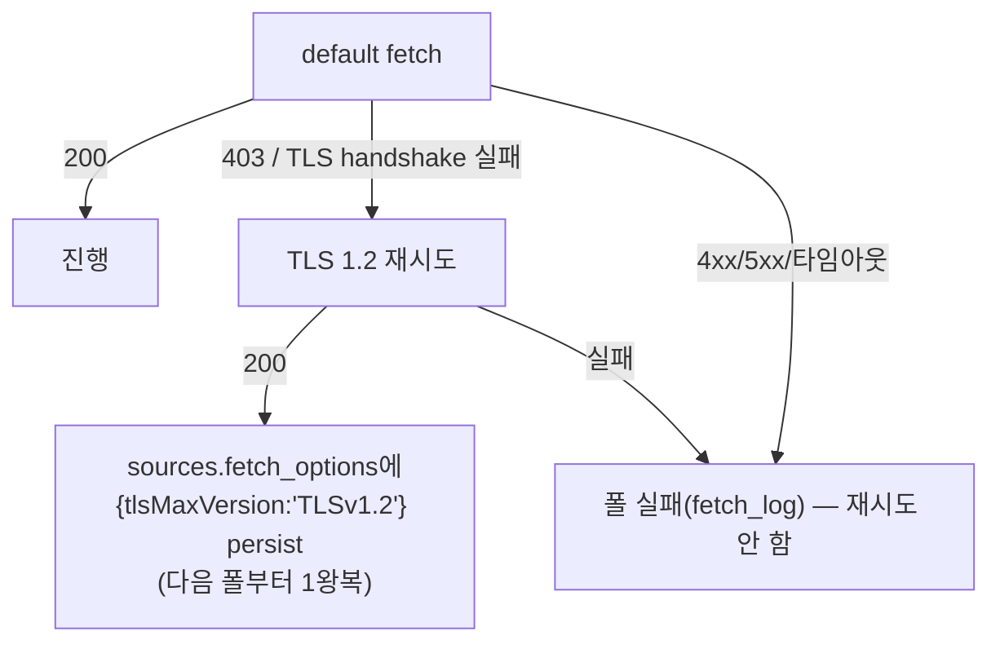
| 응답 | TLS 1.2 재시도? |
|------|-----------------|
| 403(특히 Akamai) / TLS handshake 실패 | ✅ |
| 401/404/429, 5xx, 타임아웃, 네트워크 | ❌ |

## 9.5 FetchOptions
```ts
interface FetchOptions {
  charset?: string;        // 'euc-kr' 등 (D18)
  userAgent?: string;
  headers?: Record<string,string>;
  timeoutMs?: number;
  tlsMaxVersion?: 'TLSv1.2' | 'TLSv1.3';   // CISA
}
```
소스별 옵션은 `sources.fetch_options`(JSON)에서 읽음. CISA만 `{"tlsMaxVersion":"TLSv1.2","userAgent":"JweC-CISA-Collector/1.0 (+mailto:…)"}`.

---

# 10. Discord 프리셋 (4종)

**프리셋 = 미리 만든 임베드 템플릿(Handlebars)**. 사용자는 프리셋 선택 후 JSON만 편집(D5). 렌더는 서버 1곳(D8).
```
프리셋 선택 → (CodeMirror JSON 편집) → 서버 Handlebars 렌더 → JSON.parse → ajv 검증 → Discord
```

| 프리셋 | 그룹 | 색(10진) | 핵심 필드 |
|--------|------|----------|-----------|
| `incident-active` | 도구상태(장애) | stage별: 진행중 빨강 `15548997` / 해결 초록 `5763719` | title, summary, stage(한국어 라벨), updated |
| `news-article` | 보안뉴스·기술개발·**보안위협** | 블러플 `5793266` | title, summary, source (author/image 변수 가능·현행 미사용) |
| `link-discussion` | 기술동향(HN/GeekNews) | 주황 `16737095` | title, summary, `댓글` 링크(commentsUrl) |
| `minimal` | 폴백 | 회색 `9807270` | title, link만 |

**stage→색**(incident): Investigating/Identified/Monitoring/Update→빨강, Resolved→초록 → 단일 `incident-active` 프리셋의 `stageColor` 헬퍼가 항목별로 흡수(별도 resolved 프리셋 불필요). **stage→한국어 라벨**은 `stageLabel` 헬퍼(렌더 단계 결정적 매핑, AI 번역 제외): Investigating→조사 중, Identified→원인 확인, Monitoring→모니터링 중, Resolved→해결됨, Update→업데이트(매핑에 없는 현지화 원문은 그대로 통과).

### 변수 계약 (NormalizedItem만 참조, drift 방지 D15)
`{{item.title}}` `{{item.link}}` `{{item.summary}}` `{{item.publishedAtFormatted}}` `{{item.author}}` `{{source.name}}` `{{source.feedUrl}}` `{{source.profile}}` `{{item.incidentStage}}`(incident-*) `{{item.commentsUrl}}`(link-discussion) `{{item.image}}`(enclosure 출처 — 변수 가능·현행 프리셋 미사용)
**헬퍼**: `truncate(text,n)`, `stageColor(stage)`, `stageLabel(stage)`, `eq(a,b)`, `json(value)`(C1). `stageLabel`은 영어 표준 stage를 한국어 표시 라벨로 매핑한 JSON 문자열을 `SafeString`으로 출력(미매칭 원문은 그대로). 날짜(`publishedAtFormatted`)는 **렌더 단계**에서 포맷(KST 고정 `YYYY-MM-DD HH:mm (KST)`, 결정적). 정규화 출력은 ISO 8601 UTC만 보관(contentHash 오염 방지).
> **〔D22〕 멘션·silent·forum thread·edit_in_place는 프리셋 변수가 아니라 source 전송 설정**이다 — 프리셋 .hbs는 NormalizedItem만 참조(불변, drift 방지). 멘션은 dispatcher가 `content`+`allowed_mentions`로 **주입**(임베드 아님), silent는 `flags`, forum은 `thread_id`(URL)·`thread_name`/`applied_tags`(body)로 주입한다(backend-spec §4.6).

**JSON 안 값 보간은 반드시 `{{json item.summary}}`를 쓴다**(C1): 프리셋 본문은 `JSON.parse` 전의 JSON 문자열이므로, 따옴표·개행·백슬래시가 든 텍스트 필드(`title`/`summary` 등)를 그대로 `{{item.summary}}`로 보간하면 JSON이 깨진다. `json` 헬퍼가 `JSON.stringify`로 값을 **이미 따옴표까지 포함한 JSON 리터럴**로 출력하므로, JSON 문자열 위치에선 `"description": {{json item.summary}}`처럼 바깥 따옴표 없이 쓴다.

### 본문 예 (incident-active)
```json
{ "embeds": [{
  "title": {{json item.title}}, "url": {{json item.link}},
  "description": {{json (truncate item.summary 3500)}}, "color": {{stageColor item.incidentStage}},
  "fields": [
    { "name": "진행 단계", "value": {{stageLabel item.incidentStage}}, "inline": true },
    { "name": "업데이트", "value": {{json item.publishedAtFormatted}}, "inline": true }
  ],
  "footer": { "text": {{json source.name}} }
}] }
```
> 텍스트 필드는 모두 `{{json ...}}`로 보간한다(바깥 따옴표 없음 — 헬퍼가 따옴표 포함 JSON 리터럴을 **`Handlebars.SafeString`**으로 출력해 이중 `{{ }}`의 HTML 이스케이프를 회피; 그래서 `{{{ }}}` 아님). `{{stageColor}}`(숫자 반환)·`inline: true` 같은 숫자/불리언 리터럴은 따옴표 없이 그대로 둔다.
`news-article`=title+`{{json (truncate item.summary 300)}}`+footer(author/image 변수 사용 가능·현행 프리셋 미사용). `link-discussion`=`댓글` field(`{{json item.commentsUrl}}` 생 URL, fields 항상 배열). `minimal`=title+url.

### 저장·구성
- 시드 파일 `src/resources/presets/*.hbs` → 부팅 시 DB `templates`에 1회 seed(`is_builtin=1`). **빌트인 `name`=4종 고정 슬러그**(`incident-active` 등)가 `upsertBuiltin(name)`의 안정 키. 사용자는 복제(`is_builtin=0`, `name` 충돌 시 자동 `-copy` suffix) 후 편집.
- 프리셋은 **소스 전용**(`sources.template_id`) — 그룹은 프리셋에 관여하지 않음(A3).
- 렌더 결과 ajv 검증: title≤256, desc≤4096, fields≤25, 합계≤6000, embeds≤10. **〔D22 top-level〕** content≤2000·username≤80·thread_name≤100·applied_tags≤5도 검증(backend-spec §4.6 `validate.ts`).

---

# 11. DB 스키마 + ERD

## 마이그레이션 목록
| 파일 | 내용 | 상태 |
|------|------|------|
| `0001_init.sql` | `sources`, `items` | ✅ 작성됨 |
| `0002_templates.sql` | `templates` + `sources` 확장(template_id·webhook_url·poll_interval·fetch_options·translate) | ✅ 작성됨 |
| `0003_delivery_log.sql` | 전송 이력 | ✅ 작성됨 |
| `0004_fetch_log.sql` | 폴링 이력 | ✅ 작성됨 |
| `0005_model.sql` | `model_config`, `model_usage` | ✅ 작성됨 |
| `0006_groups.sql` | `groups` + `source_groups`(N:M) + `sources` webhook override 컬럼 | ✅ 작성됨 (A3) |
| `0007_sources_poll_state.sql` | **poll state**: `sources.last_polled_at`(기록·claim) + **`sources.next_poll_at`**(ISO-Z, due 판정 — R5-poll-due) + 인덱스 **`(enabled, next_poll_at)`** + **타임스탬프 정규 형식 ISO8601 UTC 'Z'**(R4-ts-format) | ✅ 작성됨 |
| `0008_delivery_state.sql` | **items 렌더 데이터 + delivery 상태 + 번역 캐시 + delivery_log 컬럼 + 타임스탬프 정규 형식**: `items`에 `link`(앱-필수, NOT NULL DEFAULT '')·`author`·`comments_url`·`image`(렌더 데이터 영속) + `delivery_status`(CHECK enum 4종 `pending`\|`delivered`\|`failed`\|`historical`, default `pending` — R5-baseline)·`attempt_count`(default 0)·`failed_at`·`failure_reason` + **번역 캐시** `translated_title`·`translated_summary`·`translated_at`(ISO-Z, NULL — R5-translate-cache) + **`content_hash`는 0008에서 스키마 미변경**(0001 nullable 유지 — NOT NULL 전환은 items 테이블 리빌드라 회피; 앱 레벨 non-null 보장 = 스킵 판정 키·불변식). **`delivered_at`·`next_attempt_at`은 0001 컬럼 재사용**(0008에서 재추가 금지 — R5-delivered-dup). **ADD COLUMN 직후 백필**(R5-0008-backfill): `UPDATE items SET delivery_status = CASE WHEN delivered_at IS NOT NULL THEN 'delivered' ELSE 'historical' END;`(pending 금지로 재전송 차단). `delivery_log`에 `destination_key`(=`sha256(canonical(webhook_url))` hex — 원문 URL 저장·표시 안 함, secret 보호 R5-destkey-hash)·`content_hash`(전송 버전)·**`failure_reason` NULL**(per-row terminal 사유 — R5-dest-terminal); 전송 due 부분 인덱스 `items(next_attempt_at) WHERE delivery_status='pending'`. **타임스탬프 정규 형식**(R4-ts-format): 모든 시각값(`next_attempt_at`, `delivery_cutoff_at`, `last_polled_at`, `next_poll_at`, `delivered_at`, `failed_at`, `translated_at`, `published_at`, `updated_at`) 저장 = ISO8601 UTC 'Z' 단일 형식(고정 자리수, 예: `2026-05-29T14:30:00.000Z`). 앱 now 헬퍼·DEFAULT 컬럼 기록 모두 이 형식 통일(due/cutoff/백오프 비교 인덱스 전제) | ✅ 작성됨 |
| `0009_reseed_model.sql` | **모델 seed 정렬**(R4-seed-model, 결정): `model_config` 기본 모델을 지시값으로 — primary `gemini`/`gemini-3.1-flash-lite`, fallback `nvidia-nim`/`qwen3-coder-480b-a35b-instruct`(0005 불변→0009 `UPDATE`). API 키는 env only, `enabled`·fallback lazy-load 정책 불변 | ✅ 작성됨 |
| `0010_iso_timestamp_backfill.sql` | **레거시 타임스탬프 ISO-Z 백필**(R4-ts-format 소급): 기존 SQLite `datetime('now')` 형식 행을 ISO8601 UTC 'Z'로 정렬 — `model_config.created_at`·`updated_at`, `model_usage.created_at`, `schema_migrations.applied_at`. 이미 'T' 포함 행(=ISO-Z)은 `instr(…,'T')` 가드로 **멱등 스킵**. 코드 의존 없음(부팅 적용만) — 0007/0008 ts-format 통일의 기존-데이터 보정분 | ✅ 작성됨 |
| `0011_webhook_features.sql` | **〔D22 Discord 웹훅 기능확장〕** `sources`에 `silent`·`mention_role_ids`·`mention_user_ids`·`mention_everyone`·`thread_id`·`thread_name`·`applied_tags`·`edit_in_place` 추가(**전부 source 소유**) + `delivery_log.discord_message_id`(edit_in_place 메시지 편집 추적) + idx `(item_id, destination_key)`. destination_key 계산은 **코드**에서 thread_id 포함으로 확장(thread 미사용 키 불변). **`ALTER TABLE ADD COLUMN`만, 0001~0010 불변.** | ✅ 작성됨 |
| `0012_mention_here.sql` | **〔D22 보강〕** `sources.mention_here`(INTEGER NOT NULL DEFAULT 0) 추가 — `@here` 멘션 토글(`mention_everyone`과 동형, source 소유). dispatcher가 ON이면 `content`에 `@here` prepend + `allowed_mentions.parse=['everyone']`(@here·@everyone 공통 핑 토큰). **`ALTER TABLE ADD COLUMN`만, 0001~0011 불변.** | ✅ 작성됨 |
| `0013_merge_incident_presets.sql` | **〔incident 프리셋 통합〕** `incident-resolved` 빌트인 제거 — 해당 템플릿을 쓰던 소스를 `incident-active`로 repoint 후 `templates` 행 삭제(idempotent; 신규 설치는 seed 전이라 no-op). 프리셋 5종→**4종**. **데이터 마이그레이션만(스키마 불변), 0001~0012 불변.** | ✅ 작성됨 |
| `0014_generic_content_hash_title_link.sql` | **〔generic 해시 축소〕** generic 항목 `content_hash`를 `title+link`로 재계산(summary 제외 — 본문 churn 재전송 차단, §7.5). SHA-256은 stock SQLite에 없어 `runtime/migrator.ts`가 멱등 **데이터 백필**로 적용(스키마 불변). | ✅ 작성됨 |
| `0015_source_destinations.sql` | **〔D23〕** 소스별 전송 목적지 테이블 `source_destinations` 추가(`source_id`·`position`·`label`·`webhook_url`…). **D24로 폐기 → 0019에서 DROP.** | ✅ 작성됨 (D23, 0019로 폐기) |
| `0016_sources_feed_url_unique.sql` | **〔feed_url 유일성〕** 정규화된 `sources.feed_url` 소스당 1개 강제 — 중복 행 정리(`findByFeedUrl`이 반환하던 행 보존) 후 UNIQUE 인덱스. | ✅ 작성됨 |
| `0017_source_destinations_canonical_unique.sql` | **〔D23 보강〕** `source_destinations`의 canonical webhook URL + thread 유일성 강제(중복 정리 후 UNIQUE). **D24로 폐기 → 0019에서 인덱스·테이블 DROP.** | ✅ 작성됨 (D23, 0019로 폐기) |
| `0018_runtime_timestamp_iso_z_backfill.sql` | **〔런타임 ts ISO-Z 백필〕** `sources`의 런타임 시각 컬럼(`created_at`·`delivery_cutoff_at`·`last_polled_at`·`next_poll_at` 등) 중 'T' 미포함(레거시 SQLite 형식) 행을 ISO8601 UTC 'Z'로 정렬. `instr(…,'T')` 가드로 **멱등 스킵**. | ✅ 작성됨 |
| `0019_drop_source_destinations.sql` | **〔D24〕** D23 `source_destinations` 테이블·인덱스 3종 DROP(채널 모델 전환으로 소스별 목적지 폐기). | ✅ 작성됨 (D24) |
| `0020_scrub_source_webhook_url.sql` | **〔D24〕** 채널 통일 후 레거시 소스 webhook secret 제거 — `UPDATE sources SET webhook_url = NULL`(전 행 scrub). 물리 컬럼 DROP은 후속 `0021` 예정(현재 NULL 유지·deprecated). | ✅ 작성됨 (D24) |

> **0007/0008 schema-delta** (기존 0001~0006 파일은 수정 금지 — 신규 번호로만 추가):
> - **0007 = poll state** (R4-poll-enabled): `sources.last_polled_at`(기록·claim) + **`sources.next_poll_at`**(ISO-Z, due 판정) + idx **`(enabled, next_poll_at)`**(R5-poll-due) + **타임스탬프 정규 형식 ISO8601 UTC 'Z'**(R4-ts-format: 기록·비교). **due 판정 = `next_poll_at <= now`**(SQLite datetime 산술 금지); `last_polled_at`은 기록·claim용으로 유지. disabled 소스는 이 인덱스에서 제외(findDuePoll predicate `AND enabled=1`)되어 폴링 중단 = due 스캔 회피·fetch 미실행.
> - **0008 = delivery state + 렌더 데이터 + 번역 캐시**:
>   - `items` 추가: `link TEXT NOT NULL DEFAULT ''`(앱-필수 확정 — ADD COLUMN 호환 위해 `DEFAULT ''`; 앱은 실제 link 기록·없으면 `''`[atomId 폴백]), `author`, `comments_url`, `image`(전 4종 렌더 데이터 영속), `delivery_status TEXT NOT NULL DEFAULT 'pending'` **CHECK enum 4종 `pending`\|`delivered`\|`failed`\|`historical`**(R5-baseline — `historical`=저장됐으나 전송된 적 없음[첫 폴 baseline + 이후 폴 `published_at<cutoff`], `delivered`=실제 POST됨과 구분), `attempt_count INTEGER NOT NULL DEFAULT 0`(백오프 단계), `failed_at`, `failure_reason`, **번역 캐시 `translated_title TEXT NULL`·`translated_summary TEXT NULL`·`translated_at TEXT NULL`(ISO-Z — R5-translate-cache)**.
>   - **`delivered_at`·`next_attempt_at`(+`published_at`·`updated_at`)은 0001 컬럼을 재사용**한다 — 0008에서 재추가 금지(R5-delivered-dup; `updated_at`=Atom `<updated>`=referenceDate 영속). 즉 0008 items 신규 컬럼 = `delivery_status, attempt_count, failed_at, failure_reason, translated_title, translated_summary, translated_at`(+ 렌더 데이터 `link/author/comments_url/image`).
>   - **백필**(R5-0008-backfill): `delivery_status` ADD COLUMN 직후 `UPDATE items SET delivery_status = CASE WHEN delivered_at IS NOT NULL THEN 'delivered' ELSE 'historical' END;`을 실행한다 — 기존 행을 `pending`으로 두면 재전송되므로 금지.
>   - `delivery_log` 추가: `destination_key`(멀티-destination 식별 = **`sha256(canonical(webhook_url))` hex** — 원문 URL은 저장·표시하지 않는다, secret 보호 R5-destkey-hash), `content_hash`(전송된 콘텐츠 버전 — 콘텐츠 변경 시 값이 달라져 전 destination 재전송), **`failure_reason TEXT NULL`**(per-row terminal 사유 — R5-dest-terminal: terminal 4xx면 그 destination 행 `status='failed'`+`failure_reason`; 재시도 스킵 = success OR terminal `failure_reason` 행 존재).
>   - 부분 인덱스: `items(next_attempt_at) WHERE delivery_status='pending'`(전송 due 스캔 가속).
>   - **타임스탬프 정규 형식**(R4-ts-format): `next_attempt_at`·`delivered_at`·`failed_at`·`translated_at` 모두 ISO8601 UTC 'Z' 고정 형식(app now 헬퍼 + DEFAULT 컬럼 통일). items.`published_at`·`updated_at`도 동일 형식(0001 컬럼 — `updated_at`=Atom `<updated>`=referenceDate). `schema_migrations.applied_at`도 0010 백필 대상이라 ISO-Z로 정렬한다.
>   - **content_hash 앱-검증**(R4-items-null): 식별 불변식·성공 스킵 키 안정성. **스키마는 0001 nullable 유지**(content_hash를 0008에서 NOT NULL로 바꾸려면 items 테이블 리빌드 필요 → 회피), Stage2가 항상 계산하고 `ItemRepository.insert`가 non-null 보장(null 감지 시 즉시 오류).
>   - 컬럼/파일/predicate 이름은 backend-spec과 동일하게 유지한다.

## ERD
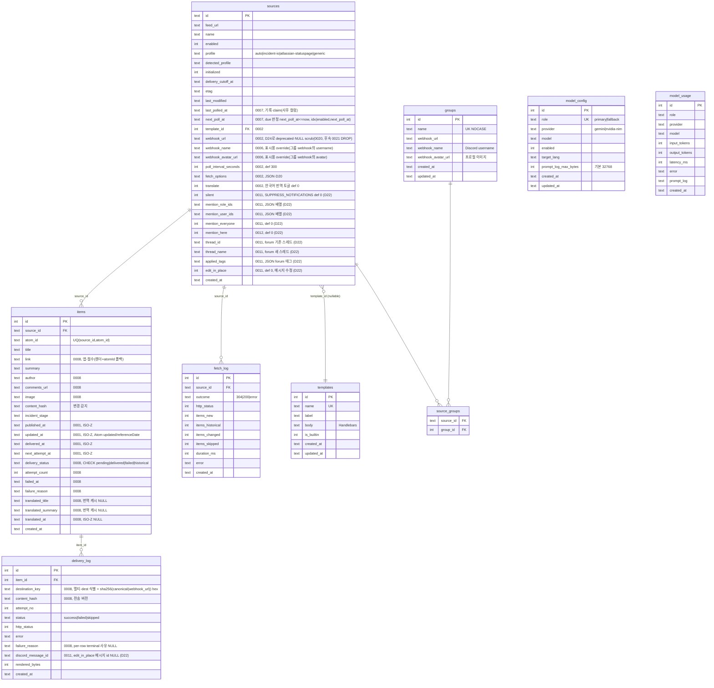
- `model_config`/`model_usage`는 FK 없는 **독립 테이블**(번역). `sources.template_id`는 nullable.
- 원칙: **식별=`atom_id`(불변), 변경=`content_hash`**.
- **ID 규약(N12)**: `sources.id`는 **앱 생성 TEXT**(노출·URL에 쓰임). 그 외 PK(`groups`/`templates`/`items`/`delivery_log`/`fetch_log`)는 **INTEGER AUTOINCREMENT**(내부용).

## 테이블 요지
- **groups / source_groups**(A3, 0006; **D24 채널 모델**): 그룹 = **전송 채널**(webhook 보유 **유일 주체**: `webhook_url`·name·avatar; **`webhook_url`은 optional** — 비면 그 그룹은 destination 미생성. template 없음). 소스 ↔ 그룹 N:M(`source_groups`), **소스는 그룹 최소 1개 필수**(D24 `assertRequiredGroups` — 옛 "소속 선택적·0개 가능"은 폐기). 전송 대상 = `webhook_url`이 있는 소속 그룹마다 destination 1개(**소스 자체 webhook 폴백 없음** — 소스엔 webhook URL이 없다, 0020 scrub), URL은 그룹 소유·name/avatar는 `blankToNull(source.X) ?? group.X`(표시용 override), threadId=source 소유, **canonical URL+threadId 기준 dedup**.
- **멀티-destination 전송/재시도**(#12, 0008): 재시도는 **item 전체**(item의 `delivery_status`/`attempt_count`로 추적)지만, `delivery_log`에 destination별로 `(destination_key, content_hash, status)`를 기록한다. **성공 스킵 판정** = `(item_id, destination_key, content_hash=현재)` success 행이 이미 있으면 그 destination은 건너뛴다(중복 방지). 이 스킵 기록은 `status='skipped'`. **콘텐츠가 변경되면 `content_hash`가 달라져** 이전 success 행과 매칭되지 않으므로 전 destination이 재전송된다. **번역 캐싱**(D-Q1): 번역이 비결정적 LLM 호출(D14)이므로 destination별 번역 불일치·중복 호출 차단을 위해 item별 번역 결과를 normalize 단계(Stage 2) 후 1회 계산하고 `items.translated_title`·`items.translated_summary` 또는 payload snapshot으로 영속화. 재시도 시 동일 번역 재사용 → 전송 payload 일관성 + API 호출 최소화(최대 5회 재시도에도 1회만 호출).
- **sources.enabled 토글**(D-Q2): enable/disable 절환이 `delivery_cutoff_at=now` 리셋 정책 적용. disable 시 pending item 보존(due 제외), re-enable 시 `next_attempt_at=now` 리셋. 0007 인덱스 `(enabled, next_poll_at)`에 의해 disabled 소스는 폴링 due 조회에서 제외(predicate `AND enabled=1`).
- **Discord 웹훅 기능확장**(D22, 0011): `sources`에 전송 옵션 추가(**source 소유**) — `silent`(알림 억제 `flags` 4096)·멘션(`mention_role_ids`/`mention_user_ids`/`mention_everyone`/`mention_here`(0012) → dispatcher가 `content`+`allowed_mentions` 주입, **임베드 아님**; @here·@everyone은 `parse:['everyone']` 공통 토큰)·forum(`thread_id`/`thread_name`/`applied_tags`)·`edit_in_place`(콘텐츠 변경 시 새 POST 대신 원본 `PATCH …/messages/{id}` 편집 — Status Page 상태 업데이트). `delivery_log.discord_message_id`로 편집 대상 추적(전송 시 `?wait=true`로 캡처). **destination_key는 thread_id 포함**으로 확장(thread 미사용 키 불변). **삭제·웹훅관리(생성/수정/삭제)는 미구현.**
- **templates**: 프리셋 DB 저장(D2). `is_builtin`로 빌트인 보존.
- **delivery_log**: 시도마다 1줄(재전송 디버깅). `destination_key`로 멀티-dest 구분, `content_hash`로 전송된 콘텐츠 버전 기록(0008). 번역 캐싱 보장을 위해 item별 동일 `content_hash` 유지.
- **fetch_log**: 폴별 new/historical/changed 카운트("이전 날짜 이벤트" 추적).
- **model_config/usage**: 번역 설정·로그. `prompt_log` 기본 ON(32768B, 의도된 정책).
- **retention**: 로그 3종 90일, 매일 자정 cleanup(런타임 잡). 모두 `created_at` 인덱스.

---

# 12. API Key 관리 (env, role 기반)

**원칙: 값마다 집은 하나.** model 설정은 DB(`model_config`)에만, **API Key는 env에만**. 겹침 없음 → precedence/정합성 문제 원천 차단.

```
PRIMARY_MODEL_API_KEY=...
FALLBACK_MODEL_API_KEY=...
```
- 키는 **역할 기반 env 이름**(provider 교체해도 env 불변). resolver: `role → ${ROLE}_MODEL_API_KEY`. provider는 클라이언트 선택만.
- 왜 env: SQLite 평문 → 백업·스냅샷·prompt_log·UI 응답에 비밀 섞임 차단. 키 교체는 재시작 필요(내부 도구라 수용).
- **정합성 = 의도(DB enabled) vs 능력(env 키 존재)의 단방향 파생 상태**(precedence 아님):
  `ready | disabled | missing-key | invalid-key`
  - ②부팅·①저장: 키 존재 정적 검증 → 없으면 경고+실효 비활성
  - ③사용: 401/403 → `invalid-key` 마킹 + graceful(원문 전송), `model_usage.error` 기록
- 역할 기반이라 "키-provider 불일치"는 use-time 401로만 검출 → UI에 "provider 교체 시 키 값도 교체" 안내.

---

# 13. 11개 피드 적용

| 그룹 | 피드 | 프로필 | 프리셋 |
|------|------|--------|--------|
| 도구상태 | OpenAI, Claude | incident-io / atlassian | incident-active |
| 보안위협 | CISA, CVE Feed | generic | news-article |
| 보안뉴스 | boannews(EUC-KR), TheHackerNews | generic | news-article |
| 기술개발 | InfoQ, 44bit, AwesomeBlogs | generic | news-article |
| 기술동향 | HackerNews, GeekNews | generic | link-discussion |

> CISA = `fetch_options.tlsMaxVersion='TLSv1.2'`(§9) · boannews = EUC-KR charset.
> 실측 픽스처(`rss-discord-bridge/test/mocks/feeds/`)는 이 11개 중 **6종**(CISA·CVEFeed·OpenAI·Claude·GeekNews·TheHackersNews)만 보유 — 나머지(boannews·InfoQ·44bit·AwesomeBlogs·HackerNews)는 운영 목표 피드이나 테스트 픽스처 미보유.

---

# 14. 미해결 — 판단이 필요한 열린 항목

> ADR(D1~D21)·운영 디테일은 확정. 아래는 구현 전/중에 판단이 필요했던 항목.
> 분류: **A** 설계 결정 · **B** 데이터/환경 검증 · **C** 소소한 정책(구현 중 결정).
> **A1~A4 모두 ✅ 확정 완료**(2026-05-28) — 아래는 결정 기록으로 보존. 현재 열린 것은 **B(검증)·C(소소)뿐**.

## A. 설계 결정 (코드 전 확정 권장)

### A1. `security-advisory` 프리셋 — ✅ **확정: 제거 유지(프리셋 4종)**
- **결정**: 별도 `security-advisory` 프리셋을 두지 않음. 보안위협 그룹(CISA·CVE)은 **`news-article` 프리셋** 사용.
- **근거**: cisa/cve를 generic으로 보내 `cvss/severity` 의미추출이 없으므로, security-advisory를 둬도 news-article과 사실상 동일 → 중복 제거.
- **부활 조건**: 훗날 `cve`/`cisa` normalizer로 severity를 추출하게 되면(A2 승급) 그때 색 구분용으로 재도입 가능(저비용, §6.8).

### A2. CVE Feed 처리 — ✅ **확정: (a) generic**
- **결정**: CVE Feed는 **일반화(generic) normalizer에서 다른 generic 피드와 함께 처리**. 별도 `cve` normalizer 미신설.
- **근거**(`test/mocks/feeds/CVEFeed.xml`, RSS): `title="CVE-2026-6957 - …"`로 **핵심 정보(CVE id)가 이미 title에** 있음 → generic floor만으로 사용 가능한 알림(제목+요약+링크). CISA와 일관(YAGNI).
- **generic 처리 동작**: `description`의 `<strong>CVE ID :</strong>… <strong>Published :</strong>…` → 태그 제거·공백 정리 → `summary`. 색은 news-article 블러플 고정.
- **포기하는 것**: description의 CVSS 기반 severity 색/필드(부가가치). 운영하며 보안 피드 색이 아쉬우면 **나중에 `cve` normalizer 1개 추가로 승급**(Envelope·엔진 불변, §6.8).

### A3. "그룹" 개념 — ✅ **확정: `groups` 테이블 + 소스 N:M** (⚠️ webhook 소유·소속 정책은 **D24로 갱신** — 아래 표시)
> **D24 갱신 요지**: 그룹=webhook 보유 **유일 채널**, 소스 자체 webhook URL 제거(0020 scrub), **소스 그룹 최소 1개 필수**(옛 "소속 선택적·0개 가능" 폐기), "그룹 0개면 소스 자체 webhook" 폴백 폐기. 아래 ~~취소선~~ 항목이 폐기분.
- **결정**: 그룹을 정식 엔티티로. **소스 ↔ 그룹 = N:M**(`source_groups` 정션). ~~그룹 소속은 선택적(소스가 0개 그룹이어도 됨).~~ → **D24: 소스 그룹 최소 1개 필수**(`assertRequiredGroups`).
- **그룹이 지정**: `webhook_url`(**optional** — 비면 그 그룹은 destination 미생성), `webhook_name`(Discord username), `webhook_avatar_url`(프로필 이미지). **`template_id`는 두지 않음** → 프리셋은 소스 전용(`sources.template_id`). **D24: 그룹이 webhook URL 보유 유일 주체.**
- **소스 표시용 override(per-field)**: 소스의 `webhook_name`/`webhook_avatar_url`은 그룹 webhook에 얹는 **표시용 override**(username/avatar) → **필드별로 `blankToNull(source.X) ?? group.X`**. ~~소스도 자체 webhook_url 지정 가능~~ → **D24: 소스엔 webhook URL 없음**(0020 scrub).
- **전송 대상 해석**(D24 `resolveDestinationsForSource`):
  - `webhook_url`이 있는 **소속 그룹마다** destination 1개: URL은 그룹 소유, name/avatar = `blankToNull(source.X) ?? group.X`, threadId=source 소유.
  - ~~그룹 0개면 소스 자체 webhook_url/name/avatar가 단독 destination.~~ → **D24 폐기: 소스 자체 webhook 폴백 없음.**
  - **canonical URL + threadId 기준 dedup**(같은 채널이면 1회만, 중복 방지).
- **검증**: ~~유효 destination 0개(그룹 없음 + 소스 webhook_url 없음) → 경고.~~ → **D24: 생성 시 그룹 최소 1개 필수로 차단**; 런타임에 destination 0개면 poller·dispatcher가 **skip**(pending 보존, 종결 실패 아님).
- **그룹명 유일성**: `groups.name` 은 UNIQUE(대소문자 무시, NOCASE) — 중복 그룹명 방지(`0006` `idx_groups_name_nocase`).
- 스키마·ERD → §11.

### A4. 번역(translation) 적용 범위 — ✅ **확정: 소스별 토글 → 한국어**
- **결정**: `sources.translate`(0/1) **토글**. 켜면 **원본 언어 무관**(영어·일본어 등 무엇이든)하게 **한국어로 번역**. 끄면 원문 그대로.
- **타깃 언어**: 한국어 고정 — `model_config.target_lang='ko'`(이미 기본값).
- **언어 감지 없음**: 소스 언어를 자동 판별하지 않음. 토글이 유일한 제어 → 한국어 피드(boannews/GeekNews)는 사용자가 토글 OFF. LLM이 "무슨 언어든 → 한국어"를 그대로 수행.
- **대상 필드**: `title` + `summary`.
- **시점**(D14): 정규화 후 → (토글 ON이면) 번역 → 프리셋 렌더 → 전송. **미리보기엔 미적용**(AI 호출 절감).
- 스키마: `sources.translate INTEGER NOT NULL DEFAULT 0`(sources 확장, 0002).

## B. 데이터/환경 검증 (코드 착수와 병행)

### B1. boannews EUC-KR
- **왜 열림**: Mock에 없음. 실제 charset 자동감지가 되는지, `fetch_options.charset='euc-kr'` 수동 지정이 필요한지 미확인.
- **할 일**: 라이브 1회 fetch → 응답 `Content-Type`/메타 charset 확인 → 자동감지 실패 시 수동 charset seed.

### B2. 의존성 네이티브 빌드 / 모델 검증
- **왜 열림**: `better-sqlite3`는 네이티브 모듈(플랫폼/Node 버전 의존), `@google/genai`·NVIDIA NIM 모델 ID는 카탈로그 검증 필요.
- **할 일**: `npm install` 후 동작 확인 + lock 고정. 모델 이름은 내 지식에 없어도 **존재하지 않음 단정 금지**(카탈로그/문서 먼저 확인).

## C. 소소한 정책 (구현 중 결정 가능 — 기록만)

| # | 항목 | 메모 / 잠정 |
|---|------|-------------|
| C1 | **예약 점검(maintenance) 항목** | 현재 OpenAI/Claude 샘플엔 없음. status page엔 발생 가능. **확정: maintenance 전용 처리 없음 — 마커 없으면 generic 폴백(자동)** |
| C2 | **incident 본문 타임스탬프 표시 여부** | 표시 안 하면 "연말 연도 보정" 자체가 불필요. **확정: entry `updated`만 표시 → 본문 타임스탬프·연도 보정 미구현** |
| C3 | **CISA `fetch_options` TLS 선(先)seed** | auto-detect가 학습하지만 첫 폴 1회 403 발생. **확정: 선seed — 알려진 host(CISA) 등록 시 `fetch_options`에 TLS 1.2 주입해 1회 실패 회피** |
| C4 | **피드별 폴링 주기 차등** | 전역 300초 default. 차등은 `poll_interval_seconds` source override로. **확정: 전 소스 300초 시작(차등은 운영 중 개별 조정)** |

---

# 15. 구현 단계

> **백엔드(Codex) 트랙의 권위 있는 구현 순서는 backend-spec §6**이며, 본 절은 두 트랙 전반의 개념적 의존 순서를 보인다. 프런트엔드(Gemini) 트랙은 frontend-spec의 구현 순서를 따른다.

레이어 의존 순서:
```
1) types.ts (FeedEnvelope/NormalizedItem/FetchOptions 계약)
2) Fetch (D20: Agent 캐시 + auto-detect & persist)
3) domain/normalize/generic + 단위 테스트
4) Stage 1 Envelope (RSS/Atom 통일)
5) domain/normalize/incident (OpenAI/Claude 2분기, Mock 픽스처)
6) Repository + scheduler 코어 (dedup·cutoff·변경감지)
7) Dispatcher + 프리셋 시드 (Handlebars + ajv + Discord)
8) 마이그레이션 0002~0006 (A3 groups·A4 translate 반영)
9) Logs/ModelUsage UI (app.js fetch + SSE)
```
- 1~3까지면 **첫 단위 테스트 실행 가능**(Mock 픽스처 기반).
- **A1·A2·A4는 8)(마이그레이션·프리셋 시드) 전에**, A3는 6)/8) 전에 확정돼 있으면 재작업 없음.
- **스키마/migration(`0002`~`0006`)은 §11대로 초기(Turn 1)에 일괄 선작성 완료** — 위 8)은 '신규 작성'이 아니라 *적용 + 프리셋 시드* 단계이며, 사후 추가는 `0007_*`(poll state)·`0008_*`(delivery state + 렌더 데이터)·`0009_*`(model_config 재시드)·`0010_*`(ISO 타임스탬프 백필)·`0011_*`(웹훅 기능 D22)·`0012_*`(@here)·`0013_*`(incident 프리셋 통합)·`0014_*`(generic 해시 축소)·`0015_*`(source_destinations D23)·`0016_*`(feed_url UNIQUE)·`0017_*`(source_destinations canonical UNIQUE)·`0018_*`(런타임 ts ISO-Z 백필)·**`0019_*`(source_destinations DROP, D24)**·**`0020_*`(소스 webhook scrub, D24)**다(기존 0001~0006 수정 금지).

---

# 16. 3대 설계 원칙

1. **2단계 분리** — 형식(Stage 1 Envelope) / 내용(Stage 2 Normalize). 어려움을 Stage 2에 격리.
2. **identity ≠ change** — 식별은 `atom_id`(불변), 변경은 `contentHash`. 중복·누락·재전송 방지.
3. **순수·결정적 정규화** — 같은 입력→같은 출력→해시 안정→"과거 이벤트 재전송" 버그 구조적 차단.

---

# 17. Export/Import (설정 백업·이전, D21)

소스(RSS 등록)와 그룹(웹훅 묶음)의 **설정을 JSON 1파일로 내보내고(export)/가져오는(import)** 기능. 용도: 백업·복원, 다른 인스턴스로 이전, 설정 공유. (상세 계약: API·포맷 = backend-spec §3.1, 서비스·트랜잭션 = backend-spec §4.9, UI = frontend-spec §4.2.)

- **스코프**: `sources` + `groups` + N:M 멤버십만. `items`·로그·`model_config`·사용자 복제 템플릿은 **미운반**(템플릿은 빌트인 슬러그 참조만). DB id가 아니라 **안정 참조**(group=`name`, source=`feedUrl`)로 운반.
- **🔒 secret 제외(webhook URL · fetchOptions headers)**: export는 직렬화 **화이트리스트**라 `webhook_url`이 빠진다(API 키 env-only·R5-destkey-hash와 동일 위생 — 평문 URL을 백업·공유 파일에 노출 금지). **`fetchOptions`도 화이트리스트(`charset`/`userAgent`/`tlsMaxVersion`/`timeoutMs`)만 export하고 `headers`는 제외** — 사용자가 `Authorization`·`Cookie`를 넣었을 수 있어 secret 유출 방지(backend §3.1·§9.5). → **신규 insert되는 그룹/소스는** 웹훅이 비어 **전송 대상 없음**이고, 운영자가 재입력해야 전송된다(overwrite는 기존 webhook 보존; 기존 no_destination 경고 재사용).
- **import = (신규 소스) 신규 등록 취급(3대 불변식 정합)**: **새로 insert되는 소스만** **`delivery_cutoff_at=now`·`initialized=0`**으로 시작 → 첫 폴이 기존 피드 항목을 전부 **historical baseline으로 저장만** 하고 전송하지 않는다(§5.6 cutoff lifecycle). **기존 `feedUrl`을 `overwrite`하는 경우는 그 소스의 `cutoff`·`initialized`·`items` 런타임 상태를 보존**하고 설정 컬럼만 갱신한다(§5.6 재활성화 규칙과 정합 — 기존 폴 상태를 깨지 않음). `items`를 운반하지 않으므로 **"등록 후 과거 이벤트 재전송" 버그(§16)를 import 경로에서도 구조적으로 차단**한다.
- **import 안전**: 파일은 신뢰 경계 밖 → 모든 `feedUrl`을 **SSRF 재검증**(§9). conflict는 두 갈래 — **import 파일 내부에 같은 feedUrl/name 중복이면 `400 validation_error`**(파일 자체 모순), **DB 기존과의 중복(이름/feedUrl)은 `skip` 기본**(overwrite 옵션 — 이때도 webhook_url·items·cutoff 보존; app-level 유일성이라 overwrite 대상 결정적; 상세 backend §3.1). **dry-run**으로 "추가/충돌/SSRF 차단/웹훅 재입력 필요(신규 webhook-less row만 — overwrite는 기존 webhook 보존)"를 미리 확인한 뒤 commit.
- **스키마 영향 없음**: 기존 4테이블(`sources`·`groups`·`source_groups`·`templates`) read/write만 → **신규 마이그레이션 불요**. (신규 npm 의존 `@fastify/multipart` 1건.)

---
*본문(§1~§17)은 2026-05-28 기준 재작성 설계 통합본.*

---

# 부록 A. 원본(삭제된) 코드베이스 분석 — 재작성의 근거

> ⚠️ **이하 부록 A는 삭제된 원본 코드베이스의 분석(역사 기록)이며 현 설계가 아니다.** React/Vite/WebSocket/DnD 등은 *재작성에서 제거된* 항목이다 — 현 설계 규칙(서버 렌더 Handlebars+htmx·SSE 단방향·no React/WS/DnD)은 §1~§17을 따른다. 구현 시 부록 A를 현 설계로 오인하지 말 것.

> 아래는 재작성 이전 원본 `rss-discord-bridge`(현재 소스 삭제됨)의 분석이다. **재작성이 왜 필요했는지의 근거** — 특히 §2.3 `on_change` cutoff 우회, §3.4 contentHash 불안정(= "과거 이벤트 재전송" 버그) — 을 보존한다. 원본은 React 19+Vite/WebSocket/DnD/Monaco 기반이었고 본문 설계(§1~§16)가 이를 대체한다. 라인 번호·파일 경로는 삭제된 원본 기준(역사적 참고).

### 아키텍처 한눈에 보기

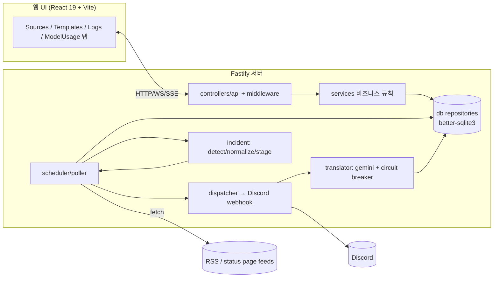

### 핵심 동작 흐름 (요약)

1. **소스 등록** → `SourceService.create` 가 `delivery_cutoff_at = now`, `initialized = false` 로 저장.
2. **첫 폴링(초기화)** → 기존 항목 적재하되 cutoff 이전 항목은 *historical* 로 표시해 전송하지 않고 `initialized=true` 로 전환.
3. **후속 폴링** → 신규 GUID 항목만 전송. `update_tracking_mode='on_change'`(=UI의 Status Page 옵션)이면 기존 항목의 `contentHash` 변경을 감지해 업데이트도 재전송하며 **cutoff 를 우회**.
4. **status page 정규화** → 누적 description 에서 최신 segment 만 떼어 요약/해시 계산.
5. **디스패치** → 템플릿 렌더 → (옵션) 번역 → SSRF 방지 fetch 로 Discord 전송, 실패 시 재시도.

### 알려진 주의 영역 (등록 후 과거 이벤트 전송 문제)

- `on_change` 분기가 **cutoff 를 우회**합니다. 초기화 이후 poll 에서 기존 GUID 항목의 contentHash 가 바뀌면 cutoff 무시하고 전송 → §2 참조.
- `normalize.ts` 의 `referenceDate = item.lastUpdatedAt ?? item.publishedAt` 이지만 파서가 `lastUpdatedAt` 을 채우지 않아 실질적으로 항상 `publishedAt` 이 기준 → §3 참조.
- OpenAI status 피드는 incident 가 업데이트될 때마다 item 의 `pubDate` 가 최신 시각으로 갱신됩니다. 옛 incident 가 업데이트되면 contentHash 비교 경로에서 재처리될 수 있어, "이전 날짜 이벤트가 계속 올라오는" 증상과 직결됩니다.

---

## 1. 런타임 & 부팅

> 신뢰도: **요약** — 영역 분석 요약에 기반. 세부(정확한 라인 번호 등)는 코드 복구 후 재검증 필요.

Node.js + TypeScript + Fastify 서버. better-sqlite3 로 로컬 SQLite 에 상태를 두고, React(Vite) 빌드 결과를 같은 서버에서 SPA 로 서빙합니다.

### 부팅 시퀀스

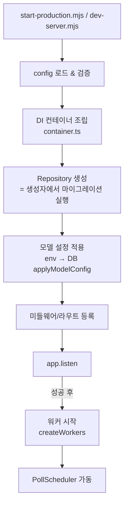

주요 검증 포인트(요약):
- **워커는 `app.listen` 성공 이후에 시작**됩니다 (`app.ts:234` 부근).
- **마이그레이션은 `Repository` 생성자 안에서** 실행됩니다 (idempotent ALTER + UUID 스왑, `runtime/migrator.ts`).
- fallback 모델 필드는 env 로 부트스트랩되지만 **DB 가 최종 권위**(`applyModelConfig`, `config.ts:177` / `app.ts:79` 부근).

### 설정 (`config.ts`)

주요 환경변수(요약 — 기본값/이름은 복구 후 재확인 권장):

| 환경변수 | 용도 |
|---|---|
| `PORT` / 바인드 주소 | 서버 리슨 (loopback-only 불변식 존재) |
| 프로덕션 키 | 프로덕션 모드 필수 키 검증 |
| `MODEL_PROMPT_LOG_MAX_BYTES` (legacy `GEMINI_PROMPT_LOG_MAX_BYTES`) | **(폐지) env 로 읽지 않음** — 프롬프트 로깅 상한은 `model_config.prompt_log_max_bytes`(DB) 설정으로 이전(`/model` UI 편집). 기본 32768·기본 ON 은 DB 시드로 유지 |
| 모델/fallback 관련 | env 로 부트스트랩 후 DB 가 권위 |

> 정책 메모: 프롬프트 로깅 기본 ON 은 의도된 정책이며, fallback lazy load 의 cold start(+600ms)도 의도된 정책입니다. "문제"로 다루지 않습니다.

### DI 컨테이너 (`runtime/container.ts`)
- repository → service → dispatcher/scheduler 순으로 조립.
- 스케줄러 ↔ 디스패처의 순환 의존은 `schedulerRef` 같은 지연 참조로 해소.

### 스케줄러 / 워커
- `scheduler/scheduler.ts` 의 `PollScheduler` 가 소스별 폴링 주기를 관리.
- `workers/index.ts` 의 `createWorkers` 가 retry/health 등 백그라운드 워커를 기동.

### 그레이스풀 셧다운 / abort / request-context
- `runtime/shutdown.ts`: 단일 flight 보장하며 정해진 순서로 종료.
- `runtime/abort.ts`: AbortSignal 기반 진행 중 작업 취소.
- `runtime/request-context.ts`: AsyncLocalStorage 로 요청 컨텍스트 전파.

### 프로덕션 시작 & 스크립트 (`package.json`)
- `build`: `tsc -p tsconfig.server.json && vite build && emit-version.mjs`
- `start`: `node scripts/start-production.mjs`
- `dev` / `dev:web`, `test`(vitest), `typecheck`, `db:optimize`, `doctor:native`, `rebuild:native`

**관련 파일**: `src/server/{app,config,types,errors}.ts` · `src/server/runtime/{container,migrator,native-dependencies,request-context,abort,shutdown,version,sample}.ts` · `src/server/scheduler/scheduler.ts` · `src/server/workers/index.ts` · `scripts/start-production.mjs`

---

## 2. 폴링 & 디스패치 ★

> 신뢰도: **직접 검증** — 이 대화에서 `poller.ts`, `source.service.ts` 를 직접 읽고 작성. 라인 번호는 직전 스냅샷 기준.

폴링 엔진은 소스별로 RSS 를 fetch → 파싱 → DB 적재 → Discord 전송하는 파이프라인입니다. 핵심 파일은 `src/server/scheduler/poller.ts`.

### 전체 흐름

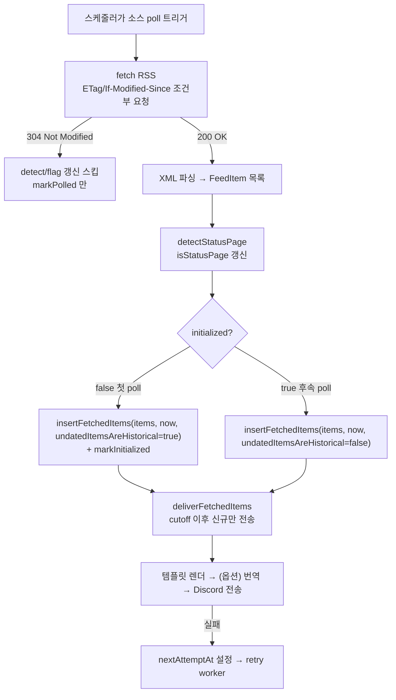

### 2.1 fetch 와 조건부 요청 / 304

- 소스에 `etag` / `last_modified` 가 있으면 `If-None-Match` / `If-Modified-Since` 헤더를 실어 보냅니다 (`poller.ts:500` 부근).
- **304 Not Modified** 응답은 body 가 없어 `generator`/`description` 둘 다 null → custom domain status page 가 `detectStatusPage` 에서 false 로 오판될 수 있어, 304 분기에서는 **detect 호출과 `setStatusPageFlag` 갱신을 모두 스킵**하고 기존 `source.isStatusPage` 를 유지합니다 (`[STATUSPAGE-304]`, `poller.ts:39-41, 143-154`).
- 성공/실패/304 모든 경우에 `markPolled(source.id)` 로 갱신 (`poller.ts:181-183`).

### 2.2 delivery cutoff & initialized 메커니즘 ★

신규 소스 등록 시 **과거 이벤트가 Discord 로 쏟아지는 것을 막는** 핵심 장치입니다.

**cutoff 설정 위치 (`source.service.ts`)**
- **생성 시**: `delivery_cutoff_at = new Date().toISOString()` (`source.service.ts:74-75, 103`).
- **갱신 시 reset 조건** (`source.service.ts:168-181`): 아래 중 하나면 `initialized=0`, `etag=null`, `last_modified=null`, `delivery_cutoff_at=now`.
  - `feedUrlChanged` — feedUrl 이 실제로 바뀜
  - `enabled` 가 false→true 전환
  - `trackingTurningOn` — `update_tracking_mode` 가 `off`→`on_change` 로 처음 켜짐
- 같은 feedUrl 재저장 PATCH 는 reset 하지 않음.

**cutoff 판정 (`isBeforeDeliveryCutoff`, `poller.ts:785-795`)**
```
cutoff = parseDate(source.deliveryCutoffAt)
if (!cutoff) return false                              // cutoff 없으면 모두 신규 취급
publishedAt = parseDate(item.publishedAt)
if (!publishedAt) return undatedItemsAreHistorical     // 날짜 못 읽으면 파라미터에 위임
return publishedAt.getTime() < cutoff.getTime()        // cutoff 이전이면 historical
```
- `historical === true` → `deliveredAt=now` 로 적재(전송 처리 완료 표시)하고 **전송 안 함**.
- `historical === false` → `newItems` 에 push 되어 **전송됨**.

**undatedItemsAreHistorical 파라미터**
- **첫 초기화 poll**: `true` (`poller.ts:163`) — 날짜 못 읽는 항목도 historical 로 간주.
- **후속 poll**: `false` (`poller.ts:171`) — 날짜 없는 항목은 신규로 간주.
- 이 파라미터는 **날짜 파싱 실패 항목에만** 영향. 날짜 정상 항목은 항상 cutoff 와 비교됩니다.

### 2.3 on_change(Status Page 옵션) 업데이트 분기 ★

`update_tracking_mode === 'on_change'` 이면 `trackUpdates=true` → 기존 GUID 항목을 bulk 조회(`findManyByGuids`, `[CODEX-23]`)해 변경을 추적합니다. `insertFetchedItems` 내부(`poller.ts:206-262`):

| 조건 | 처리 |
|------|------|
| 기존 row, contentHash 동일 | `continue` (스킵) |
| 기존 row, `existing.contentHash` 빈 값/NULL | `[BASELINE-LEARNING]` — hash 만 채우고 전송 안 함 (`updateContentHashOnly`) |
| 기존 row, hash 변경, **첫 init poll** (`undatedItemsAreHistorical=true`) | cutoff 정책 적용 — cutoff 이전 업데이트는 historical (`poller.ts:227-245`) |
| 기존 row, hash 변경, **후속 poll** | **cutoff 우회** — `deliveredAt=null` 로 갱신 후 전송 (`poller.ts:246-262`) |
| 신규 GUID | `isBeforeDeliveryCutoff` 판정 후 `insertNew` (`poller.ts:265-267`) |

> ★ **과거 이벤트 재전송 문제의 핵심**: 후속 poll 의 hash-변경 분기는 cutoff 를 우회합니다(`poller.ts:246-262`). "이미 DB 가 아는 항목의 진짜 업데이트는 backlog 가 아니다"라는 의도지만, **contentHash 가 poll 마다 불안정하면** 옛 incident 들이 매번 "변경"으로 오인되어 cutoff 를 뚫고 반복 전송됩니다. → §3 의 contentHash 안정성 분석 참조.

### 2.4 dedup 과 contentHash
- 항목은 `[...items].reverse()` 로 오래된 것부터 처리 (`poller.ts:197`).
- `contentHashForItem(rawItem)` 로 raw hash 를 구하고, `enrichItem`(=`normalizeIncidentItem`)이 incident 모드에서 최신 segment 기준으로 hash 재계산 (`poller.ts:198-202`). 누적 본문 raw hash 로 비교하면 매 poll 변경 오인 발생.
- 신규=`insertNew`, 변경=`updateContent`, baseline 학습=`updateContentHashOnly`.

### 2.5 Discord 디스패치 & 재시도
- `deliverFetchedItems(source, newItems)` 가 템플릿 렌더 → (옵션) 번역 → payload 빌드 → 전송.
- retry worker 와 중복 실행 방지를 위해 `nextAttemptAt = retryGraceDate()` grace (`poller.ts:239, 256`). historical row 는 `nextAttemptAt=null`.
- 실패 시 `deliveryLogService.add({status:'failed', ...})` (`poller.ts:175-179`).
- 웹훅 전송은 SSRF 방지 pinned-fetch / discord-webhook-fetch 래퍼 경유.

### 2.6 RSS 인그레스 보안
- `feed-url-ingress` / `pinned-fetch` 로 feedUrl 의 SSRF 차단.
- `rss-security` / `xml-encoding` 이 파싱 전 XML 안전성/인코딩 처리.

**관련 파일**: `src/server/scheduler/{poller,dedup,rss-security,xml-encoding}.ts` · `src/server/dispatcher/{discord-payload,render,source-resolve,webhook}.ts` · `src/server/security/{discord-webhook-fetch,pinned-fetch,feed-url-ingress}.ts` · `src/server/services/source.service.ts`

---

## 3. Incident & Status Page 처리 ★

> 신뢰도: **직접 검증** — 이 대화에서 `normalize.ts`, `stage.ts`, `content-hash.ts` 전체와 `poller.ts` 사용부를 직접 읽고 작성.

OpenAI(incident.io) / Atlassian Statuspage 류 피드는 **한 RSS entry 의 description 에 그 incident 의 모든 status update 가 누적**됩니다. 이 코드는 "등록 이후의 현재 단계"만 보내기 위해 누적 본문에서 최신 segment 만 추출합니다.

### 3.1 Status Page 자동 감지 (`detector.ts`)
- `detectStatusPage({ generator, description, host, ... })` 가 channel 메타(`generator`), 첫 item description 패턴, host(`status.*`) 등으로 판단.
- poller 가 매 200 응답마다 호출해 `setStatusPageFlag` 갱신(304 는 스킵).

### 3.2 누적 description → 최신 segment (`normalize.ts` + `stage.ts`)

**normalizeIncidentItem (`normalize.ts:6-28`)**
```
isIncidentMode = source.isStatusPage || source.updateTrackingMode === 'on_change'
referenceDate  = item.lastUpdatedAt ?? item.publishedAt           // (주의 ↓)
summarySource  = isIncidentMode
    ? (extractLatestIncidentSegment(item.summary, referenceDate) ?? item.summary)
    : item.summary
title   = localizeIncidentTitle(item.title, source.incidentLocale)
summary = localizeIncidentText(summarySource, source.incidentLocale)
incidentStage = isIncidentMode ? extractIncidentStage(item.summary, referenceDate) : null
finalContentHash = isIncidentMode
    ? computeContentHash({ title, summary, publishedAt: item.publishedAt })   // 최신 segment 기준
    : contentHash                                                              // 원본 기준
```

> ⚠️ **검증된 함정**: `referenceDate` 는 `item.lastUpdatedAt ?? item.publishedAt` 이지만, 파서(`poller.ts:578-588` 부근, `publishedAt: normalizeDate(item.isoDate ?? item.pubDate)`)가 **`lastUpdatedAt` 을 채우지 않습니다.** 따라서 실질적으로 항상 `publishedAt` 이 reference.

**extractLatestIncidentSegment (`stage.ts:88-130`)**
- description 의 stage marker 들을 모두 찾고, marker 주변 단락 타임스탬프(`timestampSortKey`)로 정렬해 **가장 최신 marker** 선택.
- 날짜 있는 marker 2개 이상이면 최신 timestamp, 아니면 `matches[0]`(누적 피드 보통 맨 위가 최신).
- 선택 marker 를 감싸는 `<p>...</p>` 블록만 슬라이스. `<p>` 없으면 marker 주변 **±160자 window** fallback.

### 3.3 Incident stage 추출 (`stage.ts:51-75`)
두 포맷 커버:
- **OpenAI**: `<b>Status: Monitoring</b>`
- **Atlassian/Claude**: `<strong>Resolved</strong>`

가능 stage: `Investigating · Identified · Monitoring · Resolved · Update · Postmortem`.

**타임스탬프 정렬 & 연도 경계 보정 (`timestampSortKey`, `stage.ts:137-165`)**
- 누적 description 타임스탬프는 `May 27, 05:31 UTC` 처럼 **연도 없음**.
- `referenceDate`(=publishedAt) 근처 연도로 보정하되, 후보가 reference 보다 반년(183일) 이상 미래면 작년, 반년 이상 과거면 내년으로 조정 → "Dec 31 vs Jan 1" 연말 경계 오판 방지.

### 3.4 contentHash 안정성 분석 ★
`content-hash.ts` 의 `computeContentHash` 는 `title + "\n" + summary + "\n" + (publishedAt ?? '')` 의 SHA-256. incident 모드에서는 입력이 **최신 segment 기준**.

같은 incident 가 매 poll 동일 hash 를 내려면 세 입력이 모두 안정적이어야 합니다. **불안정해질 수 있는 경우**(과거 이벤트 재전송 후보 원인):

1. **publishedAt churn**: OpenAI 피드는 incident 에 새 업데이트가 달리면 item `pubDate` 가 최신 시각으로 갱신 → publishedAt 변경 → hash 변경. (정상이라면 "진짜 업데이트"일 때만 발생해야 함.)
2. **`<p>` 블록 바이트 불안정**: 슬라이스 단락의 공백/엔티티/속성이 피드 측에서 미세 변경되면 summary 바이트가 달라져 hash 변경.
3. **타임스탬프 미부착 marker**: 파싱 가능한 타임스탬프가 없으면 `matches[0]` fallback 의존 → 항목 정렬 순서가 흔들리면 다른 segment 선택 가능.

하나라도 발생하면 §2.3 의 **on_change 후속 poll 분기(cutoff 우회)** 가 옛 incident 를 "변경"으로 보고 반복 전송합니다.

### 3.5 locale / presentation
- `locale.ts`: `localizeIncidentTitle` / `localizeIncidentText` 로 stage 표기 등을 incidentLocale 에 맞게 정규화(규칙 기반, LLM 번역과 별개).
- `presentation.ts`: 최종 Discord 표현(stage 라벨/색상 등) 구성.

### 3.6 실제 OpenAI 피드 예시
`https://status.openai.com/feed.rss` item 구조(직접 확인):
```xml
<item>
  <title><![CDATA[Increase in users hitting Codex rate limits]]></title>
  <guid>https://status.openai.com//incidents/01KS88SRADTWQW27NYRAXMBAQN</guid>
  <pubDate>Sat, 23 May 2026 10:58:20 GMT</pubDate>
  <!-- content:encoded 안에 Investigating → Identified → Monitoring → Resolved 가 누적 -->
</item>
```
- `pubDate` 는 **그 incident 의 최신 업데이트 시각**이라, 며칠 전 생성된 incident 도 방금 업데이트되면 목록 최상단으로 올라오고 `pubDate` 가 최신이 됩니다.
- 이 코드는 누적 본문에서 **마지막 segment 만** 떼어 요약/stage/hash 를 만들어 "현재 단계"만 보내려 합니다. 추출이 어긋나거나 hash 가 불안정하면 옛 날짜 incident 가 다시 올라오는 증상으로 이어집니다.

**관련 파일**: `src/server/incident/{detector,normalize,stage,content-hash,locale,presentation}.ts` · 사용부 `src/server/scheduler/poller.ts`

---

## 4. 데이터 계층

> 신뢰도: **요약** — 일부(`SourceService` cutoff reset 라인)는 이 대화에서 직접 확인. 테이블 컬럼 세부는 코드 복구 후 재검증 권장.

better-sqlite3 기반. **repository(순수 DB 접근, DML)** 와 **service(비즈니스 규칙)** 를 분리합니다.

### 아키텍처 원칙
- **Repository**: SQL 실행만. defaults/암호화/cutoff 같은 규칙 없음.
- **Service**: 기본값 해석, 템플릿 기본값, cutoff/initialized 갱신, 암호화 등 도메인 규칙 담당.
- 런타임 스키마 source of truth 는 `schema.ts`. 일부 fallback 컬럼은 `runtime/migrator.ts` 의 ALTER 로 추가(`schema.sql` 은 문서용으로 일부 차이).

### 핵심 테이블 (요약)

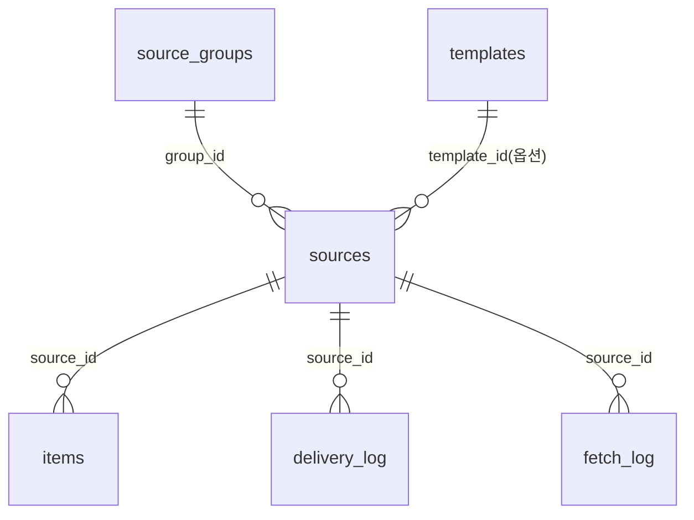

| 테이블 | 목적 |
|---|---|
| `sources` | RSS 소스 정의 + 라이프사이클 상태 |
| `items` | 수집 항목, 전송/해시 상태 |
| `templates` | Discord 메시지 템플릿 |
| `source_groups` | 소스 그룹(공통 설정 상속) |
| `delivery_log` | Discord 전송 결과 로그 |
| `fetch_log` | RSS fetch 결과 로그 |
| `audit_log` | 관리 작업 감사 로그 |
| `health_config` / `health_monitor` | 헬스 모니터 설정/상태 |
| `model_config` / `model_usage` | LLM 모델 설정/사용량 |
| `translation` | 번역 결과 캐시/저장 |

### sources 라이프사이클 컬럼 ★

| 컬럼 | 의미 | 갱신 주체 |
|---|---|---|
| `delivery_cutoff_at` | 이 시각 이전 항목은 전송 안 함 | SourceService(생성/특정 PATCH) |
| `initialized` | 첫 폴링 완료 여부 | poller(`markInitialized`) / 특정 PATCH 가 reset |
| `update_tracking_mode` | `off` / `on_change`(=Status Page 옵션) | SourceService |
| `is_status_page` | status page 자동 감지 결과 | poller(`setStatusPageFlag`) |
| `etag` / `last_modified` | 조건부 요청용 캐시 검증자 | poller(fetch 응답) |

### SourceService create/update (직접 확인)
- **create**: `delivery_cutoff_at = new Date().toISOString()`, `initialized=false` 명시 저장 (`source.service.ts:74-75, 103`).
- **update cutoff reset 조건** (`source.service.ts:168-181`): `feedUrlChanged` 또는 `enabled` false→true 또는 `trackingTurningOn`(off→on_change) → `initialized=0`, `etag=null`, `last_modified=null`, `delivery_cutoff_at=now`. 같은 feedUrl 재저장 PATCH 는 reset 안 함.

### 암호화 필드
- Discord webhook URL, update webhook URL 등 비밀값은 `SecretBox`(crypto) 로 암호화해 `*_encrypted` 컬럼에 저장. 빈 문자열/null = 해제.

### 트랜잭션 (`db/transaction.ts`)
- poller 의 fetch+insert+initialized 갱신을 한 트랜잭션으로 묶음 (`inTransaction(...)`).

### items 리포지토리 동작
- `insertNew(item, deliveredAt, nextAttemptAt)` — 신규 삽입(GUID 중복 시 무시).
- `updateContent(id, {...})` — 변경 항목 갱신.
- `updateContentHashOnly(id, hash)` — baseline 학습 시 hash 만.
- `findManyByGuids(sourceId, guids)` — on_change 변경 추적 bulk 조회(N+1 회피, `[CODEX-23]`).

**관련 파일**: `src/server/db/*.repository.ts` · `src/server/db/{schema.ts,schema.sql,repository.ts,transaction.ts}` · `src/server/services/{source,source-group,item,template,delivery-log,audit-log}.service.ts`

---

## 5. 번역 서브시스템

> 신뢰도: **요약** — 엔드포인트/필드 세부는 코드 복구 후 재검증 권장.

incident 텍스트 등을 LLM(Google Gemini / NVIDIA NIM 류 엔드포인트)으로 번역하며, circuit breaker 와 사용량 추적을 갖춥니다.

### 파이프라인 흐름
- 디스패치 직전 incident 텍스트를 번역해 Discord 로 보낼 수 있습니다.
- 결과는 `translation` 리포지토리에 저장/캐시되어 재번역 비용을 줄입니다.
- `translation.service.ts` 가 캐시 조회 → translator 호출 → 저장을 조율.

### 구성요소
- `translator/translator.ts`: 오케스트레이션(모델 선택, fallback, circuit breaker 연동).
- `translator/gemini.ts`: 실제 LLM API 호출.
- `translator/xml-envelope.ts`: 프롬프트를 XML 봉투로 안전하게 감싸고 응답 파싱(인젝션/경계 안전성).
- `translator/circuit-breaker.ts`: 연속 실패 시 호출 차단.

### Circuit Breaker 상태

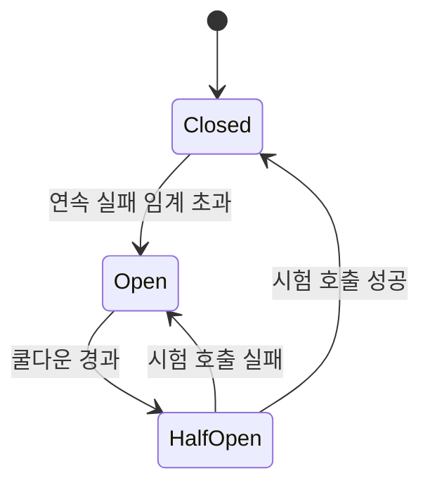

### 모델 설정 / fallback
- `model-config` 서비스/리포지토리: 활성 + fallback 모델 구성. env 로 부트스트랩하되 DB 가 최종 권위.
- **fallback lazy load 의 cold start(+600ms)는 의도된 정책** — warmup ping/heartbeat 권유 안 함.

### 사용량 추적 / 로깅
- `model_usage` 에 호출량/토큰 기록.
- 프롬프트 로깅 상한: **`model_config.prompt_log_max_bytes`(DB 설정, `/model` UI 편집 가능)**, 기본 32768, **기본 ON 정책**(동작만 기술). 구 env var `MODEL_PROMPT_LOG_MAX_BYTES`(legacy `GEMINI_PROMPT_LOG_MAX_BYTES`)는 폐지·무시.

### 관련 API (요약)
| 경로(추정) | 용도 |
|---|---|
| `translate` | 즉시 번역 |
| `retranslate` | 기존 항목 재번역 |
| `translator-stats` | 번역기/circuit breaker 통계 |
| `model-config` | 모델 설정 조회/변경 |

**관련 파일**: `src/server/translator/{translator,gemini,circuit-breaker,xml-envelope}.ts` · `src/server/services/{translation,model-config}.service.ts` · `src/server/db/{model-config,model-usage,translation}.repository.ts` · `src/server/controllers/api/{translate,retranslate,translator-stats,model-config}.ts`

> NVIDIA NIM 호출 코드를 다룰 때는 docs.nvidia.com/nim/large-language-models reference 를 우선 참조하세요.

---

## 6. 웹 UI & HTTP API

> 신뢰도: **요약** — 엔드포인트 목록/필드 세부는 코드 복구 후 재검증 권장.

React 19 + Vite 관리 UI 와 Fastify HTTP/WebSocket API.

### 프런트엔드 구조
- **탭 기반 SPA**: `App.tsx` 의 탭 상태로 Sources / Templates / Logs / ModelUsage 전환(별도 라우터 없이 tab-state).
- `NoticeContext` 로 전역 알림.
- 도메인별 hook: `useSources`, `useTemplates`, `useSourceGroups`, `useHealthMonitor`, `useModelUsage` 등.
- `lib/api.ts` 가 fetch 래퍼.

### 실시간 스트림
- `useLogStream`: SSE 기반 실시간 로그.
- `usePreviewSocket`: WebSocket 기반 미리보기.

### 소스 폼 & Status Page 옵션
- `lib/source-form.ts` + `tabs/SourcesTab.tsx` 가 소스 등록/편집 폼.
- **"Status Page 옵션"** = `update_tracking_mode` 토글(`on_change`). 켜면 `statusPageExtras` 영역이 펼쳐지고 update webhook URL 등이 노출 (`SourcesTab.tsx:650-692` 부근).
- 이 토글을 off→on 으로 켜면 서버에서 cutoff/initialized 가 reset 됨(§4 참조).

### 템플릿 빌더
- `@dnd-kit` 기반 드래그앤드롭: `DnDCanvas`, `BlockPalette`, `BlockProperties`.
- `embed-builder.ts` 로 Discord embed 구성, `DiscordPreview` 로 실시간 미리보기.
- 코드 편집은 Monaco(`CodeEditor`).

### HTTP/WS/SSE 엔드포인트 (요약)
`src/server/controllers/api/` 기준 주요 그룹:

| 그룹 | 용도 |
|---|---|
| `sources`, `source-config`, `source-groups` | 소스 CRUD / 설정 / 그룹 |
| `items` | 수집 항목 조회 |
| `templates` | 템플릿 CRUD |
| `preview`, `preview-socket` | 메시지 미리보기(HTTP/WS) |
| `log-stream`, `logs` | 로그 조회 / SSE 스트림 |
| `health-config` | 헬스 모니터 설정 |
| `meta` | 메타/버전 정보 |
| `translate`, `retranslate`, `translator-stats`, `model-config` | 번역 관련(§5) |

### 미들웨어 / 보안
- `middleware/admin-origin.ts` + `security/admin-origin.ts`: 관리 UI 출처(Origin) 검증.
- `middleware/rate-limit.ts`: 요청 속도 제한(@fastify/rate-limit).
- `middleware/error-handler.ts`: 통일된 에러 응답.
- `controllers/web/spa.ts`: 빌드된 SPA 서빙.
- `security/webhook-url.ts`: Discord webhook URL 형식/안전성 검증.
- `security/crypto.ts`(`SecretBox`): webhook URL 등 비밀값 암호화(§4).

**관련 파일**: `src/web/src/{App,main}.tsx` · `src/web/src/{tabs,hooks,lib,components}/*` · `src/server/controllers/api/*.ts` · `src/server/controllers/web/spa.ts` · `src/server/middleware/*.ts` · `src/server/security/{admin-origin,webhook-url,crypto}.ts`

---
*요약본 통합 작성: 2026-05-27. 소스 코드 부재 상태에서 작성됨 — 코드 복구 후 재검증 권장.*
