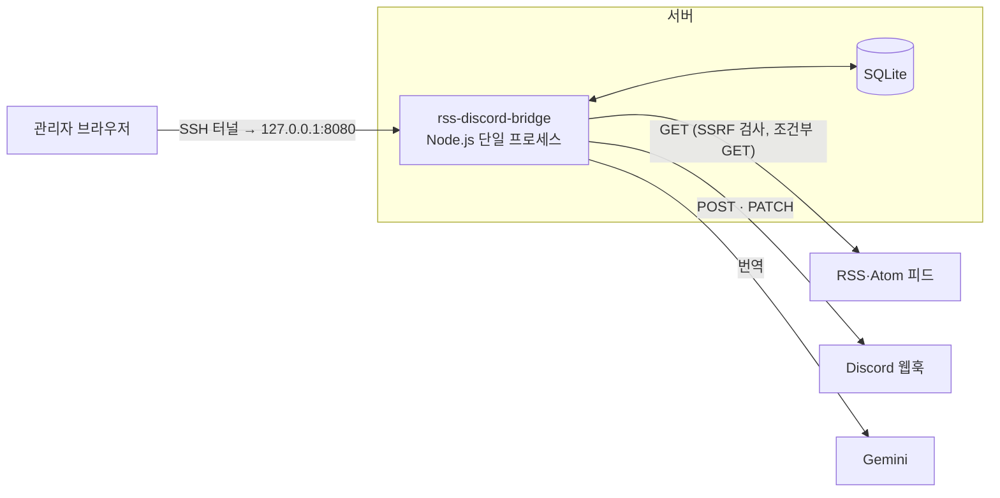
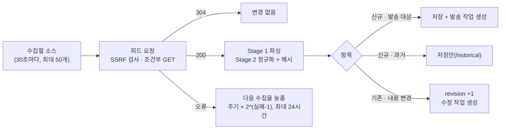
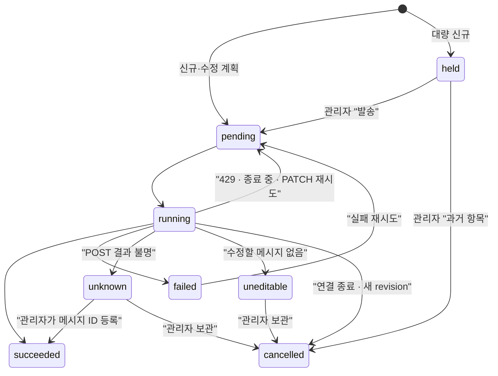

# 구조

서버가 어떻게 나뉘어 있고, 수집·발송·번역이 어떤 순서로 돌아가는지 설명한다. 기능과 API는 [기능.md](기능.md), 테이블은 [DB-스키마.md](DB-스키마.md), 결정 배경은 [결정-기록.md](결정-기록.md)에 있다.

## 1. 한눈에 보기

- **관리자 한 명, loopback 전용.** `NODE_ENV=production`에서는 `127.0.0.1` 외 주소로 시작하지 않는다. 앱에 로그인 기능은 없고 SSH 터널로 접속한다.
- **들어오는 요청**은 Host·Origin을 검사하고 분당 120회로 제한한다.
- **나가는 요청**은 모두 SSRF 검사를 거친다. 웹훅은 Discord 도메인만 허용한다.
- **비밀값:** API 키·모델 이름은 환경 변수에만, 웹훅 URL은 `groups.webhook_url`에만 있다.

## 2. 코드 구성

서버는 기능별 패키지로 나뉜다. 각 패키지는 **자기보다 낮은 tier만 import**한다.

| tier | 패키지 | 책임 |
| --- | --- | --- |
| 0 | `core` | 설정, SQLite·마이그레이션, 공통 검증·오류·HTTP |
| 1 | `net` · `feed` | SSRF 안전 요청·웹훅 URL 검사 / 피드 파싱·정규화·항목 저장 |
| 2 | `logs` | 통합 로그 조회·실시간 스트림 |
| 3 | `templates` | 프리셋 저장·렌더·payload 검증 |
| 4 | `groups` | 발신 그룹(웹훅) |
| 5 | `sources` | 수집 소스·그룹 배정 |
| 6 | `translation` | Gemini 번역·캐시·진단 |
| 7 | `delivery` | 연결 세대·발송 계획·발송·검토·미리보기 |
| 8 | `collect` | 피드 수집과 수집 워커 |
| 9 | `transfer` · `cleanup` | 설정 내보내기·가져오기 / 보존 기간 정리 |
| 10 | `web` | 관리 페이지 |
| 11~13 | `container.ts` → `app.ts` → `main.ts` | 의존성 조립 → HTTP 구성 → 진입점 |

- **위 tier의 동작이 필요하면** `container.ts`가 콜백을 넣어 준다. 예: 소스를 저장하면 `delivery`의 연결 세대를 다시 맞춘다.
- **패키지 안 파일 역할:** `repository.ts`는 SQL, `service.ts`는 업무 규칙, `routes.ts`는 HTTP 라우트다. `repository.ts`는 같은 패키지의 다른 파일을 import하지 않는다.
- **규칙은 테스트로 강제한다:** [test/architecture.test.ts](../test/architecture.test.ts).
- **그 밖의 위치:** 화면·프리셋·마이그레이션은 `src/resources/`, 테스트는 `test/<기능>/`에 있다.

## 3. 지켜야 하는 원칙

| 원칙 | 내용 |
| --- | --- |
| 식별 ≠ 변경 | 항목은 `(source_id, atom_id)`로 식별하고, 변경은 `content_hash`로만 판단한다 |
| 결정적 정규화 | 같은 입력은 항상 같은 해시를 낸다. 장애 공지는 최신 단계만 해시한다 |
| 첫 수집은 보내지 않는다 | 소스를 등록한 뒤 처음 받은 항목은 모두 과거 항목(`historical`)으로 저장만 한다 |
| 새 연결은 과거를 받지 않는다 | 새 웹훅·스레드 연결은 첫 수집으로 기준선(baseline)을 잡고, 그 뒤 항목만 보낸다 |
| 수정은 원래 보낸 곳에만 | 내용이 바뀐 항목은 처음 보낸 연결에만 수정·변경 알림을 보낸다 |
| 불확실하면 멈춘다 | 결과를 모르는 POST는 다시 보내지 않고 관리자 검토로 넘긴다 |

## 4. 수집

- **파싱 2단계:** Stage 1은 RSS·Atom 형식 차이를 흡수하고, Stage 2는 본문을 정제하고 해시를 만든다. 문자 인코딩은 요청 단계, 엔티티는 Stage 1, 태그 제거는 Stage 2가 맡는다.
- **프로필:** `generic` · `incident-io` · `atlassian-statuspage`. 처음 받은 응답에서 자동 감지하고, 직접 지정하면 그 값이 우선한다.
- **요청 제한:** 15초, 5MiB, 리다이렉트 최대 3회. 403이나 TLS 핸드셰이크 실패는 TLS 1.2로 한 번 재시도하고, 성공하면 그 설정을 하루 동안 고정한다.
- **대량 신규는 보류:** 한 번에 50건 이상, 또는 10건 이상이면서 80% 이상이 신규면 작업을 `held`로 만든다.
- **설정이 바뀌면 결과를 버린다:** 수집 도중 소스 설정이 바뀌면 그 결과는 저장하지 않고 다음 수집을 기다린다.
- **목적지가 없는 소스는 수집하지 않는다.**

## 5. 발송

발송 워커는 1초마다 처리할 작업을 가져와 웹훅별로 묶고, 묶음 안에서는 순서대로 보낸다. 수집과 발송은 `delivery_jobs` 테이블로만 연결되므로, 느린 피드가 발송을 막지 않고 느린 Discord 응답이 수집을 막지 않는다.

작업 하나는 다음 순서로 처리한다.

1. **확인:** 연결이 끝났거나 소스가 꺼졌으면 취소한다. 계획 뒤에 내용이 또 바뀌었으면 최신 내용으로 다시 계획한다.
2. **준비:** 번역 → 렌더 → Discord 제한 검증. 만든 payload는 저장해 두고 재시도 때 다시 쓴다.
3. **전송:** 새 메시지는 POST(`wait=true`), 수정은 PATCH. 요청 시간은 10초다.

| 결과 | POST (새 메시지·변경 알림) | PATCH (기존 메시지 수정) |
| --- | --- | --- |
| 2xx | 완료(`succeeded`). 메시지 ID가 없으면 `unknown` | 완료 |
| 429 | 기다린 뒤 재시도. 재시도 횟수에 넣지 않음 | 같음 |
| 5xx · 타임아웃 · 네트워크 오류 | `unknown` (자동 재전송 안 함) | 1·2·4·8분 뒤 재시도, 5회째 `failed` |
| 404 | `failed` | `uneditable` |
| 기타 4xx · 렌더·검증 오류 | `failed` | `failed` |

`held` · `unknown` · `uneditable`은 자동으로 다시 보내지 않는다. 관리자가 `/delivery-jobs`에서 처리한다.

## 6. 번역

발송할 payload를 만들 때만 번역한다. 미리보기는 번역하지 않는다.

- **필요한 필드만:** 템플릿이 실제로 쓰는 필드만 번역하고, 빈 값·한국어·단계 라벨은 요청하지 않는다.
- **공유 캐시:** 같은 입력은 소스·웹훅이 달라도 캐시를 함께 쓰고, 동시에 들어온 같은 요청은 한 번만 보낸다. 실패한 입력은 5분 동안 다시 요청하지 않는다.
- **키 전환:** `PRIMARY_MODEL_API_KEY` → `FALLBACK_MODEL_API_KEY` 순서로 같은 모델을 호출한다.
  - 한도·인증·통신 오류가 난 키는 5분 동안 쓰지 않는다.
  - 요청은 키당 한 번, 키당 15초까지다.
  - 같은 Google 프로젝트의 키는 한도를 공유한다.
- **실패하면 원문:** 번역에 실패하면 원문으로 보낸다. 키 원문과 오류 원문은 로그에 남기지 않는다.

## 7. 연결 세대

소스와 목적지(웹훅 + 스레드)가 연결된 기간을 **연결 세대**라고 한다. 설정이 바뀔 때마다 현재 목적지와 세대를 맞춘다.

- **새 세대가 생기는 경우:** 웹훅·스레드 변경, 재연결, 소스 재활성화, 피드 URL 변경. 새 세대는 다음 수집에서 기준선을 잡고, 그때까지의 항목은 보내지 않는다.
- **세대가 끝나면** 그 세대의 대기 중 작업을 취소한다.
- **새 세대가 생기지 않는 경우:** 그룹 이름·아바타 변경, 같은 웹훅을 가리키는 그룹 추가.
- **웹훅을 바꾸면** 이전 웹훅으로 보낸 메시지는 더 이상 수정하지 않는다. Discord는 메시지를 만든 웹훅으로만 수정할 수 있다.

## 8. 실행: 부팅 · 워커 · 종료

**부팅 순서**
1. 환경 설정을 읽는다(`process.env` 우선, `.env` 병합). 값이 잘못되면 시작하지 않는다.
2. SQLite를 연다(WAL, `foreign_keys`, `busy_timeout=5000`).
3. 아직 적용하지 않은 마이그레이션을 실행한다.
4. 프리셋을 시드하고 연결 세대를 맞춘다.
5. 중단된 작업을 복구한다. POST를 이미 시작한 작업은 `unknown`, 나머지는 `pending`으로 되돌린다.
6. HTTP listen에 성공한 뒤 워커를 시작한다.

| 워커 | 주기 | 동시성 | 하는 일 |
| --- | --- | --- | --- |
| PollWorker | 30초 | `POLL_CONCURRENCY` (2) | 수집 |
| DeliveryWorker | 1초 | `DELIVERY_CONCURRENCY` (2) | 발송 |
| CleanupWorker | 부팅 직후 + 매일 KST 0시 | 1 | 로그·캐시·오래된 본문 정리 |

**종료(SIGTERM·SIGINT)**
- 워커를 멈추고, 진행 중인 작업이 끝날 때까지 `SHUTDOWN_TIMEOUT_MS`(30초)까지 기다린 뒤 DB를 닫는다.
- 보내기 직전에 종료 중인 것을 알면 요청하지 않고 `pending`으로 되돌린다.
- 시간을 넘기면 DB를 닫지 않고 실패로 끝낸다. Discord에는 보냈는데 기록을 못 남기는 일을 막기 위해서다.
- systemd의 `TimeoutStopSec`은 이 시간보다 길어야 한다.

## 9. 설정값

`.env`(템플릿 `default.env.example`)로 설정한다. 범위를 벗어난 값이면 시작하지 않는다. 바꾼 뒤에는 서비스를 다시 시작한다.

| 변수 | 기본값 | 설명 |
| --- | --- | --- |
| `NODE_ENV` | — | `production`이면 loopback 주소만 허용 |
| `HOST` · `PORT` | `127.0.0.1` · `8080` | 수신 주소 |
| `DATABASE_PATH` | `./data/rss-discord-bridge.sqlite` | 실행 위치 기준 경로 |
| `PRIMARY_MODEL_API_KEY` | — | 기본 Gemini 키. 두 키가 모두 없으면 번역하지 않음 |
| `FALLBACK_MODEL_API_KEY` | — | 선택 대체 키 |
| `GEMINI_MODEL` | `gemini-3.1-flash-lite` | 번역 모델(`gemini-*`만) |
| `POLL_CONCURRENCY` | 2 (1–16) | 동시에 수집할 소스 수 |
| `DELIVERY_CONCURRENCY` | 2 (1–16) | 동시에 처리할 웹훅 수 |
| `SHUTDOWN_TIMEOUT_MS` | 30000 (100–300000) | 종료 대기 시간 |
| `FEED_MAX_BYTES` | 5242880 (1024–52428800) | 피드 응답 최대 크기 |
| `NEW_ITEMS_HOLD_COUNT` | 50 (1–100000) | 이 수 이상 신규면 보류 |
| `NEW_ITEMS_HOLD_MIN` | 10 (1–100000) | 비율 조건을 적용할 최소 신규 수 |
| `NEW_ITEMS_HOLD_RATIO` | 0.8 (0 초과 1 이하) | 보류할 신규 비율 |
| `ITEM_CONTENT_RETENTION_DAYS` | 180 (1–3650) | 피드에서 사라진 항목 본문 보존 기간 |

**코드에 고정된 값:**
- 피드: 요청 15초(소스별로 변경 가능), 리다이렉트 3회
- Discord: 요청 10초, 재시도 최대 5회
- 번역: 키별 15초, 실패 대기 5분, 대상 언어는 한국어
- 보존: 로그 30일, 실패 캐시와 완료 작업의 사본 90일
