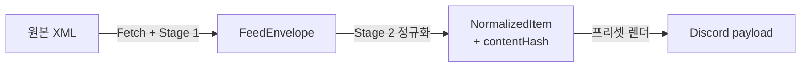

# rss-discord-bridge

RSS 2.0 / Atom 피드를 폴링해 **Discord 웹훅으로 전달**하는 셀프호스트 브리지. 특히 **status page(장애 공지)** 피드를 안정적으로 중계하도록, "등록 후 과거 이벤트가 다시 전송되는" 재전송 버그를 **구조적으로 차단**하는 데 초점을 둔 재작성판이다. 서버 렌더 관리 UI(내부·단일 관리자, loopback 전용)를 포함한다.

> Node ≥ 20 · TypeScript(ESM) · SQLite 단일 프로세스 · 목적지별 발송 작업과 공유 번역 캐시

## 주요 기능

- **RSS 2.0 / Atom 폴링 → Discord 전송** — 소스별 폴 주기, 조건부 GET(etag/last-modified)으로 대역 절감.
- **2단계 파싱** — Stage 1 Envelope(형식 흡수) / Stage 2 Normalize(순수·결정적 정제 + `contentHash`).
- **재전송 버그 차단** — identity(`atom_id`) ≠ change(`contentHash`) 분리 + 연결별 첫 수집 baseline + 고정된 목적지별 발송 작업.
- **Provider Profile 자동 감지** — `generic` / `incident-io` / `atlassian-statuspage`.
- **Discord 프리셋 4종** — `incident-active`·`news-article`·`link-discussion`·`minimal`. 서버 Handlebars 렌더이고 미리보기는 전송과 동일 경로.
- **그룹 = 재사용 전송 채널** — 웹훅을 그룹이 보유하고 여러 소스가 공유한다.
- **메시지 옵션** — 조용히 보내기·멘션·Forum 스레드/태그·수정(edit-in-place).
- **번역(→ 한국어)** — 필요한 필드만 번역하고 항목·웹훅 사이에서 입력별 캐시를 공유. primary = Gemini, fallback = NVIDIA NIM. 별도 번역 진단 지원.
- **Export/Import** — 소스·그룹 설정을 JSON 1파일로 백업/이전(웹훅 URL 등 시크릿 제외).
- **관리 UI** — 서버 렌더 Handlebars + htmx + CodeMirror + 라이브 로그 SSE. React/번들러 없음.

## 아키텍처 한눈에

폴링 한 사이클의 데이터는 네 형태로 변환된다:



- **식별 ≠ 변경** — 식별은 `atom_id`, 변경 감지는 `contentHash`. 정규화는 순수·결정적이라 해시가 흔들리지 않는다.
- **과거 글은 보내지 않는다** — 소스의 첫 수집, 새 웹훅·스레드 연결의 첫 수집은 저장만 하고 보내지 않는다.
- **불확실하면 멈춘다** — 결과가 불명확한 POST·PATCH 404는 자동 재발송하지 않고 `/delivery-jobs`에서 검토한다.

자세한 구조·흐름은 [Docs/architecture.md](Docs/architecture.md)에 있다. 이전 구현과 재현 자료는 [Archive](Archive/README.md)에 보관한다.

## 기술 스택

| 영역 | 사용 |
|---|---|
| 서버 | Fastify 5, TypeScript(ESM) |
| 저장소 | better-sqlite3(WAL) + 순번 SQL 마이그레이션 |
| 피드 | fast-xml-parser, undici(SSRF-safe Agent · 조건부 GET · TLS) |
| 렌더 | Handlebars(프리셋·뷰), ajv(Discord payload 검증) |
| UI | htmx, CodeMirror, SSE — React/Vite 없음 |
| 번역 | @google/genai(Gemini) + NVIDIA NIM 폴백 |

## 빠른 시작

요구사항: **Node ≥ 20**.

```bash
npm install
cp default.env.example .env     # 값 채우기(아래 '설정' 참고)

# 개발 (tsx watch)
npm run dev

# 프로덕션
npm run build
npm start
```

기타 명령:

```bash
npm run typecheck        # 서버 + 테스트 tsconfig 양쪽 검사
npm test                 # 전체 (vitest)
npm run test:unit
npm run test:integration
npm run benchmark        # 빌드 후 외부 API 없이 25개 피드 수집·발송 측정
```

> better-sqlite3는 **플랫폼별 네이티브 모듈**이다. 배포 서버에서는 그 서버에서 직접 `npm ci`로 빌드한다 — 다른 OS의 `node_modules`를 그대로 복사하면 동작하지 않는다.

## 설정 (.env)

env는 프로젝트 루트의 `.env`(gitignore)에서 읽는다. 템플릿은 `default.env.example`. 주요 변수는 아래와 같고, 동시성·종료 대기·대량 신규 보류 등 전체 목록은 [architecture.md §11](Docs/architecture.md#11-설정값)에 있다.

| 변수 | 기본값 | 설명 |
|---|---|---|
| `NODE_ENV` | `development` | `production`이면 운영 점검 ON + HOST를 loopback으로 강제 |
| `HOST` | `127.0.0.1` | 내부 도구 — loopback 고정 |
| `PORT` | `8080` | 바인딩 포트 |
| `DATABASE_PATH` | `./data/rss-discord-bridge.sqlite` | 실행 cwd 기준 상대경로 |
| `PRIMARY_MODEL_API_KEY` | — | 번역 primary(Gemini). 비우면 번역 OFF |
| `FALLBACK_MODEL_API_KEY` | — | 번역 fallback(NVIDIA NIM) |

> 🔒 **API 키는 env 전용** — DB에 저장하지 않는다. 비워도 부팅은 정상이며, 해당 역할만 비활성화되어 번역 없이 원문이 전송된다.

## 프로젝트 구조

```
.
├── src/
│   ├── server/        # 백엔드: controllers contracts services db domain
│   │   │              #         scheduler dispatcher translator security runtime
│   │   └── app.ts
│   └── resources/
│       ├── templates/ # 관리 UI 서버 렌더 뷰(.hbs) + 정적자산(htmx, CodeMirror)
│       ├── presets/   # *.hbs 프리셋 시드 → 부팅 시 DB seed
│       └── migrations/# 0001_init.sql … (순번 적용)
├── test/{unit,integration,mocks}/
├── Docs/              # 설계 문서
├── default.env.example
└── data/              # SQLite DB — gitignore
```

## 설계 문서

입구는 [`Docs/README.md`](./Docs/README.md)(문서 지도)다.

- 아키텍처 — [`Docs/architecture.md`](./Docs/architecture.md)
- DB 스키마 — [`Docs/db-schema.md`](./Docs/db-schema.md)
- 결정 기록 — [`Docs/decisions.md`](./Docs/decisions.md)
- 배포 가이드 — [`Docs/deploy.md`](./Docs/deploy.md)
