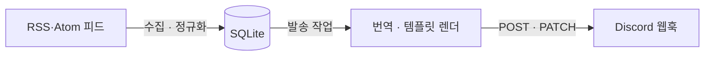

<div align="center">

# RSS-Discord-Bridge

**RSS 및 Atom Feed를 Discord Webhook으로 전달하는 도구**

여러 RSS 및 Atom Feed를 한 곳에서 관리하며 Discord Webhook으로 전달하는 도구입니다.


</div>

---

## 주요 기능

| 기능 | 설명 |
| --- | --- |
| **피드 수집** | RSS 2.0·Atom을 소스별 주기로 수집합니다. 바뀌지 않은 피드는 조건부 요청으로 건너뜁니다 |
| **장애 공지 지원** | incident.io, Atlassian Statuspage 형식을 자동으로 알아보고 장애 단계를 표시합니다 |
| **템플릿** | 내장 템플릿 4종과 직접 만든 템플릿. 실제 전송과 같은 결과로 미리 봅니다 |
| **Discord 옵션** | 조용히 보내기, 멘션, 스레드·포럼 게시, 내용이 바뀌면 기존 메시지 수정 |
| **한국어 번역** | Gemini로 제목·본문을 번역합니다. 캐시하고, 기본 키가 막히면 대체 키로 바꾸고, 실패하면 원문을 보냅니다 |
| **관리 화면** | 운영 현황, 소스·그룹·템플릿 관리, 발송 검토, 실시간 로그 |
| **설정 이전** | 소스·그룹 설정을 JSON으로 내보내고 가져옵니다. 웹훅 같은 비밀값은 빠집니다 |

---

## 빠른 시작

> **필요한 것:** Node.js 20 이상. 번역을 쓰려면 Gemini API 키가 필요합니다(없어도 원문으로 동작).

```bash
git clone https://github.com/Genticca/Private-RSS-Delivery.git
cd Private-RSS-Delivery
npm install
cp default.env.example .env

npm run dev                      # 개발 모드
# 또는
npm run build && npm start       # 빌드 후 실행
# → http://127.0.0.1:8080
```

처음 쓸 때는 **발신 그룹**에 웹훅을 등록하고 → **수집 소스**에 피드 URL을 추가한 뒤 → 소스에 그룹을 연결합니다.

> 첫 수집에서 받은 글은 저장만 하고, 그 뒤 새로 올라온 글부터 Discord로 보냅니다.

---

## 설정

`.env`에서 설정합니다. 전체 목록은 [구조 문서](Docs/구조.md#9-설정값)에 있습니다.

| 변수 | 기본값 | 설명 |
| --- | --- | --- |
| `PORT` | `8080` | 관리 화면 포트 |
| `DATABASE_PATH` | `./data/rss-discord-bridge.sqlite` | SQLite 파일 위치 |
| `PRIMARY_MODEL_API_KEY` | — | Gemini API 키 |
| `FALLBACK_MODEL_API_KEY` | — | 선택 대체 키 |
| `GEMINI_MODEL` | `gemini-3.1-flash-lite` | 번역 모델 |

> API 키는 `.env`에만 두고 DB에는 저장하지 않습니다.

---

## 동작 방식



- **식별과 변경을 나눕니다.** 글은 피드의 ID로 구분하고, 내용이 바뀌었는지는 해시로 판단합니다.
- **수집과 발송은 따로 돌아갑니다.** 느린 피드가 발송을 막지 않고, 느린 Discord 응답이 수집을 막지 않습니다.
- **불확실하면 멈춥니다.** 결과를 모르는 전송은 다시 보내지 않고 `/delivery-jobs`에서 확인합니다.

---

## 배포

관리 화면은 로그인 없이 서버의 `127.0.0.1`에서만 열리고, SSH 터널로 접속합니다. 배포 방법은 두 가지입니다. 자세한 절차는 [배포 문서](Docs/배포.md)를 참고하세요.

| 방법 | 명령 | 특징 |
| --- | --- | --- |
| **Docker Compose** | `docker compose up -d --build` | 서버에 Node.js가 필요 없습니다 |
| **systemd 직접 설치** | `npm ci && npm run build` 후 서비스 등록 | 배포 서버에서 직접 빌드해야 합니다(`better-sqlite3`가 OS별로 빌드됨) |

---

## 개발

```bash
npm run typecheck   # 타입 검사
npm test            # 전체 테스트
npm run smoke       # 빌드 후 서버를 띄워 주요 API 확인
```

| 문서 | 내용 |
| --- | --- |
| [기능](Docs/기능.md) | 기능별 동작, HTTP API, 알려진 한계 |
| [구조](Docs/구조.md) | 코드 구성, 수집·발송·번역 흐름, 설정값 |
| [DB 스키마](Docs/DB-스키마.md) | 테이블·컬럼·상태 값 |
| [결정 기록](Docs/결정-기록.md) | 주요 설계 결정 |
| [배포](Docs/배포.md) | Ubuntu·systemd 설치와 운영 |
